# Dock/Island – gerade Randkante mit konkaven Anschlüssen

24. Oktober 2026. Verifizierte Basis und Remote-HEAD: **d40f2c40b1bf8eb5d6ae923b204b938cd34708b0** (`theme/air-modern-dock-bow-demo-20261024`). Eigener Korrekturbranch: **fix/air-modern-concave-edge-20261024**.

## Korrektur gegenüber dem abgelehnten Stand

Die vorige Ellipse war die falsche Form: Sie verjüngte das Dock mitten an seiner Unterkante zur gewölbten Kapsel. Die aktuelle Benutzerbeschreibung verlangt ausdrücklich eine **gerade bodenbündige Basis mit konkaven seitlichen Randanschlüssen**. Diese Anforderung ersetzt die Ellipsenentscheidung im historischen [Bogenbericht](AIR_DOCK_BOW_DEMO.md).

Nur `air-modern-dock.css` und `air-island.css` im Produkt geändert. Modern-Dock: unten 0, oben 22px-Ecken, unten 0px-Ecken; zwei rein dekorative 12×12px-Pseudoelemente mit inversen Kreisverlaufsmasken bilden die Ausläufe links/rechts. Keine Ellipse, Skalierung, zusätzliche Dock-Buttons oder Container. Die Ausläufe reichen je 12px über die bisherige Dock-Box hinaus; sie sind kein neuer Klickbereich. Die vorhandene Breitenreserve enthält sie auch bei 390px.

Modern-Island gespiegelt: oben 0, obere Ecken 0, untere Ecken 16px, inverse Anschlüsse oben links/rechts. Uhr und Triggergröße bleiben unverändert. Der kleine dekorative Pfeil war bereits Modern-only ausgeblendet und bleibt es; die Öffnungsfunktion bleibt erhalten.

Rauchglas: Dock `rgba(16,23,28,.70)`, Blur24px/Sättigung1,3; Island `rgba(16,23,28,.80)`, Hover83%, Blur18px/Sättigung1,2. Damit dunkler als die abgelehnten56%/76%-Flächen, weiter halbtransparent. Zur Vermeidung sichtbarer Nahtlinien keine innere vertikale Rahmenkante an den Ausläufen; dezente obere Dock-/untere Island-Kontur. Pseudoelemente übernehmen Hintergrund/Blur und haben `pointer-events:none`. Dock `overflow:clip` plus13px `overflow-clip-margin` lässt die dekorativen Ecken malen, erlaubt aber **kein Scrollen**. Kein klickblockierendes Overlay.

White-pear-SVG, Originalicons, Trennlinie, App-Buttons und sämtliche JS-/HTML-/M1-/M2-/Home-/Notes-/Profil-/Preference-/Installerdateien sind unverändert. Die vorhandene klar beschriftete statische Musik-Demo wurde erhalten, nicht erweitert. Classic einschließlich Classic-Desktop + Modern-Dock erhält diese neuen Formregeln nicht.

## Tatsächliche Linux-Electron-Prüfung

Debian13 x64, Electron32.3.3/Chromium128, DPR1; echte Electron-Renderer unter authentifiziertem Xvfb, Chromium-Sandbox aktiv, GPU deaktiviert. Vorher: unveränderter detached Worktree des Basiscommits; nachher: Korrekturbranch. Getrennte synthetische Wegwerfprofile, keine privaten Nutzerdaten. Renderer-Viewports1920×1080,1650×930,390×600; keine native Windows-/macOS- oder physische390px-Geräteabnahme.

**248/248 Tests bestanden**,0 Fehler/Skips. Ellipsenregression durch den ausdrücklich neuen Gerade-/Inverseckenvertrag ersetzt, zusätzliche gespiegelte Island-Regression; bestehende M1/M2-, Sicherheits-, Notes-/Profil-/Pinning-Regressionen unverändert aktiv. `node --check scripts/check-concave-edge.cjs`, Catalina-Konfigurationscheck und `git diff --check` bestanden. Catalina-Check ist keine native macOS-Abnahme. PR-/Actions-API weiterhin Forbidden; kein neuer CI-Erfolg behauptet.

Beide finalen Electron-Helferläufe Exit0, keine Rendererfehler. Echte Notes-Minimize-/Dock-Restore-Mausklicks mit normaler M2-Bewegung; anschließend jeder weitere Standard-App-Button Finder/Browser/Music/Settings real geklickt und wieder geschlossen. Launchpad per Space, Suche nach Notes und Escape/Fokus. Island per Klick/Space/Enter, Escape/Outside-Click, Kontrollzentrum/Schnellzugriff und Close nach Panel-Scroll. Alle sechs52×52px-Dock-Hitboxen enthalten ihre Icons vollständig, tatsächlicher Mittelpunkt-Treffertest korrekt. Dekorative Ausläufe fangen keine Klicks ab. Kein horizontaler Dokumentüberlauf; `scrollLeft=100` bleibt am Dock0. Die durch die Deko vergrößerte `scrollWidth` wird nicht fälschlich als Scrollfähigkeit gewertet.

Bestätigtes Pin/Unpin ohne Menüsperre, unbekannte Pinreferenz und gespeicherte Themeentscheidungen nach Reload erhalten; echter synthetischer Notes-Save, Notes-Mitteilung/Panel-Close, leere Pins ohne verwaiste Trennlinie. Reduce Glass und Forced Colors geprüft. Home-Geometrie und Classic-Skin/-Geometrie gegen den unveränderten Vorherlauf identisch. Original-SVGs im Dock vollständig bytegleich zur Baseline.

## Gemessene Geometrie

`getBoundingClientRect()`, CSS-Pixel; alle folgenden Boxen vor/nach identisch. Die dekorativen Füße beeinflussen keine Layoutmaße.

| Viewport | Dock x/y, B×H | Abstand unten | Island x/y, B×H | Abstand oben | Kontrollzentrum x/y, B×H |
| --- | --- | --- | --- | --- | --- |
| 1920×1080 | 781.00/1012.00, 358.00×68.00 | 0 | 835.00/0.00, 250.00×45.00 | 0 | 745.00/0.00, 430.00×419.00 |
| 1650×930 | 646.00/862.00, 358.00×68.00 | 0 | 717.58/0.00, 214.84×38.67 | 0 | 610.00/0.00, 430.00×419.00 |
| 390×600 | 16.00/532.00, 358.00×68.00 | 0 | 117.00/0.00, 156.00×36.00 | 0 | 12.00/44.00, 366.00×419.00 |

Die Dock-Layoutbox bleibt358×68px; mit beiden dekorativen12px-Füßen beträgt die maximale visuelle Hüllbreite382px. Auf390px liegt diese Hülle bei x4…386 innerhalb des Viewports. Die Island bleibt horizontal exakt zentriert. Keine abgeschnittenen Icons/Controls oder kaputten Ecken in der390px-Aufnahme.

## Konturbeweis statt bloßer Radiusangabe

Zusätzlich zu DOMRects wurden tatsächliche Screenshot-Pixel mit einem zweiten Screenshot desselben Hintergrunds bei temporär ausgeblendeten festen Schalen verglichen (keine Bildbearbeitung). Gezählt wird die sichtbare Differenz ab20RGB-Stufen. Ausschnitt und Originalaufnahmen stammen direkt vom Electron-Renderer. Zwei Pixel über dem Boden:

| Viewport | Alte Kapsel, sichtbare Breite | Neue gerade Basis + Füße, sichtbare Breite | Neue Breite bei4/8/12px über Boden |
| --- | --- | --- | --- |
| 1920 | 168px | 370px | 364 / 360 / 358px |
| 1650 | 168px | 370px | 364 / 360 / 358px |
| 390 | 168px | 370px | 364 / 360 / 358px |

Die Basis ist jetzt bis zu ihren Seiten durchgehend gefüllt:370→364→360→358px beim Abstand2→4→8→12px. Die Ausläufe **verbreitern sich zum Boden**, statt das Dock unten zur Kapsel zu verjüngen. Das ist in den Detailbildern unmittelbar sichtbar. Die geschlossene Island hat spiegelbildliche Ausläufe zur Oberkante. Schwellenwerte sind eine rasterabhängige Silhouettenmessung, keine physische Materialmessung; Rohdaten enthalten auch weitere Reihen und die Island-Kontur.

[Vorher-Rohdaten](visual/air-concave-edge-before.json) · [Nachher-Rohdaten](visual/air-concave-edge-after.json). Reproduktion: `AIR_GUI_TEST_ISOLATED=1 node scripts/check-concave-edge.cjs`, Vorher zusätzlich `AIR_GUI_BASELINE=1`; echtes isoliertes Electron/CDP auf9262/9263 oder `AIR_GUI_CDP` sowie extern vorhandenes Playwright/pngjs nötig. Keine neue Projektabhängigkeit.

## Sichtbarer Vergleich

Alle50PNG-Dateien sind echte Electron-Aufnahmen oder direkte Renderer-Ausschnitte, keine künstlichen Neuzeichnungen. Bildlinks lassen sich auf GitHub öffnen; Klicken zeigt die Originalgröße. „Desktop“ zeigt die reine Hülle, „Notes“ zusätzlich das unveränderte Arbeitsfenster. Die Bildschalen wurden für die Vergleichsaufnahmen nicht umpositioniert. Kurzzeitige echte Toasts wurden vor den Desktop-/Dock-Detailaufnahmen abgewartet.

### 1920px

| Ansicht | Vorher | Nachher |
| --- | --- | --- |
| Desktop | [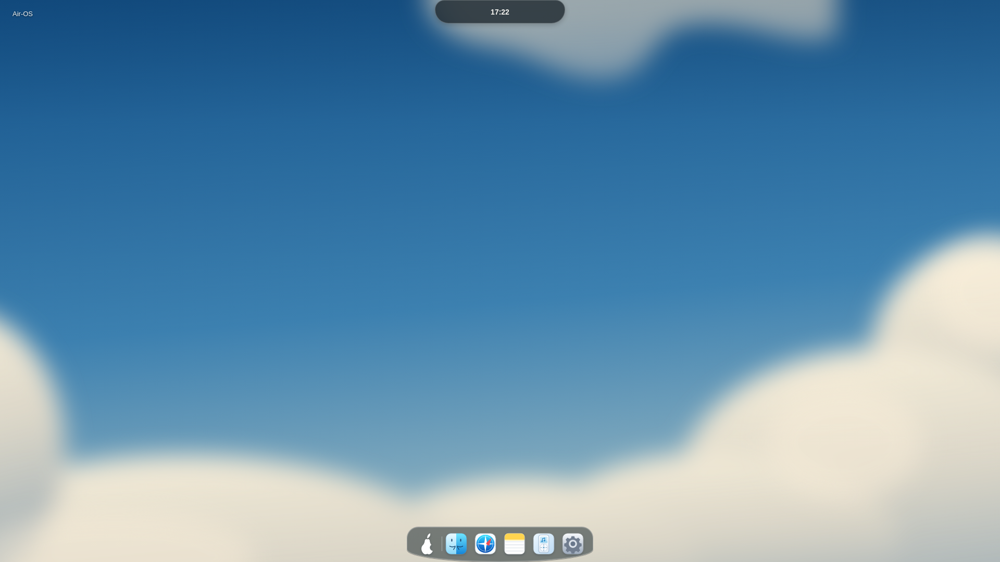](visual/air-concave-edge-before-desktop-1920.png) | [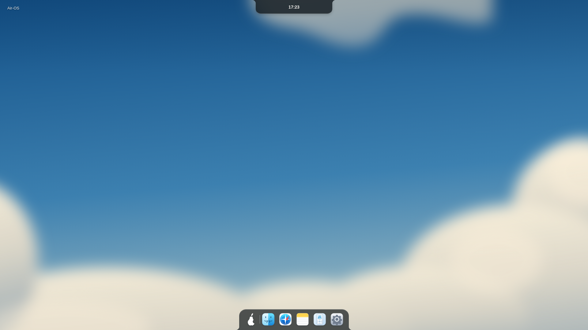](visual/air-concave-edge-after-desktop-1920.png) |
| Dock gesamt |  |  |
| Linker konkaver Übergang |  |  |
| Rechter konkaver Übergang |  |  |
| Obere Island |  |  |
| Gerade Unterkante |  |  |
| Desktop mit Notes | [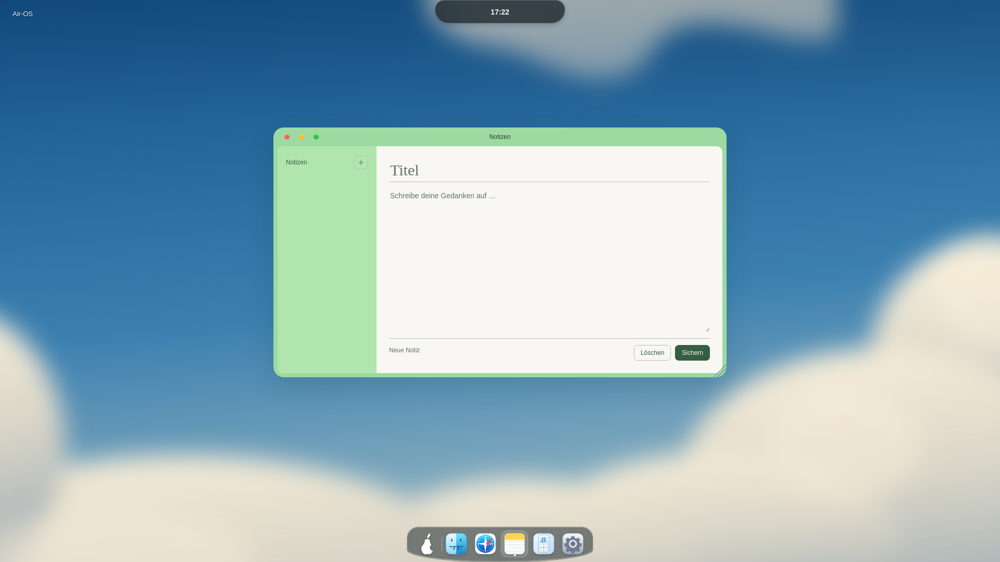](visual/air-concave-edge-before-notes-1920.png) |  |
| Bestehendes Kontrollzentrum/Demo | [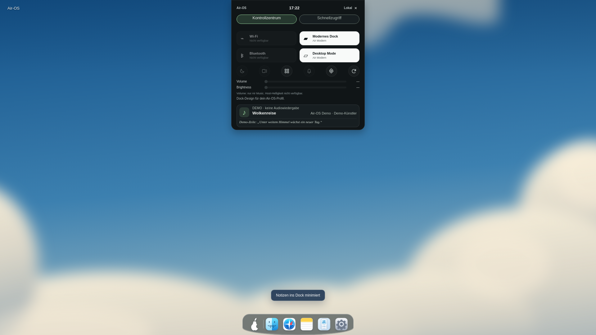](visual/air-concave-edge-before-demo-1920.png) | [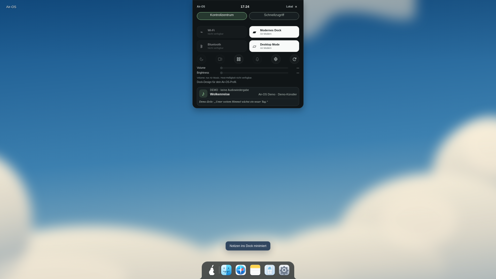](visual/air-concave-edge-after-demo-1920.png) |

### 1650px

| Ansicht | Vorher | Nachher |
| --- | --- | --- |
| Desktop | [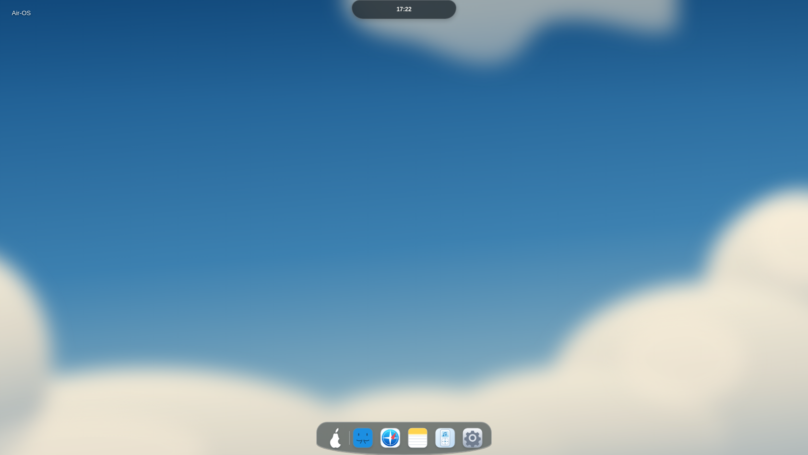](visual/air-concave-edge-before-desktop-1650.png) | [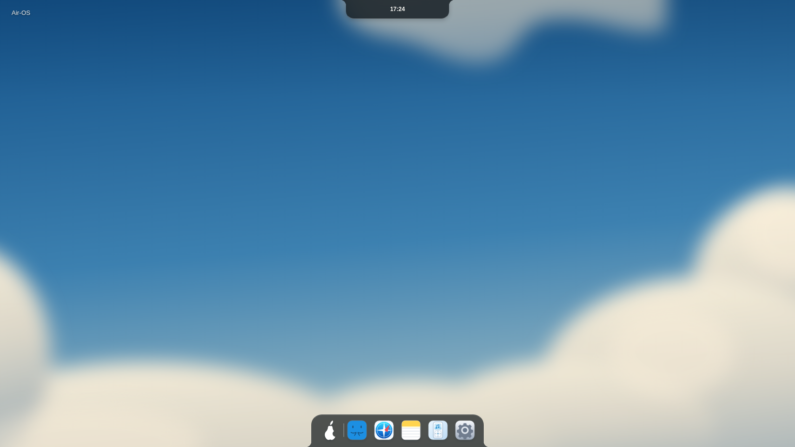](visual/air-concave-edge-after-desktop-1650.png) |
| Dock gesamt |  |  |
| Linker konkaver Übergang |  |  |
| Rechter konkaver Übergang |  |  |
| Obere Island |  |  |
| Gerade Unterkante |  |  |
| Desktop mit Notes | [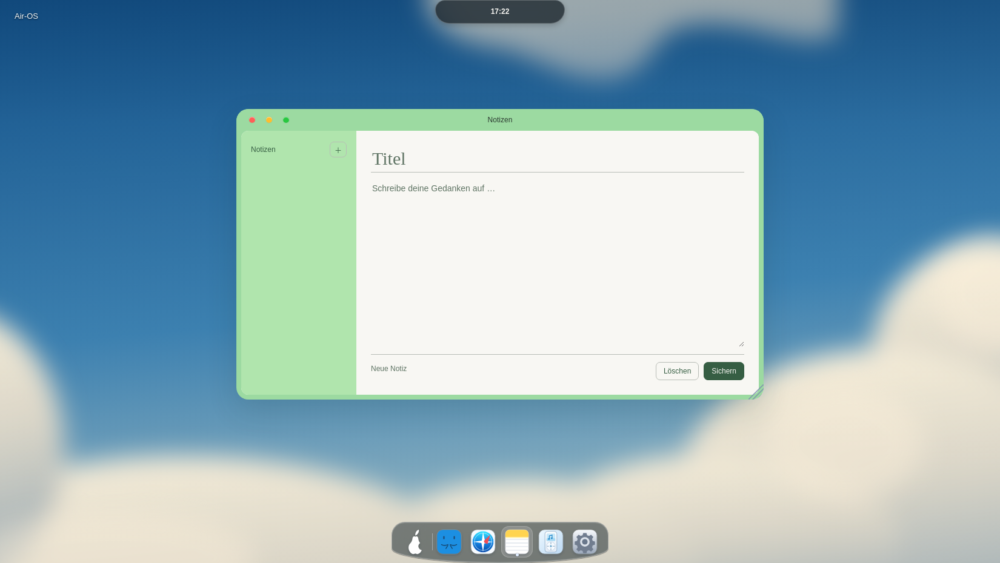](visual/air-concave-edge-before-notes-1650.png) | [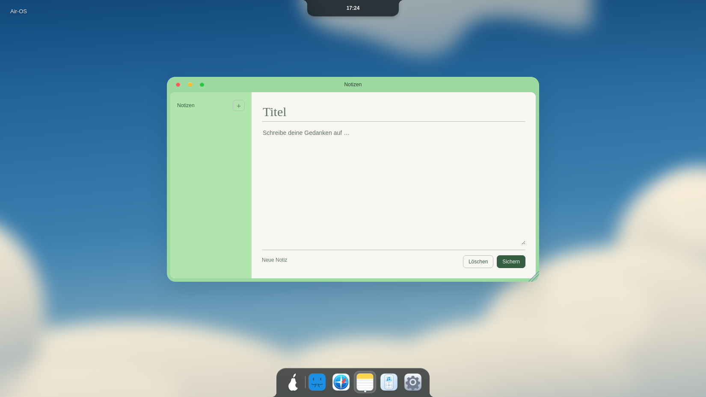](visual/air-concave-edge-after-notes-1650.png) |
| Bestehendes Kontrollzentrum/Demo | [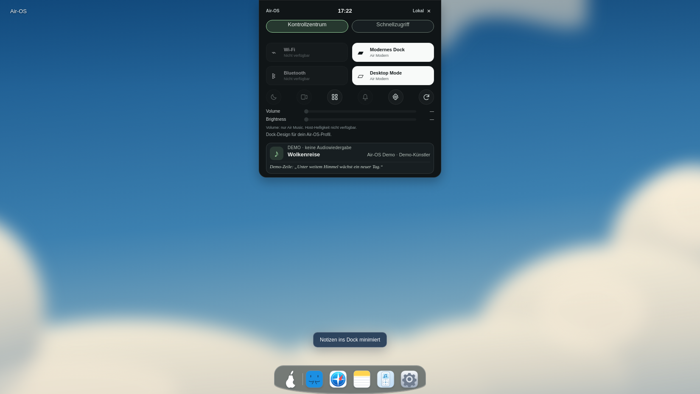](visual/air-concave-edge-before-demo-1650.png) |  |

### 390px

| Ansicht | Vorher | Nachher |
| --- | --- | --- |
| Desktop | [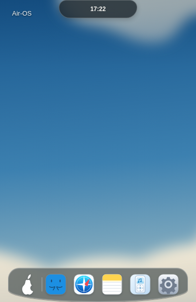](visual/air-concave-edge-before-desktop-390.png) | [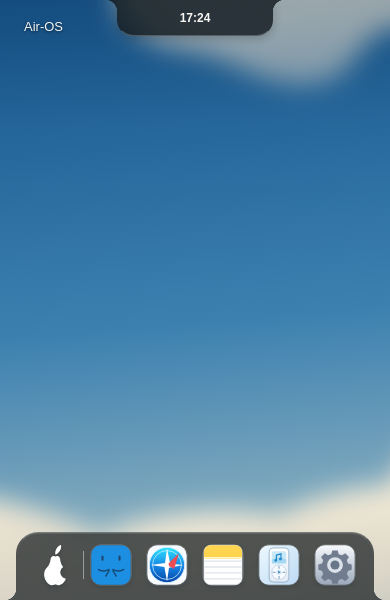](visual/air-concave-edge-after-desktop-390.png) |
| Dock gesamt |  |  |
| Linker konkaver Übergang |  |  |
| Rechter konkaver Übergang |  |  |
| Obere Island |  |  |
| Gerade Unterkante |  |  |
| Desktop mit Notes | [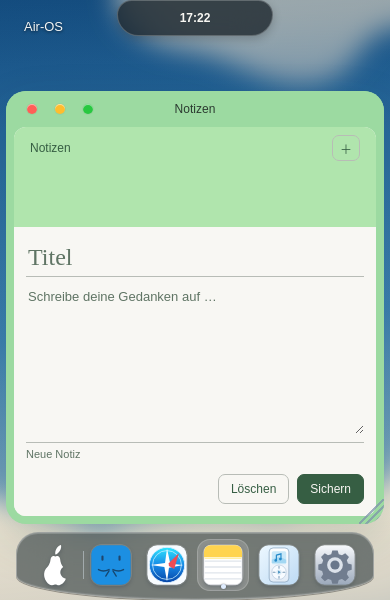](visual/air-concave-edge-before-notes-390.png) | [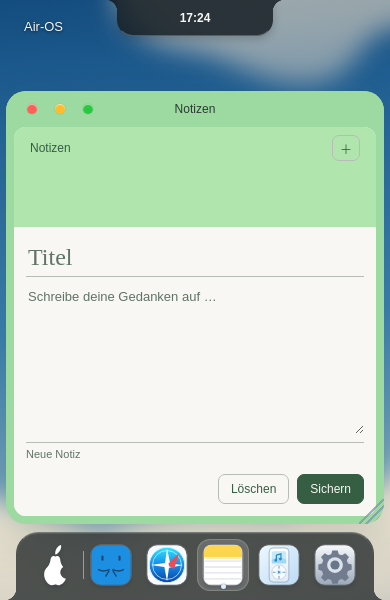](visual/air-concave-edge-after-notes-390.png) |
| Bestehendes Kontrollzentrum/Demo | [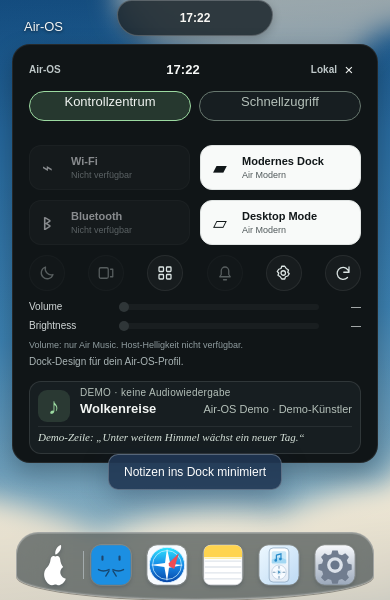](visual/air-concave-edge-before-demo-390.png) | [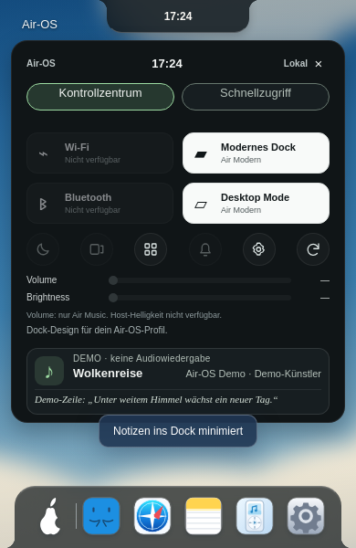](visual/air-concave-edge-after-demo-390.png) |

### Classic-Kontrolle

| Vorher | Nachher |
| --- | --- |
| [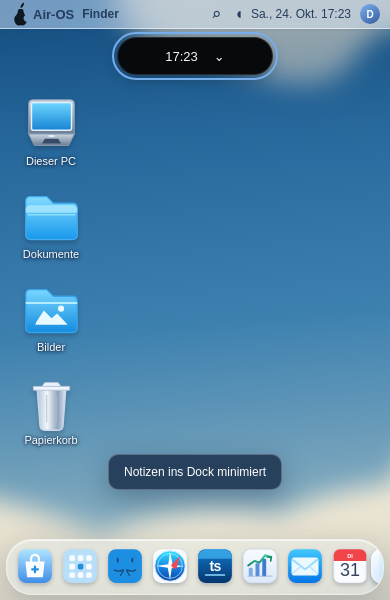](visual/air-concave-edge-before-classic-390.png) |  |

## Vergleich mit der Benutzerreferenz und offene Punkte

Die Randanschlüsse folgen jetzt ausdrücklich der beschriebenen bzw. zuvor markierten Referenzform: **flache Bildschirmkontaktkante mit seitlichen inversen Rundungen**, unten/oben gespiegelt. Die abgelehnte bauchige Kapsel ist entfernt. Dark-smoke-Material, transparente weiße Birne, farbige Originalicons und graue Trennlinie sind sichtbar. Die bisherige obere freie Pillenform ist ebenfalls durch eine randverbundene Form ersetzt.

Keine pixelgenaue Übereinstimmung mit einem fremden Referenzbild behauptet: Wallpaper bleibt das eigene weiche Wolkenmotiv; App-Auswahl/Inhalte und funktionales Air Home bleiben Air-OS-eigen. Referenzmaterialien wurden nicht kopiert. Die erneute Benutzerabnahme kann anhand der tatsächlichen Bilder erfolgen. Native Windows-/macOS-Belege, CB-03 und bekannte Audit-/Signing-/Notarisierungsblocker bleiben offen. main, bestehende PRs, Installer und andere Entwicklungsbranches unverändert.

Nächste drei getrennte Einheiten: Benutzerabnahme dieser korrigierten Randform; native Windows-/macOS-Belege; CB-03 separat prüfen. Nach Commit/Push STOP.
