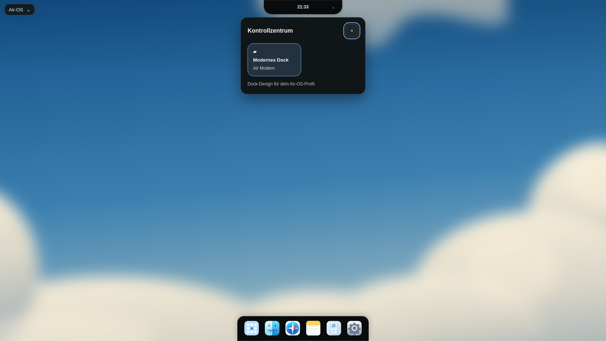
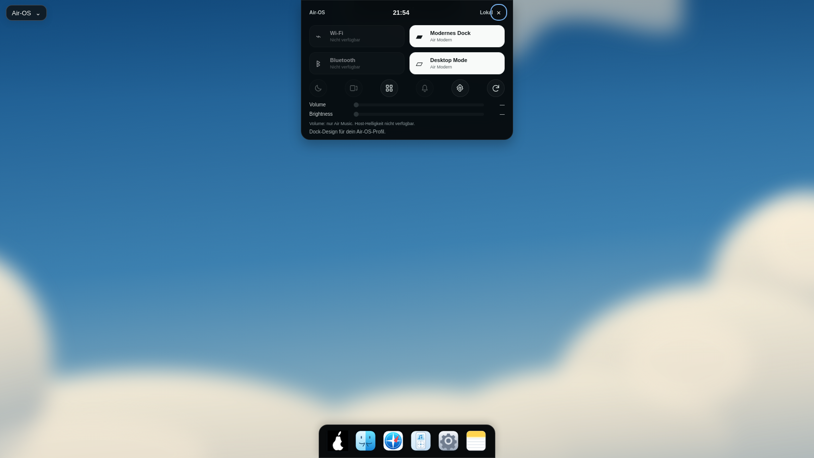
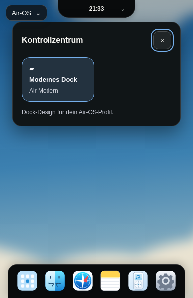
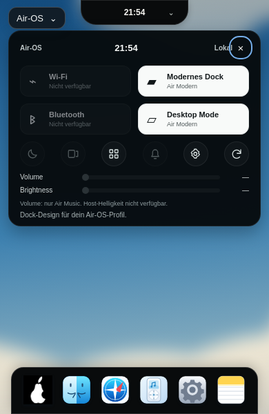

# Referenzabgleich: Dock, Island und Kontrollzentrum

23. Oktober 2026. Sichtprüfung der fünf vom Benutzer übermittelten Bilder und echter Electron-32.3.3-Screenshots. Ziel ist Bild 5, nicht eine behauptete pixelidentische Kopie. Der Anhang liegt nicht als lokale Originaldatei vor; deshalb kein automatischer Pixel-Diff oder vorgetäuschtes Farb-Sampling.

| Bisheriges Kontrollzentrum | Neues Kontrollzentrum |
| --- | --- |
|  |  |
|  |  |

| Merkmal aus Bild 5 | Umsetzung und bewusste funktionale Grenze |
| --- | --- |
| Schwarzes, oben angebundenes Panel, ungefähr 430×284px | Gemessen 430×284px, y0 auf großen Displays. 390px: 366×284px, y44 unter Systemmenü und Island. |
| Schmale Statuszeile | Echte lokale Uhrzeit, Air-OS/Lokal. Keine erfundenen Wetter-, CPU- oder Batteriewerte. |
| Vier breite Kacheln, zwei Spalten | Wi-Fi/Bluetooth sichtbar als nicht verfügbar und deaktiviert; Dock-/Desktop-Design tatsächlich gespeichert. Aktive weiße Kacheln dadurch rechts statt wie in der Referenz diagonal. |
| Sechs runde Schnellaktionen | Apps, Einstellungen und Einstellungen neu einlesen aktiv; Notes-Mitteilung erst nach echtem Speichern. Focus/Fensterübersicht ausdrücklich deaktiviert. |
| Volume / Brightness | Zwei horizontale Slider. Volume steuert ausschließlich geladenes lokales Air-Music-Audio; ohne Quelle deaktiviert. Host-Helligkeit nicht verfügbar, deaktiviert, kein falscher Prozentwert. |
| Icon und Randpositionen aus Bildern 2/3 | Weißes vorhandenes Birnen-PNG im Modern-Startbutton; alle anderen Icons unverändert. Dock unten0, Island oben0. |

| Viewport | Dock x/y, B×H | Island x/y, B×H | Panel x/y, B×H |
| --- | --- | --- | --- |
| 1920×1080 | 781/1012, 358×68 | 835/0, 250×45 | 745/0, 430×284 |
| 1650×930 | 646/862, 358×68 | 717,578/0, 214,844×38,672 | 610/0, 430×284 |
| 390×600 | 16/532, 358×68 | 117/0, 156×36 | 12/44, 366×284 |

[Rohe Messwerte](visual/air-reference-c2-measurements.json) · [Desktop 1920](visual/air-reference-c2-desktop-1920.png) · [Desktop 1650](visual/air-reference-c2-desktop-1650.png) · [Desktop 390](visual/air-reference-c2-desktop-390.png) · [Echte lokale Lautstärke 32%](visual/air-reference-c2-local-volume-390.png).

Geprüft: Suche, echter Notes-App-Start, Pin/Unpin, identische andere SVG-Icons, Dock ohne Scrollen, bestätigte Theme-Wechsel, Classic-Grid und ursprüngliches Panel, Escape/Fokusrückgabe, echte Settings-Aktionen, lokale Audiodatei und generische echte Notes-Mitteilung ohne Notizinhalt. Keine Rendererfehler. Lokale synthetische WAV-Datei für Audio-Test, keine Audioaufnahme. Bewegungsreduktion aktiv; bestehende Animations-/Outside-Click-/Profil-/Fehlerspeichertests laufen weiter.

Verbleibende sichtbare Unterschiede: weicher Vektor-Wolkenhintergrund statt fotografischer Textur; mintgrünes Air Home fehlt weiterhin (D1). Symbolformen, zusätzliche erklärende Zustandszeile und deaktivierte Hardwaresteuerung weichen von Bild 5 ab. Keine vollständige 1:1-Übereinstimmung. Auf 390px bleibt das Panel absichtlich unter dem Systemmenü. Native Windows-/macOS-/Screenreader-Abnahme offen.

Reproduktion: isoliertes Electron-Testprofil am Login, Sandbox, lokales CDP9240, extern installiertes Playwright; `AIR_GUI_TEST_ISOLATED=1 node scripts/check-reference-controls.cjs`. Keine neue Projektabhängigkeit. GitHub-Actions-API weiterhin Forbidden; keine neue CI-/Installer-/Release-Aussage.
