# Sichtbare Dock-Bogenkorrektur, dunkleres Glas und Musik-Demo

24. Oktober 2026. Verifizierte Basis/Remote-HEAD **e6100b3038bed01e8eeb472acb550f2017ace7c1**. Eigener Branch **theme/air-modern-dock-bow-demo-20261024**. Ausschließlich die vom Benutzer beauftragte begrenzte Korrektur.

## Hauptpunkt: ein anderer unterer Konturverlauf

Der vorige26px-Eckenradius ließ den Großteil der Unterkante gerade. Jetzt erhalten die **beiden unteren Ecken jeweils50% der gesamten Dock-Breite als horizontalen Ellipsenradius**, vertikal24px. CSS: `border-radius:22px 22px 50% 50% / 22px 22px 24px 24px`. Damit treffen die unteren Ellipsen in der Mitte zusammen; es bleibt kein langer gerader Abschnitt zwischen zwei kleinen Eckrundungen. Kein minimaler weiterer Eckradius-Schritt.

Das Dock behält358×68px und unten0. Seine tiefste Mitte berührt den Viewportboden. Der bisherige nach oben ausgreifende Schwebeschatten entfällt zugunsten einer feinen1px-Kontaktkante und Innenschatten. Die Bogenform wird vollständig innerhalb der bisherigen Außenmaße gezeichnet; keine Icons/Fenster nach unten verschoben. Laufende-App-Punkte sitzen jetzt2px vom Buttonboden statt5px außerhalb, damit sie innerhalb der stärker gewölbten Fläche sichtbar bleiben. Originalicons, Buttonmaße, Pin-Auswahl, Trennlinie und Dock-Animationsziele bleiben unverändert.

**Tatsächliche Hit-Konturmessung:**2CSS-Pixel oberhalb des Dockbodens gehören vorher327 horizontale Pixel zum Dock, nachher145. Die untere Kontaktbreite ist an dieser Höhe um182px bzw.≈55,7% schmaler. Dadurch ist der Bogen sichtbar ausgeprägter. Es ist eine DOM-Hit-Konturmessung über elementFromPoint, keine behauptete antialiasinggenaue Farbpixelanalyse. Die ergänzende0,5px-Randprobe fällt in Chromium durch Viewportrand-Rundung außerhalb der gültigen Trefferfläche und wird nicht als Konturwert verwendet.

## Glas und obere Pille

Dock: `rgba(35,48,56,.56)` statt38%Deckung, weiterhin24px-Blur. Die Pille:76% statt68%Deckung, weiterhin18px-Blur und unveränderte Größe/Position. Etwas dunkler, weiterhin durchscheinend; Glasreduktion/Forced Colors bleiben deckend. Der dekorative kleine Pfeil der Modern-Pille wird per CSS ausgeblendet. Die echte Uhr bleibt im vorhandenen mittleren Gridfeld; der gesamte Button, Beschriftung und aria-expanded bleiben erhalten. Classic-Pfeil/-Skin unverändert.

## Kleine Musik-Demo im vorhandenen Panel

Im bestehenden Kontrollzentrum befindet sich eine ausschließlich in Modern sichtbare **statische Demo-Karte**, keine zweite Island/Medienverwaltung:

- Songtitel: **Wolkenreise**.
- Künstler: **Air-OS Demo · Demo-Künstler**.
- Eigener kurzer Demo-Satz: **„Unter weitem Himmel wächst ein neuer Tag.“**
- Sichtbare Kennzeichnung: **DEMO · keine Audiowiedergabe** sowie Demo-Zeile.

Kein übernommener Songtext, Cover oder externes Asset. Keine Wiedergabe, Audioquelle, Zeit-/Fortschrittswerte, API, Sammlung von Nutzerdaten oder vorgetäuschte aktive Musik. Keine funktionslosen Play-Buttons. Bestehender Air-Music-Player und dessen echte lokale Lautstärke bleiben unverändert.

Die Karte liegt im vorhandenen Kontrollzentrum-Container und ist bei Schnellzugriff hidden/inert über dessen bestehenden View-Vertrag. Classic blendet sie komplett aus. Das Panel wächst absichtlich von334px auf419px; die kompakte Demo passt damit zunächst innerhalb der bestehenden420px-Maximalhöhe. Zusätzliche Notes-Mitteilungen können internes Scrollen auslösen. Damit der vorhandene Schließen-Button trotz zusätzlichem Inhalt erreichbar bleibt, ist nur der Modern-Panelheader sticky; keine neue Bedienelement-/Fokuslogik. Bei390×600 sowie zusätzlich nach einer echten Notes-Speichermitteilung mit realem Close-Klick geprüft. Escape/Outside-Click/Fokusrückgabe funktionieren weiterhin. Fenster-, Dock-, Pillen- und Home-Außenmaße bleiben gleich.

## Tatsächlich bestandene Prüfungen

**247/247 Linux-Tests bestanden**,0 Fehler/Skips. Zwei zusätzliche Regressionen: durchgehende Modern-Ellipsenregel ohne Layoutdimension-/Transformänderung und statischer klarer Demo-Vertrag ohne Audiotags/Interaktionsattrappen, Modern-only-Anzeige/Pfeil. Alle245 bisherigen Notes-/CB-02-/Profil-/M1-/M2-/Sicherheitsregressionen aktiv. Syntax, Catalina-Konfiguration und Diff geprüft; keine Dependencies/Installer-/Security-Workflowänderung.

Echte Linux/Electron32.3.3-/Chromium128-Prüfung mit Namespace-Sandbox, getrennten authentifizierten Xvfb-Sitzungen und synthetischen Testprofilen. Vorher unveränderter Basiscommit in detached Worktree, danach finaler Code. Beide Helfer Exit0, keine Rendererfehler. Drei Viewports1920×1080,1650×930,390×600. Keine native Windows-/macOS-Abnahme.

GUI bestätigt: Außenkoordinaten exakt wie vorher, kein Dock-Scrolling, Original-SVGs unverändert, stärkere Kontur per Treffer-Raster, Pfeil verborgen, Demo sichtbar/kein Audio-/Buttonelement. Tatsächliche M2-Minimize-/Dock-Restore-Klicks; Suche/Startmenü/Systemmenü/Tastatur/Fokus; Kontrollzentrum/Schnellzugriff/Escape und echter Close-Klick nach Demo-Scroll. Home-Geometrie und Classic-Haut/-Geometrie gegen Baseline identisch. Reload-Persistenz, unbekannte Pinreferenzen erhalten, Pin/Unpin, echter Notes-Save, Reduce Glass/Forced Colors und leere Pin-Auswahl ohne verwaiste Trennlinie geprüft.

| Viewport | Dock vorher/nachher x/y, B×H | Pille vorher/nachher x/y, B×H | Modern-Panel nachher x/y, B×H | Untere Hit-Kontur2px vor/nach |
| --- | --- | --- | --- | --- |
|1920×1080 |781/1012,358×68 |835/0,250×45 |745/0,430×419 |327→145px |
|1650×930 |646/862,358×68 |717,58/0,214,84×38,67 |610/0,430×419 |327→145px |
|390×600 |16/532,358×68 |117/0,156×36 |12/44,366×419 |327→145px |

[Vorher-Rohdaten](visual/air-dock-bow-before.json) · [Nachher-Rohdaten](visual/air-dock-bow-after.json). Optionale Reproduktion: `scripts/check-dock-bow.cjs`, isoliertes echtes Electron/CDP und vorhandenes externes Playwright nötig; AIR_GUI_TEST_ISOLATED=1, Baseline zusätzlich AIR_GUI_BASELINE=1, Standardports9260/9261 bzw. AIR_GUI_CDP.

## Echter Vorher-/Nachher-Bildvergleich

Alle Aufnahmen aus dem tatsächlichen Electron-Renderer, keine Neuzeichnung. Detailbilder sind direkte Screenshotausschnitte. Die unteren28px zeigen gezielt den ganzen unteren Bogen. „Demo vorher“ zeigt das bestehende Panel, das noch keine Demo-Karte besitzt. Vorübergehende Notes-Minimierungs-Toasts sind vorhandene echte UI-Rückmeldungen des Testlaufs, keine Wiedergabestatusanzeige.

| Größe | Dock vorher | Dock nachher | Unterkante vorher | Unterkante nachher |
| --- | --- | --- | --- | --- |
| 1920 | [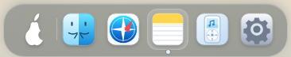](visual/air-dock-bow-before-dock-1920.png) |  | [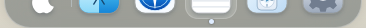](visual/air-dock-bow-before-lower-edge-1920.png) |  |
| 1650 | [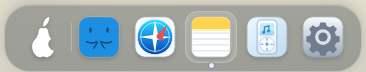](visual/air-dock-bow-before-dock-1650.png) |  |  |  |
| 390 |  | [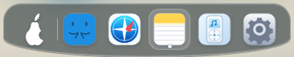](visual/air-dock-bow-after-dock-390.png) | [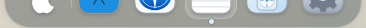](visual/air-dock-bow-before-lower-edge-390.png) |  |

| Größe | Oben vorher | Oben nachher | Panel ohne Demo vorher | Panel mit Demo nachher |
| --- | --- | --- | --- | --- |
| 1920 | [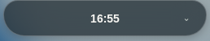](visual/air-dock-bow-before-island-1920.png) | [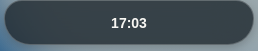](visual/air-dock-bow-after-island-1920.png) | [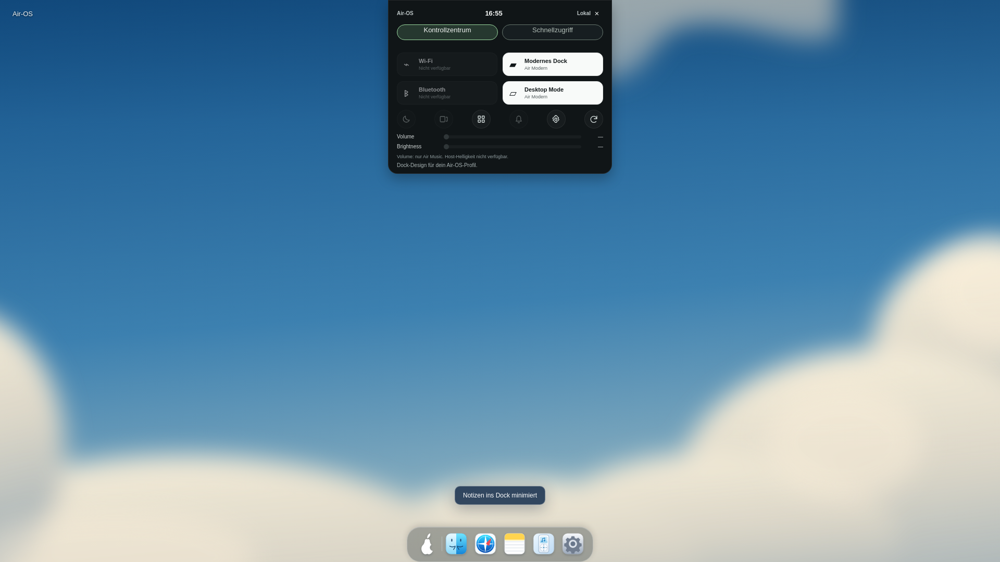](visual/air-dock-bow-before-demo-1920.png) | [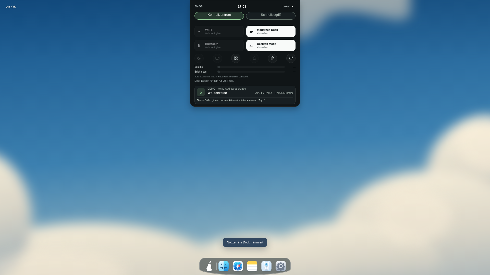](visual/air-dock-bow-after-demo-1920.png) |
| 1650 | [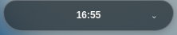](visual/air-dock-bow-before-island-1650.png) | [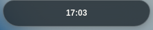](visual/air-dock-bow-after-island-1650.png) | [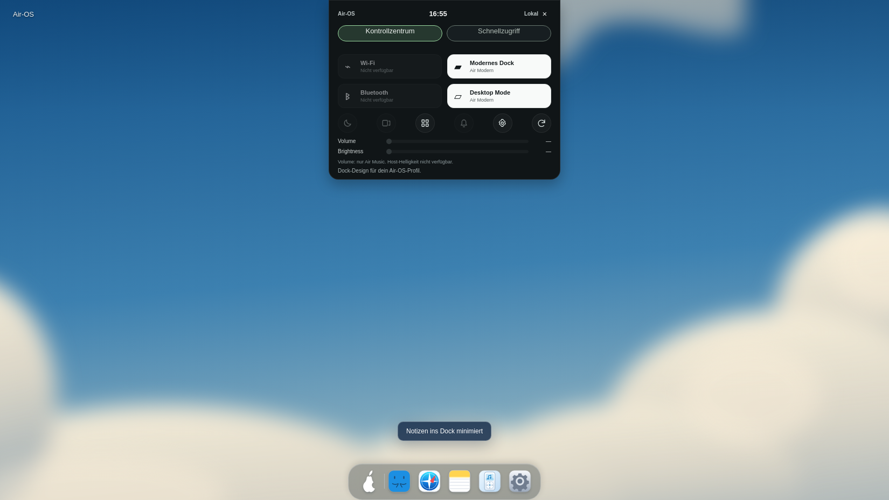](visual/air-dock-bow-before-demo-1650.png) | [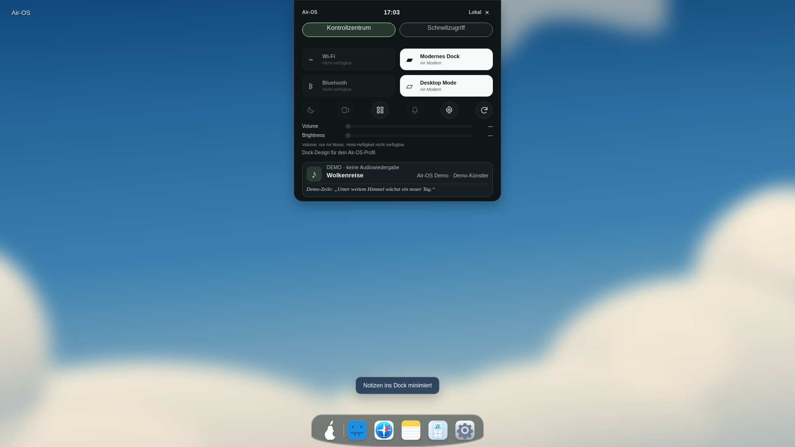](visual/air-dock-bow-after-demo-1650.png) |
| 390 | [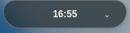](visual/air-dock-bow-before-island-390.png) | [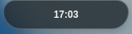](visual/air-dock-bow-after-island-390.png) | [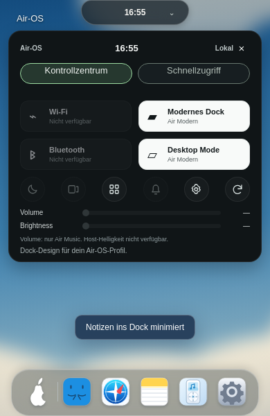](visual/air-dock-bow-before-demo-390.png) | [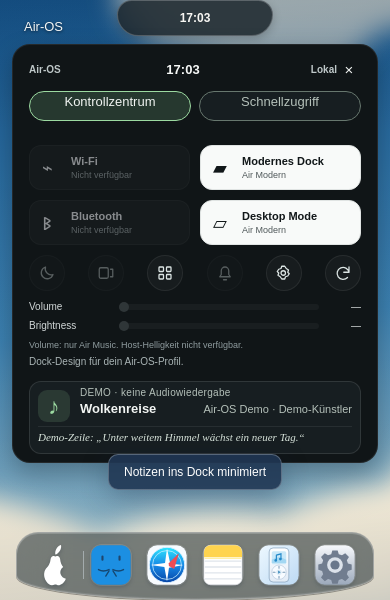](visual/air-dock-bow-after-demo-390.png) |

| Größe | Gesamt vorher | Gesamt nachher |
| --- | --- | --- |
| 1920 | [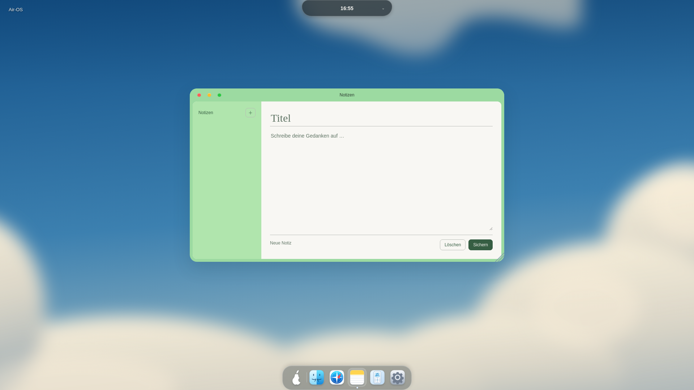](visual/air-dock-bow-before-notes-1920.png) | [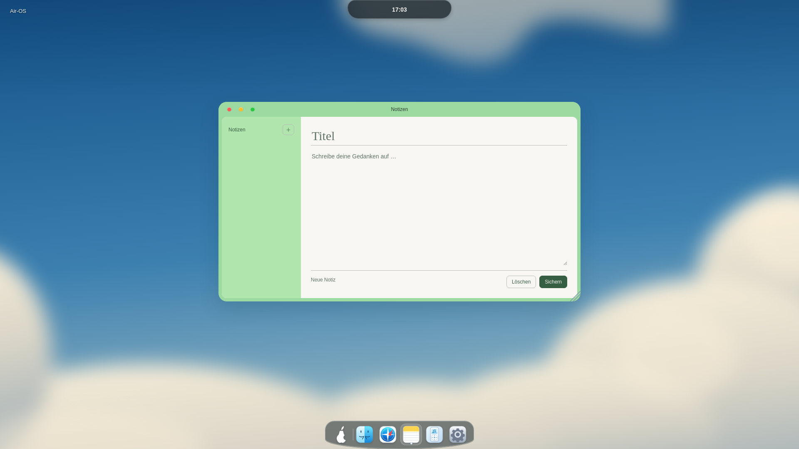](visual/air-dock-bow-after-notes-1920.png) |
| 1650 | [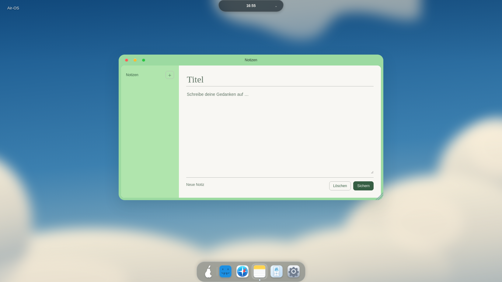](visual/air-dock-bow-before-notes-1650.png) | [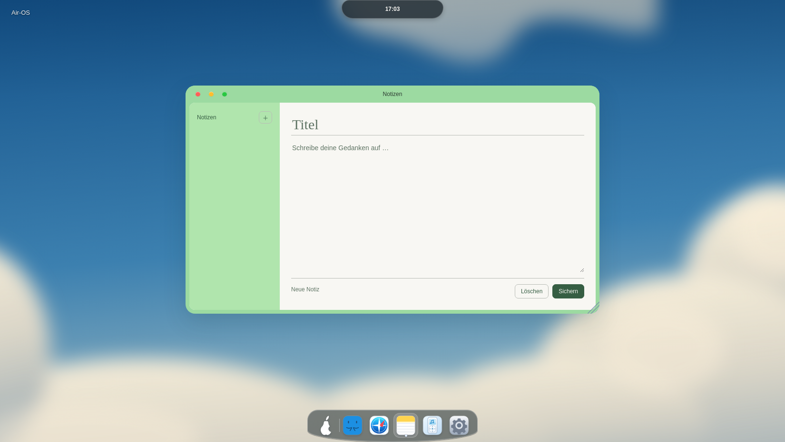](visual/air-dock-bow-after-notes-1650.png) |
| 390 | [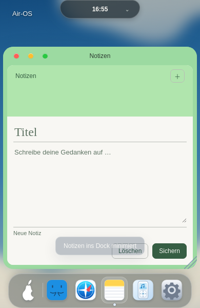](visual/air-dock-bow-before-notes-390.png) | [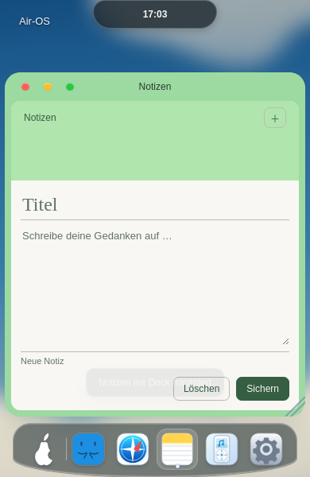](visual/air-dock-bow-after-notes-390.png) |

| Classic390 vorher | Classic390 nachher |
| --- | --- |
| [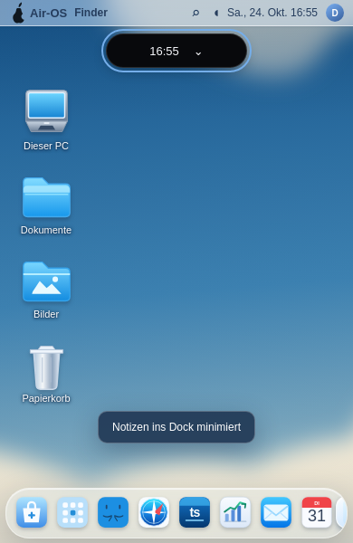](visual/air-dock-bow-before-classic-390.png) |  |

32 echte PNGs inklusive Classic-Vergleich. Die Bildvorlagen bestimmen die visuelle Richtung, es wird keine1:1-Referenzgleichheit behauptet. Der neue Ellipsenbogen ist eine eigenständige, ausdrücklich deutliche Air-OS-Korrektur; ob dies die gewünschte subjektive Zielwirkung trifft, lässt sich anhand der Bilder beurteilen. Die Kontaktebene bleibt0px, keine neue breite Taskleiste.

Produktdiff nur air-modern-dock.css, air-island.css und statische Karte in index.html. Keine Änderung an app.js, air-island.js, Air Home/Notes-Logik, Profilen, Registry, M1/M2 oder Installern. Native Windows/macOS, CB-03 und bekannte Audit-/Legacy-Electron-/Signing-/Notarisierungsblocker bleiben offen. PR-/Actions-API Forbidden, kein CI-Erfolg behauptet. main, bestehende PRs und Installer unverändert. Nächste separate Einheiten: visuelle Benutzerabnahme des Bogens, Windows-/macOS-Belege, CB-03 prüfen. Nach Commit/Push STOP.
