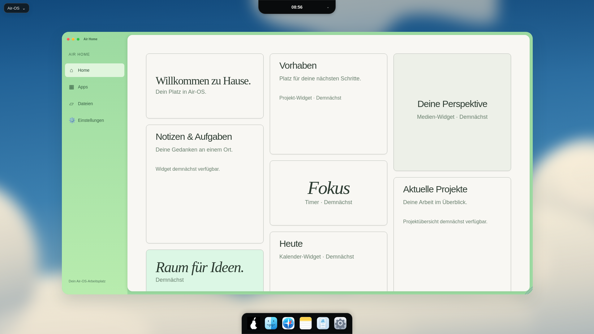

# D1 – Air Home: visueller Abgleich

24. Oktober 2026. Verbindliche Vorlage ist das erneut angehängte Folia-Referenzbild. Eigenständige lokale Air-OS-Oberfläche, kein Webseiten-Wrapper, keine Folia-/Bloom-Quellen oder fremden Assets. Vorlage visuell ausgewertet, keine behauptete automatische Pixel-Differenzmessung: Originalanhang nicht als lokale Bilddatei verfügbar.

| Merkmal | Referenzziel | Tatsächliche Umsetzung |
| --- | --- | --- |
| Fenster 1920×1080 | x200/y103, 1522×849px | Genau x200/y103, 1522×849px |
| Seitenleiste | 212px | 212px, eigene Home-/Apps-/Dateien-/Settings-Navigation |
| Cremebereich | ab x412/y113 | x412/y113, 1300×829px, #f8f7f3 |
| Kachelspalten | x472/872/1272, je380px, 20px Abstand | Genau diese x-Positionen, Breiten und Abstände |
| Linke Kacheln | y173, 210px hoch; y403, 384px hoch | Diese Positionen und Höhen erreicht |
| Rahmen | Mint #9cdaa1, 22px Radius | Eigene anwendungsspezifische CSS-Hülle; andere Fenster unverändert |
| Inhalte | Referenz enthält persönliche Daten/Fotografie | Ausschließlich klar als Demnächst bezeichnete Widget-Flächen, keine erfundenen Daten oder fremde Fotografie |

| Viewport | Fenster x/y, B×H | Navigation B×H | Screenshot |
| --- | --- | --- | --- |
| 1920×1080 | 200/103, 1522×849px | 212×849px | [1920](visual/air-home-d1-1920.png) |
| 1650×930 | 171,875/93, 1307,969×731,078px | 182,188×731,078px | [1650](visual/air-home-d1-1650.png) |
| 390×600 | 12/91, 366×430px | 366×48px, horizontal | [390](visual/air-home-d1-390.png) |

[Rohe getBoundingClientRect-Messwerte inklusive aller Kacheln](visual/air-home-d1-measurements.json).

**Konkrete Abweichungen:** Bei 1650px begrenzt der vorhandene Fensterhost die Oberkante auf y93 statt rechnerisch88,69; er wird nicht für eine einzelne App umgebaut. Auf 390px sind eine horizontale kompakte Navigation und eine Kachelspalte nötig. Die Fotografie, das schwebende Folia-Werkzeugband, dessen Marken, personalisierte Daten und Fortschrittswerte werden nicht übernommen. Stattdessen ehrliche leere Widget-Zustände. Georgia-/Systemschrift weicht von der Referenzschrift ab; Fontmetriken auf Windows/macOS nicht abgenommen. Hintergrund bleibt der vorhandene weiche Wolkenentwurf. Keine vollständige Pixelidentität behauptet.

Die Hauptfläche scrollt vertikal mit Rad/Tastatur; auf großen Displays ohne breiten Scrollbalken, damit Kachelmaße stimmen. Auf kleinen Displays sichtbarer Scrollbalken. Fensterbedienelemente und Navigation bleiben außerhalb der scrollenden Kacheln erreichbar. Dock358×68px unten0, Island oben0 und alle originalen Dock-SVGs identisch zum Ausgangsstand.

**Tatsächlich geprüft:** 186/186 Node-Tests, 0 Skips/Fehler, inklusive drei neuer Air-Home-Regressionen (eine Registry, erlaubte Navigation, Viewport-Startmaße). Echter Linux/Electron32.3.3-GUI-Lauf mit Sandbox/Xvfb bei allen drei Größen: Startmenü-Suche und Start, keine doppelte Instanz, echte Apps-/Finder-/Settings-Navigation, Verschieben, Maximieren/Wiederherstellen, Minimieren/Wiederöffnen, Tastatur-Schließen, Classic mit sichtbarer Menüleiste und ursprünglichem Grid, kein horizontaler Inhaltsüberlauf, Dock/Island erreichbar. Keine Rendererfehler. Syntax/Catalina-Konfiguration/Whitespace geprüft. Keine native Windows-/macOS-Hardwareprüfung oder neue CI-Bestätigung; Actions-API Forbidden.

Reproduktion: eigenes Wegwerfprofil am Login, Electron mit aktivierter Sandbox und lokalem CDP9241, extern vorhandenes Playwright. `AIR_GUI_TEST_ISOLATED=1 node scripts/check-air-home.cjs`. Lokaler Starthelfer `/workspace/.air-os-onboarding/start-air-home-d1.sh`, Xvfb111. Keine Projektdependency hinzugefügt; Testkonten synthetisch, Passwörter nur im Speicher. Kein Installer-/Workflow-/Preferences-/IPC-Eingriff. Nächste Einheit: E1 genau ein echtes Widget.
