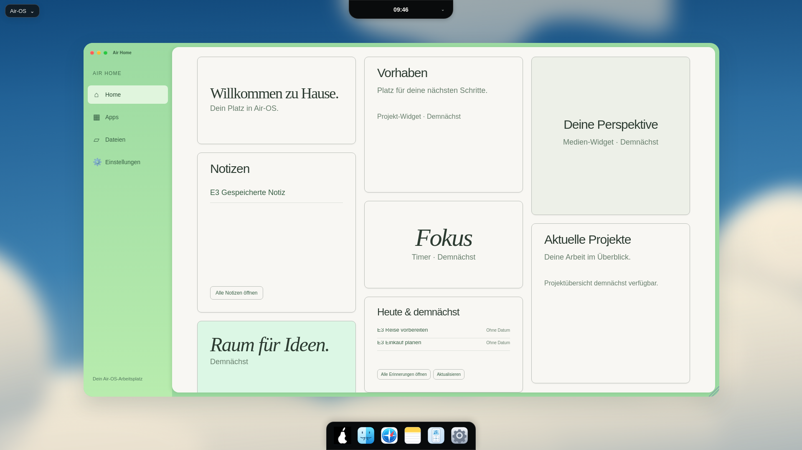

# E3 – ereignisgetriebene Air-Home-Aktualisierung

24. Oktober 2026. Basis9b584ce, Branch `feat/air-home-live-updates-e3-20261024`. Nur bestätigte Änderungswege der vorhandenen Apps/Widgets, kein Designumbau und kein neues Widget.

| Lokales DOM-Ereignis | Auslöser | Abnehmer |
| --- | --- | --- |
| `air-notes-saved` (bestehend) | Notes-save bestätigt | Bestehende Island-Mitteilung und Notes-Widget |
| `air-notes-changed` (neu) | Notes-remove bestätigt | Notes-Widget |
| `air-reminders-changed` (neu) | Reminder-save neu/bearbeitet/erledigt/offen oder remove bestätigt | Reminder-Widget |

Plain Event ohne detail/Payload, keine IDs, Titel, Inhalte, Details oder preferenceSession übertragen. App meldet nur nach API-Acknowledgement, vor ihrer separaten Editorlisten-Aktualisierung. Fehlgeschlagene Schreibvorgänge melden keinen Erfolg. Widget liest die authentifizierte aktuelle Liste selbst neu. Bestehende Save-Signale behalten Namen/Bedeutung; Notes-Löschung erzeugt keine falsche Speicherbenachrichtigung in der Island.

Publisher erfassen die vorhandene flüchtige Login-Sitzung bei Editor-Mount und prüfen sie vor dem Event erneut. Logout/pagehide/Close invalidieren Publisher und entfernen ihre Listener; disconnected-Fenster veröffentlichen ebenfalls nicht. Alte Bestätigung nach Bob-Wechsel oder erneuter Alice-Anmeldung wird verworfen. Bei fehlender/nicht prüfbarer Sitzung sicher kein Signal. Widget-Abonnements bleiben separat an ihre eigenen Sitzung/Anfragengeneration gebunden. Close entfernt neue Event-Listener, ein neues Home lädt frisch; mehrfacher Mount desselben Elements erzeugt keine Doppelabonnements. Alte Ladeantworten überschreiben keine neuere Änderung. Kein Timer oder Polling hinzugefügt.

Ein bestehender Checkboxfehler war reproduzierbar: Reminder-Refresh zeichnete Checkboxen während busy=true; neue Checkboxen blieben nach Save deaktiviert. Nach busy=false wird nun neu gezeichnet. Neue Regression prüft tatsächliche Nutzbarkeit nach Save und zwischen Erledigt/Offen, GUI bestätigt beide Richtungen.

| Viewport | Fenster x/y, B×H | Notes B×H | Due B×H, zwei offene Aufgaben | Nachweis |
| --- | --- | --- | --- | --- |
| 1920×1080 | 200/103,1522×849 | 380×384 | 380×230,391 | [1920](visual/air-home-live-e3-1920.png) |
| 1650×930 | 171,875/93,1307,969×731,078 | 326,094×330 | 326,094×198 | [1650](visual/air-home-live-e3-1650.png) |
| 390×600 | 12/91,366×430 | 299×180 | 299×156,375 | [Reminder](visual/air-home-live-e3-390.png) · [Notes](visual/air-home-live-e3-notes-390.png) |

[Rohe Viewport-Messwerte vor dem Scrollen und Event-Zählung](visual/air-home-live-e3-measurements.json). Screenshots zeigen die bestehende scrollende Hauptfläche bei der jeweiligen Kachel. Due-Höhe hängt wie in E2 von Inhalt ab (hier zwei statt drei Einträge). CSS und Template-Dateien unverändert. Original-Dock-SVGs identisch; Dock358×68 unten0, Island oben0. Keine neuen Referenzabweichungen durch Layoutänderung. Vektorwolken, eigene Schrift und bekannte D1-Abweichungen weiterhin offen.

**215/215 Node-Tests**, keine Fehler/Skips. Neun neue Regressionen; echte temporäre Notes-/Reminder-Stores und klar begrenzte DOM-/IPC-Test-Doubles für deterministische Fehler/Races. Erfolg/Fehler aller Mutationswege, keine privaten Eventdaten, automatische Datenübernahme, Erledigt/Offen, Sessionwechsel während Write/Read, Logout, geschlossene/regeöffnete Widgets, idempotenter Mount und genau ein Widget-Listener pro Ereignis. Bestehende Date-only-/Profil-/Preferences-/Sicherheitsprüfungen bleiben aktiv. Syntax/Catalina-Konfiguration/Whitespace geprüft.

**Echte Electron32.3.3-GUI**, Sandbox/Xvfb, Renderer-Viewports1920×1080,1650×930,390×600 via CDP: Notes neu/bearbeiten/löschen und Reminder neu/bearbeiten/erledigt/offen/löschen über reale bestehende App-Oberflächen. Jeweils Home aktualisiert ohne Klick auf Aktualisieren oder Reopen; acht erwartete Events pro Auflösung ohne Payload. Nach Home-Close ein weiterer Notes-Save, danach frisches Home korrekt; Logout leert synchron, neues Bob-Profil enthält keine Alice-Daten; Classic/Grid erhalten; keine Rendererfehler. Testdaten ausschließlich synthetisch, Passwörter zufällig nur im Testspeicher. Ein Testzähler wurde auf einmalige Registrierung je Renderer korrigiert, damit wiederholte Auflösungen keine künstlichen Doppelereignisse zählen.

Reproduktion: eigenes Wegwerf-userData am Login, aktive Sandbox/Xvfb114/CDP9244 und extern vorhandenes Playwright. `AIR_GUI_TEST_ISOLATED=1 node scripts/check-home-live.cjs`. Lokaler Starthelfer `/workspace/.air-os-onboarding/start-air-home-live-e3.sh`. Keine neue Projektdependency, kein --no-sandbox.

Grenzen: Ereignisse beziehen sich auf bestätigte Aktionen dieser Renderer-Apps; direkte externe Store-/Bridge-Aufrufe und Tageswechsel sind kein automatischer Trigger. Bei vor Bestätigung geschlossenem auslösendem Editor oder nicht mehr prüfbarer Sitzung kein Event; manueller Refresh/Reopen bleibt als sicherer Weg. Keine native Windows-/macOS-Hardwareabnahme; GitHub-Actions-API Forbidden, deshalb keine neue CI-Zusage. Bestehende Audit-/Signing-/Notarisierungs-/Release-Blocker unverändert; main/PRs/Installer bleiben erhalten. Nächste Einheit F1 separat.
