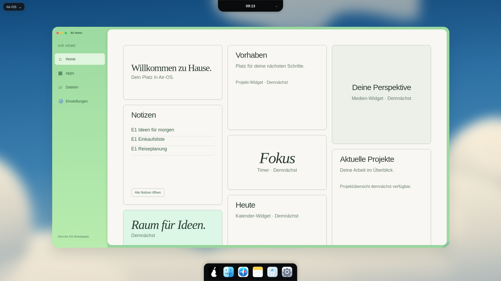

# E1 – Air-Home-Notizen: echte Daten, Titel ohne Inhalte

24. Oktober 2026. Ausgangsstand D1 bc2fcea, Branch `feat/air-home-notes-e1-20261024`. Ausschließlich die bestehende Inbox-Kachel erweitert. Übrige Widgets weiterhin „Demnächst“.

| Viewport | Fenster x/y, B×H | Notizkachel B×H | Screenshot |
| --- | --- | --- | --- |
| 1920×1080 | 200/103,1522×849px | 380×384px | [1920](visual/air-home-notes-e1-1920.png) |
| 1650×930 | 171,875/93,1307,969×731,078px | 326,094×330px | [1650](visual/air-home-notes-e1-1650.png) |
| 390×600 | 12/91,366×430px | 299×180px | [390, zur Kachel gescrollt](visual/air-home-notes-e1-390.png) |

[Leeres synthetisches Profil](visual/air-home-notes-e1-empty-390.png) · [Rohe Viewport-Messwerte vor dem Scrollen](visual/air-home-notes-e1-measurements.json).

Maximal drei echte Notiztitel, gültiges `updatedAt` absteigend; ungültige Daten zuletzt, stabile Reihenfolge bei gleichem Datum. Leerer Titel als „Ohne Titel“. Keine Body-Vorschau. Titel werden mit textContent eingefügt, lange Titel einzeilig gekürzt. „Alle Notizen öffnen“ startet die vorhandene App; keine Direktbearbeitung im Widget. Bestätigte Saves aktualisieren die Übersicht. Löschungen in der Notes-App senden bisher kein Save-Ereignis; erneutes Öffnen von Air Home lädt den aktuellen Store. Live-Löschsynchronisierung ist nicht als fertig ausgewiesen.

Vorhandene authentifizierte Bridge, dieselbe Main-Notes-Datenbank, keine neuen Dateipfade/IPC-Endpunkte/Preferences. Flüchtige vorhandene preferenceSession vor/nach Antworten und Anfragengeneration verhindern veraltete Übernahme. Close/Profile-Logout/pagehide löschen Titel sofort und lösen Listener; entfernte Fenster über MutationObserver erkannt. Keine Hintergrundintervalle, keine zweite Datenablage. Fehler erlauben erneutes Laden und zeigen keine privaten Fehlerpfade. Ein erfolgloser Logout leert vorsichtshalber ebenfalls; erneutes Öffnen lädt neu.

**Verifikation:**195/195 Node-Tests inklusive neun neuer Widget-Regressionen. Reale temporäre Notes-Stores für Profiltest, API-/DOM-Test-Doubles für deterministische verzögerte Antworten, Fehler/Retry und Lifecycle. Echte GUI mit isolierten synthetischen Alice-/Bob-Konten, zufälligem Passwort nur im Testspeicher: vorhandene Notes-Bridge liest/speichert, drei Größen, Leerzustand, Sortierung/Limit, kein Body im Home-DOM, bestehender Notes-Start via Enter, Reload, bestätigte Speicherung, literal dargestelltes HTML, sofortiger Logout-Scrub und getrennte Re-Login-Daten. Keine Rendererfehler. D1-Maße und Dock/Island-Ränder geprüft. Breite/Position von Rahmen, Navigation und anderen Kacheln unverändert. Kleines Display: Hauptinhalt wie zuvor scrollbar; Screenshot zeigt das vollständig sichtbare Widget nach Scrollen.

Reproduktion: eigenes Wegwerf-userData am Login, aktive Electron-Sandbox/Xvfb, lokales CDP9242, extern verfügbares Playwright. `AIR_GUI_TEST_ISOLATED=1 node scripts/check-home-notes.cjs`. Lokaler Starthelfer `/workspace/.air-os-onboarding/start-air-home-notes-e1.sh`, Display112. Kein --no-sandbox, keine neue Projektdependency. Der Helfer wählt Konten über den eindeutigen zufälligen Benutzernamen, damit wiederholte Läufe mit demselben Testanzeigenamen funktionieren.

Keine neuen Windows-/macOS-Hardwaretests oder CI-Erfolg behauptet; GitHub-API Forbidden. Bestehende Audit-/Signing-/Notarisierungs-/Release-Blocker bleiben bestehen. Keine Installer-/Release-Änderung. Optische D1-Abweichungen bleiben: vorhandene Vektorwolken, eigene Serifenschrift und fehlende Fremdfotografie; keine vollständige Pixelidentität mit Folia. Nächste Einheit E2 separat.
