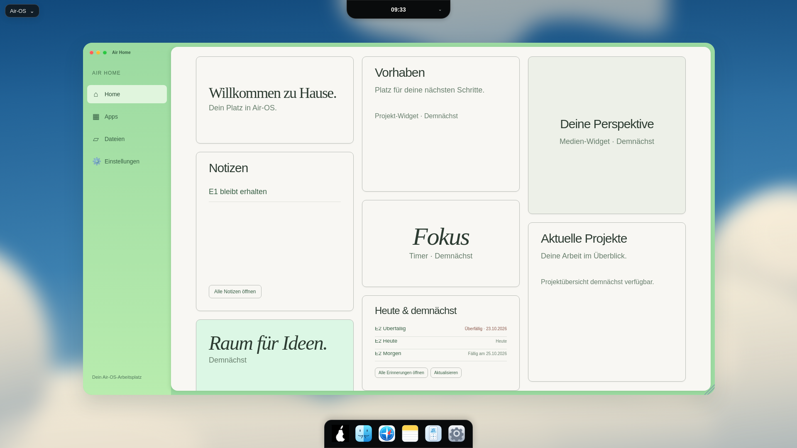

# E2 – Heute & demnächst: echte Erinnerungen

24. Oktober 2026. Basis E1 a6d2d88, Branch `feat/air-home-reminders-e2-20261024`. Nur die bestehende Due-Kachel ergänzt, übrige Kacheln und E1 unverändert.

| Viewport | Fenster x/y, B×H | Due-Kachel B×H | Screenshot |
| --- | --- | --- | --- |
| 1920×1080 | 200/103,1522×849px | 380×230,39px | [1920](visual/air-home-reminders-e2-1920.png) |
| 1650×930 | 171,875/93,1307,969×731,078px | 326,094×212,984px | [1650](visual/air-home-reminders-e2-1650.png) |
| 390×600 | 12/91,366×430px | 299×182,266px | [390](visual/air-home-reminders-e2-390.png) |

[Leeres Profil](visual/air-home-reminders-e2-empty-390.png) · [Rohe getBoundingClientRect-Messwerte vor dem Scrollen](visual/air-home-reminders-e2-measurements.json).

Screenshots zeigen die vorhandene Hauptfläche zur Due-Kachel gescrollt. Fensterrahmen, Sidebar, Dock und Island verschieben sich dabei nicht. Die Widget-Höhe passt sich auf kleineren Displays an die realen Inhalte an; keine Zeilen oder Aktionen werden abgeschnitten. E1-Inbox-Maße bleiben380×384 /326,09×330 /299×180px. Dock358×68px mit unveränderten Original-SVGs, unten0; Island oben0.

Datenpfad: vorhandene authentifizierte `window.airOS.reminders.list()`-Bridge und derselbe profilbezogene Reminder-Store. Keine neuen Pfade, Speicherdatenbanken oder IPC-Endpunkte. Nur offene Einträge, maximal drei, keine Beschreibungen. Titel und Fälligkeitsangaben ausschließlich textContent. Date-only-Felder streng auf Kalendergültigkeit geprüft und als YYYY-MM-DD mit dem aus lokalen Date-Komponenten gebildeten heutigen Tag verglichen; keine UTC-Mitternachtskonvertierung. Aufsteigende Daten ergeben überfällig/heute/zukünftig; ohne/ungültiges Datum zuletzt, stabile Gleichstände. Labels nennen „Heute“, „Überfällig · Datum“, „Fällig am Datum“ oder „Ohne Datum“.

Öffnen nutzt die vorhandene Erinnerungen-App. Aktualisieren und nach Fehler „Erneut laden“ lesen neu; Reopen tut dies ebenfalls. Keine Schreiboperation, Checkbox oder Löschung im Widget. Keine automatische Aktualisierung bei Änderungen in der App oder Mitternachtswechsel behauptet; die vorhandenen Daten werden beim nächsten Refresh erneut eingeordnet.

Datenschutz entsprechend E1: vorhandene flüchtige preferenceSession vor/nach Antwort prüfen, Generation pro Anfrage, alte Antworten verwerfen. Close-Click/Logout/pagehide leeren synchron, MutationObserver räumt nach Entfernung auf. Keine globalen Aktualisierungstimer oder zweite Kopie privater Beschreibungen. Fehler generisch, Retry möglich. Notes-Implementierung unverändert.

**Tests:**206/206, keine Fehler/Skips. Elf neue Regressionen mit echtem temporärem Reminder-Store für Alice/Bob und klar begrenzten DOM-/API-Test-Doubles für Fehler/Races. Sortierung/Limit/erledigt/leer, ungültige Daten und Schaltjahr, HTML-Titel, App-Start, Retry, Profilwechsel, Logout, Close/Reopen/Removal/pagehide, ältere Antworten und Persistenz über frische Store-Instanz. Separate TZ-Prozesse prüfen lokale Tagesgrenzen in Los Angeles/Kiritimati/Berlin einschließlich Sommerzeitwechseln.

Echte Electron32.3.3-GUI mit Sandbox und Xvfb:1920×1080,1650×930,390×600 (Renderer-Viewport via CDP), echte synthetische Profile/Reminder-Bridge, Notes bleibt sichtbar, offene/erledigte Einträge, Fälligkeit und Top-drei, Enter öffnet vorhandene App, tatsächliches Erledigen in dieser App, manueller Refresh, Reopen/Reload, literal dargestelltes HTML, Logout-Scrub und Alice/Bob-Re-Login-Isolation. Classic-Menüleiste/Grid weiterhin vorhanden. Keine Rendererfehler.

Reproduktion: eigenes Wegwerf-userData am Login, aktive Electron-Sandbox, Xvfb113/CDP9243, extern vorhandenes Playwright. `AIR_GUI_TEST_ISOLATED=1 node scripts/check-home-reminders.cjs`. Lokaler Helfer `/workspace/.air-os-onboarding/start-air-home-reminders-e2.sh`. Synthetische Daten, zufällige Passwörter nur im Testspeicher; keine neue Projektdependency.

Keine neue Windows-/macOS-Hardwareabnahme, CI-API Forbidden. Keine Installer-/Release-Änderung, keine Audit-/Signing-/Notarisierungsblocker abgeschaltet. Bestehende D1-Designabweichungen bleiben: Vektorwolken und eigene Schrift statt vollständiger Pixelkopie; bei1650px y93 durch vorhandenen Fensterhost. E3 behandelt Aktualisierungs-/Profilgrenzen separat.
