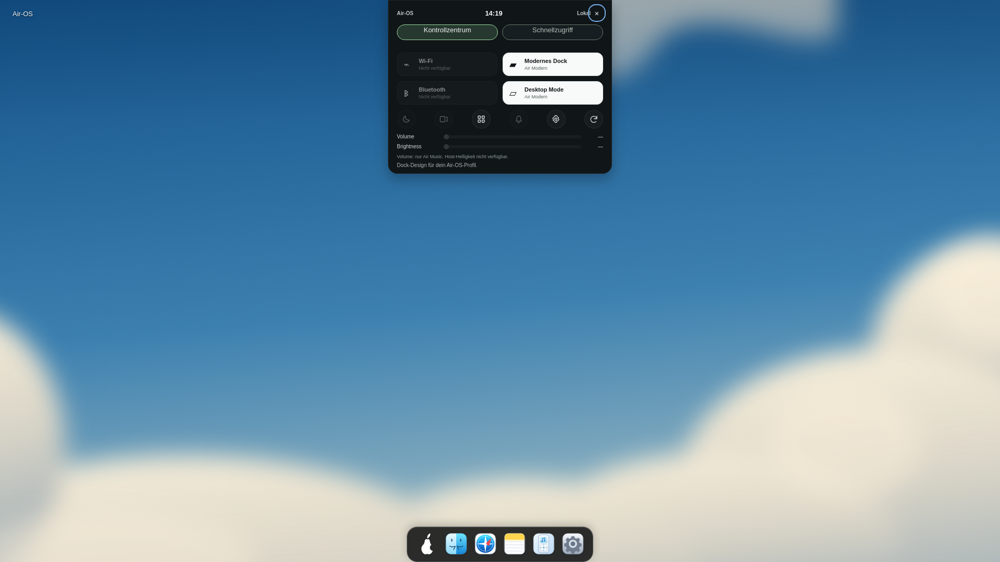
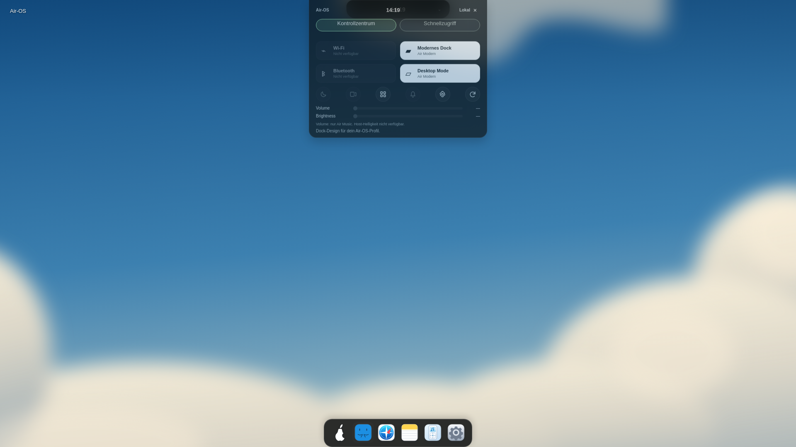
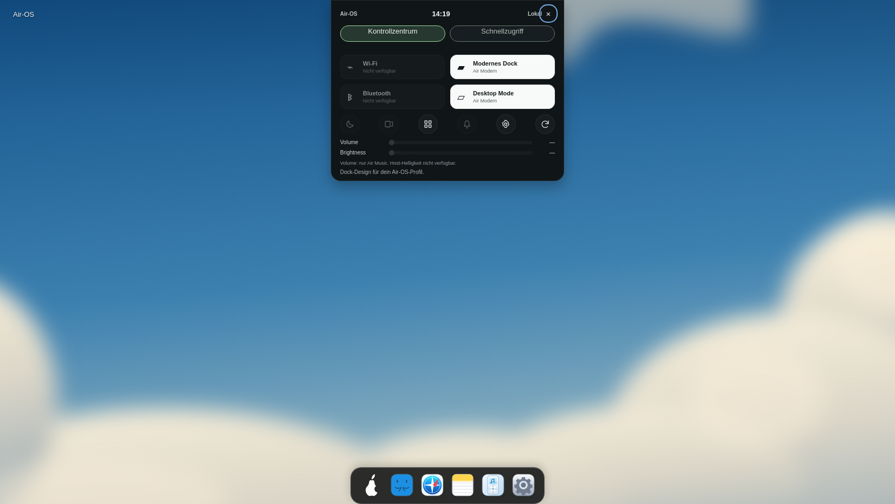
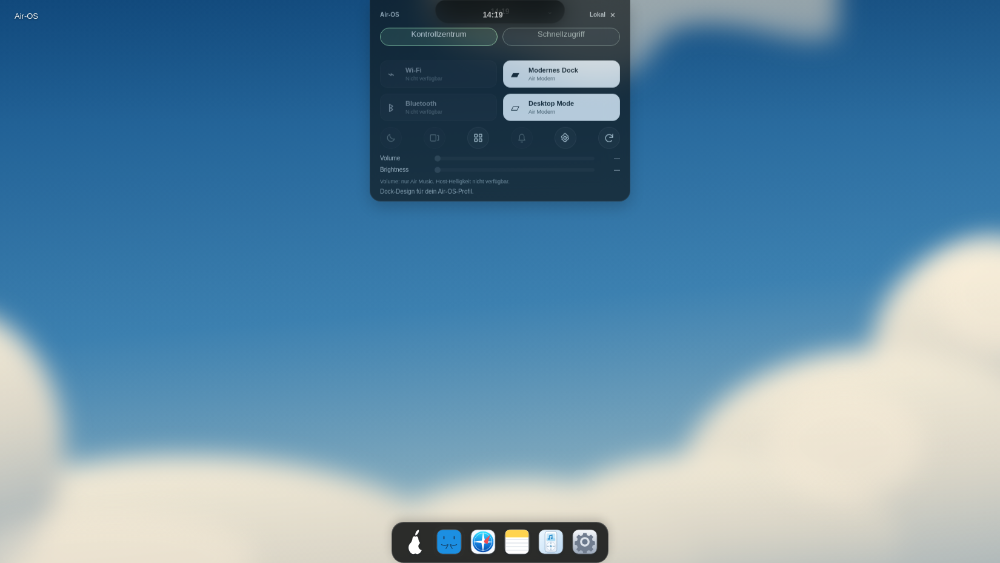
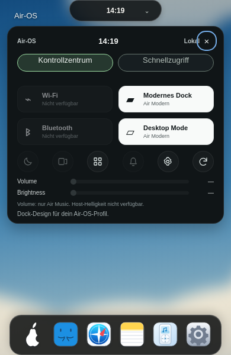
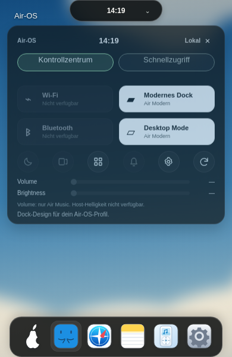

# M1 – unterbrechbare Dynamic-Island-Animation

24. Oktober 2026. Bestätigte Basis/Remote-HEAD `3d5bd3d117925ef3de2eb03f91dc21bdfae894ca`, eigener Branch `fix/air-island-interruptible-m1-20261024`. Ausschließlich bestehendes Island-Panel, keine Animationsbibliothek.

## Änderung

Bisher: CSS-Einstieg140ms plus separater WAAPI-Ausstieg120ms. Wiederöffnen beendete den Ausstieg mit Hidden/Cancel und startete das CSS-Einblenden neu. Dadurch sprang die Darstellung zurück zum Anfang.

Modern verwendet nun **eine gemeinsame WAAPI-Zeitleiste**:140ms ease-out, Opacity0→1 und translateY(-4px)→0, fill:both. Richtungswechsel ruft reverse() auf derselben Animation auf. Browser behält die aktuelle Zeitposition einschließlich angewandter Easing-Kurve; kein Zurücksetzen auf ein neues Startbild. Abschließen/Abbrechen entfernt den Effekt vollständig. CSS-Einstieg wird ausschließlich für das Modern-Panel deaktiviert; Classic behält seinen bestehenden CSS-Einstieg und unmittelbaren Schließweg. Kein Spring, kein Überschwingen, kein neuer Timer. Keine Behauptung einer Feder-/Geschwindigkeitsstetigkeit beim Richtungswechsel.

Initiales currentTime und playbackRate werden explizit gesetzt, damit auch Öffnen/Schließen/Wiederöffnen vor dem ersten gezeichneten Frame funktioniert. Abschluss-Callbacks prüfen Animationsidentität UND eine fortlaufende Generation. Ein alter Callback derselben umgedrehten Animation darf keine neue Öffnung schließen. Erneutes Schließen während eines laufenden Schließens startet keinen zweiten Effekt.

Beim Schließen sofort inert/is-closing, aria-expanded=false und gegebenenfalls Fokus zum Trigger; Wiederöffnen hebt diese Sperre auf. Vollständig neues Öffnen beginnt weiterhin im Kontrollzentrum. Ein unterbrochener Ausstieg behält seine sichtbare K3-Ansicht, damit ein Schnellzugriff→Kontrollzentrum-Höhenwechsel keinen zusätzlichen Sprung erzeugt. Nach vollständigem Schließen wieder Kontrollzentrum. Schließen invalidiert ausstehende K3-App-Startantworten bereits am Anfang des Ausstiegs.

Bestehendes Settings-Ereignis, Dokumentverbergen und pagehide räumen Animationen sicher auf. Sowohl Air-OS-Bewegungsreduktion als auch prefers-reduced-motion umgehen Modern-Animationen. Ein zusätzlicher change-Listener auf die vorhandene Media Query beendet auch eine gerade laufende Bewegung; wird bei dispose entfernt. Keine neuen Daten/IPC/Preferences.

## Ausgeführte Tests

**235/235 Node-Tests bestanden**,0 Fehler/Skips; Island-Datei23/23. Drei neue M1-Regressionen: laufende Zeitposition und wiederholte Richtungswechsel, veraltete Open/Close-Callbacks, K3-Ansicht bei Unterbrechung/frischer Öffnung und ausstehender Launch, Bewegungsreduktion/Dispose. Bestehende Cleanup-/Escape-/Outside-/Session-/Notes-/Speicherfehler-/Fokusregressionen weiter aktiv; bestehende Exit-Tests auf gemeinsame140ms-Zeitleiste angepasst. Test-Doubles explizit nur für deterministische Callback-/Zeitpositionsfälle, echte Animation zusätzlich unten.

Syntaxprüfung air-island.js/Testhelfer, gesamte Testsuite, Catalina-Konfiguration und git diff --check bestanden. Keine Dependency-/Installer-/Security-Workflow-Änderung.

## Echte Electron-Prüfung

Linux Electron32.3.3/Chromium128 mit eigener authentifizierter Xvfb-Sitzung, aktiver Chromium-Sandbox, isoliertem synthetischem Testprofil und lokalem CDP. Helfer `scripts/check-island-motion.cjs`, `AIR_GUI_TEST_ISOLATED=1`, optional `AIR_GUI_CDP`, Standardport9254. Playwright nur vorhandenes externes Testwerkzeug, keine neue Produktabhängigkeit.

Bei jeder der drei Renderer-Viewportgrößen:

- Zwölf Richtungswechsel einer **tatsächlich laufenden** Browseranimation über mehrere requestAnimationFrame-Schritte. Vorher-/Nachher-Abtastung im selben JavaScript-Task: Opacity, getBoundingClientRect().y und currentTime identisch, dieselbe Animationsinstanz erhalten. Playback-Richtungswechsel nach animation.ready bestätigt (reverse setzt zunächst eine ausstehende Playback-Rate, deshalb nicht voreilig die synchrone playbackRate als Ergebnis interpretieren).
- Alte onfinish-Handler gezielt nach Umkehr erneut aufgerufen: kein Verbergen/Reset. Zusätzlich dreifaches Toggle vor dem ersten Frame.
- K3-Schnellzugriff bei unterbrochenem Schließen erhalten, Escape mit sofortiger Fokus-Rückgabe, Outside-Click, vier echte App-Starts home/notes/reminders/finder und sichtbarer Fokus im vorhandenen Fenster.
- Air-OS- sowie OS-Bewegungsreduktion ohne laufenden Effekt; Classic-CSS-Einstieg unverändert und Schließen unmittelbar. Zusätzlich OS-Reduced-Motion-Wechsel während laufender Animation und pagehide-Cleanup.
- Dock-/Island-Außenmaße, Glasfarben/Blur/Radien und alle sechs Dock-Icon-SVGs exakt mit den gespeicherten Ausgangsmessungen aus dem Soft-Glass-Commit verglichen: identisch. Kein Glas-/Logo-/Dock-/Window-Manager-Code geändert. Keine Rendererfehler.

| Viewport | Island x/y, Breite × Höhe | Panel in Ruhe x/y, Breite × Höhe | Dock x/y, Breite × Höhe | Max. Sprung bei Umkehr |
| --- | --- | --- | --- | --- |
| 1920 × 1080 | 835/0,250×45 | 745/0,430×334 | 781/1012,358×68 | 0px / Opacity0 / Zeit0ms |
| 1650 × 930 | 717,58/0,214,84×38,67 | 610/0,430×334 | 646/862,358×68 | 0px / Opacity0 / Zeit0ms |
| 390 × 600 | 117/0,156×36 | 12/44,366×334 | 16/532,358×68 | 0px / Opacity0 / Zeit0ms |

[Rohmesswerte einschließlich aller36 Umkehrpaare](visual/air-island-m1-measurements.json). Messungen belegen Positions-/Opacity-/Zeitstetigkeit unmittelbar am Richtungswechsel, **keine garantierten FPS oder Hardware-Performance**. Ruhescreenshots zeigen die unveränderte Gestaltung; die separat beschrifteten70ms-Bilder sind echte gezielt pausierte Browseranimationen, kein Beleg für einen neuen Layoutzustand.

| Größe | Geöffnet, in Ruhe | Animationszustand70ms, gezielt pausiert |
| --- | --- | --- |
| 1920 |  |  |
| 1650 |  |  |
| 390 |  |  |

Die erste Helferfassung erwartete zu früh den synchronen playbackRate-Wechsel und versuchte den auf großen Displays vom bestehenden Panel überdeckten Trigger direkt anzuklicken. Korrigierte Prüfung wartet auf animation.ready und nutzt den vorhandenen Schließen-Button/Trigger-Ereignisweg für die unmittelbare Unterbrechung; echte Tastatur/App-Klicks weiterhin separat geprüft. Abschließender vollständiger Helferlauf Exit0. Keine Produktgeometrie verändert, um einen Test zu erfüllen.

## Grenzen und nächste kleine Einheiten

Native Windows-/macOS-Abnahmen weiterhin offen; Linux ist kein Ersatz. Keine neue Referenz-/Supaste-Pixelgleichheit behauptet. Bestehender Control-Center-Aufbau, Uhren-/Notiz-/Theme-Funktionen bleiben; Air Home, Birne, Glass-Design, Dock, Fenstergeometrien und Classic-Skin unverändert. Keine neue Animation anderer Fenster oder Ansichten.

PR-/Actions-Abfrage erneut Forbidden; kein neuer CI-Erfolg behauptet. Bekannte Audit-/Legacy-Electron-/Signing-/Notarisierungs-/Release-Blocker sowie CB-02/CB-03 bleiben offen. main/PRs/Installer unverändert, keine Veröffentlichung oder Merge. Nächste separate Einheiten: native Windows-Abnahme; native macOS-Abnahme; danach eine einzeln bestätigte CB-02/CB-03-Abweichung korrigieren. Nach Commit/Push STOP.
