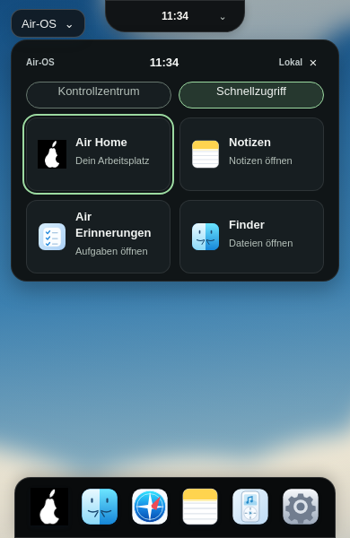

# K3 – dunkler Schnellzugriff in derselben Island

24. Oktober 2026 · Basis41d7d67d11c46928ba6fa171a4730b9ac9cacb73 · Branch `feat/air-island-quick-access-k3-20261024`.

## Eine zusätzliche Ansicht, keine zusätzliche Verwaltung

Bestehender air-island-Host, dieselbe Panel-Region und dieselbe Uhr. Zwei native Buttons „Kontrollzentrum“/„Schnellzugriff“ mit group-Label, aria-pressed und aria-controls; aktive Ansicht mintbetont. Die Regionsüberschrift folgt der Ansicht auch für Screenreader. Öffnen setzt grundsätzlich Kontrollzentrum, keine neue Preference.

Bestehende Kontrollzentrum-Inhalte sind lediglich in einem Container zusammengefasst, nicht dupliziert. Die inaktive Inhaltsgruppe ist hidden und inert; verdeckte Kacheln/Slider/Karten lassen sich nicht fokussieren. Classic blendet neue Navigation/Ansicht aus; sein Kontrollinhalt bleibt im bisherigen Boxlayout. Einstellungen, Notes-Mitteilung und Live-Uhr verwenden unveränderte bestehende Funktionen.

| Karte | Registry-ID / tatsächlicher Name | Zutreffende Bezeichnung | Iconquelle |
| --- | --- | --- | --- |
| Home |home / Air Home |Dein Arbeitsplatz |Benutzer wählte ausdrücklich vorhandenes Air-OS-Birnenlogo |
| Notes |notes / Notizen |Notizen öffnen |Unverändertes Notes-SVG |
| Erinnerungen |reminders / Air Erinnerungen |Aufgaben öffnen |Unverändertes Reminder-SVG |
| Finder |finder / Finder |Dateien öffnen |Unverändertes Finder-SVG |

Namen werden bei Darstellung aus der Registry gelesen und nur über textContent eingefügt. Die vier IDs sind Schnellverweise, keine zweite App-Datenbank. Home besitzt bisher keine Icon-Metadaten: das bestätigte Birnenlogo wird nur für diese Karte wiederverwendet, weder global registriert noch als historisch vorhandenes Home-Icon ausgegeben. Keine Änderung an Startmenü-Logo, anderen Icons oder Home-Pinning-Berechtigung. Keine fremden Assets oder neue Abhängigkeit.

Card-Klick ruft den bestehenden openApp-Pfad auf. Erst erfolgreicher Start schließt die Island; Fokus landet in sichtbaren vorhandenen App-Inhalten, ersatzweise bei dessen bestehender Close-Taste. Verborgene Finder-Editorfelder werden übersprungen – dies war ein echter Befund im ersten GUI-Lauf. Kein Finder-/Window-Manager-Umbau. Fehler bleiben im Panel mit erneuter Aktivierung möglich; Doppelstarts und alte Antworten nach Close/Reopen werden unterdrückt. Aus inaktiver/geschlossener/Classic-Ansicht kein neuer Schnellstart.

## Design und Geometrie

Panel#101517, Karten#171e21, Primärtext#f2f5f3, Sekundärtext#b5c1ba, Mint#9cdaa1. Zwei Kartenspalten mit10px Abstand,12px Radius/Padding,32px Originalicon, mindestens82px Kartenhöhe; lange Registry-Namen dürfen umbrechen. Ruhiger Hover, unmittelbares Press-Feedback#365044, sichtbarer2px-Mint-Fokus. Keine neue Animation, Federbibliothek oder Timer. Bestehende Öffnen-/Schließen-Animation und beide Reduced-Motion-Wege erhalten; M1 bewusst separat.

| Viewport | Geschlossene Island x/y, B×H (unverändert) | Panel x/y/B (unverändert) | Höhe vorher / Control / Quick | Dock (unverändert) |
| --- | --- | --- | --- | --- |
|1920×1080 |835/0,250×45px |745/0/430px |284/334/270px |781/1012,358×68px |
|1650×930 |717,578/0,214,844×38,672px |610/0/430px |284/334/270px |646/862,358×68px |
|390×600 |117/0,156×36px |12/44/366px |284/334/270px |16/532,358×68px |

Die zusätzliche Navigation benötigt50px; die Kontrollkacheln selbst werden nicht neu dimensioniert. Schnellzugriff ist kürzer. Geschlossene Island unverändert exakt oben0, Dock unten0. Auf390px endet Control zunächst bei378px und Quick bei314px, deutlich oberhalb des Docks bei532px. Notes-Mitteilung darf die Inhaltshöhe erhöhen; bestehende420px-Grenze und vertikales Panel-Scrolling bleiben. Kein horizontaler Scrollbalken. Kein Verschieben des Fensterhosts oder der Desktop-Hülle.

## Echte Vorher-/Nachher-Aufnahmen

Vorher: unveränderter bestätigter K2-Commit in detached Test-Worktree; nachher K3. Beide echte Linux/Electron32.3.3-Läufe mit aktiver Sandbox/Xvfb und getrennten synthetischen Profilen, nacheinander. Keine nachbearbeiteten Bilder oder umbenannten alten Screenshots.

| Größe | Vorher | Kontrollzentrum nachher | Schnellzugriff |
| --- | --- | --- | --- |
|1920×1080 |[Vorher](visual/air-island-k3-before-1920.png) |[Control](visual/air-island-k3-control-1920.png) |[Quick](visual/air-island-k3-quick-1920.png) |
|1650×930 |[Vorher](visual/air-island-k3-before-1650.png) |[Control](visual/air-island-k3-control-1650.png) |[Quick](visual/air-island-k3-quick-1650.png) |
|390×600 |[Vorher](visual/air-island-k3-before-390.png) |[Control](visual/air-island-k3-control-390.png) | |

[Vorher-Messwerte/Classic-Skin](visual/air-island-k3-before-measurements.json) · [Nachher-Messwerte/Classic-Vergleich](visual/air-island-k3-after-measurements.json). Screenshots zeigen absichtlich Tastaturfokus auf einer Karte. Aktive Uhrzeit stammt jeweils aus dem echten Lauf. Keine Supaste-Pixelgleichheit behauptet; vorhandene Hybridwerte sind die Gestaltungsgrundlage, originale Supaste-Bilder weiterhin nicht erreichbar.

## Tatsächlich geprüft

**231/231 Linux-Tests**,0 Fehler/Skips. Sechs neue Tests mit markierter DOM-/API-Umgebung: Default/Wechsel/Reset/hidden/inert; vier bestehende Startpfade mit Registry-Namen/Originalicons und Fokus; Fehler/Retry/Doppelstart/veraltete Bestätigung; Classic/Pagehide/Registry-Cleanup; sichere Titel/fehlende Registrierung; Fokus überspringt versteckte Finder-Felder. Alle bisherigen Control-Center-/Clock-/Preferences-/Notes-/Volume-/Session-/Reduced-Motion-/Animationscleanup-Tests weiter grün. Syntax, Catalina-Konfiguration und Whitespace geprüft.

Echte GUI bei1920×1080,1650×930,390×600 (Renderer-Viewports via CDP):

- Standardkontrollzentrum, Tab/Enter/Space für Ansichtswahl; vier Karten, reale Registry-Namen und unveränderte Icons. Karte Home mit Space inklusive sofortigem Press-Farbwert geprüft, andere Karten mit Enter gestartet. Zwölf echte interne App-Starts über alle Größen, Panel geschlossen und Fokus im jeweiligen existierenden Fenster.
- Inaktive Controls per focus() nicht erreichbar, Rückwechsel korrekt, Escape mit Trigger-Fokus und Outside-Click schließen, erneutes Öffnen startet Control. Kein horizontaler Overflow oder Dock-Überdeckung.
- Original-Dock-SVGs und closed-Island-/Dock-DOMRects identisch. Classic-Kontrollzentrum einschließlich berechneter Skin/Geometrie gegen die echte K2-Baseline identisch. Kartenstarts verändern keine Preferences.
- Echte bestätigte Dock-/Desktop-Theme-Wege und Settings-Refresh; Wi-Fi/Bluetooth/Helligkeit weiterhin deaktiviert. Echte Notes-Speicherung erzeugt generische Mitteilung ohne Titel/Inhalt; Mitteilung in Quick verborgen und in Control wieder zugänglich.
- Synthetische lokale WAV-Datei in vorhandener Air-Music-Oberfläche geladen, Regler steuert tatsächliches Audioelement auf32%, kein Systemaudiozugriff. Wechsel Quick/Control erhält Wert, inaktive Slider nicht fokussierbar.
- OS-Media-Reduced-Motion und Air-OS-Reduce-Motion separat, Logout/neuer Bob-Login mit Control-Default und ohne alte Notes-Mitteilung. Keine Rendererfehler.

Fehler-/verzögerte Startfälle deterministisch in Unit-Tests, echte erfolgreiche Starts in GUI; keine künstliche native Hardwarewirkung behauptet. Keine neue CI-Zusage: Actions-API Forbidden. Keine native Windows-/macOS-Abnahme, CB-02/CB-03 unverändert offen. Bestehende Audit-/Legacy-Electron-/Signing-/Notarisierungsblocker bestehen.

Reproduktion: extern vorhandenes Playwright, eigene Wegwerf-userData-Profile am Login. `AIR_GUI_TEST_ISOLATED=1 AIR_GUI_BASELINE=1 node scripts/check-island-quick.cjs` an CDP9250; Baseline beenden, danach `AIR_GUI_TEST_ISOLATED=1 node scripts/check-island-quick.cjs` an CDP9251. Lokale Helfer `/workspace/.air-os-onboarding/start-air-island-quick-k3-baseline.sh` (Display120, Worktree k3-baseline-tree aus41d7d67) und `start-air-island-quick-k3-after.sh` (Display121). Zufällige Passwörter nur im Testspeicher, ausschließlich synthetische Daten. Keine neue Dependency, kein --no-sandbox.

main, bestehende PRs, Installer und andere Entwicklungsbranches nicht verändert. Kein Clipboard/OCR/Cloud/Mediensteuerungs-Ausbau, keine M1-Animation implementiert. Nächster Schritt M1 separat.
