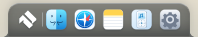
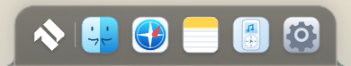
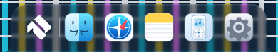
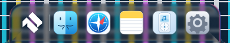

# GLASS-2 – sichtbares gemeinsames MacShell-Material

Basis **1ac6c3adedcfa8a1df1013ab2980c2a7d718b24d**, Branch **feat/air-liquid-glass-2**,26.Oktober2026 (Europe/Berlin). Keine neuen Apps/Menüs, keine Veröffentlichung/Cloud-Anmeldung, ausschließlich synthetische Testprofile/Notizen. Keine native Windows-/macOS-GPU-Abnahme verfügbar.

## Ursachen und Korrektur

Das aktive Wolkenwallpaper ist das eigene eingebettete **SVG**, kein JPG. Deep Port1 verweigerte diese Quelle; zusätzlich endete der bisherige URL-RegEx am inneren `url(#sky)` des SVGs. Jetzt wird die vollständige CSS-URL gelesen und **nur das exakte eingebaute SVG** zugelassen. Fremde SVG-Daten bleiben gesperrt. Lokale PNG/JPEG/WebP/GIF-Test-/Profilwallpaper werden begrenzt akzeptiert; keine beliebigen Remote-/Datei-URLs.

Texturaufbau berücksichtigt aktive Bildgröße/Position, Cover/Contain sowie vorhandene lineare Wallpaper-Overlays inklusive `::after`. Gemeinsamer Szenencache/Mipmaps statt pro Fläche neuer Decoder. Hintergrundquelle bleibt ausschließlich das aktive Wallpaper; **keine Live-App-/Systemdesktopaufnahme**. Zusätzlicher2px-Canvas-Vorblur ist eine dokumentierte Qt-MultiEffect-Anpassung.

Statische Panel-/Dialoghosts besaßen zuvor keinen eigenen Positionierungsanker: die Canvasfläche konnte sich nach Animationsende am falschen Vorfahren ausrichten. Ein reversibler relativer Hostanker behebt das ohne Änderung des Layoutrechtecks; der echte Screenshot-Test prüft nun die Deckung jeder aktiven Kachel mit ihrem Host. Materialcanvas liegt jetzt eindeutig über dem Hosthintergrund und unter Inhalt. Statische Inhaltselemente erhalten eine eigene Ebene; direkte Textknoten, etwa echte Benachrichtigungen, werden reversibel in Vordergrund-Spans gehalten. Sticky-Header/absolute Fenstertitel behalten ihre Positionierungsart. Bei Scroll-Panels wird nur die Materialkachel gegensinnig zum Scrolloffset verschoben. Sie bleibt im Clientbereich statt über die Scrollbalkengrenze hinauszuragen; dadurch entstehen keine zusätzlichen horizontalen oder vertikalen Scrollbalken. Historien-Neuaufbau kann die Kachel nicht mehr dauerhaft entfernen. GPU-aktive Flächen schalten opake Hintergrund-/Backdrop-Dopplungen und die alten Foot-Pseudoflächen aus. Notes/Home behalten die mintfarbenen Arbeitsflächen; geeignete Titelleisten erhalten nur eine schwache Materialauflage, nicht der private Editorinhalt.

## Tatsächlich laufende Originalshader

MacShell-Pin **1bdb51870b621100fd2709f66c8f8e00ab17b9c4**, MIT Copyright(c)2026 Rickky. [Unveränderte neue Quellen und Lizenz](../third_party/glass2/), [Hashes](../third_party/glass2/provenance.json). Bestehende OFL-Nachweise unverändert.

| Original | Aktiver Produktpfad | Technische Anpassung |
|---|---|---|
| `liquidglass.frag` | Kalender, Spotlight, Kontrollzentrum/Popovers, Verlauf/Banner, Widgets und geeignete Fenstertitelleisten | Bestehende Snell-/Bezel-/24-Tap-Golden-Angle-/Mip-/Dispersion-/Rim-/Grain-Formeln. Qt440/UBO/Samplerbindings → GLSL ES300/Uniforms. CSS-Viewport-/Transformmaßstab explizit im Sampling. |
| `dockglass.frag` | Vorhandenes Dock und geschlossene Island | Originales adaptives dunkles Tinting, obere Lichtquelle, Crisp/Pool/Meniskus, Materialtiefe und Farbdispersion. Keine MacShell-Dockhülle. Werte für Air-OS kalibriert: Dicke30, Dispersion.11, Rim.65, Magnify.08; Tint Dock.45/Island.60, um helle Hintergründe und Uhrlesbarkeit zu vereinbaren. `shadowAmt=0` wie im Dock-QML; dessen30px-Qt-Ressourcenpadding wird nicht als zusätzliche Air-OS-Hülle eingeführt. |
| `contourglow.frag` | Dieselben Materialkacheln bei Hover/Tastaturfokus | Originale Line/Halo/Near-Cursor-Formeln als zweiter premultiplizierter Pass im **gleichen** WebGL-Kontext; Amount maximal.5, endlicher220ms-OutCubic-Verlauf. Keine dauernde Glowanimation. |

Generierung reproduzierbar: `node scripts/build-glass2-shaders.cjs`. Originaldateien unverändert, neue ES-/Maskenadapter in `macshell-glass2-shaders.js`; alter MacLock-/Deep-Port-Shader bleibt erhalten. Für die Air-OS-Form ersetzen wir die rechteckige Distanz/Normalenbestimmung durch eine gemeinsame SDF mit numerischem Normalengradienten. Refraction-/Lightingformeln bleiben; keine Behauptung eines vollständig bytegleichen adaptierten Shaders.

Die Dock-QML-Vorlage setzt Bezel `min(height*.36,26)`, Thickness `30*glassLiquid`, Dispersion `.06*glassLiquid`, Magnify `.08*glassLiquid`, Rim `.20*glassRim`, Tint `.55*glassOpacity` und Shadow0. Air-OS übernimmt Bezel/Grunddicke/Magnify/Shadow; die oben ausgewiesenen stärkeren Dispersion-/Rim- und getrennten Tintwerte sind **bewusste Materialkalibrierungen**, keine unveränderten QML-Defaults. [Originalzeilen](https://github.com/0-ss/MacShell/blob/1bdb51870b621100fd2709f66c8f8e00ab17b9c4/MacShell/MacDock.qml#L5422).

## Form, Fallback und Bewegung

Dock: gerader Boden, bestehende obere Rundungen plus12px **inverse seitliche Füße**, kein Oval. Island: spiegelverkehrte obere Anschlüsse. GPU-Kachel umfasst diese Füße bei unverändertem Host-/Buttonrechteck; die SDF berücksichtigt asymmetrische CSS-Radien einschließlich echter0-Radien. Vorhandenes Clipping/Hitboxen und M1/M2 bleiben zuständig. Keine Host-Skalierung/Vergrößerung. Text/Icons liegen über dem Material, Canvas/Glanzflächen nehmen keine Klicks entgegen.

Normale Software-/SwiftShader/llvmpipe/WARP-Pfade bleiben **CSS-Fallback**, nicht als produktionsfähiges WebGL ausgegeben. Unklassifizierte GPU ebenfalls Fallback. Dieser Fallback erhält dunkle transparente Mehrschichtflächen, Glosskante, innere Tiefe, Backdropfilter und begrenzte Pointer-Lichtpositionen. Reduced Glass/Transparency/Forced Colors wechseln unmittelbar zu lesbaren opaken Flächen; Canvas wird ausgeblendet und Ressourcen freigegeben. Classic-Regeln werden nicht umgestaltet.

Pointerupdates begrenzt auf etwa40ms, im isolierten Diagnosepfad140ms. Nur endliches Settling bzw. laufende vorhandene Öffnungsanimationen lösen Folgeframes aus. Danach kein permanenter RAF/GPU-Loop. Nur tatsächlich sichtbare Flächen dürfen Settling fortsetzen; ausgeblendete Panels halten keinen Timer am Leben. Ein Schlüssel aus Szene, Geometrie, Maske und Lichtzustand verhindert erneutes Zeichnen/Kopieren unveränderter Materialkacheln. Fensterbewegungen invalidieren gezielt ihre Titelleisten. Pro Materialfläche maximal500.000 Pixel auf regulärem GPU-Pfad, bisDPR2; keine Behauptung vollständiger Retinaschärfe für beliebig große Flächen. Context Loss, Classic, reduzierte Transparenz, Logout und pagehide entfernen Materialkacheln und räumen Programme/Texturen/Buffer/Listener auf.

## Was tatsächlich getestet wurde

**363/363 Tests bestanden**,0 Fehler/Skips; sieben neue Regressionen für gerade/konkave Masken, gespiegelte Island, Wallpaper-Koordinaten, vollständige SVG-URLs/Overlays, reproduzierbare Shaderports unveränderte Software-Schutzbedingungen und Original-/MIT-Bytehashes. Vollständige bisherige Suite erhalten. **149 Laufzeitressourcen**, Syntax-/Diffprüfungen bestanden; keine neuen App-Abhängigkeiten/Installer-/Signingänderungen. Bildanalyse nutzt vorhandenes Pillow als Entwicklungswerkzeug.

Echtes sandboxed **Linux-Electron44** bei1920×1080,1650×930,390×600: normale Software-Produktoberfläche vor/nach, dazu vollständig integrierter Diagnosepfad mit Wolken- und generiertem Kontrastraster. Testuhr nur per CDP im Test-Renderer eingefroren, damit Bilder dieselben Zustände haben; Produktuhr unverändert.390px ist ein schmaler Renderer, keine physische390px-Hardware. Bestehender voller App-/Profil-/Classic-/M1-/M2-/K3-/Reduced-Motion-/WebGL-Ausfall-Test separat erneut bestanden: [Regressionsbericht](visual/glass2-regression/r1-gui-report.json).

**Diagnose klar begrenzt:** `AIR_GUI_TEST_ISOLATED=1` **und** `--glass-integration-test` **und** eigener temporärer `userData`-Name `air-r1-gui-*`; Abfrage nur über bestehende authentifizierte Bridge. Sonst keine Software-GPU-Freigabe. Im Diagnosemodus maximal16.384 Materialpixel je Fläche. Es läuft der echte unveränderte Produkt-Einstieg mit denselben Shadern, Masken, Ebenen und realen App-Inhalten. Keine Shader-Quelltextänderung oder Rendererinfo-Spoofing im Test; lediglich Beobachtung der echten Kontextobjekte für Context-Loss. Das ist **kein normal freigegebener Softwarebetrieb und kein physischer Hardwaretest**.

Der Diagnosemodus besitzt einen ebenfalls gesperrten Kontrollvergleich: gleiche App, gleiche Textur/Masken/Farben/Geometrie, nur Thickness/Magnify/Dispersion auf0. Damit wird wirkliche gerenderte Brechung gegenüber neutralem Sampling gemessen – nicht eine CSS-Farbänderung als Refraktion bezeichnet.

[Messdaten/Bildvergleich](visual/glass2-comparison.json), [Vorher](visual/glass2-before/report.json), [normaler Software-Fallback nachher](visual/glass2-after/report.json), [integrierter Diagnosepfad](visual/glass2-diagnostic/report.json). Alle Hostrechtecke bei beiden Wallpapern exaktgleich: Dock358×68/bottom0, Islandtop0. Pixelmaskentest: Alpha **0/255/255** für Aussparung/konkaven Fuß/gerade Basis. Die Refraktion-ein/aus-Bilder unterscheiden sich im iconfreien Oberkantenband im Mittel um **17,993 / 16,280 / 4,990 RGB-Kanalstufen** (1920/1650/390). Farben/Geometrie/Masken/Wallpaper bleiben dabei gleich. Gemessene0 zusätzliche Material-GPU-Draws in650ms beruhigtem Zustand pro Aufnahme. Programme/Texturen/Kacheln nach Classic/Context Loss jeweils0; Logout/pagehide bereinigt. Echte Notes-Save-Banner mit sichtbarem Vordergrundtext aufgenommen. Kontrastproben verwenden leere Materialseitenbänder der Island mit konservativem Text#f2f5f3; gemessene Mindestprobe **6,47:1** im WebGL-Diagnosematerial und **10,48:1** im Software-Fallback; keine vollständige WCAG-Abnahme aller Widgets/Zustände behauptet.

Gelöste Prüfungsbefunde: eingebettetes SVG/URL abgeschnitten; bei Transparenzwechsel war der CSS-Zustand bereits gesetzt, während der alte Settingscache noch nicht nachgezogen hatte → beide Zustände stoppen Materialressourcen; direktes Banner-Textnode braucht eine eigene Vordergrundebene. Ein früher roter Test wartete die laufende Lichtbewegung nicht vollständig ab; der finale Test zählt deren ausstehende Timer mit und prüft danach weiterhin strikt0 Leerlaufdraws. Logout-Navigation wird als Navigation abgewartet, nicht mit einem wartenden CDP-Promise verwechselt.

Diagnosezähler nach der vollständigen Sechs-Szenen-Sequenz: **425 Draws,281 Materialtransfers,9 Szenentextur-Aufbauten**, kumuliert14.242ms Controller-Walltime inklusive asynchronem Warten/Decoding/SwiftShader. Das ist keine GPU-Timerquery oder FPS-Messung. Protokoll und Bilder sind die tatsächlichen Messungen; der16K-Pixel-Diagnosepfad dient Funktionsnachweisen und nicht einer Performancefreigabe.

Weitere reale390px-Prüfung: Kalender und Verlauf nach Gelesen-Aktion behalten eine verankerte Canvasfläche, ohne zusätzlichen horizontalen Scrollbereich: [Kalender](visual/glass2-extra/calendar-material.png), [Verlauf](visual/glass2-extra/history-material.png), [Messbericht](visual/glass2-extra/report.json). Frühe fehlgeschlagene Diagnoseaufnahmen bleiben separat als solche erhalten; maßgeblich sind die bestandenen finalen `report.json`-Läufe.

## Sichtbarer Vergleich

Alle Bilder echte Rendereraufnahmen mit identischen öffentlichen Testdaten, kein künstlich nachgezeichnetes UI. Je Größe zusätzlich Rasterwallpaper, Fenster, Widgets, Kalender/Panel und Hover in den verlinkten Ordnern.

| Zustand | Vorher | Software-Fallback nachher | Integriertes WebGL-Diagnosematerial |
|---|---|---|---|
| Dock1920 |  |  |  |
| Geschlossene Island390 | [Vorher](visual/glass2-before/island-clouds-390.png) | [Fallback](visual/glass2-after/island-clouds-390.png) | [GL](visual/glass2-diagnostic/island-clouds-390.png) |
| Offenes Panel/Kontrollzentrum1650 | [Vorher](visual/glass2-before/control-clouds-1650.png) | [Fallback](visual/glass2-after/control-clouds-1650.png) | [GL](visual/glass2-diagnostic/control-clouds-1650.png) |
| Spotlight1920 | [Vorher](visual/glass2-before/spotlight-clouds-1920.png) | [Fallback](visual/glass2-after/spotlight-clouds-1920.png) | [GL](visual/glass2-diagnostic/spotlight-clouds-1920.png) |
| Fenster/Widgets390 | [Vorher](visual/glass2-before/window-clouds-390.png) | [Fallback](visual/glass2-after/window-clouds-390.png) | [GL](visual/glass2-diagnostic/window-clouds-390.png) |
| Echte Benachrichtigung1920 | [Vorher](visual/glass2-before/notification-clouds-1920.png) | [Fallback](visual/glass2-after/notification-clouds-1920.png) | [GL](visual/glass2-diagnostic/notification-clouds-1920.png) |
| Raster-Refraktion1920 | gleiche Szene ohne Lens-Uniforms:  | CSS gilt nicht als Refraktionsnachweis |  |

Reproduktion: `scripts/check-glass2.cjs` mit bestehendem isoliertem Electron-Testlauncher; anschließend `python scripts/measure-glass2.py`. Kein Public Deployment ausgelöst, keine Cloud-/iPad-Aufgabe begonnen. Bestehende MacLock-, Registry-, Profil-, Cloud-/PWA- und Buildverträge erhalten.

Teilcommits: `673ffa3` enthält Engine/Originalports/Masken/Fallback und sechs Regressionen; `cfae0d4` sichert die real gefundenen Layer-/Scroll-/Ressourcen-/Cachekorrekturen und Originalhashprüfung. Der Dokumentationsabschluss enthält die Bildnachweise. Remote-Basis per Git bestätigt. GitHub-API für PR-/CI-Abfrage antwortete hier403; kein neuer grüner CI-Lauf behauptet. Keine bestehenden PRs/Workflows geändert.

**Noch anders als MacShell:** kein sicherer Live-Fensterbackdrop; QML-MultiEffect/ScreenCapture bleibt ein anderer Vorpass, Air-OS-eigene inverse Kontur und Materialkalibrierung, kein zusätzlicher30px-Qt-Paddingrahmen, Diagnoseauflösung begrenzt. Physische Windows-/macOS-GPU/Retina-/Treiberkosten und natürliche Animation unter Hardware sind offen. Keine Pixelgleichheit oder60fps behauptet. Normale Hardwarepipeline wurde hier nicht als auf physischer GPU abgenommen ausgegeben.
