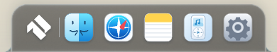

# GLASS-3 – Materialzuverlässigkeit, Skalierung und lokale Diagnose

26.Oktober2026, Basis `f816618f0c5f7f5eba6abb0b55b089b37882c966`, Branch `feat/air-liquid-glass-3`. GLASS-2 wird weitergeführt, nicht ersetzt. Keine neuen Bibliotheken, Cloudanmeldung, Veröffentlichung oder Nutzung privater Daten.

## Tatsächliche Änderungen

- GPU-Einstufung verwendet die optionale unmaskierte Rendererinfo oder, wenn sie fehlt, die normale WebGL-Rendererkennung. Explizite Intel/AMD/NVIDIA/Apple/Adreno/Mali/PowerVR-Hinweise gelten als **Hardware-Kandidat**, nicht als bestandene Abnahme. Softwarehinweise haben Vorrang, unbekannte/generische Angaben bleiben Fallback. Fehlende Debug-Erweiterung allein ist damit kein Ausschluss mehr. Software-Schutz und dreifach abgesicherter isolierter16K-Diagnosepfad bleiben erhalten.
- Kleine Materialien bis DPR3 statt2; große Flächen weiter maximal500.000 Pixel und innerhalb tatsächlicher Textur-/Renderbufferlimits. Gemeinsamer Backbuffer wächst bedarfsweise statt bei jedem Materialwechsel zu schrumpfen. Seine Gesamtfläche ist auf1M Pixel begrenzt (Diagnose32K); bei ungünstigen Seitenverhältnissen wird neu dimensioniert. Material-2D-Puffer werden nur bei Größenänderung neu angelegt, sonst gezielt gelöscht und aus dem belegten Viewportbereich kopiert. Keine zusätzliche Engine oder permanente Renderloop.
- Dekodiertes aktives Wallpaper wird einmal wiederverwendet. Settingsänderungen zerstören nicht mehr pauschal alle Programme/Texturen. Szenenschlüssel berücksichtigt weiterhin Quelle, Overlays, Größe/Position und jetzt DPR. Szenentextur bis DPR2/2880px Breite/4M Pixel; Texturhöhe ebenfalls am GPU-Limit begrenzt. Nur eine dekodierte Quelle, bei Release/Logout entfernt. Vorhandener Material-Zustandsschlüssel verhindert unnötige Transfers.
- Bestehende originale `liquidglass`, `dockglass`, `contourglow` bleiben unverändert portierte Shader aus MacShell-Pin `1bdb51870b621100fd2709f66c8f8e00ab17b9c4`; keine neuen Shaderkopien. Ruhigerer Rim .55/.45 statt .65/.50 ist eine eigene Kalibrierung. Die200ms-OutCubic-Lichtreaktion übernimmt den Interaktionswert des ursprünglichen [MacDock-Navigations-Hovers](https://github.com/0-ss/MacShell/blob/1bdb51870b621100fd2709f66c8f8e00ab17b9c4/MacShell/MacDock.qml#L1377). Feinere Fallbackkontur orientiert sich an dessen CornerBorder, ohne dessen Dockhülle zu übernehmen. MIT-/OFL-Nachweise unverändert.
- Dunklerer, mehrschichtiger CSS-Fallback mit ruhiger Lichtkante und innerer Tiefe. Reduced Transparency/Glass bleiben opak, Forced Colors verwendet Systemfarben. Classic wird nicht umgestaltet.
- Kontrollzentrum → „Anordnung & Desktopwidgets“ → **Materialdiagnose**: lokaler modaler Dialog mit GPU-Kategorie, tatsächlich aktivem Renderpfad, Kontextverlustzähler, DPR, Draws, Dekodierungen, Puffergrößenänderungen und Controller-/Transfer-Walltime. Manuelle Aktualisierung, kein Polling, Escape/Schließen; Entfernung bei Profilwechsel/pagehide. Kein Roh-Gerätename, Wallpaper, Passwort oder Notizinhalt; nichts wird automatisch protokolliert oder exportiert. Hardware-Kandidat ist ausdrücklich keine Zertifizierung. Isolierter Testlauncher prüft denselben Produktpfad mit synthetischem Wallpaper und öffentlichen Testnotizen.

## Backdropentscheidung

Weiter **aktives Wallpaper plus vorhandene eigene Wallpaper-Overlays**, keine Livefensteraufnahme. Chromium bietet hier keinen geprüften verlustfreien, datenschutzfesten DOM-zu-Textur-Pfad. Screen-Capture würde Berechtigungen, vertrauliche Inhalte und laufende Capturekosten einführen; rekonstruiertes HTML wäre kein echter Backdrop. Daher keine neue Aufnahmefunktion implementiert. Diese Grenze ist sichtbar in der Diagnose (`wallpaper-only`).

## Abnahme und Grenzen

Die Messungen stammen aus echtem sandboxed Linux-Electron44/SwiftShader. Reguläre Softwarekonfiguration verwendet CSS; der integrierte WebGL-Pfad läuft nur im vorhandenen ausdrücklich isolierten Diagnosehost. Keine Hardwareabnahme, kein Software-Produktionsversprechen, keine FPS-Behauptung.390px ist ein schmaler Renderer, kein physisches390px-Gerät. DPR2-Prüfung ist ein Renderer-DPR-Test, keine Retina-Hardwareabnahme.

Vorher-/Nachher-Szenen verwenden identische synthetische Profile/Notizen, gespeicherte Widgetpositionen, dasselbe Wolkenwallpaper bzw. ein eigens generiertes Kontrastraster. Die Testuhr ist ausschließlich im CDP-Testrenderer fixiert. Streifen sind technischer Refraktionsnachweis, kein Produktwallpaper.

| Ansicht | GLASS-2 vorher (Software) | GLASS-3 nachher (Software) | GLASS-3 isolierte WebGL-Diagnose |
|---|---|---|---|
| Dock1920 |  |  |  |
| Island390 | [Bild](visual/glass3-before/island-clouds-390.png) | [Bild](visual/glass3-after/island-clouds-390.png) | [Bild](visual/glass3-diagnostic/island-clouds-390.png) |
| Kontrollzentrum1650 | [Bild](visual/glass3-before/control-clouds-1650.png) | [Bild](visual/glass3-after/control-clouds-1650.png) | [Bild](visual/glass3-diagnostic/control-clouds-1650.png) |
| Spotlight1920 | [Bild](visual/glass3-before/spotlight-clouds-1920.png) | [Bild](visual/glass3-after/spotlight-clouds-1920.png) | [Bild](visual/glass3-diagnostic/spotlight-clouds-1920.png) |
| Fenster/Widgets390 | [Bild](visual/glass3-before/window-clouds-390.png) | [Bild](visual/glass3-after/window-clouds-390.png) | [Bild](visual/glass3-diagnostic/window-clouds-390.png) |

Vollständige Aufnahmen/Messungen: [Vorher](visual/glass3-before/report.json), [Fallback](visual/glass3-after/report.json), [WebGL/DPR/Cleanup](visual/glass3-diagnostic/report.json), [App-/Profil-/M1-/M2-Regressionslauf](visual/glass3-regression/r1-gui-report.json). [Lokale Diagnose](visual/glass3-after/diagnostics-clouds-1920.png), [DPR2](visual/glass3-diagnostic/retina-diagnostic.png). Reproduktion mit `scripts/check-glass3.cjs`, bestehendem isoliertem Electron-Testlauncher und `AIR_GLASS_DIAGNOSTIC=1` nur für den gesondert gekennzeichneten Diagnosepfad.

Nativer Windows-/macOS-GPU-/Treiber-/Retina-Test bleibt offen. Keine Pixelgleichheit zum nicht ausführbar verglichenen Qt-Original. Backbuffertransfer ist weiterhin ein WebGL→Canvas2D-Transfer; dessen Walltime ist **keine GPU-Timerquery**. Keine private Fenstertextur und keine pauschale Leistungsfreigabe. main, PRs, Installer, MacLock, Dock-/Islandformen, M1/M2, Apps, Profile, Cloud und PWA bleiben erhalten. GitHub-PR-/CI-API hier HTTP403, kein neuer grüner CI-Lauf behauptet.

## Tatsächliche Testergebnisse

**367/367 Tests bestanden**,0 Fehler/Skips; vier neue Regressionen für konservative GPU-Klassifikation/Software-Vorrang, DPR-/Pixel-/Texturgrenzen, Wiederverwendung und datensparsame Diagnose.149 Laufzeitressourcen, JavaScript-Syntax und Diffprüfung bestanden. Vollständiger bisheriger Electron-App-/Profil-/Neustart-/M1-/M2-/K3-/Reduced-Motion-/WebGL1/2-Ausfalllauf ebenfalls Exit0.

Vorher, Software-Nachher und integrierte Diagnose: jeweils sechs Szenen (drei Größen × zwei Wallpaper), alle Exit0. Dock358×68/bottom0 und Islandtop0 exaktgleich. Maskenalpha0/255/255 für Aussparung/konkaven Fuß/gerade Basis. Refraktion ein/aus: mittlere absolute RGB-Kanaldifferenz im iconfreien Band **17,577 /15,819 /4,779** (1920/1650/390), gleiche Farben/Geometrie/Quelle. [Bildmessdaten](visual/glass3-comparison.json). Alle protokollierten650ms-Ruhefenster:0 zusätzliche Materialdraws. Classic/Kontextverlust:0 Programme/Texturen/Kacheln; Logout/Profilwechsel disposed und kein ausstehender Frame. Kontextverlustzähler tatsächlich1; DPR2 tatsächlich2.

Kumulierte Diagnose vor dem DPR-Test:435 Draws,272 Transfers,**107 Backbuffer-Größenänderungen**,8 Szenenaufbauten,**6 Bilddekodierungen**,60ms gemessene JS-Transfer-Walltime,12.833ms Controller-Walltime inklusive asynchronem Warten/SwiftShader. Die16K-Diagnosekacheln treffen die enge32K-Backbuffergrenze häufiger als reguläre Flächen; Wiederverwendung ist deshalb nicht immer möglich. GLASS-2 dimensionierte den Backbuffer und jedes2D-Canvas bei jedem Transfer neu. Die neuen Zähler belegen die Wiederverwendung, aber **keinen kontrollierten Hardware-Geschwindigkeitsgewinn**. Gesamtzeiten sind workload-/softwareabhängig und keine FPS-/GPU-Zeitmessung. Physische Hardware- und natürliche Retina-Laufzeit bleiben offen.
