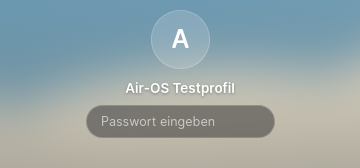
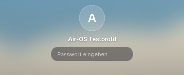
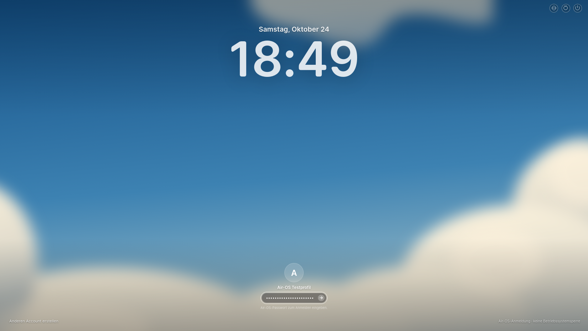
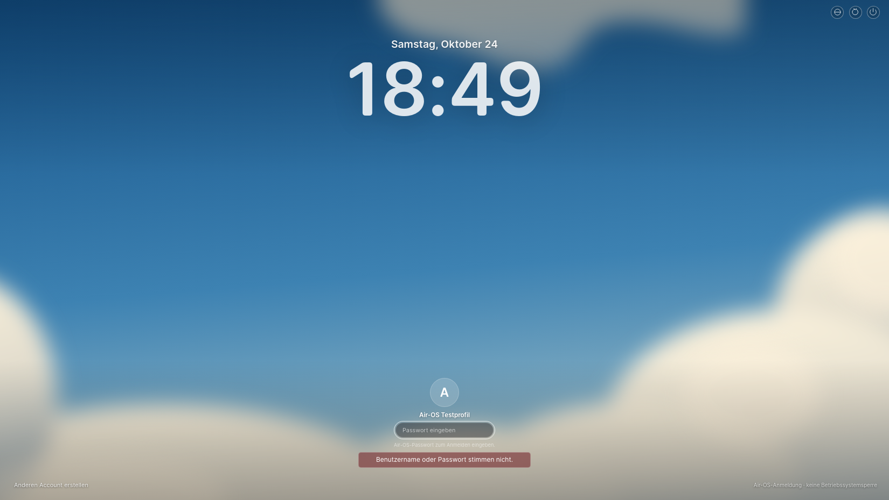
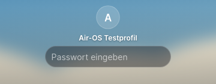
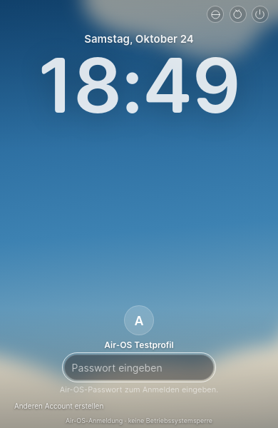
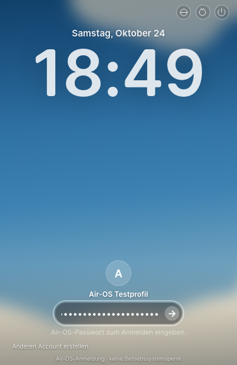
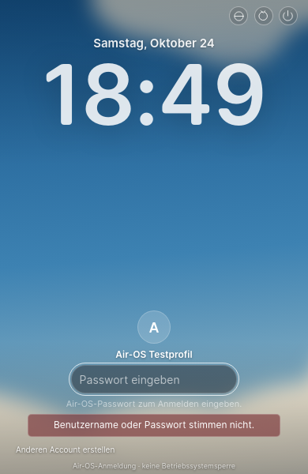
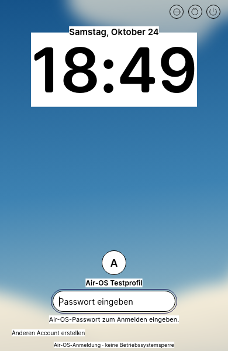

# L1A – MacLock-Grundansicht mit echter Air-OS-Anmeldung

24. Oktober2026. Air-OS-Basis/Remote-HEAD **8834f7f965e1f09581a826a66c2e602e31810f6c** (`fix/air-modern-concave-edge-20261024`), eigener Branch **feat/air-maclock-foundation-l1a-20261024**. Analysierter Originalstand **[1bdb51870b621100fd2709f66c8f8e00ab17b9c4](https://github.com/0-ss/MacShell/tree/1bdb51870b621100fd2709f66c8f8e00ab17b9c4/MacLock)**. Keine freie Lockscreen-Neugestaltung: die unten ausgewiesenen Formeln, Typografie-, Positionierungs- und Fallbackwerte stammen aus dem Originalcode.

## Ergebnis und klare Phasengrenze

Die vorhandene `login.html` für Start/Abmelden zeigt jetzt MacLocks große Uhr, Datum, Wallpaper, unteren Profilbereich und Passwortfeld. Echte Kontoanlage/Anmeldung verwenden weiterhin ausschließlich die bestehenden `airOS.accounts`, `createAccount` und `login`-Bridges. `main.cjs`, `preload.cjs`, Passwort-Hashing, IPC-Vertrauensprüfung und Speicherung wurden nicht verändert. Ein erfolgreiches Renderer-Ergebnis öffnet nicht selbst den Desktop: ausschließlich der bestehende Main-Prozess darf nach bestätigter Authentifizierung navigieren.

**Dies ist eine Air-OS-Anmeldung, keine Windows-/macOS-Systemsperre.** Keine Betriebssystempasswörter, PAM-/Wayland-Sitzungssperre, globalen Tastaturhooks oder neue IPC-Endpunkte. Kein zusätzlicher Qt-/Quickshell-/Hyprland-Prozess. Das bestehende Ausblenden/Wecken und Neustarten/Beenden betrifft ausdrücklich nur Air-OS. Die bisherigen pauschalen100%-/WLAN-Anzeigen ohne echte Datenquelle wurden aus dieser Anmeldeansicht entfernt.

L1A implementiert nur die ruhende Grundansicht und native Eingabe. **L1B-Shader, Fokus-Blur, Eingangs-/Ausgangs-/Morpheffekte sowie L1C-Musik/Albumcover/Lyrics sind nicht implementiert.** Darum existieren keine vorgetäuschten Musik-/Lyrics-/Animationszwischenbilder. Der fokussierte Screenshot dokumentiert ausdrücklich den aktuellen L1A-Zustand **ohne zusätzliche Fokusunschärfe**. Die bestehende Island-Demo bleibt unverändert und ist kein MacLock-Player.

## Prüfung des Originals und Lizenznachweise

Root-Lizenz des geprüften MacShell-Stands: **MIT, Copyright (c)2026 Rickky**. Keine abweichenden Copyright-/Lizenzheader in den gelesenen MacLock-QML-/JS-/Shader-/Shell-/Python-Quellen gefunden. Abweichung: die beiden Schriftdateien haben eigene Metadaten **Copyright2023 Laurids Kern**. Sie wurden deshalb unabhängig mit Open Runde geprüft: [Upstream3e7ed7f3cdfa5523766db7e430066472615fc935](https://github.com/lauridskern/open-runde/tree/3e7ed7f3cdfa5523766db7e430066472615fc935), `src/desktop`, **SIL OFL1.1**, abgeleitet von Inter (Copyright2016 The Inter Project Authors). Beide OTFs sind bytegleich zwischen MacLock und diesem Upstream. Die OFL wird nicht als MIT ausgegeben.

- [MacShell-MIT-Originaltext](../third_party/maclock/LICENSE), vollständig und unverändert übernommen.
- [Open-Runde-OFL-Originaltext](../third_party/maclock/OpenRunde-LICENSE.txt), vollständig und unverändert übernommen.
- [Copyright-/Übernahmehinweise](../third_party/maclock/NOTICE.md), einschließlich Laurids Kern und Inter.
- [Originaldatei-Inventar mit SHA256 und tatsächlichem Übernahmestatus](../third_party/maclock/SOURCE_MANIFEST.json).

| Direkt kopierte Schrift | SHA256 |
| --- | --- |
| OpenRunde-Regular.otf | `8398c8adfc2b41a21cd1c0e00dbbd81c2ce3877cc5c9843bebd3e0b7b43cfbcc` |
| OpenRunde-Semibold.otf | `39d6c706cfbb9cad2a7ea2bfdbe12c4384185d8625a21208a39cbdfe1ea1790c` |

Die Schriften sind unverändert und werden nur zusammen mit der App ausgeliefert. Keine fremden Wallpaper, Apple-Logos, Albumcover, Screenshots oder Lyrics kopiert. `maclock-wallpaper.svg` ist bytegleich aus dem bereits vorhandenen originalen Air-OS-`AIR_MODERN_CLOUDS`-Vektor extrahiert, nicht aus MacShell. Drei reine Ressourcen-Einträge in `package.json/build.files` gewährleisten die Auslieferung von Layoutmodul, Wallpaper sowie Schriften und Lizenztexten. Installer-Ziele/-Optionen, Abhängigkeiten, Workflows, Builds und Releases unverändert; kein Installer erzeugt.

## Tatsächliche Übernahmen / Portierungen

Alle Originalverweise beziehen sich auf den festgehaltenen Commit, nicht einen beweglichen HEAD.

| Originaldatei / Funktion | Übernahme in Air-OS | Anpassung und Grund | Treue / offene Abweichung |
| --- | --- | --- | --- |
| `MacLock/LockScreen.qml:16`, Skalierung | Formel direkt in `maclock-layout.js` portiert: `u=max(0.6,height/1200)` | Qt-Property wird JS-Funktion und CSS-Variable; rein testbar, kein zweiter Rendererzustand | Nominale Werte exakt gleich |
| `LockScreen.qml:490–558`, Clock/Datum | Uhr y=`0.075*height`, Standardgröße176u, Datum25u, Abstand−14u, Laufweite−1.5u, Gewicht680; H:mm ohne AM/PM portiert | DOM/Intl ersetzt Qt/MorphText, lokale echte Uhr; `date` bewahrt das Originalmuster `dddd, MMMM d` mit lokalisierten Namen | Formeln exakt; Qt- und Chromium-Zeilen-/Rastermetriken nicht durch eine Originalausführung verglichen |
| `shell.qml:18–19`, FontLoader | Zwei Original-OTF-Dateien direkt kopiert, lokale `@font-face` | Kein FontLoader im Browser; eigenes Font-CSP ohne Remotequelle | Originale Open-Runde-Fallbackfamilie; optionales systemseitiges Nunito wird in L1A nicht vorausgesetzt. Statische Semibold-Datei hat keine variable680-Achse |
| `LockScreen.qml:623–628`, Uhr-Fallback | Weiß85% übernommen; Schattenwerte8u/64u/22% aus dem benachbarten Schattenblock | CSS-Textschatten statt Qt MultiEffect; kein Glas-Shader in L1A | Originalwerte erhalten, Blur-Kernel nicht als pixelgleich behauptet; L1B |
| `LockScreen.qml:39–55,147–157`, Wallpaper/Vignette | PreserveAspectCrop→CSS cover; Stops0/.35/.72/1, Schwarz22%/0/0/30% | Bestehendes eigenes lokales Air-OS-Wolkenbild statt Linux-Wallpaperpfad/Videoabfrage | Skalierungsprinzip/Stops gleich, Bild bewusst Air-OS-eigen; keine privaten Preferences vor Anmeldung gelesen |
| `LockScreen.qml:1370–1445`, Profil | Unterer Abstand78u, vertikaler Abstand10u, Avatar70u mit Ruhezustand0.94, Name15u, transparenter Initialen-Fallback16%, Kontur22% | Öffentlicher Air-OS-Profilname und erster Buchstabe, `textContent`; keine Linux-AccountsService-Dateien | Nominale Größen/Anker gleich; Air-OS besitzt hier keine authentifizierte Fotoquelle |
| `LockScreen.qml:1445–1460,1510–1518`, Passwort |210u/236u Breite,36u Höhe,14u Text,16u Innenabstand; Submit24u und6u Außenabstand portiert | Echtes `input[type=password]` statt QML-gezeichneten Passwortpunkten; IME/Autofill/Tab nativ | Größe im Desktop exakt; native Punkte und Fokusrahmen weichen ab; Punktmorph L1B |
| `Glass.qml:28–35`, dokumentierter Shader-Fallback | RGBA(.12,.12,.14,.45),1px/18%-Kontur und Pillenradius portiert | QSB ist nicht in Electron ausführbar; L1A nutzt ausdrücklich den Original-Fallback | Kein behaupteter Liquid-Glass-/Refractions-Effekt; L1B |
| `shell.qml:56–160`, State/Auth | Uhrintervall1s, Busy-/Leereingabe-Schutz als DOM-Controller portiert | Auth bleibt bestehende Air-OS-API; keine PAM-/unlockTimer-Übernahme. Uhr bei hidden/pagehide pausiert, Secrets entfernt | Authsemantik sicher angepasst; keine künstliche430ms-Entsperrung |
| `LockScreen.qml:1665–1700`, Eingabe | Body-Tippen fokussiert das echte Feld, Escape und Ctrl+U leeren, reale Caps-Lock-Keyevents | Natives Textfeld statt globalem QML-Key-Collector; keine Tastaturfalle. Leertaste/Tab für echte Buttons | Wesentliche L1A-Bedienung erhalten; kein globales OS-Keyhook/9s-Idle-Timer |

Die übrigen Module wurden für die Folgephasen analysiert, **nicht** als neue Laufzeit kopiert: `MorphText.qml` (zwei Textlagen, OutQuint/OutCubic, Fade/Scale/Blur), `MorphGlyph.qml`, `Glyph.qml`/`ClockGlyph.qml`, `ContourGlow.qml`/`contourglow.frag`, `liquidglass.frag`, `glasstext.frag`, `burn.frag`, `fade.frag`, `ripple.frag`; in `LockScreen.qml` Medien-Slots/Drag/Artwork-/Lyrics-Zustände, Benachrichtigungen und Live-Aktivitäten; in `shell.qml` PAM/Wayland-/Monitor-/Linux-Datei-/Prozesszugriffe. `genius-lyrics.py` und `spotify-canvas.py` sind externe Netz-/Scraperpfade und werden nicht für Demo-Daten übernommen. `lock-via-ipc.sh`, `enable-sleep-lock.sh`, `hyprland.lua`, Shader-Build/QSB und pyc bleiben Linux-/Qt-spezifisch und werden nicht ausgeführt/gebündelt.

## Sicherheit und Air-OS-spezifische Anpassungen

Bestehende Benutzerkonten, Kontoanlage und Fehlermeldungen bleiben erreichbar. Keine zweite Nutzer-/Settings-Datenbank. Mehrere Konten werden weiterhin anhand der bereits öffentlichen Accountliste auswählbar angezeigt; das ist eine zusätzliche Air-OS-Funktion gegenüber dem einzelnen Linux-Benutzer im Original. Accountnamen/Initialen ausschließlich `textContent`; kein dynamisches Metadaten-HTML. Eingabefelder bleiben wirkliche Passwortfelder, keine Klartextdarstellung oder Speicherung in LocalStorage/Events/Logs. Während einer Authentifizierung werden Doppelrequests, Konto- und Moduswechsel verhindert. Fehler leeren das Passwort und erlauben Retry. Pagehide verwirft verspätete Account-/Auth-UI-Antworten und räumt neue Listener/Uhrtimer auf.

Ohne authentifizierte Sitzung wird keine private Preference gelesen. Die Anmeldeuhr nutzt deshalb MacLocks Standard24h; gespeicherte12h-/Classic-/Dock-/Wallpaper-Auswahlen werden nicht überschrieben und gelten nach Anmeldung unverändert. Die Oberfläche erscheint bei Start und nach bestehendem Abmelden; sie sperrt keine laufende Desktop-Sitzung durch einen bloßen Overlay-Trick.

Auf390px verbleiben originale Uhr-/Avatar-/Ankerwerte, aber das native Passwortfeld hat mindestens210×36px, Text14px, Submit24px, Name12px und Hinweis11px. Dies ist eine explizite Bedienbarkeitsanpassung gegenüber dem nur126/141.6×21.6px großen Originalfeld bei u=.6. Auf größeren Viewports keine solche Mindestgrößenanpassung. Kontowahl ist begrenzt vertikal scrollbar; keine Konten werden gelöscht/versteckt unzugänglich gemacht. Eigene App-Aktionsbuttons oben rechts und Kontoanlage-/Sicherheitsbeschriftung unten sind Air-OS-Zusätze, keine vorgetäuschten Hardwarewerte.

## Tatsächliche Tests und Screenshots

**258/258 Tests bestanden**,0 Fehler/Skips: vorher248 plus10 neue L1A-Regressionen. Geprüft: Originalformeln/Zeit-/Datumsformat, öffentliche Namen und sichere Darstellung, Doppelrequest/Profilwechsel während pending Login, Fehlversuche/API-Fehler/Retry, leeres erstes Profil/Kontoanlage/Passwortmismatch, Accountladefehler, Tastatur/Escape/Caps Lock, Uhr hidden/pagehide, verspätete Antworten/Secret-Cleanup und Ressourcen-/Font-SHA-/Lizenzverträge. Sämtliche vorhandenen Notes-/Reminders-/Profil-/M1-/M2-/Dock-/Registry-/Runtime-/Dateisicherheitstests erhalten.

Echter Linux/Electron32.3.3/Chromium128-Renderer unter authentifiziertem Xvfb, Chromium-Sandbox aktiv, GPU aus, DPR1, synthetische Wegwerfkonten. Kein nativer Windows-/macOS-Nachweis.1920×1080,1650×930,390×600 sind tatsächlich gerenderte Electron-Viewports; die390px-Prüfung behauptet kein natives Windows-Fenster unter dessen Mindestbreite.

Finaler Helfer `scripts/check-maclock-l1a.cjs` Exit0: echte UI-Kontoanlage, falsches Passwort über Enter → sichtbare Fehlermeldung/kein aktueller Benutzer/Notes-Zugriff verweigert; echte erfolgreiche Anmeldung per Submit; Tab/Shift+Tab/Escape/Tippen, fokussierbares natives Passwortfeld. App-Start über Startmenü/Suche, Notes-Minimize-/Dock-Restore im Reduced-Motion-Smoke, Air Home, Island/K3, Classic/Modern. Zweites Testprofil sieht keine Notizen des ersten; erneute Anmeldung erhält eigene Notizen. Gespeicherte Classic-/Dock-Classic-/12h-Auswahl und Pins einschließlich unbekannter Referenz bleiben nach Logout/Re-Login erhalten. Reduced Motion, Forced Colors und appinternes Ausblenden/Wecken geprüft. Keine Remote-Assetanfrage oder Rendererfehler. M1/M2-Animationscode ist unverändert und seine gesamte deterministische Suite bestanden; keine neue Zwischenframe-/native Plattformabnahme behauptet.

Die erste GUI-Probe deckte ein Eingabeproblem des generischen `system-ui`-Schriftstapels dieser Linux-Umgebung auf. Kontoanlage zurück auf ihren bisherigen -apple-system/Segoe-UI/Helvetica/Arial-Stapel; erneute echte Eingaben/Kontoanlage bestanden. Nur die MacLock-Elemente nutzen die geprüften lokalen Open-Runde-Fonts.

Syntaxchecks für login.js/maclock-layout.js/GUI-Helfer, Catalina-Konfigurationscheck und Diff-Check bestanden. Catalina-Konfigurationscheck ist keine macOS-Ausführung. PR-/Actions-API Forbidden; kein neuer GitHub-CI-Erfolg behauptet.

### Messwerte

`getBoundingClientRect()` bzw. echte Text-Range-Rects, CSS-Pixel. Avatarwerte berücksichtigen den originalen Ruhefaktor. Alle Boxen vollständig im Viewport; keine horizontale Überbreite. Die Text-Rangebreite hängt von der tatsächlich angezeigten Uhrzeit ab und ist kein fixierter Sollwert.

| Viewport | u | Datum/Uhr-Anker y | Uhrschrift | Profilabstand unten | Avatar gerendert | Passwort idle B×H | Passwort fokussiert B×H |
| --- | --- | --- | --- | --- | --- | --- | --- |
| 1920×1080 | 0.9 | 81.00 | 158.40px | 70.19px | 59.22×59.22px | 189.00×32.39px | 212.39×32.39px |
| 1650×930 | 0.775 | 69.75 | 136.40px | 60.44px | 50.99×50.99px | 162.75×27.89px | 182.89×27.89px |
| 390×600 | 0.6 | 45.00 | 105.60px | 46.80px | 39.48×39.48px | 210.00×36.00px | 210.00×36.00px |

[Rohdaten / tatsächliche Geometrie, Fokuszustand, geschützte Desktopmaße](visual/maclock-l1a-measurements.json).

### Originalvergleich – konkrete Blockade

`qs` ist nicht installiert; vorhandene qml/qmlscene-Befehle sind Qt-Chooser ohne ausführbare Qt-Installation (`could not find a Qt installation`). Kein Quickshell/Hyprland/Wayland-Lock-Compositor. Daher **keine Original-MacLock-Ausführung**. README-Referenzbilder wurden versucht:

- [Original Lockscreen](https://github.com/user-attachments/assets/6ef28e50-612f-4e7b-9822-c0aa0168a6ae): HTTP403, auch `?raw=true`.
- [Original Player-Referenz im README](https://github.com/0-ss/MacShell#maclock): öffentlich verlinkt; keine hier verifizierte Bildansicht.

Kein Bild aus dem Original wird als hier ausgeführt oder visuell vermessen ausgegeben. Deshalb ist ein direkter Original-/Port-Pixeldiff **BLOCKIERT**. Die vorliegenden Bilder werden gegen die gelesenen Originalformeln/Anker/Farben geprüft; Shader-/Raster-/Fontmetriken gegenüber einem ausgeführten Original sind noch nicht visuell bestätigt. Bei später verfügbarer Originalvorschau oder rechtmäßig bereitgestellten Originalscreenshots wird L1D genau diesen Vergleich nachholen. Keine Pixelgleichheit behauptet.

### Direkt sichtbare echte Electron-Aufnahmen

17PNG-Dateien, unverändert aus dem tatsächlichen Renderer bzw. direkte Ausschnitte. Nur synthetische Konten/Passwörter, keine privaten Inhalte. „Fokus“ bedeutet in L1A nativer Fokusrahmen und aktive Feldbreite, **noch kein Fokus-Blur**. „Passworteingabe“ zeigt ausschließlich native Maskierungszeichen. Für Musik/Lyrics/Animationen keine erfundenen Screenshots; diese gehören L1B/L1C.

| Viewport | Uhr / Wallpaper / Anmeldung | Profil-Detail | Feld fokussiert | Maskierte Eingabe | Bestätigter Fehler |
| --- | --- | --- | --- | --- | --- |
| 1920 |  |  |  |  |  |
| 1650 |  |  |  |  |  |
| 390 |  |  |  |  |  |

| Forced Colors390 | Kontowahl390 |
| --- | --- |
|  |  |

## Folgende kleine Phasen – nur dokumentiert

### L1B – Originalmaterialien und Bewegungen portieren

1. **L1B.1 Glass-/Clock-Shader:** `Glass.qml`/`liquidglass.frag` und `glasstext.frag` mit originalen Uniformwerten nach WebGL2 übersetzen. Qt440/QSB-Bindings, qt_Matrix und ShaderEffectSource durch Browser-Uniforms, lokale Wallpaper-/Glyph-/Height-Map-Texturen ersetzen; keine Qt-Binaries. Originaluhr: Intensität0.6, Refraction `(6+4*(1-intensity))*u`, Bevel4.5, Licht−.6/−.8. Original Glass-Thickness18, Tint.50, Shadow.4 für Passwort. Lizenz-/Shaderhash und jede Anpassung ergänzen. Fallback/Forced Colors/Reduce Glass messen, ohne eine Bibliothek einzuführen.
2. **L1B.2 Entry/Fokus:** Original650ms OutQuint für Opacity/Positions-/Wallpaper1.09→1.0; Aktivierung MultiEffect blurMax48/blur.55 und650ms, Passwortbreite450ms OutQuint. CSS-Blur ist nicht automatisch äquivalent zu Qt-MultiEffect; Endzustand/Kernel im realen Vergleich kalibrieren. Original-OutQuint als `1-(1-t)^5` oder exakt gesampelte WAAPI-Easingkurve abbilden. Exitwerte420/520/380/300/260ms dokumentiert übernehmen, aber Main-Authentifizierung nicht für eine künstliche Animation verschieben oder umgehen.
3. **L1B.3 Morph/Unterbrechungen:** `MorphText.qml` für Uhr560ms, Scale1.03/.97, zwei Lagen; Passwortpunkt-/Shake-/Caps-/Submit-Morphs aus dem Original. Laufende Zeitpositionen/Generation-Cleanup, schnelle Richtungswechsel, Escape/Fokus/IME; Reduced Motion sofortige stabile Endwerte. Zwischenframes bei25/50/75% tatsächlich aufnehmen. Keine M1/M2- oder zweite Island-Animationsverwaltung ändern.

### L1C – originaler Demo-Player, Artwork und Lyrics

1. **L1C.1 Medien-Bubble:** Original372u×150u, erweiterte Höhe138u; Cover58u und Radius11u; Titel15u/Künstler13u, Bar5u/hover8u, eigene eindeutig beschriftete Demo-Titel/Künstler/Bilder. Keine MPRIS-/Spotify-/Systemsteuerung vortäuschen. Die bestehende Island-Demo nicht als neue echte Quelle ausgeben.
2. **L1C.2 Artwork/Slots:** Originalzustände `""`, `art`, `lyrics`, `artlyrics` und Cover-Tap-Übergänge; großes Cover372u/Radius28u, Abstand24u. SlotTop aus Clock-Endlage +22u, SlotBottom vor Login−26u. Drag mit originalem Rubberband `sqrt(delta)*7` und650ms OutQuint, Hand-over1100ms InOutCubic / Hintergrund650ms OutCubic. Original-Burn-/Ripple-Shader erst nach separater Browserport-Prüfung, kein ungeprüftes Canvas/Videoasset.
3. **L1C.3 Lyrics:** Nur eigene Demozeilen. Breite min(Viewport−80u,620u), Höhe min(.42*H,440u), originaler Zielpunkt30% und gefiederte Fade-Maske. Große Cover-/Side-by-side-Geometrie, Scroll-/Tap-Hitbereiche und No-lyrics/Instrumental-Zustände wirklich testen. `fade.frag` portieren, keine Genius-/Spotify-Canvas-Scraper oder fremden Texte übernehmen.

### L1D – nachweisliche visuelle Abweichungen korrigieren

Ausgeführtes Original oder tatsächlich erreichbare, rechtmäßig nutzbare Originalaufnahmen beschaffen; Commit, gleiche Uhrzeit/Locale/Wallpaper/Fontkonfiguration/Viewport/DPR dokumentieren. Erst dann Vergleich Uhr/Profil/Password/Glass sowie Media/Lyrics und Zwischenframes. Je Einheit nur eine bewiesene Abweichung (z.B. Qt-/Skia-Zeilenhöhe oder Shader-Bevel) korrigieren. Gegenwärtige Originalblockade und390px-Mindestgrößen separat ausweisen. Keine eigene Bildrekonstruktion als Originalbeleg verwenden.

### L1E – Integration und Plattformregressionen

Native Windows-/macOS-Tests mit Skalierung, Schriftmetriken, IME/Autofill/Keyboard, reduzierte Bewegung und hoher Kontrast. Auth-/Profil-/Fehler-/Pending-/Logout-Grenzen und alle bestehenden Apps/Prefs/Classic/M1/M2 erneut prüfen. Ein appinterner Sperr-/Resume-Einstieg für eine laufende Sitzung benötigt einen gesonderten authentifizierten Backend-Vertrag; ein kosmetischer Overlay allein ist keine sichere Sperre. Echte OS-Sperre separat planen: Windows unterstützte native Sitzungssperr-API (z.B. LockWorkStation) nur im Host, macOS unterstützten Systemmechanismus und Berechtigungen konkret prüfen. Niemals OS-Kennwörter sammeln, keine beliebigen Shellkommandos als API akzeptieren und keinen fehlenden Systemschutz vortäuschen. Keine solche OS-Integration in L1A.

## Grenzen / Abschluss

Noch offen: Original-Vorschau und Referenzbilder, L1B/L1C-Materialien/Animationen/Player, native Windows/macOS, CB-03 sowie bestehende Audit-/Signing-/Notarisierungsblocker. Die ursprünglichen Desktopdateien einschließlich Dock-/Island-CSS und app.js/air-island.js/Notes-/Home-Code sind unverändert; Classic-Desktop und bestehende gespeicherte Profile bleiben erhalten. Nur appinterne Anmeldeoberfläche und erforderliche lokale Ressourcen geändert. main, bestehende PRs und Installerbranches unverändert. Keine Release-/Installererstellung.

Nächste drei getrennte Einheiten: **L1B.1 Shader-/Materialport**, **L1B.2 Entry/Fokus**, **L1B.3 unterbrechbarer Morph**. Erst nach eigenem Auftrag; nach L1A-Commit/Push STOP.
