# L1B.1 – MacLock Liquid Glass in WebGL2

24.Oktober2026. Verifizierter Air-OS-Ausgangscommit **044a727224667f8a882372e2c86e6931770d0216**, Branch `feat/air-maclock-foundation-l1a-20261024`. Eigener Branch **feat/air-maclock-liquid-glass-l1b1-20261024**. MacShell-Original erneut geprüft: HEAD unverändert **1bdb51870b621100fd2709f66c8f8e00ab17b9c4**. Vorherbasis ist ein unveränderter detached Worktree dieses L1A-Commits.

## Ergebnis und Umfang

Die große Uhr und das Passwortfeld der bestehenden Air-OS-Anmeldung erhalten jetzt echte **WebGL2-Materialshader**. Die Uhr verwendet Glyphen-Coverage plus weichgezeichnete Height Map; daraus werden Oberflächennormale, Hintergrundversatz, Dispersion, Frost/Tint und Beleuchtung berechnet. Das Passwortfeld nutzt die originale Rounded-Box-Distanzfunktion, Squircle-Bezel, Snell-Brechung mit Glasindex1.5, Mehrkanal-Abtastung, Linseneffekt, Kantenlicht, Meniskus, Grain und Schatten. Es ist keine bloße `backdrop-filter:blur()`-Optik.

**Nur L1B.1:** keine Wallpaper-Zoom-/Entry-/Exit-/Fokus-Blur-Animation, kein Clock-/Password-Morphing, keine Musik oder Lyrics. Die bestehende statische L1A-Eingabe-/Fokusgeometrie und das originale Air-OS-Wolkenmotiv bleiben. Authentifizierung, Konten und Speichern unverändert; weiterhin appinterne Anmeldung, keine Betriebssystemsperre.

## Tatsächliche Originalübernahme und Lizenzen

- [Original liquidglass.frag, unverändert kopiert](../third_party/maclock/original/liquidglass.frag).
- [Original glasstext.frag, unverändert kopiert](../third_party/maclock/original/glasstext.frag).
- [GLSL-ES300-Port / WebGL2-Shader](../maclock-shaders.js): **Fragment-Hilfsfunktionen und main-Rechenwege exakt erhalten**, einschließlich aller24 Golden-Angle-Samples, Gradient-/Snell-/Dispersion-/Tint-/Rim-/Grain-Gleichungen. Automatischer Quellvergleich schützt diese Aussage. Einzige Änderung in Clock-Rechenweg: Variablenname `refract`→`refractPx`, um die globale ES-Uniform nicht mit dem eingebauten Funktionsnamen zu kollidieren.
- Qt440-In/Out- und std140-Bindings durch ES300-Precision, einzelne Uniforms/Sampler ersetzt; unbenutztes `qt_Matrix` entfällt, `qt_Opacity` wird1. Vertex-/Viewport-/Premultiplied-Alpha- und Texturverwaltung ersetzt QML/ShaderEffectSource; kein QSB/Qt-Prozess.
- [Materialrenderer / DOM-Lifecycle](../maclock-glass.js): Parameter aus `Glass.qml` und `LockScreen.qml`, lokale Szene/Maske, Ressourcenbesitz und Fallback-Steuerung. Keine Auth-/Preferences-/Passwort-API wird aus diesem Modul gelesen.
- [MIT-Lizenz, Copyright(c)2026 Rickky](../third_party/maclock/LICENSE) vollständig erhalten; [NOTICE](../third_party/maclock/NOTICE.md) und [Datei-SHA-/Übernahmestatus](../third_party/maclock/SOURCE_MANIFEST.json) aktualisiert. Originalfonts unverändert, separate [SIL-OFL1.1](../third_party/maclock/OpenRunde-LICENSE.txt) und Copyright Laurids Kern/Inter erhalten.

Keine neue Bibliothek/Dependency, kein fremdes Wallpaper/Asset und kein Qt-Frameworkcode übernommen. `package.json/build.files` ergänzt ausschließlich die zwei benötigten lokalen JS-Ressourcen; die bereits vorhandene Third-Party-Glob schließt die Auditshader/Lizenzen ein. Installerziele, Optionen, Workflows, Abhängigkeiten und Releases unverändert; kein Installerbuild.

## Originalwerte → tatsächliche Uniforms

| Bestandteil | Originalvorgabe / Rechnung | WebGL2-Wert |
| --- | --- | --- |
| Clock | Material Glass, Intensity0.6, Bevel4.5, Tintweiß | `mode=1`, `intensity=.6`, `bevel=4.5`, `tint=[1,1,1,1]` |
| Clock-Brechung | `(6+4*(1-intensity))*u` |6.84 /5.89 /4.56px bei1080/930/600H |
| Clock-Licht | ursprünglicher Ruhewert | `lightDir=[-.6,-.8]`; keine neue Pointer-/Lichtanimation |
| Clock-Maskenpadding | `max(48*u,clockPx*.5)` |79.2 /68.2 /52.8CSS-px |
| Height Map | blurMax16, blur=`clamp(clockPx*.04/16,.12,.6)` | Kernelunterstützung6.336 /5.456 /4.224CSS-px |
| Szenetextur | gerundete halbe Breite/Höhe |960×540 /825×465 /195×300, mit Mipmaps |
| Szenen-Preblur | blurMax32, blur0.35 | Gauß-Kernelunterstützung11.2Texel, siehe Abweichung unten |
| Passwort-Thickness |18; `Glass.qml` multipliziert×1.6 | `thickness=28.8`; Shader berechnet weiteren Faktor1.35 originalgetreu |
| Passwort-Tint |0.50; `Glass.qml` multipliziert×.55 | `tintMix=.275` |
| Passwort-Schatten |0.4 | `shadowAmt=.4` |
| Weitere Glass-Uniforms | Original-Glass.qml | pad10, radius=H/2, bezel=min(H*.36,26), dispersion=.078, magnify=.08, rim=.5, grain=.006, blurPx1.5, saturation1.25, dark1, debug0 |

Die Basiswerte18/0.50 werden somit **nicht fälschlich als bereits transformierte Shaderuniforms** eingesetzt. Alle Übertragungsfaktoren stammen ebenfalls aus dem Original. Fragment-Hauptverfahren sind unverändert; die Qt-spezifische Zuleitung ist gezielt portiert.

## Texturen, DOM und technische Abweichungen

Eine dekorative, nicht klickbare WebGL2-Canvas rendert zwei Materialquads. Das echte native Passwortfeld, Submit, Fokusrahmen und Profile bleiben DOM-Controls darüber; nichts wird durch Canvas-Textfelder oder neue Authlogik ersetzt. Der Renderer liest ausschließlich die öffentliche Uhrzeit, ihre Fontmetriken und Elementrechtecke sowie das eigene lokale Wallpaper. **Weder Passwortwerte noch Nutzernamen, Notizinhalte oder fremde Profildaten werden als Textur aufgenommen.** Keine DOM-Screenshots oder Profil-APIs als Hintergrundquelle.

Die Szene wird wie im Original halbiert, per Cover skaliert und mit der unveränderten22%/0/0/30%-Vignette versehen. Uhrmaske: vorhandene Open-Runde-Familie, Gewicht/Größe/Laufweite und tatsächliche Text-Range-Metriken; Canvas2D rastert die Glyphen, eine zweite Alpha-Textur dient als Height Map. Quellen sind lokale Canvas-Texturen, anschließend echte GPU-Passes. Kein CSS-Backdrop-Filter im neuen Materialpfad.

**Explizite Anpassung:** Qt MultiEffects private Blur-Pyramide ist keine direkt ausführbare Browserfunktion. Vorfilter und Height Map verwenden deshalb zwei separable GPU-Gauß-Passes, Kernelunterstützung=`blurMax*blur`, Sigma=Unterstützung/3, normalisierte Gewichte, geclampte Ränder. Die originalen normierten Steuerwerte bleiben erhalten, aber der Kernel ist **keine nachgewiesen pixelgleiche Qt-MultiEffect-Reproduktion**. Diese verbleibende Kalibrierung braucht ein ausführbares Original. Font-Antialiasing, Farbraum-/Treiberunterschiede und Viewport-Pixelrundung können ebenfalls abweichen. DPR wird für Canvas/Glyphen bis2 berücksichtigt, höhere Werte werden zum Ressourcenlimit bei2 gerastert; CSS-Geometrie bleibt unverändert. Tatsächliche GUI-Belege hier DPR1.

Das ursprüngliche Clock-Licht liegt statisch oben links. Pointer-Nachführung mit900ms-Übergang und andere Bewegungen gehören einer späteren Interaktionseinheit, nicht diesem Materialport. CSS-Textschatten aus L1A bleibt unter der Uhr; Feldschatten kommt aus dem Originalshader.

## Reduktion, Ausfall und Ressourcen

Der CSS-Fallback wird erst nach einem vollständig gültigen Draw durch das WebGL-Material ersetzt. Bei fehlendem WebGL2, Shader-/Framebuffer-/Textur-/Drawfehlern, Context Loss oder Assetfehlern bleiben die ursprüngliche DOM-Uhr und native Anmeldung sichtbar/bedienbar. CSS-Fallback ist der originale L1A-Flachfallback, nicht als aktives WebGL ausgegeben. Bei Kontextverlust bleibt die Ansicht sicher im Fallback; erneutes Aktivieren über den Glas-Schalter erstellt einen frischen Kontext. Kein Stale-Callback darf eine neue Oberfläche verändern.

`forced-colors`, `prefers-reduced-transparency`, `prefers-contrast:more` und vorhandene `air-reduced-glass`-Klassen deaktivieren die GPU-Schicht. „Glas reduzieren“ ist ein **flüchtiger, per Tastatur erreichbarer Schalter nur für diese Anmeldung**, `aria-pressed`, ohne neue Preference/Storage. Er erzeugt eine deckende Feldfläche; Forced Colors nutzt Systemfarben. Systemvorgaben können damit nicht überstimmt werden. Private profilbezogene Preferences sind vor Anmeldung gesperrt und werden nicht ausgelesen; die bestehende gespeicherte Profilwahl wird nicht überschrieben. Reduced Motion bleibt erhalten; Materialpfad hat keine neue Animation oder laufenden Animationsloop.

Rendering nur bei relevanter Uhränderung/Geometrie/Font-/Darstellungszustand, ein coalesceter RAF; keine neue Hintergrundabfrage oder Dauer-RAF. Bei verstecktem Dokument werden GPU-Ressourcen ebenfalls freigegeben; sichtbares Dokument kann neu erzeugen. Auf `pagehide` disconnecten Observer, Listener einschließlich alter Canvas-Context-Handler werden entfernt, RAF verworfen, Assets abgekoppelt und Programme/Shader/Texturen/Puffer/Framebuffer/VAO zerstört. Optionaler `WEBGL_lose_context` beendet den eigenen Kontext zusätzlich. Verspätete Asset-Promises und Kontext-Callbacks sind abgegrenzt. Ein aktiver Renderer besitzt3 Programme/3 Texturen/1Buffer/1Framebuffer/1VAO,0 verbleibende Shaderobjekte; nach Freigabe alles0.

## Tatsächliche Prüfungen

**268/268 Tests bestanden**,0 Fehler/Skips: zehn neue Materialregressionen zusätzlich zu258. Quellparität/Originalhashes, Uniformwerte, begrenzte Texturanzahl/Idempotenz, fehlgeschlagene Kompilierung/Allokations-/Framebuffer-Passes, sichere Fallback-Aktivierung, alle Reduktionsmedien, versteckte Seite, Pagehide, verspätete Assets, ausrangierte Context-Loss-Handler und CSS-/Paketisolation geprüft. Bestehende Auth-, Profil-, Notes-, Home-, Registry-, Runtime-, Datei-, Classic-, M1-/M2-Regressionen erhalten. Syntax/Catalina-Konfiguration/Diff geprüft; kein nativer Catalina-Test.

### Echte Electron-Läufe

Linux Debian13 x64, Electron32.3.3/Chromium128, authentifizierter Xvfb, aktiver Chromium-Sandbox; drei getrennte synthetische Wegwerfprofile/Prozesse:

1. **Vorher:** unveränderter L1A-Worktree.
2. **Nachher:** tatsächliches WebGL2 über ANGLE/SwiftShader, **Software-Grafik**, keine Behauptung physischer Hardware-GPU-/Windows-/macOS-Abnahme. Softwareflags ausschließlich im externen GUI-Launcher, nicht im Produkt.
3. **Fallback:** tatsächliches Electron mit nativer `BrowserWindow.webPreferences.webgl=false` im isolierten Testlauncher [scripts/start-maclock-no-webgl.cjs](../scripts/start-maclock-no-webgl.cjs). `getContext('webgl')` **und** `getContext('webgl2')` liefern wirklich null; kein Renderer-JS-Mock. Einzelne Disable-WebGL-Kommandozeilenschalter hatten sich in Electron zuvor als unwirksam erwiesen; diese nicht bestandenen Versuche werden nicht als Ausfallbeleg gewertet. Produkt-main.cjs bleibt bytegleich. Die native deaktivierte Instanz besteht alle drei Viewports und echte Anmeldung/Retry.

Vergleichsuhr ausschließlich in den isolierten Testseiten auf24.10.2026,10:24 eingefroren, damit alle Glyphen identisch sind; Produktionsuhr/-Timer unverändert. Die Screenshots behaupten deshalb keine aktuelle Realzeit.1920×1080/1650×930/390×600 sind echte Electron-Renderer-Viewports bei DPR1;390px kein nativer Windows-Mindestfensterbeleg.

Alle drei finalen Helferläufe Exit0, keine Rendererfehler. Pro Viewport: identische L1A-Text-/Profil-/Stage-/Feld-/Fontmetriken, kein horizontaler Überlauf, native Klick-/Tastatur-/Passwortmaskierung, falsches Passwort→kein angemeldeter Benutzer, Retry→echter Desktop. Notes über Startmenü/Suche, Minimize/Dock-Restore im Reduced-Motion-Smoke, Air Home/Island/K3, Classic/Modern und erneut angemeldeter gespeicherter Classic-Modus geprüft. Dock-/Island-/Home-Geometrie exakt gegen Vorher verglichen. M1/M2-Code unangetastet, vollständige deterministische Suite bestanden; keine zusätzliche native Animationsabnahme behauptet.

Nachher außerdem: flüchtige Glasreduktion und deckender Fallback, Forced Colors, DOM-Glasreduktionsvertrag, echte `WEBGL_lose_context`-Störung mit anschließend erfolgreicher CSS-Anmeldung. Unveränderte Uhr über1200ms erzeugt keine zusätzlichen GPU-Frames. Drei tatsächlich erfasste Pagehide-Proben je Nachher-/Fallback-Lauf sind disposed, ohne RAF und mit sämtlichen Ressourcen0. Ein zunächst falscher Sollzähler von sechs wurde auf die tatsächlich registrierten drei Proben (eine pro Viewport) korrigiert; keine verlorene Freigabe wurde als Erfolg ausgegeben.

### GPU-Pixelbeweis der Brechung

Ein ausschließlich im GUI-Test erzeugtes kontrastreiches Schachbrett wurde durch dieselben Originalprogramme gerendert und unmittelbar mit `readPixels` ausgelesen. Gegenprobe: gleiche Materialien und Beleuchtung, aber Clock-refract0 bzw.Feld-Thickness0/Magnify0. Es ist ein GPU-Testmuster, kein Original-MacLock-Bild und kein Produkt-Wallpaper.

| Messung | Ergebnis |
| --- | --- |
| Geänderte Uhrpixel, RGB-Abweichung>8 |1286 |
| Geänderte Feldpixel, RGB-Abweichung>8 |4759 |
| Maximale RGB-Differenz Uhr/Feld |173 /223 |
| GL-Fehler nach Readback |0 |
| Ressourcen nach Test-Renderer-Destroy |alle0 |

Nachgewiesener Renderer: `ANGLE (Google, Vulkan 1.3.0 (SwiftShader Device (Subzero) (0x0000C0DE)), SwiftShader driver)`. Damit sind Bildbrechung/Linsenversatz in tatsächlich ausgeführten Shadern belegt; nicht bloß eine CSS-Beschreibung oder ein erfolgreich gemockter GL-Aufruf.

## Gemessene Geometrie – vor/nach/fallback identisch

Echte Text-Range-/DOMRects in CSS-Pixeln bei derselben Testuhr. Materialraster liegt dekorativ darüber und verändert keine Boxen.

| Viewport | Uhrtext x/y, B×H | Passwortfeld x/y, B×H | Effektstatus |
| --- | --- | --- | --- |
| 1920×1080 | 748.78/95.41, 422.44×191.00 | 865.50/955.42, 189.00×32.39 | WebGL2 / realer CSS-Fallback bestätigt |
| 1650×930 | 643.12/82.91, 363.75×165.00 | 743.62/822.92, 162.75×27.89 | WebGL2 / realer CSS-Fallback bestätigt |
| 390×600 | 54.17/55.61, 281.66×127.00 | 90.00/497.20, 210.00×36.00 | WebGL2 / realer CSS-Fallback bestätigt |

[Rohdaten Vorher](visual/maclock-glass-before.json) · [Rohdaten WebGL](visual/maclock-glass-after.json) · [Rohdaten wirklich ohne WebGL](visual/maclock-glass-fallback.json). Optionaler GUI-Helfer: `scripts/check-maclock-glass.cjs`, externes Playwright, echtes isoliertes Electron/CDP, `AIR_GUI_TEST_ISOLATED=1`, `AIR_GUI_PHASE=before|after|fallback`, Standardports9268/9269/9270 oder `AIR_GUI_CDP`. Fallback muss nativ deaktiviert sein; der Helfer prüft dies ausdrücklich. Reproduzierbarer nativer Einstieg: `AIR_GUI_TEST_ISOLATED=1 electron scripts/start-maclock-no-webgl.cjs --remote-debugging-port=9270` mit eigenem isoliertem Konfigurations-/userData-Verzeichnis. Dieser Testeinstieg setzt ausschließlich für den separaten Prozess die öffentliche BrowserWindow-WebGL-Option, unveränderte Auth-/Sandboxoptionen bleiben erhalten; er ist nicht Teil der ausgelieferten App.

## Vorher-/Nachherbilder

32 echte unveränderte Electron-PNGs bzw.direkte Renderer-Ausschnitte: alle fünf geforderten Ansichten pro Auflösung im Vorher-/Nachhervergleich (30), dazu Glasreduktion und Forced Colors (2). „Vorher-Fallback“ ist der tatsächliche L1A-CSS-Stand ohne Materialrenderer, „Nachher-Fallback“ der getrennte native WebGL-Ausfalllauf. Keine künstlich nachgezeichneten Referenzbilder. Detailausschnitte zeigen die linke Feldkontur; Uhrbilder zeigen die glyphenabhängige Lichtbrechung.

### 1920px

| Ansicht | Vorher | Nachher |
| --- | --- | --- |
| Gesamter Lockscreen |  |  |
| Große Uhr / Glas | [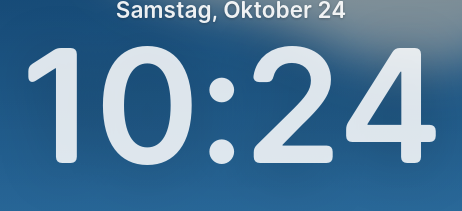](visual/maclock-glass-before-clock-1920.png) | [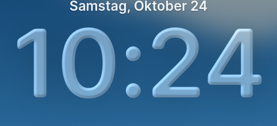](visual/maclock-glass-after-clock-1920.png) |
| Profil / Passwortfeld | [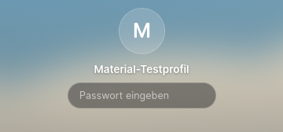](visual/maclock-glass-before-profile-1920.png) | [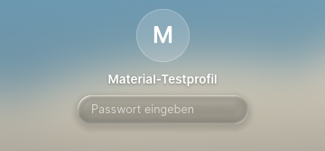](visual/maclock-glass-after-profile-1920.png) |
| Brechung / Feldrand | [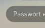](visual/maclock-glass-before-edge-1920.png) | [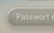](visual/maclock-glass-after-edge-1920.png) |
| CSS ohne WebGL |  |  |

### 1650px

| Ansicht | Vorher | Nachher |
| --- | --- | --- |
| Gesamter Lockscreen |  | [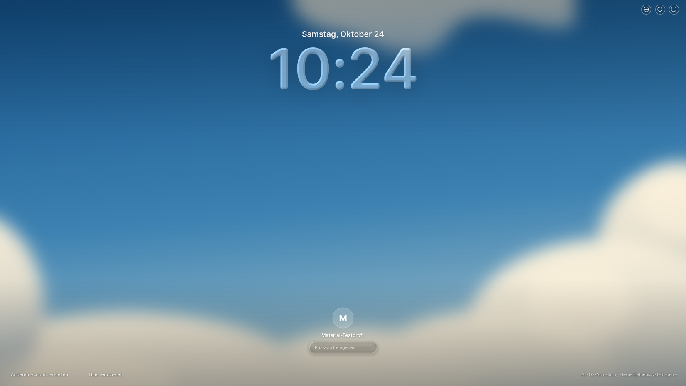](visual/maclock-glass-after-desktop-1650.png) |
| Große Uhr / Glas | [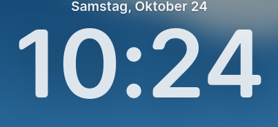](visual/maclock-glass-before-clock-1650.png) | [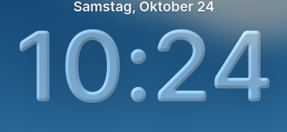](visual/maclock-glass-after-clock-1650.png) |
| Profil / Passwortfeld | [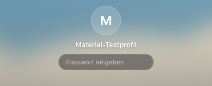](visual/maclock-glass-before-profile-1650.png) | [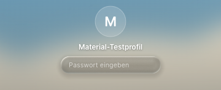](visual/maclock-glass-after-profile-1650.png) |
| Brechung / Feldrand | [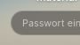](visual/maclock-glass-before-edge-1650.png) | [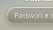](visual/maclock-glass-after-edge-1650.png) |
| CSS ohne WebGL |  | [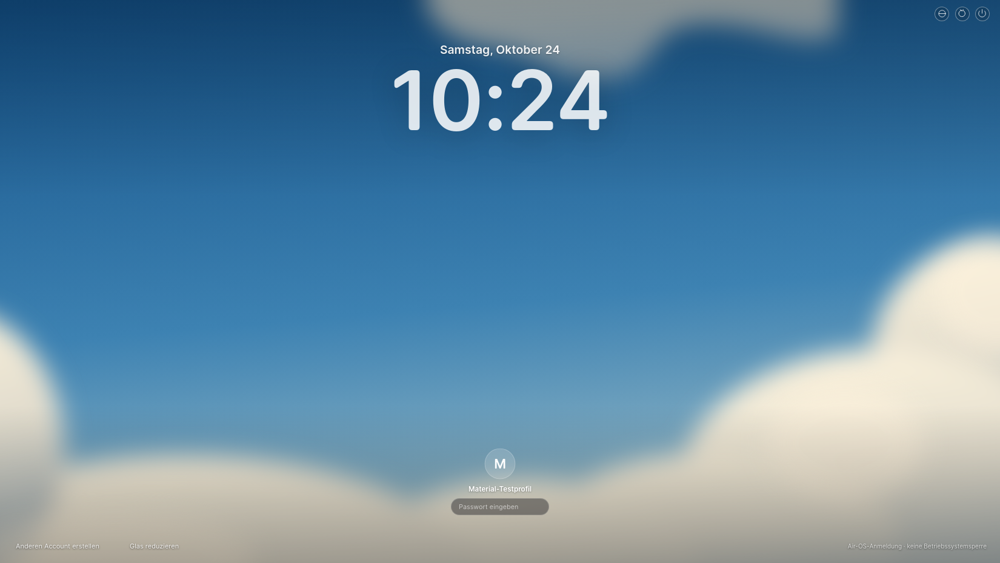](visual/maclock-glass-fallback-desktop-1650.png) |

### 390px

| Ansicht | Vorher | Nachher |
| --- | --- | --- |
| Gesamter Lockscreen | [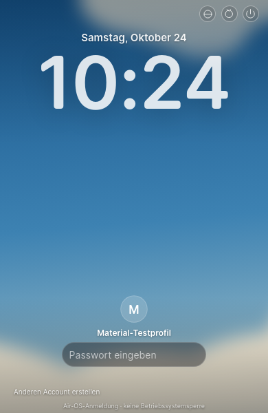](visual/maclock-glass-before-desktop-390.png) | [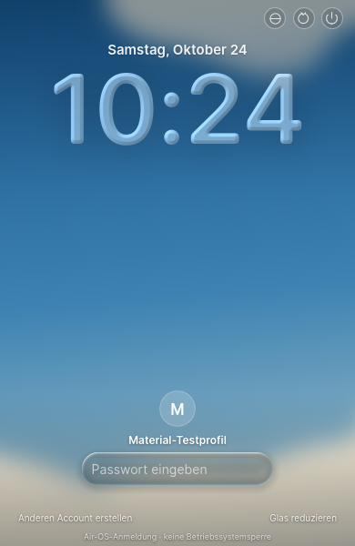](visual/maclock-glass-after-desktop-390.png) |
| Große Uhr / Glas | [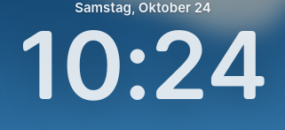](visual/maclock-glass-before-clock-390.png) | [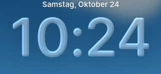](visual/maclock-glass-after-clock-390.png) |
| Profil / Passwortfeld | [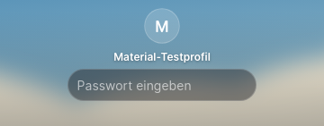](visual/maclock-glass-before-profile-390.png) | [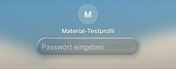](visual/maclock-glass-after-profile-390.png) |
| Brechung / Feldrand | [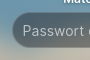](visual/maclock-glass-before-edge-390.png) | [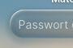](visual/maclock-glass-after-edge-390.png) |
| CSS ohne WebGL |  |  |

| Glas reduziert390 | Forced Colors390 |
| --- | --- |
| [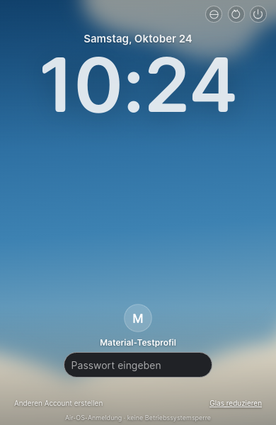](visual/maclock-glass-after-reduced-390.png) | [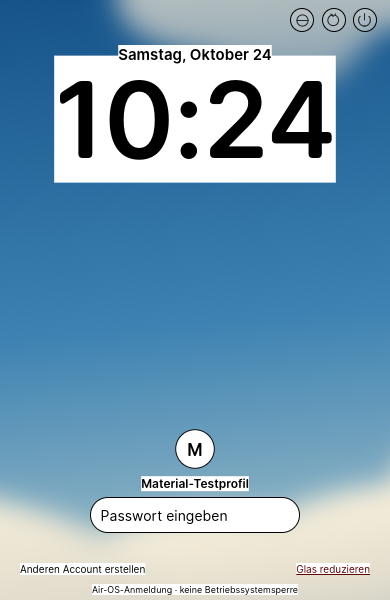](visual/maclock-glass-after-forced-390.png) |

## Verbleibende Originalabweichungen / STOP

Original-MacLock-Shaderwerte und Hauptrechenwege sind geprüft, **keine Pixelgleichheit behauptet**. Die L1A-Blockade eines ausgeführten Qt-/Quickshell-Originals und erreichbarer Original-Referenzbilder besteht; deshalb fehlt weiterhin ein vergleichbarer Original-Screenshot. Vorfilter-/Height-Map-Kernel, Plattform-Rasterisierung/Farbraum, DPR>2 und statisches statt pointeranimiertes Licht sind ausdrücklich ausgewiesene Anpassungen. Eine spätere Originalabnahme kann die technische Materialkalibrierung präzisieren.

Neue JS-Dateien ausschließlich für Material/Shader, bestehende login.js/maclock-layout.js/Fonts/Wolkenmotiv unverändert. Keine Authentifizierung, Main/Preload, Desktop-Apps, Home, Dock, Island, Notes, Classic oder M1/M2 geändert. Nur bestehende Loginseite und Ressourcenliste ergänzt. main/PRs/Installerbranches und Installerworkflows unverändert. PR-/Actions-API Forbidden, kein CI-Erfolg behauptet. Native Windows/macOS, CB-03 und bekannte Release-/Audit-/Signing-/Notarisierungsblocker bleiben offen.

Nächste drei separate Einheiten: **L1B.2 Entry/Wallpaper-Zoom/Fokus-Blur**, **L1B.3 unterbrechbarer Clock-/Passwort-Morph**, **L1C.1 originalgetreuer klar markierter Demo-Player**. Keine dieser Phasen hier vorweggenommen. Nach Commit/Push STOP.
