# L1B.2 – Originale MacLock-Bewegungswerte in Electron

24. Oktober 2026. Verifizierte Basis/Remote-HEAD: **e4a3d52b00f33c228618cbfa66248839d0e41176**, `feat/air-maclock-liquid-glass-l1b1-20261024`. Eigener Branch: **feat/air-maclock-motion-l1b2-20261024**. Original: 0-ss/MacShell **1bdb51870b621100fd2709f66c8f8e00ab17b9c4**, unverändert gegenüber L1B.1. Vorherbilder stammen aus einem unveränderten detached Worktree von e4a3d52.

## Ergebnis

Die vorhandene Anmeldung erhält Entry/Zoom, Fokus-Blur und die Exit-Ziele aus `MacLock/LockScreen.qml`. Eine endliche RAF-Zeitleiste bildet `Easing.OutQuint` exakt als `1-(1-t)^5` ab. Bei Richtungswechsel wird der momentan erreichte Verlauf ausgewertet und zum neuen Ziel weitergeführt. DOM-Geometrie und dekorative WebGL-Materialien verwenden denselben veröffentlichten, tatsächlich gezeichneten Zustand. Keine Animationsbibliothek, Qt-/Quickshell-Prozesse oder zweite Anmeldung.

**283/283 Tests bestanden, 0 Fehler/Skips.** Drei getrennte echte Linux-Electron-Läufe (unveränderter Vorherstand, WebGL2-Nachher, nativer WebGL-Ausfall) bestanden bei 1920×1080, 1650×930 und 390×600. 68 echte Electron-PNGs bzw. direkte Renderer-Ausschnitte; unten vollständig eingebunden/verlinkt. Authentifizierung/Retry, Profiltrennung, Cleanup und unveränderte Desktopgeometrien bestätigt.

**Grenze der Abnahme:** Software-Grafik im Cloud-Rechner ist bei 1920px deutlich zu langsam für eine flüssige Animation. Die gemessene Zielkurve und korrekte Endzustände sind nachgewiesen, eine hochwertige Wiedergabe auf physischer Windows-/macOS-GPU noch nicht. Original-Qt-Oberfläche weiterhin nicht ausführbar; keine Pixelgleichheit behauptet. Details und alle Zeitwerte unten.

## Original → Port und Lizenz

Originaldatei: [LockScreen.qml am fixierten Commit](https://github.com/0-ss/MacShell/blob/1bdb51870b621100fd2709f66c8f8e00ab17b9c4/MacLock/LockScreen.qml). Copyright (c) 2026 Rickky, MIT. [Vollständige Lizenz](../third_party/maclock/LICENSE), [NOTICE mit Übernahmestatus](../third_party/maclock/NOTICE.md), [Originaldatei-Hashes/Manifest](../third_party/maclock/SOURCE_MANIFEST.json). Unveränderte Open-Runde-Fonts mit separater [SIL OFL 1.1](../third_party/maclock/OpenRunde-LICENSE.txt) bleiben erhalten.

| Originalbereich | Ausgang → Ziel | Dauer / Kurve | Umsetzung |
| --- | --- | --- | --- |
| Zeilen 25–34, Wallpaper-Ready / Show-Timer | Root-Opacity 0→1 | 650ms OutQuint; Sicherheits-Timer 450ms | `maclock-motion.js`, Wallpaper.decode + fonts.ready; erste Materialbereitschaft berücksichtigen |
| Zeilen 52–54, Wallpaper.scale | 1.09→1.0 | 650ms OutQuint | CSS-Hintergrund und eigene WebGL-Szenenkomposition synchron |
| Zeilen 510–513, Uhrposition / Opacity | y3.5%→7.5%, 0→1 | 650ms OutQuint | bestehende Ruheposition bleibt, nur temporäre Translation |
| Zeilen 1390–1400, Login / Avatar | Abstand unten30u→78u, 0→1; Avatar .94→1 bei Fokus | 650ms OutQuint | vorhandene DOM-Controls; u=max(.6,H/1200) |
| Zeilen 74–83, Fokus-MultiEffect | blurMax48, blur0→.55 und Opacity0→1 | jeweils650ms OutQuint | kontinuierlicher Blur/Opacity, kein abrupter Zustandswechsel |
| Zeilen 1443–1447, Passwortbreite | 210u→236u bei Fokus oder nichtleerem Feld | 450ms OutQuint | Width-Custom-Property; bestehende mobile Mindestbreite210px bleibt |
| Exit, Zeilen34/54/512/1392–1393 | Root0; Zoom1.06; Uhr3.5%/0; Login unten30u/0 | 420/520/420/300/380/260ms OutQuint | identische unabhängige Zielspuren; kein Auth-Timer |

Root- und Kind-Opacity werden wie in QML multipliziert. Bei Eintritt mit Fortschritt q ergibt das für Uhr/Login q², nicht bloß q. Das gilt auch für `qt_Opacity` der vorhandenen Materialshader. Weitere QML-Effekte (Press-Squish, Shake, MorphGlyph, Medien, Lyrics, Wayland-xray und PAM) werden nicht mit übernommen. Diese Einheit beginnt weder L1B.3 noch L1C.

Direkter QML-Code ist im Browser nicht ausführbar. Übernommen/portiert wurden die genannten Zielwerte, Dauern, Abhängigkeiten und die originale Kurve; DOM-/RAF-/WebGL-Verknüpfung und Cleanup sind Air-OS-Code. Die beiden ursprünglichen L1B.1-Fragment-Hauptrechenwege bleiben unverändert und durch Quellparitätstests geschützt. Keine neuen fremden Assets oder Abhängigkeiten.

## Technische Anpassungen und Sicherheit

- Vor Start bleibt ein statisches eigenes Wolkenposter mit Vignette sichtbar. Das ersetzt den im Original durchscheinenden Wayland-Desktop; keine Aufnahme privater Desktop-/Profilinhalte. Wallpaper-/Fontbereitschaft startet die Animation, spätestens der originale450ms-Sicherheitspfad gibt die Oberfläche frei. Ein blockierter JavaScript-Thread kann auch Timer verzögern; keine harte Echtzeitgarantie. Beim kalten GPU-Start wird dessen erste Bereitschaft berücksichtigt, statt die650ms vor dem ersten Materialbild zu verbrauchen.
- Ein Modell enthält nur öffentliche visuelle Skalare. `air-maclock-frame` hat keinen Payload; der Renderer liest ausschließlich den bereits gezeichneten Snapshot. Kein Passwort, Benutzername oder private Profilinhalt wird an Canvas, Shader, Event-Payload oder Logs weitergegeben. Das Bewegungsmodul liest keine Auth-/Profil-API und keinen Inputwert; nur bestehende CSS-Zustandsklassen.
- Generation und RAF-Ticket werden vor jeder Callback-Wirkung geprüft. Alte Callbacks können weder neue Frames löschen noch ein früheres Ziel wieder einsetzen. `pagehide` entfernt Listener/Observer, dekodierte Bildreferenz, Deadline und RAF; die GPU gibt alle Objekte frei. Versteckte Seiten beenden den laufenden Übergang am letzten Ziel, ohne Hintergrundanimation. Kontowechsel startet den Eintritt nicht erneut; Kontoanlage bleibt bedienbar.
- Reduced Motion über OS-Media oder bestehende `air-reduced-motion`-Klassen setzt Zielzustände sofort, auch bei einer Laufzeitänderung. Keine permanente RAF-Schleife nach Abschluss. L1B.1-Forced-Colors-/Reduced-Glass-/Kontextverlust-Fallback bleibt erhalten. Kontextverlust während einer Bewegung verwirft die alte RAF-Generation und setzt die CSS-Bewegung auf derselben Zeitleiste fort.
- `login.js` erhält genau einen inhaltsfreien `air-login-confirmed`-Hinweis nach `result.ok`. Fehler lösen keinen Exit aus. Der Hinweis plant ausschließlich einen späteren Darstellungsframe; **keine synchrone GPU-Arbeit im Login-Callback, kein await, keine neue Authentifizierung und keine verzögerte Navigation**. Main/Preload sind bytegleich. Der bisherige sofortige Desktopwechsel darf den Exit abschneiden. Der originale PAM-Unlock-Timer wird nicht kopiert. Ein vollständiger Exit wird zusätzlich mit der reinen Präsentationsmethode `leave()` getestet, die weder anmeldet noch navigiert.

### Blur und Materialkohärenz

Qt MultiEffects private Blur-Pyramide lässt sich nicht unverändert ausführen. Der normierte Fokus-Steuerwert bleibt exakt0…0.55/650ms, ebenso Opacity0…1. Der CSS-Fallback verwendet Kernelunterstützung48×.55=26.4px, Sigma=26.4/3=**8.8 CSS-px**. Im WebGL-Material wird dieselbe Zoom-/Fokus-Szene aus der gecachten halbaufgelösten L1B.1-Szenentextur komponiert. Mip-LOD mit `sigmaHalf=48*blur/3*.5` und `lod=log2(max(1,sigmaHalf*sqrt(12)))` nähert die Blur-Pyramide an; Vignette bleibt im Viewport verankert. **Keine nachgewiesen pixelgleiche Qt-Kernelreproduktion.**

Die L1B.1-Glasparameter (Uhr .6/4.5, Feld18→28.8, Tint.50→.275, Shadow.4) bleiben. Bei Zoom1/Blur0 wird die ursprüngliche Szenentextur direkt verwendet. Während Bewegung/Fokus kommt genau eine wiederverwendete Textur hinzu, keine Szenen-/Glyphen-Neuberechnung pro Frame. Gemessen je Viewport: ein Masken- und ein Szenenaufbau bei der kontrollierten Eintrittssequenz. Programme4, Texturen3 im Ruhegrundzustand bzw.4 bei aktivem Fokus/Zoom; Buffer/Framebuffer/VAO jeweils1, Shaderobjekte0. Nach `pagehide` alle0. Der zusätzliche vierte Shader ist ausschließlich der Szenen-Compositor, nicht ein Ersatz der Materialverfahren.

Initiales und abschließendes Frame werden per GL-Fehlerabfrage validiert. Aktive Zwischenframes vermeiden die synchrone `getError`-Abfrage; Kontextverlust wird weiter geprüft/per Ereignis verarbeitet. FBO-Vollständigkeit bei erstmaliger Allokation. Diese Begrenzung reduziert Software-Stalls, beseitigt aber nicht die gemessene Cloud-Bildratenbegrenzung.

## Tatsächliche Tests

`npm test`: **283/283**, davon15 zusätzliche Regressionen gegenüber268: exakte Eintritts-/Fokus-/Exit-Werte und Zeiten, Richtungswechselkontinuität, Materialbereitschaft, Decode-/450ms-Fehlerfallback/verspätete Assets, gleiches DOM-/Materialframe, mobiler Mindestwert, Reduced Motion zur Laufzeit, veraltete Context-Loss-/RAF-Callbacks, Hidden/Pagehide/Listenercleanup, stabile Kontoanlage, inhaltsfreier bestätigter Login ohne synchrones Draw sowie begrenzte Bewegungstexturen/Validierungsgrenzen. Bestehende Auth-, Speicher-, Profil-, Classic-, M1-/M2-Tests bleiben aktiv.

Syntaxprüfung aller drei Laufzeitmodule und des GUI-Helfers; `npm run check:catalina` und `git diff --check` bestanden. Der Catalina-Check ist ein Konfigurationscheck, keine native macOS-Abnahme. Keine Installer/Release erzeugt. Ein zunächst falsch benannter npm-Check existierte nicht; ausgeführt/bestanden wurde der vorhandene `check:catalina`.

Linux Debian13 x64, Electron32.3.3/Chromium128, DPR1, authentifizierter Xvfb, aktive Chromium-Sandbox. WebGL-Lauf über ANGLE/SwiftShader (Software-Grafik). Der separate Fallback setzt nativ `BrowserWindow.webPreferences.webgl=false`; `getContext('webgl')` und `getContext('webgl2')` tatsächlich null, kein Renderer-Mock. Synthetische isolierte Accounts/Notizen, keine echten Benutzerdaten.

Finale drei Helferläufe Exit0, keine Rendererfehler. Vorher statisch L1B.1; Nachher und Fallback jeweils echte Dekodierung/Eintritt, pro Viewport vier schnelle Fokusumkehrungen, falsches Passwort→kein angemeldeter Benutzer/kein Exit, Retry→echter Desktop, Notes/Home/Startsuche/K3/Minimize-Restore-Smoke. Nachher zusätzlich echter `WEBGL_lose_context` während Fokus und erfolgreicher CSS-Login, Reduced Motion, zwei echte Profile mit getrennten Stores und persistierten Classic-/Dock-/12h-/Pinwerten einschließlich unbekannter Referenz.13 Pagehide-Proben je Nachher/Fallback, alle disposed/kein RAF/keine Deadline/GPU0. Die zusätzliche neue Profilprüfung ist ein echter Login/Logout; keine Simulation des authentifizierten Stores.

Ein erster Fallback-Helfer hatte eine ungeschützte WebGL-only-Messung auf `last=null`; der Test wurde passend zum echten Fallback getrennt. Ein Wiederholungsversuch mit wiederverwendetem Testprofil enthielt ein zusätzliches Testkonto und daher eine größere Accountpicker-Zeile; Geometrieassertion blieb unverändert, finaler Beleg nutzt einen frischen isolierten Prozess/Profilstore. Der erste Start innerhalb der eingeschränkten Prozessumgebung hatte keine verwendbare Sandbox; der echte Test wurde mit erlaubtem Prozessstart und aktiver Chromium-Sandbox ausgeführt, nicht mit `--no-sandbox`. Diese abgebrochenen Versuche sind keine bestandenen Abnahmen.

### Natürliche Laufzeiten, ohne angehaltene Testzeit

`performance.now()`/echte RAFs vom gestarteten Übergang bis zum tatsächlich gezeichneten Endzustand. Paint-Aufrufe enthalten auch initiale synchrone Zustandsbilder und sind **keine garantierte Compositor-Framerate**.

| Viewport | WebGL-Endzustand nach | Paint-Aufrufe | Nativer CSS-Fallback nach | Paint-Aufrufe |
| --- | --- | --- | --- | --- |
| 1920×1080 | 752.4ms | 4 | 703.9ms | 12 |
| 1650×930 | 652.0ms | 12 | 680.0ms | 22 |
| 390×600 | 652.0ms | 32 | 653.0ms | 43 |

650ms ist die Original-Zeitleistendauer, kein Versprechen für ein pünktliches Hardware-/Compositorbild. Bei1920px ist der Softwarepfad mit nur4 Paint-Aufrufen und752.4ms bis zum Endbild **keine bestandene Flüssigkeits-/60fps-Abnahme**. Keine Sprünge der mathematischen Zielkurve bei den gemessenen schnellen Richtungswechseln; die niedrige zeitliche Abtastung bleibt sichtbar möglich. Das verlangt einen gesonderten Test auf physischer GPU, keine Behauptung bereits perfekter Animation.

Nach bestätigtem Login gemessene Zeit bis `pagehide`: WebGL **981/823/24/6/296ms**, CSS-Fallback **1/3/5/6/5ms** (nur Seiten, die den Rückhinweis vor Navigation noch empfingen). Das ist keine Passwortprüfdauer. Es gibt keinen eingefügten Warte-Timer; trotzdem zeigt der Software-Grafikpfad mögliche Draw-/Navigationslatenz. Deshalb keine sofortige Hardware-Desktopüberblendung als bestätigt ausgeben. Erfolgreiche Anmeldung selbst bleibt bestätigt und wird nicht auf einen Animationsabschluss konditioniert.

### Kontrollierte Zwischenbilder

Für präzise25/50/75%-Screenshots wird ausschließlich im Test die Playwright-Uhr angehalten/weitergeschaltet. Es sind echte Electron-Rendererbilder, keine künstlich gezeichneten Bilder, aber **kein Echtzeit-FPS-Nachweis**. Die natürliche Sequenz oben wird davor separat ohne Zeitsteuerung aufgezeichnet. Vergleichsuhr10:24 nur im Test fixiert; Produktuhr/-Timer unverändert. Der Test-Clock rundet auf Millisekunden:

| Angefordert | Tatsächlich t /650ms | Root-Opacity q | Wallpaper-Zoom | Uhr/Login-Opacity q² |
| --- | --- | --- | --- | --- |
| 25% | 163ms / 25.07692% | 0.763909766 | 1.021248121 | 0.583558130 |
| 50% | 325ms / 50.00000% | 0.968750000 | 1.002812500 | 0.938476562 |
| 75% | 488ms / 75.07692% | 0.999038369 | 1.000086547 | 0.998077663 |

Exakte Formelabweichung für q/Zoom im Helfer <1e-9. Renderer-Snapshot und gezeichneter DOM-Snapshot verwenden denselben q-Wert. Bei schnellen Fokusumkehrungen stimmt der neue Startwert mit dem zur Umkehrzeit ausgewerteten vorigen Verlauf überein (<1e-8); kein alter Completion-Callback.

### Unveränderte Ruhegeometrie / erlaubte Fokusverbreiterung

CSS-Pixel, echte Text-Range-/DOMRects bei10:24. Ruhewerte vor/nach/fallback exakt gleich. Alle bestehenden mobilen Mindestgrößen bleiben.

| Viewport | Uhrtext x/y; B×H | Passwort ohne Fokus x/y; B×H | Mit Fokus B×H |
| --- | --- | --- | --- |
| 1920×1080 | 748.78/95.41; 422.44×191.00 | 865.50/955.42; 189.00×32.39 | 212.39×32.39 |
| 1650×930 | 643.12/82.91; 363.75×165.00 | 743.62/822.92; 162.75×27.89 | 182.89×27.89 |
| 390×600 | 54.17/55.61; 281.66×127.00 | 90.00/497.20; 210.00×36.00 | 210.00×36.00 |

390px:210px native Mindestbreite verhindert ein Schrumpfen auf126/141.6px; dies ist die bestehende L1A-Ausnahme, keine neue Layoutänderung. Keine horizontalen Überläufe. Dock-/Island-/Air-Home-Boxen nach Login exakt gegen Vorher verglichen. `app.js`, Desktop-CSS/HTML, Main/Preload, M1/M2, Home/Notes, Originalfonts und Layoutmodul bytegleich. `package.json` ergänzt ausschließlich die neue erforderliche Laufzeitdatei im vorhandenen Manifest; keine Dependency-/Installeroption/-Workflowänderung.

## Vollständiger sichtbarer Bildvergleich

Alle folgenden Bilder sind tatsächliche Electron-Screenshots oder direkte Renderer-Ausschnitte. Vorher ist **statisches L1B.1**; bei Eintritt/Exit hat dieser Stand naturgemäß keine entsprechenden Zwischenbilder. Wiederholte Vorherbilder dienen als statischer Layoutvergleich. Ein unverändertes Endbild ist gewollt: Die Änderung liegt im Weg dorthin und im Fokus-Blur, nicht in einem neuen Lockscreen-Layout.

### 1920px – Vorher / Nachher

| Zustand | L1B.1 vorher | L1B.2 nachher |
| --- | --- | --- |
| Gesamter Lockscreen / fertig eingeblendet |  |  |
| Eintritt25% (tatsächlich163ms) |  | [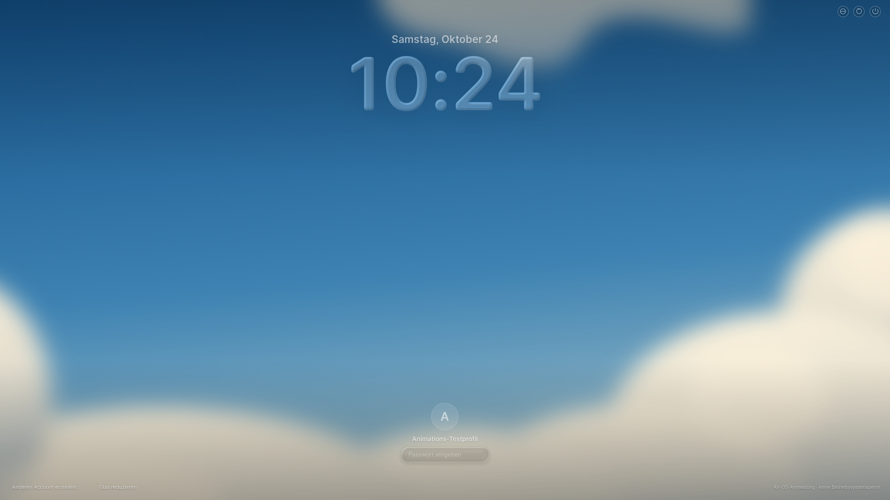](visual/maclock-motion-after-entry25-1920.png) |
| Eintritt50% /325ms |  |  |
| Eintritt75% (tatsächlich488ms) |  |  |
| Profil und Passwort ohne Fokus | [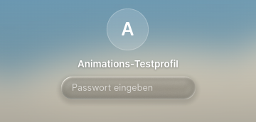](visual/maclock-motion-before-unfocused-1920.png) |  |
| Fokusübergang225ms nach Aktivierung |  |  |
| Fokus fertig / Blur |  |  |
| Glass-Feldkontur im Fokus, Originalmaterial erhalten | [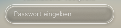](visual/maclock-motion-before-glass-1920.png) | [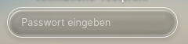](visual/maclock-motion-after-glass-1920.png) |
| Exit210ms / nur Präsentation, keine Entsperrung |  |  |

### 1920px – echter nativer WebGL-Ausfall

| Zustand | CSS-Fallback in Electron |
| --- | --- |
| Gesamter Lockscreen |  |
| Eintritt25% | [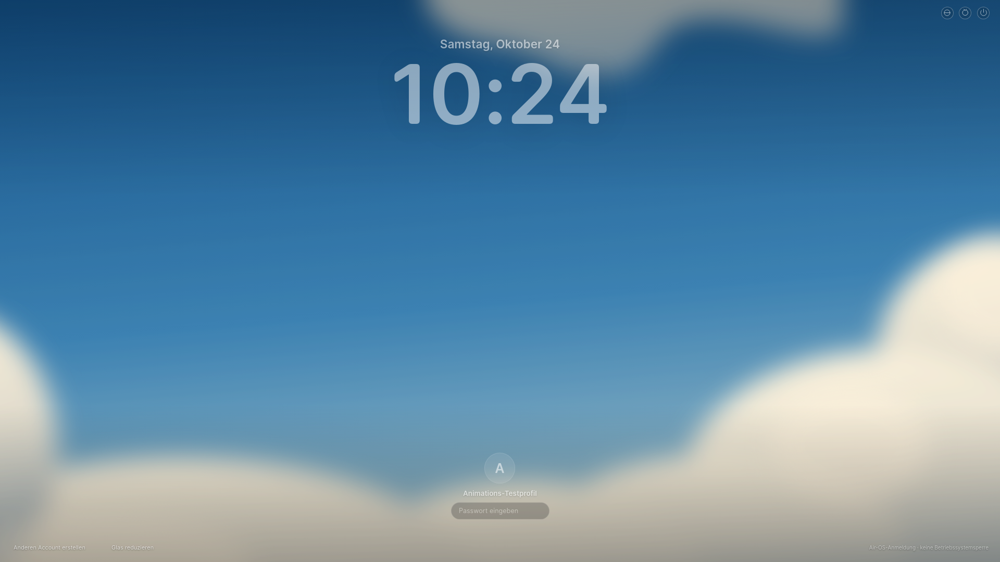](visual/maclock-motion-fallback-entry25-1920.png) |
| Eintritt50% | [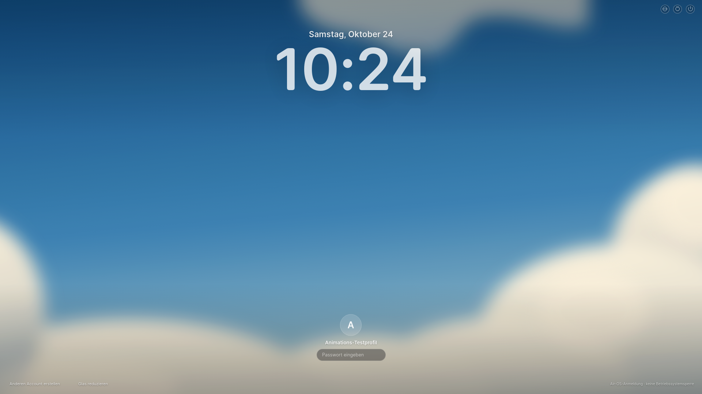](visual/maclock-motion-fallback-entry50-1920.png) |
| Eintritt75% |  |
| Profil ohne Fokus | [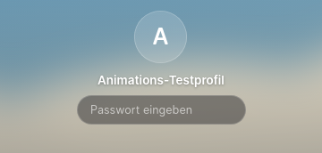](visual/maclock-motion-fallback-unfocused-1920.png) |
| Fokus225ms |  |
| Fokus fertig |  |
| Feldkontur ohne WebGL | [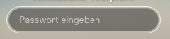](visual/maclock-motion-fallback-glass-1920.png) |
| Exit210ms / Darstellung |  |

### 1650px – Vorher / Nachher

| Zustand | L1B.1 vorher | L1B.2 nachher |
| --- | --- | --- |
| Gesamter Lockscreen / fertig eingeblendet |  |  |
| Eintritt25% (tatsächlich163ms) |  | [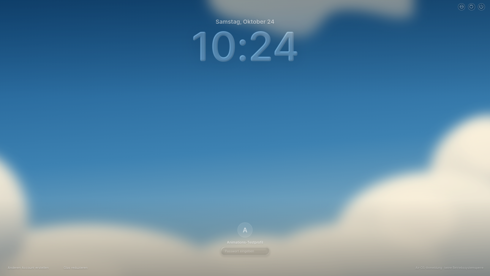](visual/maclock-motion-after-entry25-1650.png) |
| Eintritt50% /325ms |  |  |
| Eintritt75% (tatsächlich488ms) |  |  |
| Profil und Passwort ohne Fokus | [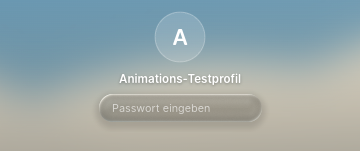](visual/maclock-motion-before-unfocused-1650.png) |  |
| Fokusübergang225ms nach Aktivierung |  |  |
| Fokus fertig / Blur |  |  |
| Glass-Feldkontur im Fokus, Originalmaterial erhalten | [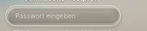](visual/maclock-motion-before-glass-1650.png) | [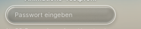](visual/maclock-motion-after-glass-1650.png) |
| Exit210ms / nur Präsentation, keine Entsperrung |  |  |

### 1650px – echter nativer WebGL-Ausfall

| Zustand | CSS-Fallback in Electron |
| --- | --- |
| Gesamter Lockscreen |  |
| Eintritt25% |  |
| Eintritt50% |  |
| Eintritt75% | [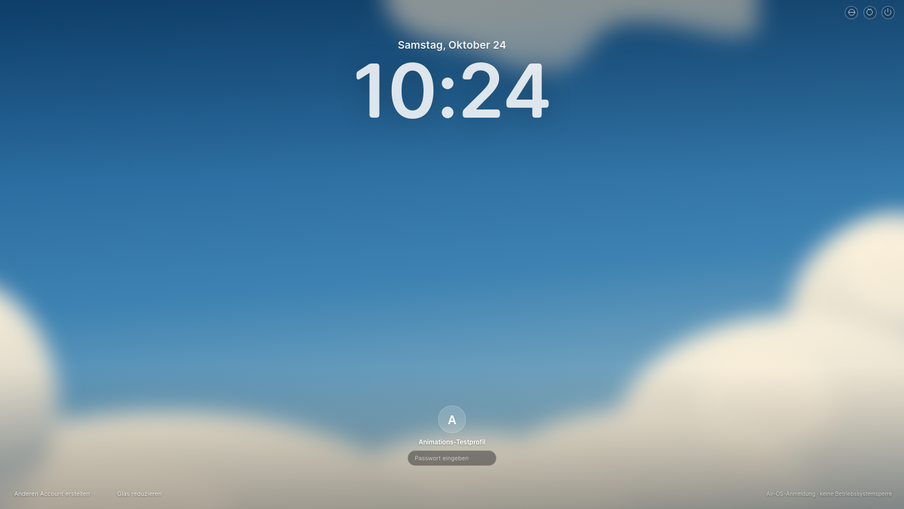](visual/maclock-motion-fallback-entry75-1650.png) |
| Profil ohne Fokus | [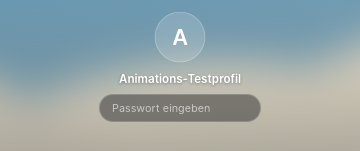](visual/maclock-motion-fallback-unfocused-1650.png) |
| Fokus225ms |  |
| Fokus fertig |  |
| Feldkontur ohne WebGL | [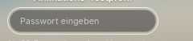](visual/maclock-motion-fallback-glass-1650.png) |
| Exit210ms / Darstellung |  |

### 390px – Vorher / Nachher

| Zustand | L1B.1 vorher | L1B.2 nachher |
| --- | --- | --- |
| Gesamter Lockscreen / fertig eingeblendet |  |  |
| Eintritt25% (tatsächlich163ms) |  | [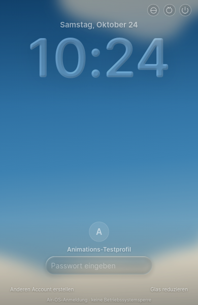](visual/maclock-motion-after-entry25-390.png) |
| Eintritt50% /325ms |  | [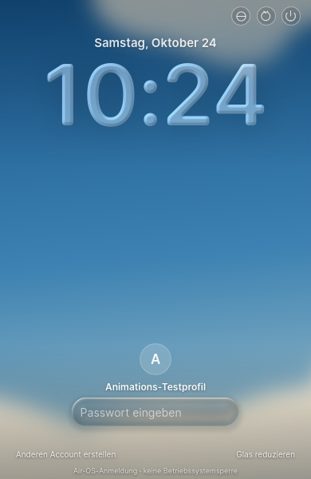](visual/maclock-motion-after-entry50-390.png) |
| Eintritt75% (tatsächlich488ms) |  |  |
| Profil und Passwort ohne Fokus |  | [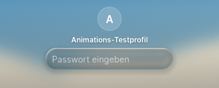](visual/maclock-motion-after-unfocused-390.png) |
| Fokusübergang225ms nach Aktivierung | [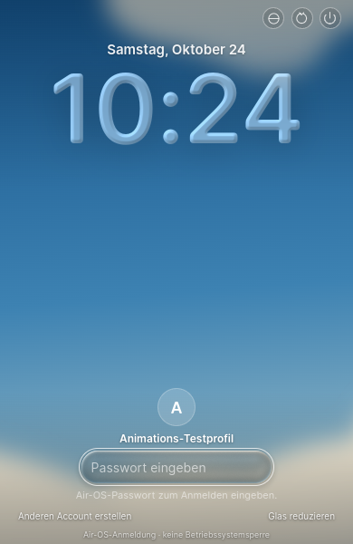](visual/maclock-motion-before-focused-390.png) |  |
| Fokus fertig / Blur |  |  |
| Glass-Feldkontur im Fokus, Originalmaterial erhalten | [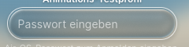](visual/maclock-motion-before-glass-390.png) | [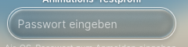](visual/maclock-motion-after-glass-390.png) |
| Exit210ms / nur Präsentation, keine Entsperrung |  |  |

### 390px – echter nativer WebGL-Ausfall

| Zustand | CSS-Fallback in Electron |
| --- | --- |
| Gesamter Lockscreen | [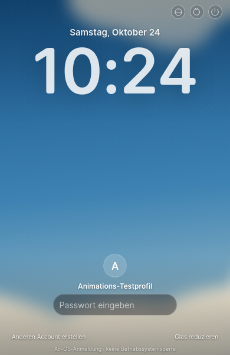](visual/maclock-motion-fallback-desktop-390.png) |
| Eintritt25% | [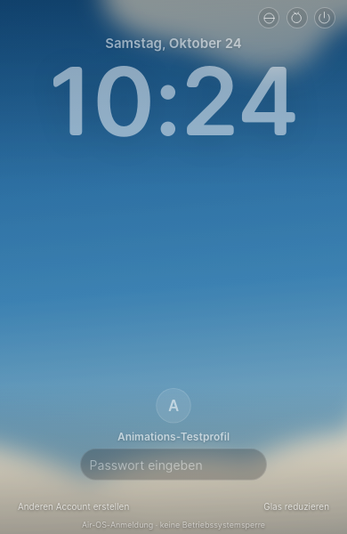](visual/maclock-motion-fallback-entry25-390.png) |
| Eintritt50% | [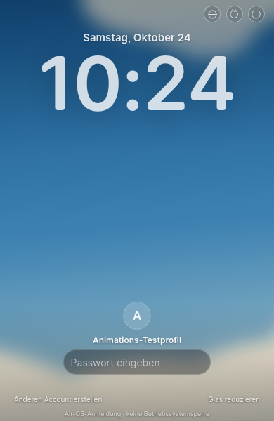](visual/maclock-motion-fallback-entry50-390.png) |
| Eintritt75% |  |
| Profil ohne Fokus | [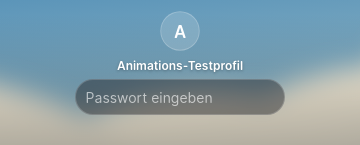](visual/maclock-motion-fallback-unfocused-390.png) |
| Fokus225ms |  |
| Fokus fertig | [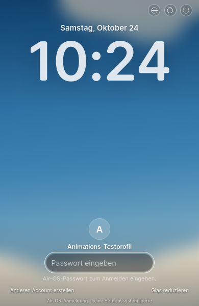](visual/maclock-motion-fallback-focused-390.png) |
| Feldkontur ohne WebGL | [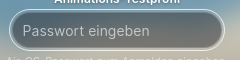](visual/maclock-motion-fallback-glass-390.png) |
| Exit210ms / Darstellung |  |

### Reduced Motion

| WebGL2-Material, sofortiger Zielzustand | Nativer CSS-Fallback, sofortiger Zielzustand |
| --- | --- |
|  |  |

## Reproduktion, Rohdaten und offene Punkte

[Vorher-Messwerte](visual/maclock-motion-before.json) · [Nachher inklusive natürlicher Frames/Umkehrpaare/Cleanup](visual/maclock-motion-after.json) · [Nativ ohne WebGL](visual/maclock-motion-fallback.json).

Helfer [scripts/check-maclock-motion.cjs](../scripts/check-maclock-motion.cjs), externes vorhandenes Playwright, isolierte synthetische Credentials. `AIR_GUI_TEST_ISOLATED=1 AIR_GUI_PHASE=before|after|fallback node scripts/check-maclock-motion.cjs`, CDP9271/9272/9273 oder `AIR_GUI_CDP`. Jeder finale Lauf benötigt einen frischen isolierten userData-/Konfigurationspfad und Sandbox/X-Display. Vorher muss den unveränderten Basis-Worktree starten. Nachher startet normales `npm start`, native Fallbackinstanz nutzt ausschließlich den bestehenden Testentry `scripts/start-maclock-no-webgl.cjs`. Keine Testflags im Produkt; kein `--no-sandbox`. Für den finalen Fallback wurde der freie Port9274 genutzt. Beenden per vorhandener `airOS.quit()`; aus Tests gestartete Prozesse werden nicht weiterentwickelt.

Originalvergleich weiterhin **BLOCKIERT**: kein ausführbares Quickshell/Qt/Hyprland und kein zugänglicher vergleichbarer Original-Screenshot (bisherige README-Bilder HTTP403). Daher können Parameter-/Kurvenportierung und L1B.1-Geometrie bestätigt werden, keine Original-Pixelgleichheit. Qt-Kernel, Font-/Treiber-/Farbunterschiede und physische Animationsqualität bleiben zu kalibrieren. Wallpaper ist bewusst das eigene Air-OS-Wolkenmotiv. 390px ist echter Linux-Electron-Viewport, kein nativer Windows-Mindestfensterbeleg.

PR-/Actions-Lesezugriff erneut Forbidden; kein neuer CI-Erfolg behauptet. main und Installerbranch-HEADs unverändert; keine PRs geöffnet/verändert, keine Releases/Installer erzeugt. Native Windows-/macOS-Abnahmen, CB-03 und bisherige Release-/Signingblocker bleiben offen.

Nächste drei getrennte, erst nach neuem Auftrag beginnende Einheiten: **L1B.3** weitere unterbrechbare MacLock-Morph-/Interaktionsbewegungen; **L1C.1** klar gekennzeichneter Demo-Player ohne vorgetäuschte Systemmedien; **L1D/native Vergleichseinheit** physische GPU-/Plattform- und Originalbildkalibrierung. Diese Sitzung endet nach Commit/Push, keine weitere Phase.
