# L1B.3 – Originale MacLock-Textmorphs und Anmeldeinteraktionen

24. Oktober2026. Verifizierte Basis/Remote-HEAD **14a43a5a1f631b8f18e90f60f47cd61877718a28**, `feat/air-maclock-motion-l1b2-20261024`. Eigener Branch **feat/air-maclock-morph-l1b3-20261024**. MacShell fest auf **1bdb51870b621100fd2709f66c8f8e00ab17b9c4**. Vorher ist ein unveränderter detached Worktree der bestätigten L1B.2-Basis.

## Ergebnis und Abnahmegrenze

Die vorhandene Uhr, das Datum und die Anmeldehinweise verwenden einen portierten zweilagigen MorphText-Zustand. Überblenden, Blur, Skalierung, Stretch und Breiten-/Ausrichtungsformeln stammen aus dem Original; die Uhr erhält ausdrücklich ihre echten Instanzwerte statt der Standardwerte. Hinzu kommen originale Caps-Lock-, Submit-/Spinner-, Press- und Shake-Zustände. Native Passworteingabe, Maskierung und authentifizierte Bridge bleiben maßgeblich. Keine Passwortzeichen/-längen/-dots in dekorativen Lagen, Canvas, Shader, Events oder Logs. Keine neue Animation- oder Qt-Bibliothek, kein neuer Timer/Pollingpfad, keine Musik/Lyrics.

**300/300 Tests bestanden, 0 Fehler/Skips.** Finale getrennte echte Linux-Electron-Läufe für unverändertes L1B.2, L1B.3-WebGL2 mit erkanntem SwiftShader und nativen WebGL-Ausfall bei1920×1080,1650×930,390×600 bestanden. Zwei zusätzliche native XTest-Caps-/Submit-Läufe prüfen die Abstände bei allen drei Größen.105 echte Electron-PNGs, unten vollständig eingebunden. Kein physischer GPU-/Windows-/macOS- oder Original-Pixelgleichheitsnachweis.

**Performance bleibt begrenzt:** bei1920px weiterhin nur4 Eintritts-Paint-Aufrufe. Minutenwechsel im finalen Softwarepfad1086.8ms bis zum letzten Morph-Paint, davon564ms nach tatsächlichem Morphstart. Der neue Software-Fallback vermeidet zusätzliche Material-Readbacks; pro Minutenwechsel weiterhin nur ein WebGL-Draw und ein Maskenaufbau wie in L1B.2. Das ist keine bestandene60fps-/Flüssigkeitsabnahme. Details unten.

## Originalübernahmen und tatsächliche Instanzwerte

Originalquellen am [fixierten MacShell-Commit](https://github.com/0-ss/MacShell/tree/1bdb51870b621100fd2709f66c8f8e00ab17b9c4/MacLock). Copyright(c)2026 Rickky, MIT. [Lizenz](../third_party/maclock/LICENSE), [NOTICE](../third_party/maclock/NOTICE.md), [Datei-Hashes und Übernahmestatus](../third_party/maclock/SOURCE_MANIFEST.json). Die drei QML-Komponenten sind bytegleich als Auditquellen gebündelt; QML wird nicht ausgeführt:

| Original | Tatsächliche Verwendung | Port / bewusste Grenze |
| --- | --- | --- |
| [MorphText.qml](../third_party/maclock/original/MorphText.qml) | Datum/Hinweis; spezielle Uhrinstanz in LockScreen.qml | Zwei Textlagen, original berechnete Breiten/Stretch, Blur-/Crisp-Übergang und Kurven in `maclock-morph.js`; DOM/Compositor ersetzt Qt |
| [MorphGlyph.qml](../third_party/maclock/original/MorphGlyph.qml) | Medienbuttons um Zeile1063, nicht der Passwort-Submit | Analysiert/auditiert; keine erfundene Medienaktion in der Anmeldung. Standard360ms, BlurMax16, Fade-out70%/OutCubic, Scale1.3→1/.7 gehören nicht pauschal zur Uhr |
| [ClockGlyph.qml](../third_party/maclock/original/ClockGlyph.qml) | Alarm-/Stopwatch-/Timer-Widgets um Zeile349, nicht die großen Zeitziffern | Analysiert/auditiert; keine neuen Timer-/Alarmwidgets oder bedeutungslosen Symbole |
| LockScreen.qml 515–576 | Datum und Glas-Uhr | Echte Instanzparameter unten; vorhandene L1B.1-Fragmente/Fonts bleiben unverändert |
| LockScreen.qml 1450–1660 | Press, Shake, Caps, Submit, Hinweis | Zielwerte, Zeitabläufe und Caps-Vektorpfade nach DOM/CSS/SVG portiert; native Eingabe ersetzt bewusst den QML-Passwort-Dot-Renderer |

Open Runde Regular/Semibold bleiben bytegleich mit separater [SIL OFL1.1](../third_party/maclock/OpenRunde-LICENSE.txt). Keine fremden Wallpaper/Logos/Medienassets. `package.json` ergänzt nur `maclock-morph.js` im vorhandenen Ressourcenmanifest; keine Dependencies, Installeroptionen oder Workflows geändert.

| Element | Wirkliche Originalwerte | Umsetzung |
| --- | --- | --- |
| Allgemeiner Text / Datum / Hinweis |420ms; BlurMax44; ScaleIn1.06, ScaleOut.94; Stretch und animateWidth=true | Ausgehende Opacity/Blur über75% der Dauer mit OutCubic; alle übrigen Morphwerte OutQuint |
| Ausrichtung |0/.5/1;650ms OutQuint | Zentrale Textlage folgt `align*(boxWidth-layerWidth)`; reine Modellregression prüft Alignmentwechsel, keine neue Ausrichtungs-UI |
| Große Uhr |560ms; ScaleIn1.03, ScaleOut.97; animateWidth=false, stretch=false, useBlur=false innen; äußeres BlurMax48 | Uhrbox übernimmt wie im Original die neue Breite direkt, beide Textlagen bleiben horizontal zentriert; externe Blur-Hülle statt innerem Clock-Layer-Blur |
| Crisp-/Blur-Hand-over |fx=min(1,bl/.35) | Überblendende scharfe/weiche Darstellung in Datum/Hinweis; Qt-Blurkernel angenähert mit Sigma=blurMax*bl/3 |
| Hinweis sichtbar |300ms, standardmäßig linear | Bestehender Hinweis bleibt semantisch erhalten, Textmorph420ms; bestehender separater Air-OS-Fehleralert bleibt unverändert zuständig für die konkrete Fehlermeldung |
| Caps Lock |Opacity0↔.9/180ms linear; Scale.5↔1/300ms OutQuint;18u; rechts12u ohne Submit, sonst6u+Submit+6u | Originale Pfeil-/Balkenpfade als SVG; bestehender mobiler24px-Submit ausdrücklich berücksichtigt |
| Submit sichtbar |Opacity0↔1/200ms linear; Scale.4↔1/340ms OutQuint | Eindeutiger vorhandener Button, `aria-label` erhalten; bei unsichtbarem Button zusätzlich inert, keine unsichtbaren Tabziele |
| Submit Busy |Arc0…1.4π, Radius.36w, Strichmax(1.6,.09w),800ms linear | SVG-Arc rotiert ausschließlich während echter bestehender Busy-Phase; Reduced Motion zeigt statischen Arc, kein neuer RAF-/Pollingloop |
| Press |ScaleX1↔1.045, ScaleY1↔.86;140ms hin,420ms zurück/OutQuint | Maus/Enter, Pointercancel/Blur/Release; native Hitbox/Submit bleibt zuständig |
| Fehler-Shake |−16u/55ms OutQuint,14u/80ms InOutQuad,−10u/75ms InOutQuad,7u/70ms InOutQuad,−3u/65ms InOutQuad,0/90ms OutQuint |435ms, bei erneutem Fehler vom aktuell sichtbaren Wert; nur nach explizitem fehlgeschlagenem Bridge-Ergebnis `ok===false`, nicht bei fehlender Antwort/Exception |

`MorphText`-Standards werden folglich nicht fälschlich auf die Uhr oder Symbole angewendet. Der passwortbezogene Pfeil/Spinner ist im Original ein eigener Zustand, kein MorphGlyph. Ein zusätzlicher frei erfundener Glyph-Crossfade wurde nicht eingebaut.

## Materialpfad und Performance-Fallback

Das große Uhr-DOM-Element enthält sofort die aktuelle tatsächliche Uhrzeit und `dateTime`; es bleibt während des Morphs mit Opacity0 im Accessibility-Baum. Zwei dekorative Lagen sind `aria-hidden` und nicht klickbar. Kein zweites semantisches Uhr-Element. Ausgehender/ankommender Text liegen wie im Original übereinander; Überlagerung ist während der Morphphase beabsichtigt, kein zweiter separat platzierter Zeitwert. Ruheposition/Font-/Endgeometrie bleiben wie L1B.2.

**Normaler Materialpfad:** Der vorhandene WebGL-Renderer kann aus seinem tatsächlich gerenderten, ausschließlich öffentlichen Uhr-/Feldmaterial zwei kleine Rasterausschnitte cachen. Das ist keine Aufnahme des DOM-Passwortfelds: Native Texte, Passwortpunkte, Profilname oder andere Apps sind nicht im WebGL-Canvas enthalten. Bei einem Inhaltswechsel entsteht genau ein neuer Glyphenmaskenaufbau; keine neuen Shaderprogramme/Pässe pro Morphframe. Die beiden Rasterlagen werden über CSS-Transformation/Opacity/Blur zusammengesetzt. Währenddessen wird nur der dekorative Canvas-Uhrbereich ausgespart; keine klickblockierenden Overlays. Press/Shake verwenden entsprechend den gecachten Feldhintergrund. Am Ende genügt eine vorhandene Materialaktualisierung, um die endgültige Feldgeometrie sicherzustellen. Zeitweilig gecachte Brechung folgt nicht jedem neuen Hintergrundsample; der finale Live-GL-Zustand bleibt maßgeblich.

**Erkannter Softwarepfad:** `WEBGL_debug_renderer_info` wird einmal ausgewertet (SwiftShader/llvmpipe/softpipe/software). Ein erster echter Softwarelauf zeigte Readback-bedingte Zusatzlatenz; deshalb erstellt der finale Softwarepfad keine Materialkopien. Er benutzt dieselben ursprünglichen zwei Textlagen/Kurven und eine ausdrücklich angenäherte Texttönung während des Morphs. Im letzten Viertel blendet diese Darstellung weich über die wieder sichtbare echte L1B.1-Glas-Uhr aus. Press/Shake verwenden vorübergehend den funktionsfähigen CSS-Feldhintergrund. Endzustände bleiben echte unveränderte Liquid-Glass-Shader. Das ist **keine pixelgleiche Glas-Maskenberechnung in den Software-Zwischenbildern**. Bei unbekanntem/gesperrtem Renderer-Info-String kann die Softwareerkennung fehlen; physische GPU-/Treiberprüfung bleibt nötig.

Ohne WebGL wird das native DOM mit denselben Text-/Interaktionsbewegungen verwendet. Forced Colors/Reduced Glass geben den bestehenden L1B.1-Fallback vor; Kontextverlust beendet die dekorativen Lagen und zeigt sofort den aktuellen lesbaren Text. `maclock-motion.js`, `maclock-shaders.js`, beide ursprünglichen Fragmentshader und vorhandene Fonts bleiben bytegleich. Keine Änderung der Eintritts-/M1-/M2-Logik.

## Unterbrechbarkeit, Sicherheit und Cleanup

Ein endliches Zweilagenmodell verfolgt die aktuelle Opacity/Skalierung/Blur/Breite. Ein Rückwechsel zum bereits vorhandenen Text setzt dort fort, ohne Ausgangswerte neu einzusetzen. Bei einem dritten schnellen Text wird die weniger sichtbare der zwei Lagen wiederverwendet; keine unbegrenzte Kette von Text-/Canvas-Layern. Latest Content bleibt maßgeblich. Originales Qt setzt ankommende Anfangswerte hart neu; der Electron-Port erhält bei laufenden Rückwechseln den erreichten Zustand, um die verlangte Unterbrechbarkeit zu gewährleisten. Generations-/Ticketprüfungen verhindern verspätete RAF-Wirkungen; keine textändernden Completion-Callbacks.

Das Bewegungsmodul liest keine Inputwerte, Secrets, Profile oder IPC. Es erhält nur öffentliche Uhr/Datum und feste Air-OS-Hinweise. Der vorhandene Loginpfad meldet explizite Ablehnung bzw.Accountwechsel durch inhaltsfreie Events; Erfolg bleibt das bestehende L1B.2-Ereignis. Keine Änderung von Passwortprüfung, Speicherformat, Profilrechten, Main/Preload oder Navigation; kein Warten auf einen Animationsabschluss. Fehlende Antwort/Transportfehler bleiben sichtbare vorhandene Fehler, kein fälschlich bestätigtes Passwort-Rejection-Signal. Sperren gegen Doppelsubmit/Accountwechsel während Auth bleiben aktiv.

`pagehide`, Accountwechsel, verstecktes Dokument, Reduced Motion und Context Loss beenden/ersetzen die laufenden visuellen Zustände. Observer/Listener/RAF und dekorative Hosts werden freigegeben, gecachte Canvas-Verweise entfernt; keine private UI über Profilgrenzen. Reduced Motion über Media oder bestehende Klassen setzt sofort stabile Endwerte. Bestehender1s-Uhrtimer bleibt der einzige Zeitgeber der Uhr, pausiert weiterhin bei verborgenem Dokument. Keine neue permanente Renderloop; Spinner ausschließlich für vorhandene Busy-Zeit.

## Tatsächliche Tests und Messungen

**300/300 automatisierte Tests**,0 Fehler/Skips (17 zusätzliche Tests gegenüber283): tatsächliche Clock-/Textwerte, exakte Kurven/Skalen/Blur/Fade, Stretch-Clamps/Alignment/Breite, schnelle Rück-/Drittwechsel, identischer Text ohne Neustart, Reduced Motion, Shakefolge, Originalhashes/Lizenzen, fehlender Secret-/IPC-/HTML-Pfad, bestätigte/ausbleibende/stale Ablehnungsevents, Materialtile-Caching/Freigabe, Software-Readbackverzicht und originale/mobile Caps-Anker. Bestehende Sicherheits-/Speicher-/Profil-/Classic-/M1-/M2-Regressionen erhalten.

Syntaxprüfungen von Login, Morph, Glass und beiden GUI-Helfern, `npm run check:catalina` und `git diff --check` bestanden. Catalina ist nur ein Konfigurationscheck, keine native macOS-Abnahme.

Linux Debian13 x64, Electron32.3.3/Chromium128, DPR1, authentifizierter Xvfb und aktive Chromium-Sandbox. WebGL2 über ANGLE/SwiftShader (Software-Grafik); kein physischer GPU-Nachweis. Nativer Fallback über den bestehenden separaten Testentry `scripts/start-maclock-no-webgl.cjs` mit `BrowserWindow.webPreferences.webgl=false`. WebGL/WebGL2 liefern wirklich null, kein Renderer-Mock. Je Lauf frische synthetische Profile, keine echten Benutzerinhalte.

Finale Hauptläufe alle Exit0, keine Rendererfehler: drei natürliche Minutenwechsel vor jeder Clock-Instrumentierung, kontrollierte Zwischenbilder danach; Fokus, falsches Passwort/Retry/echter Login, Caps-Tasten, schnelle Textwechsel, Reduced Motion, echter Context Loss→CSS-Login, zwei Profile mit getrennten Notes-Stores, Classic-Einstellung sowie unveränderte Dock-/Island-/Home-Boxen gegen die Basis. Je15 Pagehide-Proben im Nachher-/Fallbacklauf: disposed, keine Morph-RAF, keine dekorativen Hosts, GPU-Kontext freigegeben. Zusätzliche native XTest-Läufe prüfen Caps plus tatsächlich getippten maskierten Buchstaben und gleichzeitig sichtbaren Submit, ohne Key-State-Mocks.

### Natürliche Zeiten und CPU-/GPU-Aufwand

Die folgenden ersten Messungen jedes Viewports verwenden echte RAFs und `performance.now`, **keine angehaltene oder installierte Playwright-Uhr**. Nur das zivile Testdatum wird vorgegeben und um eine Minute verschoben; der bestehende reale1s-Timer löst den Wechsel aus. Erst nach allen drei natürlichen Sequenzen werden kontrollierte Screenshotzeiten installiert. Einzelbeobachtungen auf geteilter Cloud-Software-Grafik, keine statistische Hardwarebenchmark-Garantie.

| Größe | L1B.2 Entry / Paint-Aufrufe | L1B.3 Entry / Paint-Aufrufe | L1B.3 Wechsel→letzter Paint | Ab Morphstart / Paint-Aufrufe |
| --- | --- | --- | --- | --- |
| 1920×1080 | 1365.9ms /4 | 1277.5ms /4 | 1086.8ms | 564.0ms /8 |
| 1650×930 | 911.2ms /4 | 973.0ms /6 | 575.8ms | 561.1ms /9 |
| 390×600 | 709.2ms /8 | 687.7ms /9 | 589.7ms | 572.3ms /16 |

Paint-Aufrufe enthalten synchrone Zustandsbilder und sind keine garantierte Compositor-Framerate. Das gewollte560ms-Morph kommt zum bestehenden Inhaltsdraw hinzu; er beginnt nach dessen Bereitschaft. Der1920px-Pfad bleibt mit4 Eintrittspaints und8 Morphpaints deutlich eingeschränkt. Kein Versprechen flüssiger60fps oder konstanter650ms-Entry-Wandzeit. Historische L1B.2-Messung752ms bleibt historisch; für diesen direkten Vergleich wurde die Basis frisch mit denselben9:59-Glyphen/Umgebung gemessen.

| Aufwand pro natürlichem Minutenwechsel | L1B.2 | Finales L1B.3 |
| --- | --- | --- |
| WebGL-Draws, alle Größen |1 |1 |
| Glyphenmaskenaufbauten, alle Größen |1 |1 |
| Neue Shaderprogramme / Pässe pro Morphframe |0 |0 |
| Programme/Texturen im GL-Ruhezustand |4/3 |4/3 |
| Readback auf erkanntem Softwarepfad |0 |0 |
| Beobachtete Main-Thread-Long-Tasks≥50ms bei1920px |349ms |328ms |
| Weitere Long Tasks im beobachteten Minutenfenster1650/390 |keine≥50ms |keine≥50ms |

Das sind gezählte GPU-Arbeitsaufrufe und Main-Thread-Beobachtungen, **keine gemessenen Hardware-GPU-Millisekunden**. Browser-Compositor-/Blurkosten sind damit nicht vollständig profiliert. Renderer-/Clock-Rohtraces und RAF-Stichproben unten. Die reine CSS-Instanz ohne WebGL erreichte letzte Morphpaints nach566.4/560.8/567.1ms ab beobachtetem Textwechsel; keine pauschale FPS-Ableitung.

Der zunächst getestete Material-Readbackpfad hatte bei1920px1329.9ms bis zum fertigen Uhrwechsel. Dies führte zum gezielten Software-Fallback. [Separater diagnostischer Kurzdatensatz](visual/maclock-morph-readback-probe.json) enthält gerundete damalige Terminalbeobachtungen, ausdrücklich keinen vollständigen Rohtrace/finale Abnahme. Hardware-Caching bleibt als normaler Pfad unitgeprüft; die physische Hardwarewiedergabe ist offen. Der finale Softwarebeleg ist `maclock-morph-after.json`.

### Kontrollierte Zwischenbilder und tatsächliche Paintzeiten

Screenshots sind echte Electron-Rendererbilder, nur ihre Testzeit ist kontrolliert. Sie sind kein Echtzeit-FPS-Beweis. Angefordert25/50/75% von560ms =140/280/420ms. Der Fake-RAF rastert auf Framegrenzen; daher zeigen die finalen WebGL-Softwarebilder die zuletzt tatsächlich gezeichneten Zustände bei128/272/416ms (**22.86/48.57/74.29%**). JSON enthält sowohl Abfragezeit/logischen Zustand als auch `paintTime` des letzten tatsächlichen Paints. Diese Werte werden nicht als exakt zum Screenshot zeitgleiche Compositorwerte ausgegeben.

| Logischer Zeitpunkt | Eingangsopacity / Scale | Ausgangsopacity / Scale | Externer Morphblur-Steuerwert |
| --- | --- | --- | --- |
|25% |.762695313 /1.007119141 |.296296296 /.977119141 |.237304688 |
|50% |.96875 /1.0009375 |.037037037 /.9709375 |.03125 |
|75% |.999023438 /1.000029297 |0 /.970029297 |.000976563 |

CSS-Fallback-Paintzeiten variierten leicht nach RAF-Phase; alle angeforderten/letzten Paintzeiten sind in dessen JSON erhalten. Die logischen Kurvenwerte sind durch exakte Modelltests geschützt. Kein Screenshot wurde künstlich nachgezeichnet oder als Original-MacLock-Bild ausgegeben.

### Gemessene Endgeometrie und Caps-Lock-Abstände

9:59→10:00, CSS-Pixel. Alle Ruhe-/Zielwerte entsprechen dem unveränderten L1B.2-Stand; breitere Ziffern bleiben zentriert. Fokus-/native mobile Mindestgrößen unverändert.

| Größe | Uhr vor x/y; B×H | Uhr nach x/y; B×H | Passwort Ruhe B×H | Caps→Submit-Lücke |
| --- | --- | --- | --- | --- |
| 1920×1080 | 786.97/95.41; 346.06×191.00 | 743.86/95.41; 432.28×191.00 | 189.00×32.39 | 5.41px |
| 1650×930 | 676.00/82.91; 297.98×165.00 | 638.88/82.91; 372.23×165.00 | 162.75×27.89 | 4.66px |
| 390×600 | 79.62/55.61; 230.73×127.00 | 50.89/55.61; 288.22×127.00 | 210.00×36.00 | 3.59px |

Die Caps-Lücke entspricht6u. Bei390px bleibt der bereits vorhandene24px-Submit erhalten; dafür wird der originale Caps-Anker um diese bestehende mobile Größenabweichung ergänzt. Keine Überlappung, Caps bleibt im Feld. Der Screenshot „Caps + Submit“ verwendet echte XTest-Eingabe; der sichtbare Passwortpunkt gehört ausschließlich zum nativen Passwortfeld. Separate Caps-Verifikationsbilder ersetzen die früheren Caps-Einzelbilder nach dieser gezielten Ankerkorrektur.

## Vollständiger Bildvergleich

105 unveränderte PNGs bzw.direkte Renderer-Ausschnitte. Jede Bildzelle ist gleichzeitig ein direkter Dateilink. Vorher ist L1B.2 und besitzt noch keinen Uhrmorph; dort sind Zwischenbilder folglich nicht vorhanden. „Nachher“ ist **erkannter SwiftShader mit dokumentiertem temporärem Software-Morph-Fallback und echter GL-Uhr am Ende**, kein physischer Hardwarepfad. „Ohne WebGL“ ist der native Ausfallprozess.

### 1920px

| Zustand | Vorher L1B.2 | Nachher L1B.3 | Nativ ohne WebGL |
| --- | --- | --- | --- |
| Desktop |  |  |  |
| Uhr9:59 |  | [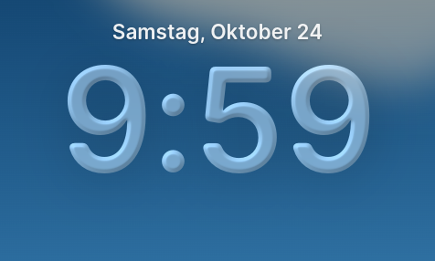](visual/maclock-morph-after-clock-before-1920.png) | [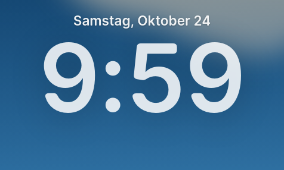](visual/maclock-morph-fallback-clock-before-1920.png) |
| Uhr10:00 / Endzustand |  | [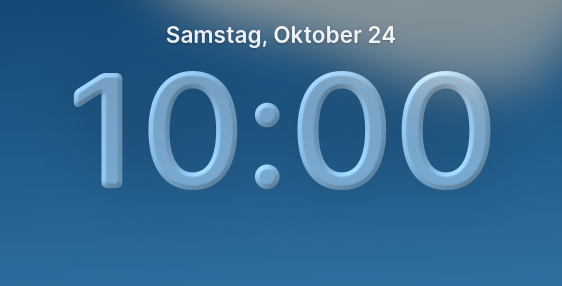](visual/maclock-morph-after-clock-after-1920.png) | [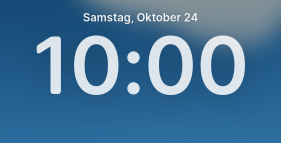](visual/maclock-morph-fallback-clock-after-1920.png) |
| Uhrmorph25% angefordert | Kein entsprechender Basiszustand | [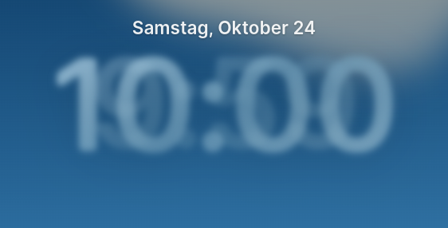](visual/maclock-morph-after-morph25-1920.png) | [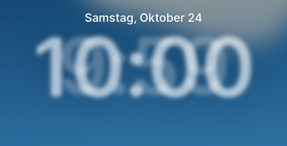](visual/maclock-morph-fallback-morph25-1920.png) |
| Uhrmorph50% angefordert | Kein entsprechender Basiszustand | [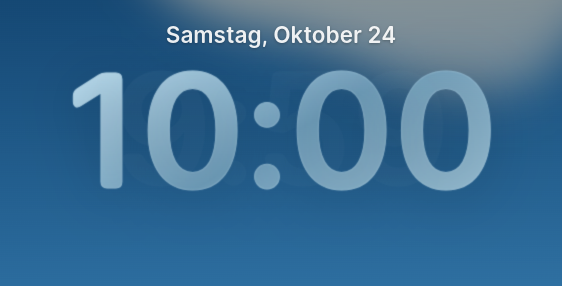](visual/maclock-morph-after-morph50-1920.png) | [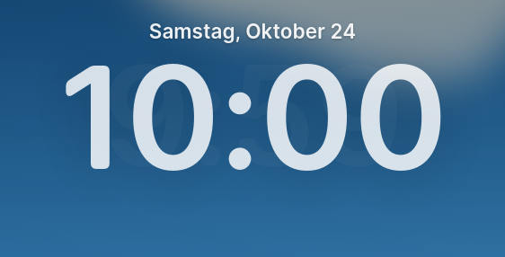](visual/maclock-morph-fallback-morph50-1920.png) |
| Uhrmorph75% angefordert | Kein entsprechender Basiszustand | [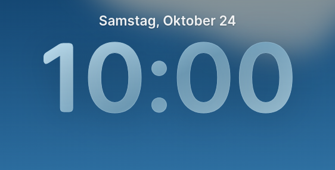](visual/maclock-morph-after-morph75-1920.png) |  |
| Passwort Ruhe |  | [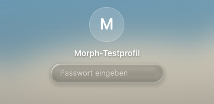](visual/maclock-morph-after-field-rest-1920.png) | [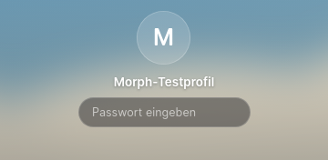](visual/maclock-morph-fallback-field-rest-1920.png) |
| Passwort Fokus |  |  | [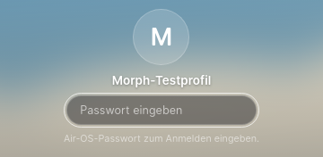](visual/maclock-morph-fallback-field-focus-1920.png) |
| Fehler-/Shake-Zwischenzustand | [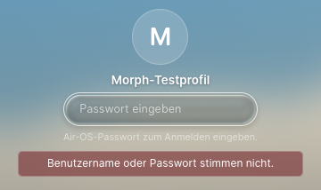](visual/maclock-morph-before-shake-1920.png) | [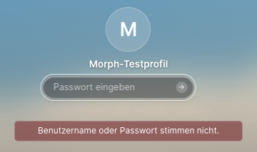](visual/maclock-morph-after-shake-1920.png) | [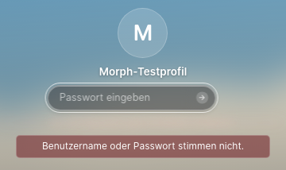](visual/maclock-morph-fallback-shake-1920.png) |
| Caps Lock ohne Submit | [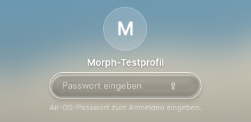](visual/maclock-morph-before-caps-1920.png) | [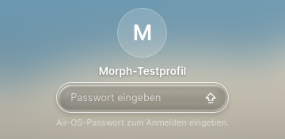](visual/maclock-morph-after-caps-1920.png) | [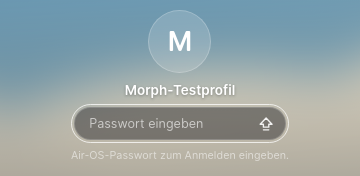](visual/maclock-morph-fallback-caps-1920.png) |
| Caps Lock mit Submit | Kein entsprechender Basiszustand | [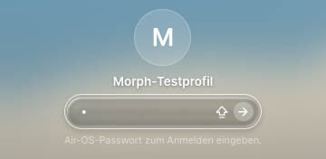](visual/maclock-morph-after-caps-submit-1920.png) | [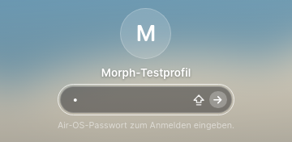](visual/maclock-morph-fallback-caps-submit-1920.png) |
| Submit-Pfeil / native maskierte Eingabe |  | [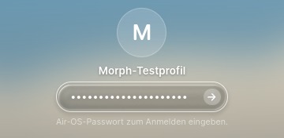](visual/maclock-morph-after-submit-1920.png) | [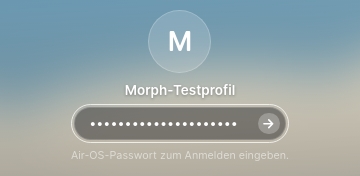](visual/maclock-morph-fallback-submit-1920.png) |
| Reduced Motion / stabiler Endzustand | [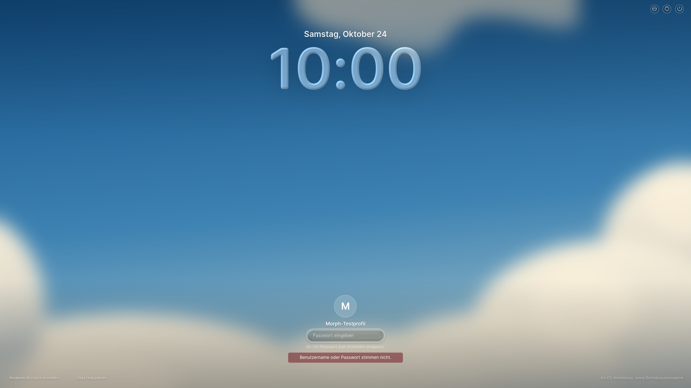](visual/maclock-morph-before-reduced-1920.png) |  | [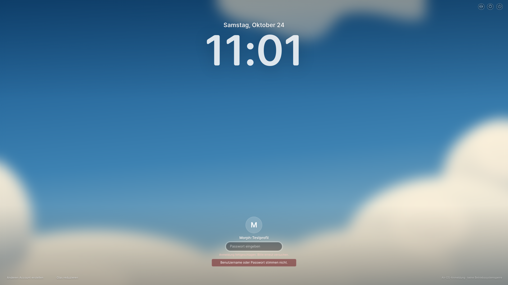](visual/maclock-morph-fallback-reduced-1920.png) |

### 1650px

| Zustand | Vorher L1B.2 | Nachher L1B.3 | Nativ ohne WebGL |
| --- | --- | --- | --- |
| Desktop |  |  | [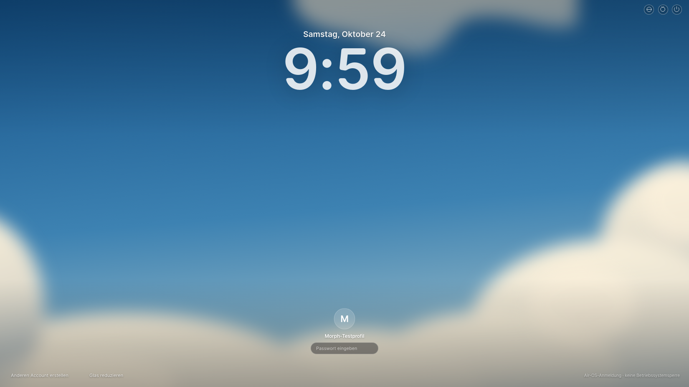](visual/maclock-morph-fallback-desktop-1650.png) |
| Uhr9:59 | [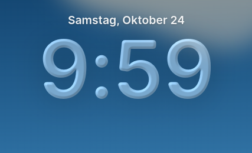](visual/maclock-morph-before-clock-before-1650.png) |  | [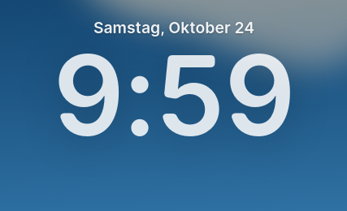](visual/maclock-morph-fallback-clock-before-1650.png) |
| Uhr10:00 / Endzustand |  | [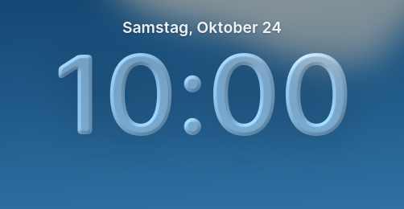](visual/maclock-morph-after-clock-after-1650.png) | [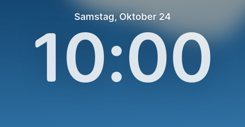](visual/maclock-morph-fallback-clock-after-1650.png) |
| Uhrmorph25% angefordert | Kein entsprechender Basiszustand | [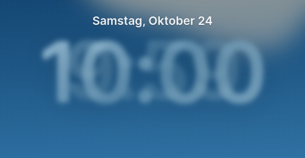](visual/maclock-morph-after-morph25-1650.png) | [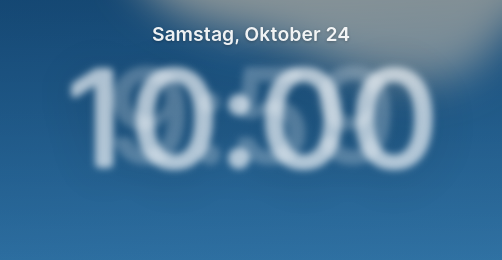](visual/maclock-morph-fallback-morph25-1650.png) |
| Uhrmorph50% angefordert | Kein entsprechender Basiszustand |  |  |
| Uhrmorph75% angefordert | Kein entsprechender Basiszustand | [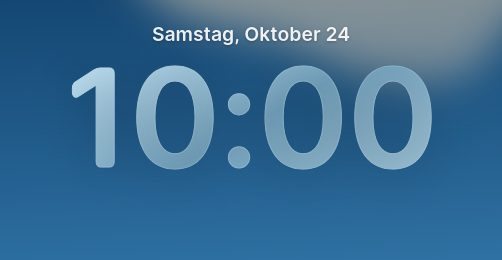](visual/maclock-morph-after-morph75-1650.png) | [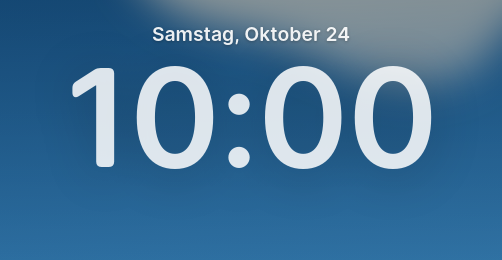](visual/maclock-morph-fallback-morph75-1650.png) |
| Passwort Ruhe | [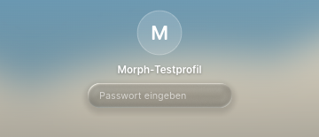](visual/maclock-morph-before-field-rest-1650.png) |  | [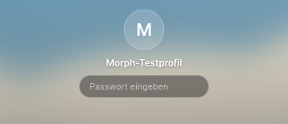](visual/maclock-morph-fallback-field-rest-1650.png) |
| Passwort Fokus |  | [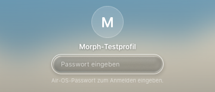](visual/maclock-morph-after-field-focus-1650.png) | [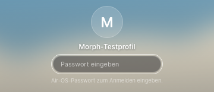](visual/maclock-morph-fallback-field-focus-1650.png) |
| Fehler-/Shake-Zwischenzustand | [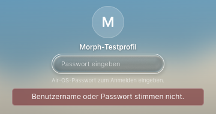](visual/maclock-morph-before-shake-1650.png) | [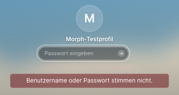](visual/maclock-morph-after-shake-1650.png) |  |
| Caps Lock ohne Submit | [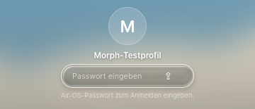](visual/maclock-morph-before-caps-1650.png) | [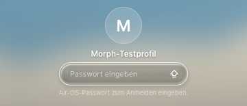](visual/maclock-morph-after-caps-1650.png) | [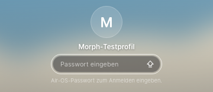](visual/maclock-morph-fallback-caps-1650.png) |
| Caps Lock mit Submit | Kein entsprechender Basiszustand | [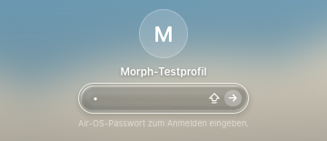](visual/maclock-morph-after-caps-submit-1650.png) | [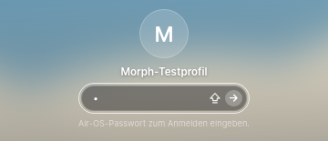](visual/maclock-morph-fallback-caps-submit-1650.png) |
| Submit-Pfeil / native maskierte Eingabe | [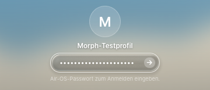](visual/maclock-morph-before-submit-1650.png) |  | [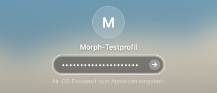](visual/maclock-morph-fallback-submit-1650.png) |
| Reduced Motion / stabiler Endzustand |  |  |  |

### 390px

| Zustand | Vorher L1B.2 | Nachher L1B.3 | Nativ ohne WebGL |
| --- | --- | --- | --- |
| Desktop | [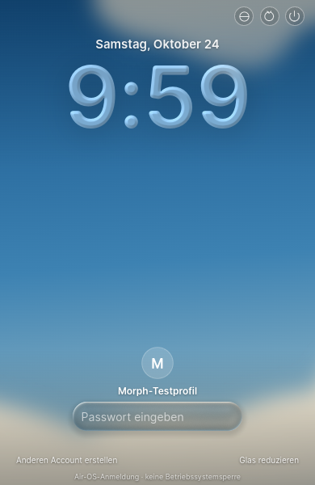](visual/maclock-morph-before-desktop-390.png) |  | [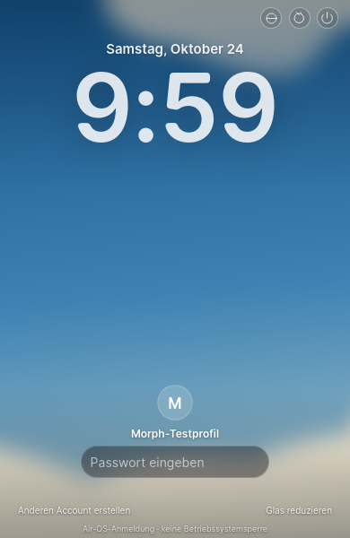](visual/maclock-morph-fallback-desktop-390.png) |
| Uhr9:59 | [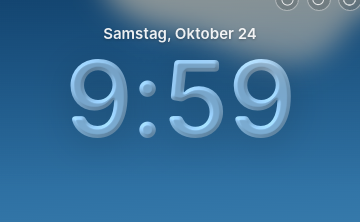](visual/maclock-morph-before-clock-before-390.png) |  | [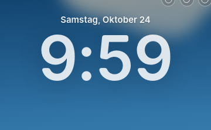](visual/maclock-morph-fallback-clock-before-390.png) |
| Uhr10:00 / Endzustand |  |  |  |
| Uhrmorph25% angefordert | Kein entsprechender Basiszustand |  |  |
| Uhrmorph50% angefordert | Kein entsprechender Basiszustand |  |  |
| Uhrmorph75% angefordert | Kein entsprechender Basiszustand |  |  |
| Passwort Ruhe |  |  |  |
| Passwort Fokus |  |  |  |
| Fehler-/Shake-Zwischenzustand |  |  |  |
| Caps Lock ohne Submit |  |  |  |
| Caps Lock mit Submit | Kein entsprechender Basiszustand |  |  |
| Submit-Pfeil / native maskierte Eingabe |  |  |  |
| Reduced Motion / stabiler Endzustand |  |  |  |

## Rohdaten, Reproduktion und Grenzen

- [Unveränderte L1B.2-Basis: natürliche Zeiten und Geometrien](visual/maclock-morph-before.json)
- [Finaler L1B.3-Softwarepfad: natürliche Zeiten, kontrollierte Zustände, Cleanup](visual/maclock-morph-after.json)
- [Nativer WebGL-Ausfall](visual/maclock-morph-fallback.json)
- [Finale native Caps-/Submit-Geometrie WebGL](visual/maclock-morph-after-caps-verification.json) und [ohne WebGL](visual/maclock-morph-fallback-caps-verification.json)

Haupthelfer [scripts/check-maclock-morph.cjs](../scripts/check-maclock-morph.cjs): vorhandenes externes Playwright, `AIR_GUI_TEST_ISOLATED=1`, `AIR_GUI_PHASE=before|after|fallback`, `AIR_GUI_CDP`, `AIR_GUI_DISPLAY`, `AIR_GUI_XAUTHORITY`. Eigener frischer userData-/Konfigurationspfad und Sandbox-X-Display je Prozess. Vorher startet bestätigten detached Worktree; Nachher normales Electron, nativer Fallback den bestehenden separaten Testentry. Caps-Verifikation: [scripts/check-maclock-caps.cjs](../scripts/check-maclock-caps.cjs) mit denselben Isolationsvariablen. XTest über vorhandenes libX11/libXtst, keine neue npm-Abhängigkeit. Passwortzufallswerte verbleiben nur im Testprozess, nicht in Bild-/JSON-/Logdateien.

Ein anfänglich fehlerhafter Screenshot-Helfer vermischte eigene Date-Vorgabe mit Playwright-Date-Installation; alle natürlichen Messungen laufen nun ausdrücklich davor, kontrollierte Minutenwechsel über `setSystemTime`. Ein weiterer Testbeobachter lief versehentlich auf der Desktopseite ohne Uhrnode; jetzt auf Login begrenzt. Native Caps-Tasten melden den geänderten Linux-Lockzustand zuverlässig mit nachfolgendem echtem Shift-Ereignis. Diese abgebrochenen Harnessversuche werden nicht als bestandene Abnahmen gezählt. Keine Produkt-Sicherheitstests abgeschaltet. Die ersten langsamen Readbackbeobachtungen führten zum dokumentierten Fallback, nicht zu einer60fps-Behauptung.

Originalvergleich weiterhin **BLOCKIERT**: kein ausführbares Qt/Quickshell/Hyprland und kein zugänglicher vergleichbarer Original-Screenshot (bisherige README-Attachments HTTP403). Daher Parameter-/Codeport und Air-OS-Basisvergleich bestätigt, keine Original-Pixelgleichheit. Qt-Blurkernel, Font-/Treiber-/Farbraumunterschiede sowie Software-Zwischenmaterialien bleiben Näherungen. Native Windows-/macOS-/physische GPU-Abnahmen offen.390px ist ein echter Linux-Electron-Viewport, keine native Windows-Mindestfensterbehauptung. Submit-Busy-Spinner wird an echte Busy-Klasse gebunden und in Quell-/Busy-/Authregressionen geprüft; keine künstlich verlängerte Anmeldung nur für einen Spinner-Screenshot.

Main/Preload, Desktop/App-/Fensterverwaltung, `maclock-motion.js`, `maclock-shaders.js`, Original-Fragmentshader, Fonts/Wallpaper/Layoutmodul, Air Home/Notes/Dock/Island/Classic/M1/M2 sind unverändert. Produktänderung ausschließlich an bestehender Loginfläche und Materialcache-Anbindung. PR-/Actions-Lesezugriff Forbidden, kein neuer CI-Erfolg behauptet. main/PRs/Installerbranches nicht verändert, keine Installer/Releases erzeugt. CB-03/Signing-/Releaseblocker bleiben offen.

Nächste drei getrennte Einheiten erst nach neuem Auftrag: **L1C.1 Demo-Player**; **L1D Original-/Hardwarevergleich und gezielte Kalibrierung**; **L1E Integrations-/native Plattformregressionen**. Diese Sitzung endet nach Commit/Push. Keine Musik/Lyrics begonnen.
