# L1C.1 – kompakte öffentliche MacLock-Musik-DEMO

25. Oktober 2026 (Europe/Berlin). Verifizierte Air-OS-Basis/Remote: **7c90367c3489408940a2c773aa9c58a38a041b52**, R1-Dokumentationsabschluss. Eigener Branch **feat/air-maclock-compact-media-l1c1-20261025**. MacShell-Remote/Original weiterhin **1bdb51870b621100fd2709f66c8f8e00ab17b9c4**. Keine alte Entwicklungsbasis eingespielt; Arbeitsbaum war sauber. main, PRs, R1-Buildbranch und Installerworkflows bleiben unverändert.

## Tatsächliche Umsetzung und Originalzuordnung

Die vorhandene Air-OS-Anmeldeseite besitzt jetzt genau eine kompakte Medienblase. Der sichtbare Hinweis **„DEMO · keine Audiowiedergabe“**, eigenes Cover, „Wolkenlicht“/„Air-OS Studio“ und statische Position0:56 von3:20 sind öffentliche synthetische Testdaten. Keine Audiodatei, Audioengine, Wiedergabe oder private Profil-/Medienquelle. Vorheriger/Play/Nächster sind native deaktivierte Buttons mit zutreffenden Beschriftungen. Die Fortschrittsanzeige ist ein nicht editierbarer, zugänglich beschrifteter `progressbar`. Keine Fake-Seek-/Transportaktionen, keine Formsubmission und keine zusätzlichen Tabstopps.

| Original am fixierten Commit | Tatsächliche Übernahme / Electron-Anpassung |
| --- | --- |
| [LockScreen.qml, media](https://github.com/0-ss/MacShell/blob/1bdb51870b621100fd2709f66c8f8e00ab17b9c4/MacLock/LockScreen.qml#L754) | Port der kompakten `artT=0`-Geometrie: `u=max(.6,H/1200)`,372u×150u, zentriert, oberer Slot `.075H+clock.height+22u`, Radius28u. Keine neue Dock-/Island-/Login-Geometrie. |
| [Glass.qml](https://github.com/0-ss/MacShell/blob/1bdb51870b621100fd2709f66c8f8e00ab17b9c4/MacLock/Glass.qml), media.Glass | Echte Wiederverwendung des vorhandenen WebGL2-`liquidglass`-Programms und bereits vorbereiteten Hintergrunds: thickness26×1.6=41.6, tint.48×.55=.264, shadow.55, pad10, bezel min(H×.36,26), rim.5, dispersion.078, magnify.08, grain.006, blur1.5, saturation1.25. Ein zusätzlicher Slab-Draw pro ohnehin angefordertem Frame, keine neuen Programme/GL-Texturen/Framebuffer/Renderloop. Bestehende Uhr-/Passwortparameter unverändert. |
| LockScreen.qml, art/txtCol | Cover58u, x/y16u, Radius11u; Text x87u/rechts18u, vertikal um45u zentriert; Titel15u/Semibold, Künstler13u/66% Weiß, Abstand2u. Vorhandene Open-Runde-Fonts. Eigenes lokales SVG ersetzt nicht freigegebenes Original-/Musikcover. |
| LockScreen.qml, scrub | x18u/rechts18u, y88u, Höhe16u; Zeiten11u/tabular, Abstand10u, Leiste5u/22% Weiß, Füllung88% Weiß. Originales `fmt` mit Finite-Guard; öffentliche feste Position28%. Kein500ms-MPRIS-Polling übernommen. |
| LockScreen.qml, transport | y110u, Abstand26u;32/38/32u×34u, Glyphen22/26/22u. Originales35%-Capability-Disabled-Material. Keine echte Quelle: alle drei deaktiviert. |
| [Glyph.qml](https://github.com/0-ss/MacShell/blob/1bdb51870b621100fd2709f66c8f8e00ab17b9c4/MacLock/Glyph.qml) | Originales `rpoly`-Verfahren und Play/Prev/Next-Koordinaten direkt nach JS portiert; ausschließlich öffentliche geometrische2D-Glyphen. Originaldatei bytegleich als MIT-Auditquelle gebündelt. Bei Forced Colors explizite Systempalette statt weißer Glyphen auf weißem Canvas. |

Dateien: [maclock-media.js](../maclock-media.js), [CSS](../maclock-media.css), [eigene Grafik](../maclock-demo-cover.svg), vorhandener [Glass-Host](../maclock-glass.js). `login.html` bindet ausschließlich diese Ergänzung ein. Paketdateiliste um die drei tatsächlich benötigten Laufzeitdateien ergänzt; keine Installeroption/Dependency/Runtime/IPC geändert. [Quellmanifest](../third_party/maclock/SOURCE_MANIFEST.json), [MIT](../third_party/maclock/LICENSE), [Portnachweise](../third_party/maclock/NOTICE.md), [OFL](../third_party/maclock/OpenRunde-LICENSE.txt) erhalten.

## Sicherheit, Lebensdauer und bewusst begrenzter Umfang

Der Medienbaustein liest weder `airOS`, Preferences, Stores, Passwörter noch lokale Musikpfade, Netzwerk oder andere Profile. Titel nur über `textContent`; keine HTML-Injektion. Canvas enthält ausschließlich die drei öffentlichen Transportglyphen, keine Texte oder Passwortkopien. Nach Accountwechsel bleiben dieselben öffentlichen Daten sichtbar; kein privater Now-Playing-Vertrag vorweggenommen.

Layout-/Glyphenarbeit nur bei veränderter Geometrie, Fontbereitschaft oder Hochkontrastpalette. Deduplication, abgebrochene Listener und `ResizeObserver.disconnect()`; verspätete Fontantworten können eine geschlossene Seite nicht reaktivieren. Bei `pagehide` Karte verborgen und2D-Canvasgrößen freigegeben. Vorhandener Glass-Host übernimmt Reduced Glass, Forced Colors, verstecktes Dokument, WebGL-Ausfall/Context Loss und GPU-Cleanup für alle drei Materialien. Keine eigene RAF-/Timer-/Audio-/MPRIS-Loop.

Keine große Coveransicht, Drag-/Slotwechsel, Lyrics-Schaltfläche/-Ansicht, Coverwechsel oder Medienbindung in L1C.1. Das zusätzliche DEMO-Etikett steht oberhalb der unveränderten Kartenbox. Die Eintrittsopacity folgt bewusst der vorhandenen L1B.2-650ms-Zeitleiste, statt zusätzlich die originale unabhängige500ms-Blasenopacity/650ms-Skalierung einzuführen. Endgeometrie/Materialwerte aus dem Original, keine behauptete Pixelgleichheit: Qt/Quickshell-Original hier nicht ausführbar und kein vergleichbarer Original-Screenshot verfügbar. Air-OS-Wallpaper statt fremder Artwork. Nächste Medienphasen bleiben separat.

## Ausgeführte Prüfungen

**321/321 vollständige Tests bestanden**,0 Fehler/Skips; zehn neue Regressionen gegenüber R1. Gezielter Media-/Glass-Lauf23/23. Tests erfassen Originalgeometrie/Materialwerte/Glyphenintegrität, öffentliche statische Daten ohne private API/Audio/Timer/HTML, deaktivierte Controls, Finite-Formatter, Resize-Deduplizierung, Forced-Colors-Palette, Pagehide/späte Fonts, Laufzeitdateien, einen zusätzlichen Draw mit unverändertem GL-Ressourcenbestand und vollständigem GPU-Cleanup. Bestehende Auth-/Profile-/M1-/M2-/Morph-/Island-/Notes-/Home-Tests erhalten.

Alle75 Laufzeitressourcen gefunden und JS/CJS syntaktisch geprüft; `check:catalina` und `git diff --check` bestanden. Frischer Audit der unveränderten eingefrorenen Modern-Toolchain0 Befunde. Keine neue Dependency; Legacy2 High, Plattform-/Signatur-/Releaseblocker bleiben offen. Paketliste ergänzt, kein neuer Installer oder Windowsbuild in dieser Phase behauptet; R1-Artefakt bleibt der unveränderte R1-Build.

Drei echte Linux-Electron44.9.3-Läufe **Vorher/Nachher/native WebGL-Ausfall jeweils Exit0**. Jede Größe: echte Formular-/Maus-/Tastatur-Anmeldung, Fehlpasswort/leeres Passwort nach Ablehnung/Retry, Notes/Home/Reminders/Finder-Starts, Modern/Classic-Wechsel, Layoutmessung. Nachher/Fallback zusätzlich Reduced Motion, Forced Colors, manuelle Glasreduktion, zwei getrennte synthetische Profile; Bob sieht keine Alice-Notizen, Demo bleibt profilunabhängig öffentlich. Native `getContext('webgl')` und `getContext('webgl2')` im Fallback tatsächlichnull. Echte `WEBGL_lose_context`-Probe ergibt `context-lost`, CSS-Fallback, sämtlichen GL-Bestand0. Pagehide-Handlerprüfung: Media disposed/Observer und Listener entfernt/Canvasgrößen0; Glass-GPU0, Motion/Morph kein pendingFrame. Die Cleanup-Snapshots stammen aus gezieltem Pagehide-Ereignis; die An-/Abmeldungen und Profilnavigationen selbst wurden ebenfalls tatsächlich ausgeführt.

[Vorher-Rohdaten](visual/l1c1-before/l1c1-report.json) · [Nachher-Rohdaten](visual/l1c1-after/l1c1-report.json) · [nativer Fallback](visual/l1c1-fallback/l1c1-report.json). **31 echte PNGs**; kein Screenshot künstlich neu gezeichnet. Der neue Inhalt wird tatsächlich im Electron-Renderer dargestellt, Detailbilder sind Renderer-Ausschnitte.

| Viewport | gemessene Medienbox x/y/B/H (CSS-px) | Radius / Cover (Soll) |
| --- | --- | --- |
|1920×1080|792.59375 / 306.203125 / 334.796875 / 135|25.2 / 52.2|
|1650×930|680.84375 / 264.953125 / 288.296875 / 116.25|21.7 / 44.95|
|390×600|83.390625 / 195.796875 / 223.1875 / 90|16.8 / 34.8|

Subpixelabweichung unter.06px gegenüber der Originalformel. Die gesamte Blase bleibt im Viewport, oberhalb der Anmeldung. Clock/Passwort/Profil/Loginstage und Dock/Island sind **vorher/nachher/Fallback exakt gleich** gemessen: Dock358×68/unterer Abstand0 in allen Größen; Island250×45,214.84375×38.671875 und156×36/oberer Abstand0. Unveränderte Codebestände: main/preload/app.js, Auth/Profile/Stores, Desktopstyles/Dock/Island/M1/M2 sowie Shaderquellen/Motion/Morph. Der Glass-Host ergänzt lediglich die optionale Medien-Slab-Geometrie.

**Natürliche Software-Laufzeitproben, keine angehaltene Testuhr:** DOM-Entry-Paints vorher/nachher4/4,5/6,8/6; Glass-Frames2/2,4/5,6/5 bei1920/1650/390. Zeit vom Motion-Start bis letztem Paint1970.9/1781.1ms,1634.7/1048.1ms,1417.0/757.2ms. Einzelne Softwareläufe mit unterschiedlicher Initialisierungs-/Shaderlast, kein repräsentativer Benchmark und kein Nachweis einer Performanceverbesserung. Insbesondere1920 weiterhin weit unter flüssiger Animation, keine60fps-/Hardwarefreigabe. Materialzustand unverändert4 Programme/3 Texturen; zusätzlicher Slab nutzt dieselben Ressourcen, keine neue Renderloop oder synchroner Readback. Original-/Hardwarekalibrierung und bekannte Software-GPU-Engstelle bleiben offen.

Öffentliche PR-/CI-Seiten erreichbar; keine PRs geändert. Kein neuer CI-Erfolg für L1C.1 behauptet, insbesondere keine neue native Windows-/macOS-GUI-Abnahme. Die neue Phase ändert den R1-Windowsworkflow nicht.

 Ein erster Hochkontrastlauf deckte eine CSS-Spezifität des neuen Fallbacks auf; korrigiert und Palette-Redraw/Cleanup gezielt getestet. Eine erste Context-Loss-Probe verlangte zu eng einen bestimmten Fehlertext: Der Abnahmepunkt verlangt nun den realen Kontextverlust mit Fallback und vollständig freigegebenen GPU-Objekten; der tatsächliche Grund steht unverändert in den Rohdaten. Fehlgeschlagene/abgebrochene Harnessversuche zählen nicht als bestandene Läufe.

## Sichtbarer Vorher-/Nachhervergleich

Echte Linux-Electron44-Aufnahmen mit Chromium-Sandbox und isolierten synthetischen Profilen, ANGLE/SwiftShader-Softwaregrafik. Keine Windows-/macOS-/physischeGPU-Abnahme.1920/1650 native Testfenster tatsächlich vergrößert;390px ist ein schmaler echter Renderer in einem mindestens760px breiten Host, kein natives390px-Gerät. Vorher stammt aus eigenem unverändertem R1-Worktree, Nachher aus dieser Phase.

| Auflösung / Ansicht | R1 vorher | L1C.1 nachher |
| --- | --- | --- |
| 1920×1080 / Lockscreen | 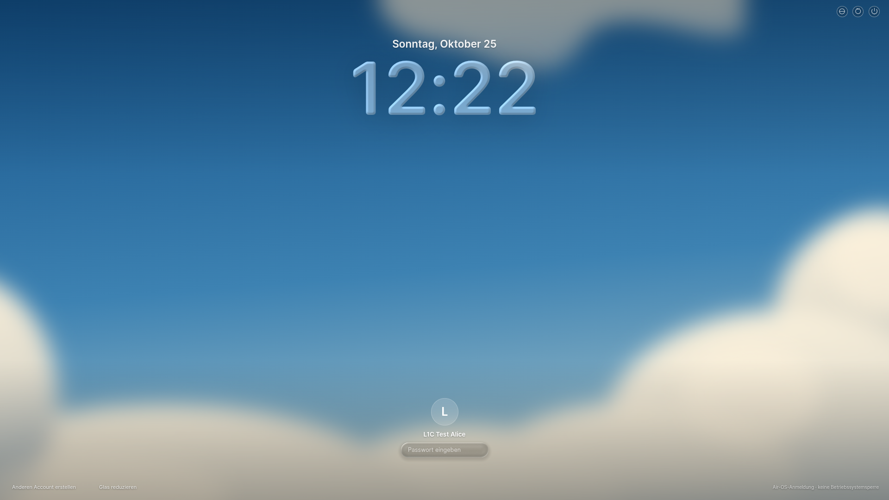 |  |
| 1920 / Blasendetail |  | 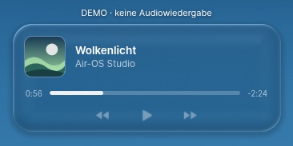 |
| 1650×930 / Lockscreen |  |  |
| 1650 / Blasendetail |  | 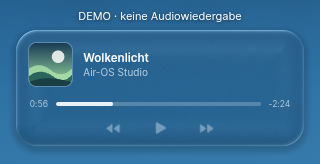 |
| 390×600 / Lockscreen | 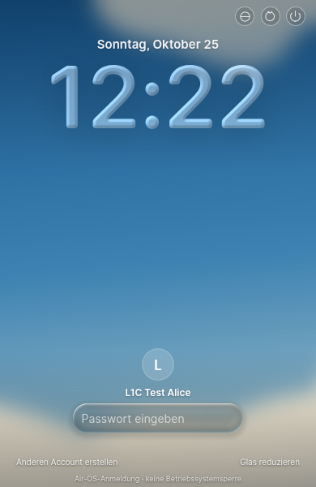 | 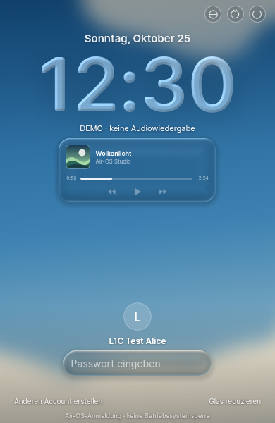 |
| 390 / Blasendetail |  | 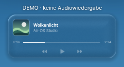 |

| Breite | Nativer WebGL-Ausfall | Forced Colors | Glas reduzieren |
| --- | --- | --- | --- |
| 1920 | 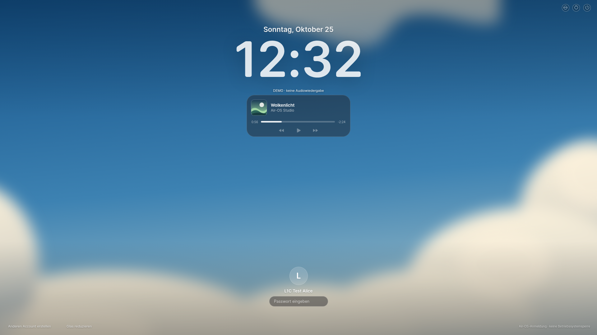 | 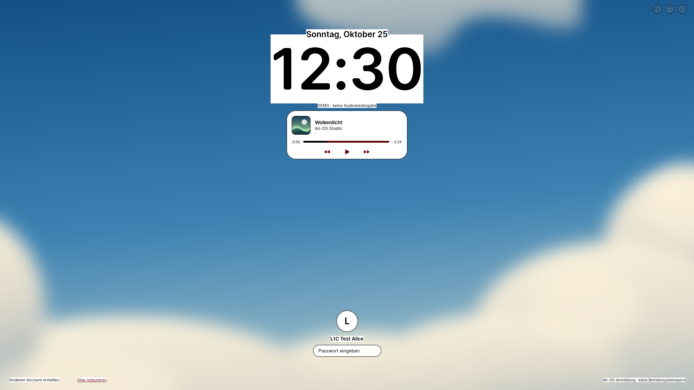 |  |
| 1650 |  | 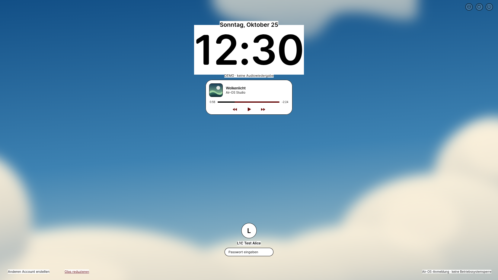 | 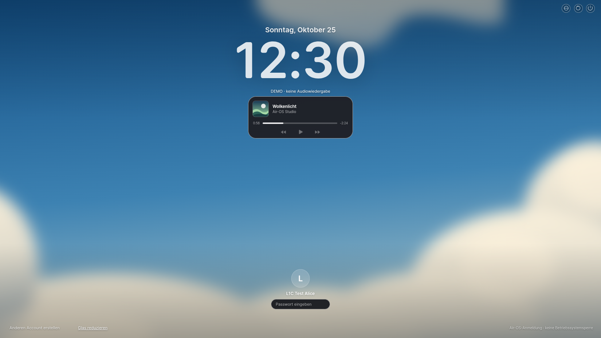 |
| 390 | 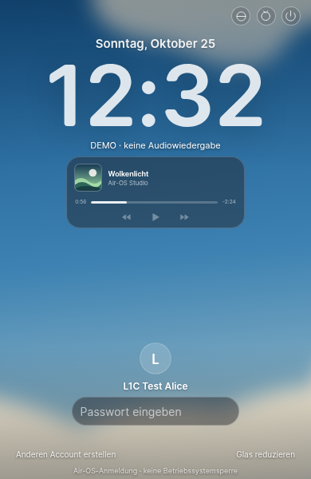 | 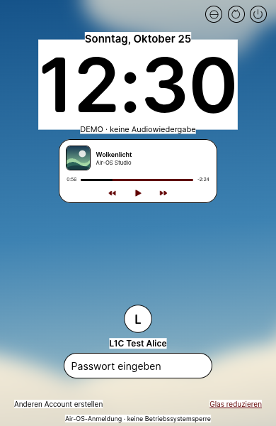 | 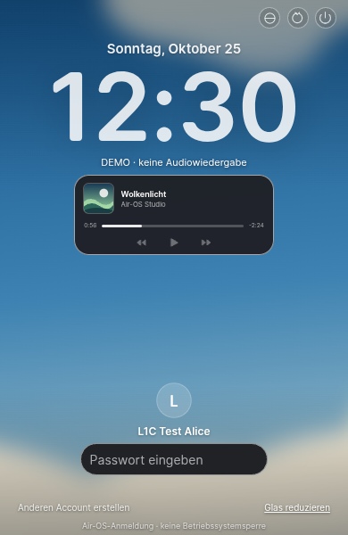 |

[Context-Loss-Fallback](visual/l1c1-after/l1c1-after-context-loss-390.png). Alle weiteren Fallbackdetails: [1920](visual/l1c1-fallback/l1c1-fallback-media-1920.png), [1650](visual/l1c1-fallback/l1c1-fallback-media-1650.png), [390](visual/l1c1-fallback/l1c1-fallback-media-390.png); [sämtliche Aufnahmen und Rohdaten](visual/l1c1-fallback/).

## Abschluss / nächste getrennte Einheiten

L1C.1 tatsächlich umgesetzt, getestet und auf eigenem Branch gesichert; Commit-SHA im Abschlussbericht. Keine nächste Phase automatisch begonnen. Nur nach neuem Auftrag: L1C.2 große Coveransicht, L1C.3 begrenzter Cover-/Hintergrundeffekt, AM2 separat echte lokale Wiedergabe. Native Plattform-/Performance-/Releaseblocker bleiben offen. STOP.
