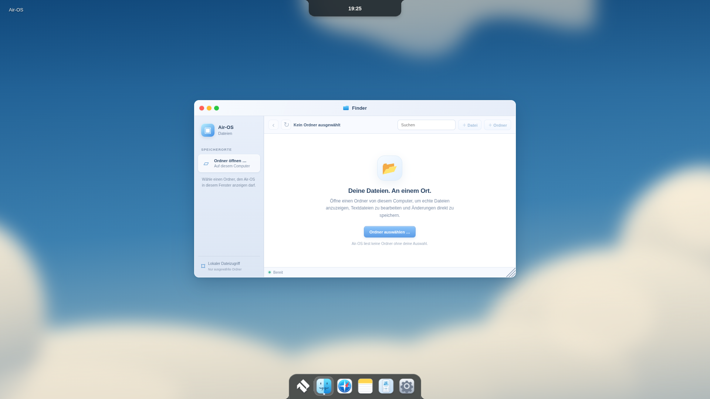
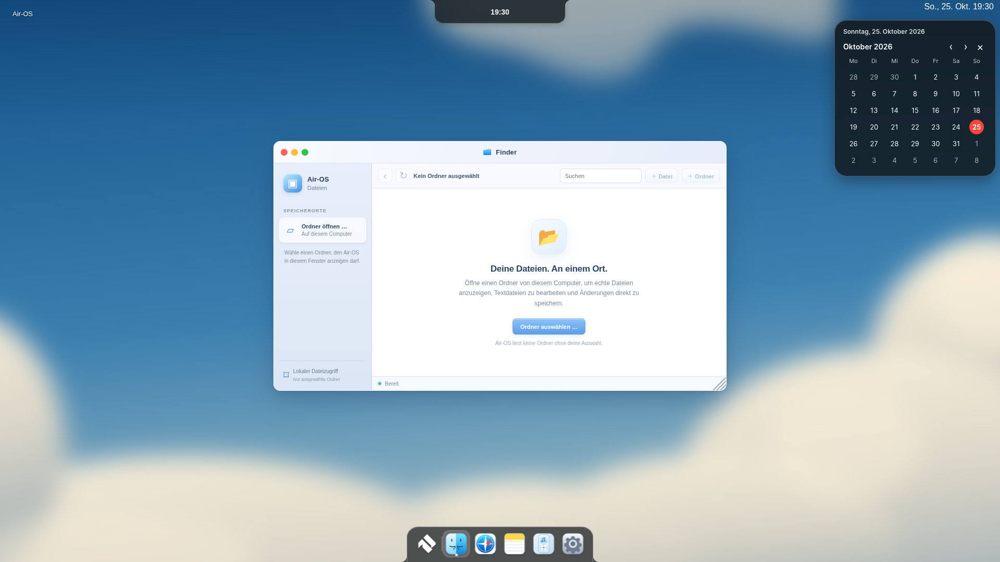
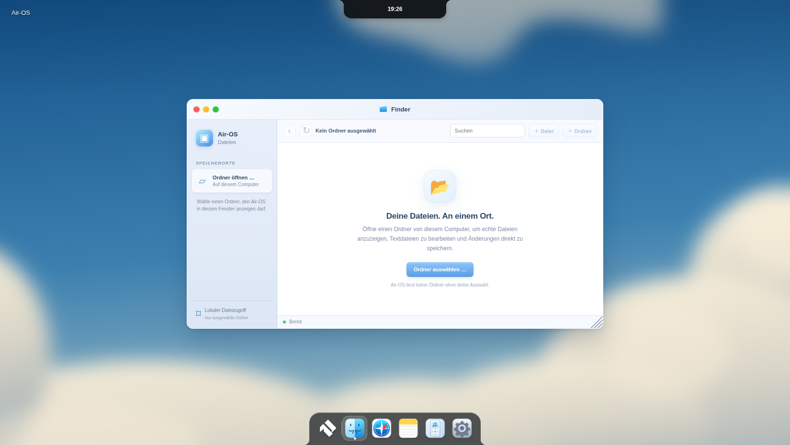
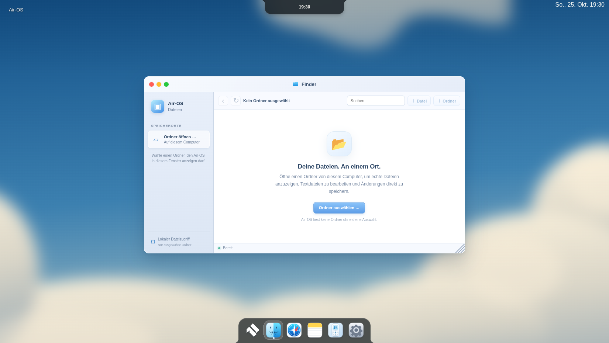
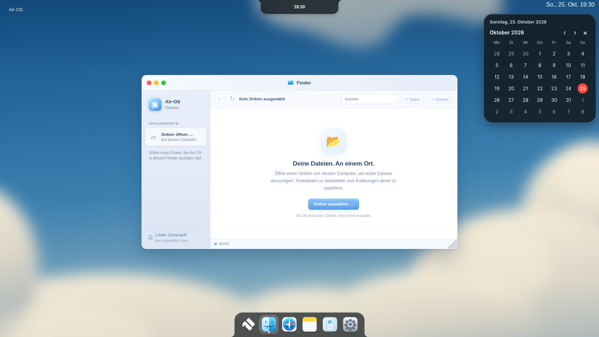
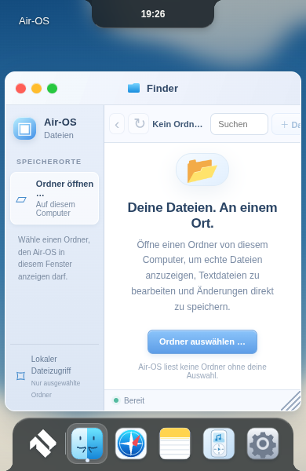
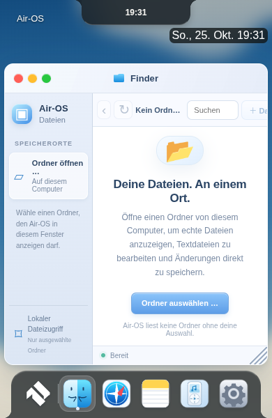
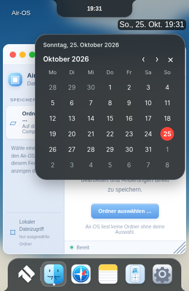

# MS-UI1 – rechter Uhr-/Kalenderbereich

Basis `8a2824ed7b4e285fa0f41308c53a6258b5476577`, Branch `feat/air-menubar-calendar-msui1-20261025`,25.Oktober2026 Europe/Berlin.

## Originalcode und tatsächlicher Port

MacShell fixiert auf **1bdb51870b621100fd2709f66c8f8e00ab17b9c4**:

- [MacBar.qml](https://github.com/0-ss/MacShell/blob/1bdb51870b621100fd2709f66c8f8e00ab17b9c4/MacShell/MacBar.qml), `calCells`, `shiftMonth` und Kalender-Popup, Zeilen4812–4827/7230–7361: lokaler 42-Zellen-Raster mit Nachbarmonaten, Monatsnavigation über Date-Konstruktor, Heute-Markierung. Nach JavaScript/DOM portiert in `air-calendar.js`. Quellenabschnitte in `third_party/macbar/MacBar-calendar.qml.txt` erhalten.
- [CalendarWidget.qml](https://github.com/0-ss/MacShell/blob/1bdb51870b621100fd2709f66c8f8e00ab17b9c4/MacShell/CalendarWidget.qml): Originalkopie in `third_party/macbar/CalendarWidget.qml`. Lokale Datumslogik/WeekStart und30-Sekunden-Prüfung als Grundlage. Dunkelmodus-/Heute-Farbe#FF453A übernommen; keine vollständige Widget-/Desktopfunktion portiert.
- Tatsächlicher MacBar-Popover:310px, Radius24, x rechts8px, y Barhöhe+6, Padding16×14, Spacing8, Header14/DemiBold, Wochentage11, Tage13, Zeilen32, Heute-Kreis28, Navigation26/Radius13. Open Runde Regular/Semibold aus vorhandenem lizenziertem Fontpaket. Eintrittsskalierung.96→1,140ms OutCubic. Farben/Glaskonturen als dunkles CSS-Material mit42px Blur und opakem Software-/Reduced-Glass-Fallback übertragen. **Keine echte QML-LGlass-Refraction oder Pixelgleichheit behauptet.** Keine neuen GPU-Pässe/Renderloops.
- Anpassungen: deutsche Lokalisierung/Montagbeginn statt optionalem Sonntag; Tageskonstruktion mit lokaler Mittagszeit für DST-Robustheit; Navigation nur echte Monate, keine Events/Termine/zweiter Datenspeicher. Schließbutton/Tastaturfokus zusätzlich. Schließen sofort und ohne Animation statt original110ms Ausblenden; vermeidet unsichtbare fokussierbare Controls/stale Completioncallbacks. Öffnungsopacity folgt aktuell derselben140ms CSS-Animation statt unabhängigen110ms des Originals. Stärkerer Sekundärtextkontrast als originale55%-Deckkraft.

MIT Copyright(c)2026 Rickky in Port und [mitgebündelter Lizenz](../third_party/macbar/LICENSE) erhalten. Bestehende Open-Runde-OFL-Nachweise bleiben im Fontpaket. Original-QML nicht zur Laufzeit ausgeführt, kein Qt/Hyprland-Prozess. Originaloberfläche hier nicht ausgeführt; kein vergleichbarer nativer Original-Screenshot verfügbar.

## Integration und Grenzen

Die bisherige `.menubar` inklusive rechter Uhr ist im Modern-Modus ausgeblendet. Bestehendes `#clock` wird daher vorübergehend in einen echten Button oben rechts umgehängt; Classic erhält dasselbe Element an ursprünglicher Position zurück. Keine zweite Menüleiste. Moderne linke System-/Appmenüs, Suche/Accountpfade bleiben erhalten. Unter650px sitzt der rechte Uhrbutton in der nächsten Randzeile unter der unveränderten Island; Popover ab70px. Desktop-Popover38px, rechts8. Keine Island-/Dockgrößen-/Positionsregeln verändert.

Klick toggelt; Escape/Schließbutton geben Fokus zurück; Outside-Click lässt Fokus beim geklickten Ziel; Tab/Shift-Tab bleiben innerhalb des geöffneten Dialogs. Monatsschalter native Buttons für Enter/Space. Sichtbare Fokusringe, `aria-expanded`/Dialogbeschriftung/Monatsansage. Tagfelder sind absichtlich reine Datumsanzeige. Aktuelles lokales Datum beim Öffnen, Fokus und alle30s während offen; kein Hintergrundtimer nach Schließen/Logout/pagehide. Bei Classicwechsel schließt der Dialog. Lokale Datumsberechnung berücksichtigt Monats-/Jahreswechsel, Schaltjahre und Zeitzone ohne UTC-Datumsstrings. Kein simuliertes OS-Datum in Produktcode.

`air-calendar.css`/JS und MIT-Quellen im vorhandenen Paket eingeschlossen; PWA übernimmt sie über bestehenden Build. Keine Cloudauth/Schlüssel/privaten Daten, keine Veröffentlichung und keine Änderungen an Installer-/Signinglogik. Native Windows/macOS/iPad-Abnahme offen. MacShell-Folgephasen nicht begonnen.

## Prüfung

350/350 Tests bestanden; neue gezielte Schaltjahr-/Jahrhundert-/42-Zellen-/Zeitzonenprüfungen. Echte Linux-Electron44-Vorher-/Nachherprüfung mit isolierten synthetischen Profilen1920×1080,1650×930,390×600; bestehende R1-Prüfungen zu Profilen/Notes/Home/Classic/Modern/M1/M2/K3/ReducedMotion/Neustart/WebGL-Ausfall beibehalten. Kalender prüft Öffnen/Monatsnavigation/Tab/Space/Escape/Fokus/Outside-Click und Classic-Rückkehr. Voller zusätzlicher Lauf: [Regressionsbericht](visual/msui1-after/full-regression-report.json); abschließender fokussierter Lauf nimmt Bilder nach Animationsende auf.130 Laufzeitdateien/Syntax und Diff geprüft.390px ist schmaler echter Renderer, keine native390px-Hardware.

| Breite | Vorher Desktop | Nachher Desktop | Geöffneter Kalender |
|---|---|---|---|
|1920||||
|1650||||
|390||||

Rohmessungen: [Vorher](visual/msui1-before/r1-gui-report.json), [Nachher](visual/msui1-after/r1-gui-report.json). Keine erfolgreiche native Windows/macOS/Safari- oder Shader-Originalabnahme abgeleitet. Offene Unterschiede sind oben ausdrücklich benannt.
