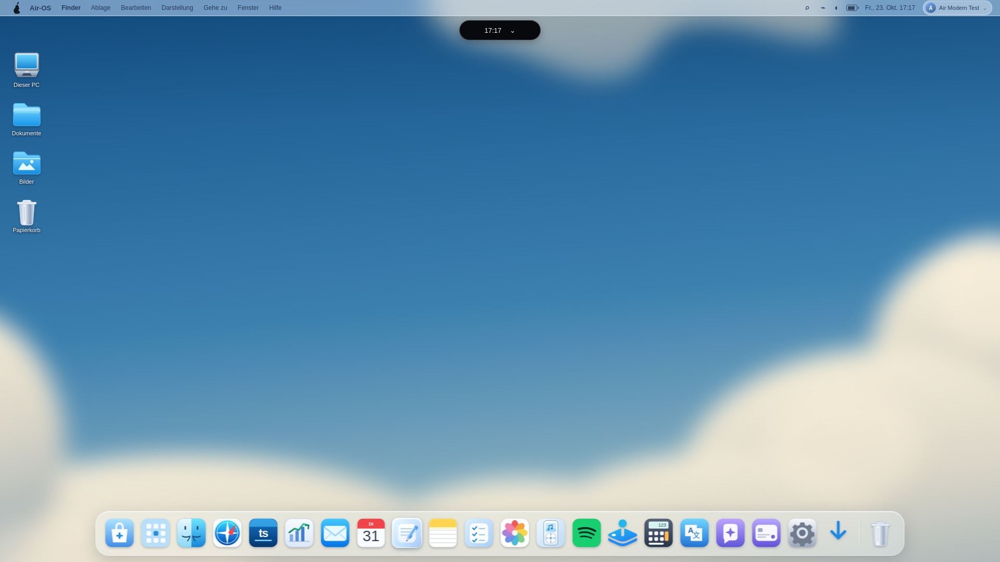

# Air Modern – verbindlicher Designplan aus Bild 2

> Neue ergänzende Richtung,24. Oktober2026: [Air-OS Ultimate Hybrid – Konzept vor F2](AIR_OS_ULTIMATE_HYBRID_DESIGN.md). Mint/Creme, Wolken, Originalicons und gemessene Geometrien bleiben erhalten. Neue dunkle Such-/Schnellflächen und Apple-Interaktionsprinzipien sind dokumentierte Entwürfe; F2 erst nach Freigabe. Supaste-Zugriff hier403, deshalb dessen genaue visuelle Auswertung noch offen. Historische Abschnitte unten sind keine neuen Abnahmen.

23. Oktober 2026. Bild 1 ist der zu ersetzende Bestand, **Bild 2 ist die visuelle Zielreferenz**. Keine Folia-Webseite, kein fremdes Logo, kein Bloom-Code/-Asset. Bloom bleibt GPL-Referenz für allgemeine Interaktionsprinzipien; Air-OS-Implementierung eigenständig unter MIT. Desktop bleibt innerhalb der Electron-App. Installer-Workflows, Testinstaller-Branch und vorhandene Downloads bleiben unangetastet.

## Referenzgeometrie

Das beigefügte Bild 2 ist 1920 × 1080 px groß. Die folgenden Bildkoordinaten sind aus der sichtbaren Vorlage angenähert; sie sind keine automatisch berechnete Pixel-Diff-Messung. Die daraus festgelegten Zielmaße sind die Grundlage der nächsten Einheiten.

| Element | Ziel bei 1920 × 1080 | Umgerechnet auf 1650 × 930 |
| --- | --- | --- |
| Air-Home-Außenrahmen | etwa x=200, y=103, Breite=1522, Höhe=849 | x≈172, y≈89, 1308 × 731 |
| Anteil am Desktop | 79,3 % breit, 78,6 % hoch; oben 9,5 % Abstand | dieselben Proportionen, nicht Vollbild |
| Mint-Seitenleiste | etwa 212 px / 13,9 % der Fensterbreite | etwa 182 px |
| Mint-Rahmen, Außenradius | 9–10 px, Radius 22 px | 8–9 px, Radius 20 px |
| Hauptinhalt | 3 Spalten, Kacheln ca. 380 px, Abstand 20 px, Rand 60 px | Kacheln ca. 327 px, Abstand 17–18 px, Rand 52 px |
| Schwarzes Host-Dock | etwa 440 × 68 px, mittig, unten 0–8 px | etwa 378 × 59 px; Icons 35–42 px |
| Schwarze Island | etwa 250 × 45 px, mittig am oberen Rand | etwa 215 × 39 px |

Das große helle Werkzeugband **innerhalb** des Folia-Fensters ist nicht das schwarze Air-OS-App-Dock. Keine Kopie dieses Fremdprodukts/Logos oder seiner Daten. Bei kleinen Displays: Außenabstand 12–16 px, Kacheln später auf zwei/eine Spalte, Seitenleiste kompakter; Island und Dock dürfen niemals Bedienelemente verdecken. Layout-/Fokusvertrag mit der bestehenden Fensterverwaltung umsetzen, keine zweite Fensterverwaltung.

## Farb- und Typografiesystem

An Bild 2 angenäherte und für Air-OS festgelegte Werte, keine behaupteten exakt gesampelten Originalfarben. Bereits als wiederverwendbare `--air-modern-*`-Tokens in styles.css hinterlegt; bestehende App-Oberflächen werden erst in ihren Folgephasen umgestellt.

| Rolle | Air-OS-Wert |
| --- | --- |
| Himmel, Richtwert | `#235f94`, Verlauf von `#124f86` zu `#9bbcc7` |
| Mint-Rahmen | `#9cdaa1` |
| Helle Navigation | `#b0e5ad` |
| Warmer Inhaltsgrund | `#f8f7f3` |
| Dunkelgrüner Text | `#2c3b31` |
| Sekundärtext | `#677e6c` |
| Feine Umrandung | `#b8bcb6`, 1 px |
| Dock/Island | `#090b0c` |
| Kachelradius | 10 px |
| Fensterschatten | `0 18px 48px #183b3929` |

Spätere Schriftumstellung: System-UI für Navigation/Inhalte (`system-ui`, macOS-Systemschrift, Segoe UI unter Windows); eigene Serif-Akzente mit vorhandenen Georgia/Times-Fallbacks statt fremder Fontdateien. Hauptbegrüßung ca. 34–36 px, Abschnittstitel 28–30 px, Inhalt 17–18 px bei Referenzgröße, entsprechend kleiner bei 1650 px. Tatsächliche Fontmetriken pro Plattform visuell abnehmen. Keine externen Fonts erforderlich.

## Kleine, einzeln prüfbare Einheiten

- **A1 – diese Sitzung abgeschlossen:** Original-Wolkenhintergrund und Farb-/Maßgrundlage. `clouds` ist der neue Default bei fehlender Auswahl/neuen Profilen. Vorhandene explizite Bilder bleiben erhalten. Bestehende Einstellungen erlauben Auswahl von „Blaue Wolken“, Classic-Bildern und eigenen Bildern.
- **A2 – abgeschlossen:** separater profilbezogener Desktop-Theme-Vertrag „Air Modern / Classic“ im bestehenden Preferences-Service; Alt-/Neuprofile, Reset und fehlgeschlagenen Save testen. Dock-Theme nicht als zweiten widersprüchlichen Desktop-Theme-Store missbrauchen.
- **A3 – abgeschlossen:** minimale Modern-Desktop-Hülle: dauerhaft sichtbare Menüleiste/Seiten-Icons ausblenden, aber Menüfunktionen, Kontomenü/Abmelden, Suche, Settings und alle Apps über erreichbare Maus-/Tastaturwege erhalten. Classic wiederherstellbar; keine stille Funktionsentfernung.
- **B1/B2/B2.2 – abgeschlossen:** Dock auf 358×68 px und schwarze Fläche reduziert; Apps weiterhin aus bestehender Registry/Lifecycle. Pinning-Renderer, Pin/Unpin, Sortierung und Kontextmenüs in jeweils eigenen Untereinheiten. Vorhandener Pinning-Speichervertrag bleibt die Grundlage.
- **C:** bestehende Island an oberen Rand/proportionale Größe anpassen; echte Uhrzeit/Control-Tile/Notes-Mitteilung erhalten, Fokus/kleine Displays/reduzierte Bewegung regressionsprüfen. Keine Fake-Medien-/Batteriewerte.
- **D:** eigenständiges Air Home in bestehender Registry/Fensterverwaltung, Mint-Rahmen und Navigation; kein Web-Wrapper für Folia. Ein Fenster, keine Dashboard-Funktionssammlung in derselben Einheit.
- **E:** je ein echtes Widget anbinden: angemeldeter Benutzer/lokales Datum; Notes; Reminders. Kalender zunächst Profilgrenze lösen. Projekte/zuletzt verwendete Apps/Fokus-Timer nur mit tatsächlichem Zustandsmodell; keine Beispielwerte als echte Nutzerdaten.
- **F:** Fensterrahmen/Öffnen/Schließen sowie Bewegungsreduktion über vorhandene Lifecycle-/Animationswege angleichen.
- **G:** bestehende Apps einzeln integrieren; Finder-/Store-/Runtime-/Profile-/Dateisicherheitsfunktionen erhalten.
- **H:** festgelegte Screenshot-Fälle auf Windows und macOS, unterschiedliche Größen, Tastatur/Kontrast/Performance; Abweichungen einzeln beheben. Keine 1:1-Abnahme aus einem einzelnen Linux-Bild ableiten.

## A1-Implementierung und tatsächliche visuelle Prüfung

Eigene SVG-Vektorgrafik in app.js, als Data-URI offline im Renderer dekodiert, kein Netzdownload oder fremdes Bild. Statische Farbverläufe und weiche Wolkenformen, keine neuen Timer/Animationen. Kein zusätzliches Runtime-Asset und keine Änderung von package.json/Build-Manifest/Installer-Workflows nötig. Alte CSS-Regel erzwang das Strandbild mit `!important` sogar über der gespeicherten Preferences-Auswahl; sie ist entfernt. Der erste echte GUI-Test entdeckte diesen Effekt (`clouds` gespeichert, berechnetes Bild trotzdem Strand), nach Fix tatsächlich SVG sichtbar.

145 Node-Tests bestanden, kein Fehler/Skip; gezielte Preferences-/Pinning-/Schreibsicherheitsprüfungen 16/16. Neue Store-Regression prüft Default, Neustart über neue Store-Instanz, Classic-/Custom-Bilder, Profiltrennung, Wechsel/Reset und Ablehnung freier Wallpaper-URLs. Keine bestehenden Daten migriert oder gelöscht.

Echter Electron-32.3.3-/Linux-/Xvfb-GUI-Test mit aktiver Namespace-Sandbox, ohne --no-sandbox, separatem Wegwerfprofil und lokalem CDP 9231. Der alte Helfer-Display :99 war nicht autorisiert; eigener authentifizierter Display :101 löste dies, ohne fremde Sessions zu beenden. Baseline vor Änderung lokal unter `/workspace/.air-os-onboarding/modern-a1-evidence/before-1920.png`. GUI-Helfer `/workspace/.air-os-onboarding/check-modern-a1.cjs` (vorhandenes Playwright):

1. Neues Profil liefert clouds; tatsächlich dargestellte Data-URI dekodiert als 1920 × 1080 SVG.
2. Echte Settings-Klicks wechseln zu Yosemite und wieder zu Wolken, bestätigte authentifizierte Preferences-IPC liefert die Auswahl, Reload behält sie.
3. Bestehendes Launchpad öffnet/schließt über Dock; vorhandener automatischer Finder wird für den Hintergrundvergleich regulär geschlossen, keine Registry-/Lifecycle-Ersetzung.
4. Vollflächiger Hintergrund und mittige Island bei 1920 × 1080, 1650 × 930, 390 × 600; statischer Hintergrund bei OS-Bewegungsreduktion, keine ungefangenen Rendererfehler.

Screenshots stammen tatsächlich aus diesem Electron-Lauf, kein Mockup und kein erzeugter Entwurf einer noch fehlenden Dashboard-Oberfläche:

[1650 × 930](visual/air-modern-a1-1650.png) · [390 × 600](visual/air-modern-a1-390.png)

## Ausdrückliche Abweichungen zu Bild 2

- **Hintergrund:** eigenes weiches Vektorbild, nicht die fotografische Wolkenstruktur/Körnung oder exakte Wolkenverteilung der Referenz. Farbrichtung angenähert, kein Pixel-Match.
- **Menü/Icons (seit A3):** in Modern ausgeblendet, in Classic unverändert sichtbar. Kleiner eigener Air-OS-Menüknopf links oben erhält System-/Profilaktionen. Kein dauerhaftes neues Werkzeugband.
- **Dock (seit B1):** Modern-Dock tatsächlich 358×68px, Originalicons 42px, Hintergrund #090b0c, 6px vom unteren Rand; bei allen drei geprüften Breiten ohne Scrollen. Classic bleibt unverändert. B2-Startmenü steht aus.
- **Island:** tatsächlich 156 × 38 px, y=39; Ziel etwa 250 × 45 bei y≈0 bzw. skaliert bei 1650. Vorhandene Funktion erhalten, neue Proportionen erst C.
- **Air Home:** Mint-Fenster, Seitenleiste, cremefarbene Kacheln/Typografie und Widgets fehlen vollständig; nur Designvorgaben/Tokens, keine fertigen Komponenten behauptet.
- **Animationen:** in A1 nur statischer Hintergrund. Keine bestätigte neue Dock-/Island-/Fensteranimation oder generelle Performance-Abnahme.
- **Plattform:** neue visuelle Abnahme nur Linux/Electron, keine neue Windows-/macOS-/Installer-/Screenreader-Abnahme. Vorhandene Testinstaller aus 668f636 enthalten dieses Redesign noch nicht.

Die Sitzung liefert bewusst nur A1. Ziel bleibt Bild 2; die deutlichen strukturellen Abweichungen sind geplante offene Arbeit, keine abgeschlossene visuelle Freigabe. Bestehende Audit-/Signing-/Notarisierungs-/Datenisolationsgrenzen bleiben bestehen.

## A2 – Theme-Vertrag (23. Oktober 2026)

Desktop-Design und Dock-Design sind unabhängige Felder desselben profilbezogenen Preferences-Stores. `html[data-desktop-theme="modern"]` / `html[data-desktop-theme="classic"]` ist der zentrale Renderer-Zustand für A3; A2 ändert daran keine Desktop-Styles. Neue Main-registrierte Konten mit `profileSchemaVersion: 2` starten bei fehlender Datei Modern, Alt-/unklare Profile und bestehende Dateien ohne gültigen Desktop-Wert Classic. Explizite Auswahl bleibt erhalten; Reset folgt der Kontogeneration. Erst bestätigtes Speichern aktiviert die Auswahl, Fehler werden sichtbar gemeldet.

[Eigener Electron-Screenshot bei 1650×930](visual/air-modern-a2-settings-1650.png): getrennte Auswahl Desktop/Dock; Menü, Icons, Dock und Island bewusst im bisherigen Zustand. Ausführlicher Test-/Persistenznachweis und Grenzen im aktuellen DEVELOPMENT_PROGRESS-Checkpoint. Nächste Einheit A3; keine behauptete Übereinstimmung mit Bild 2.

## A3 – minimalistische Desktop-Hülle (23. Oktober 2026)

Modern nutzt den bestehenden Desktop-Theme-Vertrag, keine neue Präferenz. `display:none` entfernt klassische Menüleiste/Icons auch aus dem Tastaturzugriff; Classic stellt sie wieder her. Ein 32px hoher Air-OS-Knopf bei x=12/y=10 öffnet eine zurückhaltende dunkle Navigation (270px breit, auf Viewport begrenzt, scrollbar). Native Buttons und Details statt unvollständiger ARIA-Menü-Semantik: Enter/Space, normale Tab-Reihenfolge, sichtbarer Mint-Fokus und Escape mit Rückgabe. Originale Account-Elemente werden verschoben; Apps/Suche/Legacy-Aktionen behalten ihre vorhandenen Handler. Alle vorhandenen Apps bleiben über Launchpad/Dock zugänglich.

Echte Electron-Screenshots desselben GUI-Laufs, kein Mockup:

| Größe | Modern | Classic |
| --- | --- | --- |
| 1920×1080 | [Modern](visual/air-modern-a3-1920.png) | [Classic](visual/air-classic-a3-1920.png) |
| 1650×930 | [Modern](visual/air-modern-a3-1650.png) | [Classic](visual/air-classic-a3-1650.png) |
| 390×600 | [Modern](visual/air-modern-a3-390.png) | [Classic](visual/air-classic-a3-390.png) |

[System-/Profilmenü bei 390×600](visual/air-modern-a3-menu-390.png). A3 entfernt die beiden dominierenden Classic-Elemente aus Modern. Gegenüber Bild 2 bleiben Vektorwolken, großes helles Dock, alte Island-Proportionen/-Position und fehlendes Air Home ausdrücklich offen. Ein geöffnetes Popup überlagert vorübergehend Desktop-Inhalte; Escape/Outside-Click stellen die freie Fläche sofort wieder her. Classic bleibt optisch im bisherigen Zustand. Kein Vergleich mit behauptetem Pixel-Match; keine Windows/macOS-Hardware-Abnahme.

Automatisiert: `npm test` (154/154). Optionaler tatsächlicher Electron-Test: `AIR_GUI_TEST_ISOLATED=1 AIR_GUI_CDP=http://127.0.0.1:9233 node scripts/check-air-modern-shell.cjs`. Voraussetzung: Electron in **eigener Wegwerf-userData-Konfiguration** am Login, aktiver Sandbox/Xvfb und lokalem CDP; vorhandenes externes Playwright, keine zusätzliche Projektabhängigkeit. Der Helfer erstellt ausschließlich ein synthetisches Testkonto, hält das zufällige Passwort nur im Arbeitsspeicher und prüft alle drei Auflösungen inkl. echten Klicks, App-/Fensteraktionen, Suche, Profil/Abmelden und erneuter Anmeldung. Nicht gegen ein persönliches Profil ausführen. Lokaler Starthelfer: `/workspace/.air-os-onboarding/start-modern-a3.sh`, eigenes authentifiziertes Display :103. Native Screenreader-/OS-Tests bleiben Folgearbeit. Keine neue Bewegung hinzugefügt.

## B1 – schwarzes kompaktes Dock ohne Scrollen (23. Oktober 2026)

B1 verwendet `dockTheme=modern`, unabhängig von `desktopTheme`. Keine automatische Änderung gespeicherter Designs. Standard ohne explizite Pins: Launchpad/Alle Apps, Finder, Browser, Notizen, Air Music, Einstellungen. Spotify bleibt mit seinem unveränderten grünen Icon über vorhandene Pins/Launchpad erreichbar, wird ohne Installationserkennung nicht als sicher installiert dargestellt. ChatGPT ist keine startbare Registry-App. Das eigene Windows-ähnliche Startmenü folgt B2; bis dahin öffnen Alle Apps und die bestehende Launchpad-Suche regulär über die bestehende Registry/Lifecycle.

| Viewport | Gemessenes Dock | Mittelpunkt | Nachweis |
| --- | --- | --- | --- |
| 1920×1080 | 358×68px | x=960 | [Modern](visual/air-modern-b1-1920.png) |
| 1650×930 | 358×68px | x=825 | [Modern](visual/air-modern-b1-1650.png) |
| 390×600 | 358×68px | x=195 | [Modern](visual/air-modern-b1-390.png) |

[Unverändertes Spotify-Originalicon mit expliziten Pins bei 390px](visual/air-modern-b1-pins-390.png) · [Classic-Dock bei 1650px](visual/air-classic-b1-1650.png).

Schwarz #090b0c, Icons 42px bei bisheriger Standardgröße 48, Höhe 68px, Radius 20px, 6px Abstand unten. Kein horizontaler Scrollcontainer (`overflow:clip`), Client-/Inhaltsbreite 356/356px; Scrollversuch ergibt 0. Responsive Kapazität maximal sieben solche Buttons auf breiten Displays bzw. sechs bei 390px. Weitere Pins bleiben unverändert gespeichert, ausgeblendete Buttons haben keine sichtbaren/fokussierbaren Flächen. Launchpad immer sichtbar, Tooltip/Accessible Name nennt weitere darstellbare Pins. `dockPins=[]` zeigt nur Launchpad, null erbt die kleine Default-Auswahl. Keine ersatzweise monochromen Store-Icons; Einträge ohne vorhandene Icon-Klasse bleiben ausschließlich im Launchpad. Classic stellt seine Original-Buttons/Reihenfolge wieder her; dessen altes Layout wird nicht still geändert.

159 Node-Tests erfolgreich; eigener GUI-Helfer `AIR_GUI_TEST_ISOLATED=1 AIR_GUI_CDP=http://127.0.0.1:9234 node scripts/check-compact-dock.cjs` (extern vorhandenes Playwright, keine neue Projektabhängigkeit). Start ausschließlich in isoliertem Electron-Profil am Login, aktiver Sandbox, authentifiziertem Xvfb und lokalem CDP. Lokaler Starthelfer `/workspace/.air-os-onboarding/start-modern-b1.sh`, Display :104. GUI vergleicht unveränderte SVG-Inhalte vor/nach Themewechsel und prüft Geometrie/kein Scrollen, echte App-Klicks, Tastatur, Reduce-Motion, Fokus beim Resize, viele/leere/zusätzliche Pins, Original-Spotify-Icon, Classic und Reload-Persistenz. Kein nativer Spotify-/ChatGPT-/Windows-/macOS-Hardwaretest.

Vergleich mit Bild 2: Dockgröße jetzt im gewünschten Bereich; farbige eigene Air-OS-Originalicons statt fremder Logos. Abweichend bleiben App-Auswahl, 6px Abstand zum Rand, eigene Vektorwolken, alte Island-Proportionen und fehlendes Mint-Air-Home. Keine Pixelgleichheit oder Release-Abnahme behauptet. Nächste Einheit B2, nicht Teil dieser Sitzung.

## B2 – eigenständiges Air-OS-Startmenü (23. Oktober 2026)

Im Modern-Dock öffnet derselbe unveränderte Alle-Apps-Button ein dunkles Popup; `dockTheme` steuert diese Dock-Aktion weiterhin unabhängig vom Desktop-Theme. Classic-Dock und der große Launchpad-Zugang bleiben erhalten. Live-Suche „Apps suchen …“ nach Name/ID, 25 Registry-Einträge ohne zusätzliche Datenbank, farbige Originalicons, lesbare leere Trefferliste. App-Namen werden als Text behandelt; Start nur über vorhandene Registry-/Lifecycle-/Native-/Store-Wege. Kein Pin-Kontextmenü in B2.

| Viewport | Menü gemessen | Dock unverändert | Electron-Screenshot |
| --- | --- | --- | --- |
| 1920×1080 | 480×440px, x720/y556 | 358×68px | [Startmenü](visual/air-start-b2-1920.png) |
| 1650×930 | 480×440px, x585/y406 | 358×68px | [Startmenü](visual/air-start-b2-1650.png) |
| 390×600 | 366×436px, x12/y80 | 358×68px | [Startmenü](visual/air-start-b2-390.png) |

[Lesbarer nativer Fehler unter Linux](visual/air-start-b2-error-390.png) · [Unveränderter großer Launchpad-Weg im Classic-Dock](visual/air-start-b2-classic-1650.png). Menü jeweils 10px oberhalb des Docks und mittig; nur Trefferbereich vertikal scrollbar. Kein Dock-Scrolling. Kompakte 36px-Kopien der vorhandenen SVGs, keine Grayscale-Filter oder neuen Logos; Über Air-OS besitzt bisher kein Bild und bleibt als Text statt erfundenem Ersatzicon erreichbar.

Fokus in Suchfeld; Enter/Space öffnen, Pfeile wählen, Enter startet, Escape/Outside-Click geben Fokus zurück. Native Tab-Reihenfolge ohne Fokusfalle. Start wird bestätigt, bevor das Menü schließt; Fehler bleiben lesbar und ermöglichen Retry, Doppelstarts/veraltete UI-Antworten sind gesperrt. 140ms sanfte Öffnung, bei reduzierter Bewegung keine Animation. Kein Host-Status oder erfolgreicher Spotify-Start auf Linux erfunden; die vorhandene Bridge lehnt dort sicher ab. ChatGPT erscheint erst nach echter späterer Registrierung/Startintegration.

165/165 Node-Tests. Optionaler echter GUI-Test: `AIR_GUI_TEST_ISOLATED=1 AIR_GUI_CDP=http://127.0.0.1:9235 node scripts/check-start-menu.cjs` mit extern vorhandenem Playwright, eigener Wegwerf-userData-Konfiguration am Login, Sandbox/Xvfb und lokalem CDP. Lokaler Helfer `/workspace/.air-os-onboarding/start-modern-b2.sh`, Display :105. Test erstellt synthetisches Konto, prüft drei Auflösungen, Registry-Vollständigkeit, Original-SVG, Dockmaß/kein Scrollen, Suche/App-Start/Leermeldung, Tastatur/Fokus, Animation/Reduce-Motion, echten Linux-Nativfehler, großen Launchpad- und Classic-Weg sowie identische Preferences/Pins. Keine neue Dependency oder IPC. Native Windows-/macOS-/Screenreader-Abnahme offen.

B2 ergänzt B1, ohne dessen Styles zu ändern. Weitere visuelle Abweichungen bleiben Wolkenstruktur, alte Island-Position und fehlendes mintgrünes Air Home. Pinning/Unpinning und Kategorien sind nicht als fertig ausgewiesen. Nächste Einheit **B2.2**, anschließend C1/D1 separat.

## B2.2 – profilbezogenes Anheften und Lösen (23. Oktober 2026)

Startmenü als kompakte dunkle Liste mit getrennten App- und Pin-Buttons; Original-SVGs unverändert. Badges zeigen angeheftet/im Dock oder angeheftet/unter Alle Apps. Nicht darstellbare Icons bekommen keine falsche Pin-Erfolgsmeldung; App-Start bleibt möglich. Startmenü/Launchpad immer erreichbar, nicht lösbar. Suchpfeile behandeln ausschließlich `[data-start-app]`, Pin-Aktionen sind eigenständige Tab-/Enter-/Space-Ziele. Nach bestätigter Änderung bleiben Menü und Suche offen, Fokus bei der Aktion; Speicherfehler erlauben Retry.

| Viewport | Angeheftet, sechs Originalicons (358×68px) | Spotify gelöst |
| --- | --- | --- |
| 1920×1080 | [Angeheftet](visual/air-start-pins-b22-1920.png) | [Gelöst](visual/air-start-unpinned-b22-1920.png) |
| 1650×930 | [Angeheftet](visual/air-start-pins-b22-1650.png) | [Gelöst](visual/air-start-unpinned-b22-1650.png) |
| 390×600 | [Angeheftet](visual/air-start-pins-b22-390.png) | [Gelöst](visual/air-start-unpinned-b22-390.png) |

[Bei vollem 390px-Dock weiterhin gespeichert, aber unter Alle Apps](visual/air-start-overflow-b22-390.png). Keine B1-Dock-Styles geändert, keine neuen/umgefärbten Logos. Vertikal scrollt ausschließlich die Startmenü-Liste. Gegenüber Bild 2 bleiben Wolkenstruktur, alte Island und fehlendes Air Home offen.

Eine Default-Liste, geteilt mit Dock-Auswahl: null erbt die vollständige Standardauswahl, [] explizit leer, explizite Arrays behalten Reihenfolge und unbekannte Referenzen. Lösen materialisiert niemals nur sichtbare Icons. Neue Pins hinten, keine Duplikate, maximal 64. Renderer nutzt bestehende Schreibwarteschlange und liest vor jedem Vorgang frisch aus dem Store; kein optimistischer Erfolg. Bestehende Preferences-Update-IPC ist um eine optionale erwartete Sitzung ergänzt: Main generiert pro Anmeldung eine flüchtige zufällige Kennung, neue Pin-Schreibvorgänge prüfen sie vor Write und vor UI-Übernahme. Legacy-Aufrufer bleiben kompatibel. Keine zweite Datenbank oder IPC-Route.

175 Node-Tests erfolgreich. Echter optionaler GUI-Helfer: `AIR_GUI_TEST_ISOLATED=1 AIR_GUI_CDP=http://127.0.0.1:9236 node scripts/check-start-pins.cjs` (extern vorhandenes Playwright; keine neue Dependency). Voraussetzung: eigener Wegwerf-userData-Pfad `/workspace/.air-os-onboarding/modern-b22-profile`, Electron am Login, aktive Sandbox, authentifiziertes Xvfb/local CDP. Lokaler Helfer `/workspace/.air-os-onboarding/start-modern-b22.sh`, Display :106. Test erstellt nur synthetische Alice-/Bob-Konten; Passwort nur im Speicher. Prüft drei Größen, echte Pin-Tastaturaktionen/App-Start, Overflow, echte isolierte Speicherblockade mit Restore/Retry, Reload, Classic-Rückkehr und Ab-/Anmeldung mit Profiltrennung. Ausstehende Antworten beim Profilwechsel zusätzlich mit realem temporärem Store und markierten IPC-Test-Doubles sowie produktivem Main-Handler geprüft. Frische Store-Instanz prüft Neustart-Persistenz; kein voller Electron-Prozessneustart oder nativer Windows-/macOS-Hardwaretest behauptet.

Keine Drag-and-drop-Sortierung, komplexen Kontextmenüs, neue App-Registrierung, Island/Air-Home- oder Installer-Änderungen. Nächste Einheit **C1**, danach D1 separat.

## C1/C2 – Randkorrektur, visuelle Referenzen ausstehend

Neuer Auftrag ersetzt die bisherigen 2px/6px-Floating-Abstände: Modern-Island oben 0px, Modern-Dock unter Modern-Desktop unten 0px. An der berührten Kante gerade Ecken; andere Ecken dezent gerundet. Keine Desktop-/Window-Manager-Verschiebung. Gesicherter eigener Zwischenstand auf `fix/air-modern-edge-attachment-c12-20261023`, ausdrücklich aus B2.2 ceae6ba abgeleitet, bewährte C1-Dateilösung wiederverwendet. Kein behaupteter Abschluss des gesamten C1/C2-Auftrags.

| Viewport | Island x/y, Breite×Höhe | Dock x/y, Breite×Höhe | Nachweise |
| --- | --- | --- | --- |
| 1920×1080 | 835/0, 250×45px | 781/1012, 358×68px | [Modern](visual/air-edge-c12-modern-1920.png) · [Panel](visual/air-edge-c12-panel-1920.png) · [Classic](visual/air-edge-c12-classic-1920.png) |
| 1650×930 | 717,58/0, 214,84×38,67px | 646/862, 358×68px | [Modern](visual/air-edge-c12-modern-1650.png) · [Panel](visual/air-edge-c12-panel-1650.png) · [Classic](visual/air-edge-c12-classic-1650.png) |
| 390×600 | 117/0, 156×36px | 16/532, 358×68px | [Modern](visual/air-edge-c12-modern-390.png) · [Panel](visual/air-edge-c12-panel-390.png) · [Classic](visual/air-edge-c12-classic-390.png) |

[Rohe Messwerte](visual/air-edge-c12-measurements.json): oberer/unterer Abstand je 0px, geschlossen keine Viewport-Verschiebung, altes Kontrollzentrum weiterhin 340×210px. 179/179 Tests und echter Linux/Electron-GUI-Test: Original-SVGs, Classic, kein Dock-Scrolling, Fensterbedienung, Panel/Escape/Fokus, Startmenü-Suche/App-Start/Pin/Unpin erfolgreich. Wiederholung: `AIR_GUI_TEST_ISOLATED=1 AIR_GUI_CDP=http://127.0.0.1:9238 node scripts/check-edge-attachment.cjs`, isoliertes Electron-Profil am Login und extern vorhandenes Playwright nötig. Lokaler Sandbox-/Xvfb-Helfer `/workspace/.air-os-onboarding/start-modern-edges-c12.sh`, Display :108. Keine zusätzliche Dependency.

**Offen und blockiert:** Die im neuen Auftrag angekündigten Bilder 3/5 sind in dieser Sitzung nicht verfügbar. Logo und bindendes Kontrollzentrum-Layout lassen sich deshalb nicht visuell abnehmen. Vorhandenes altes weißes Birnenlogo wird nicht ungeprüft für Bild 3 ausgegeben; Launchpad-Grid und bisherige Dock-Kachel bleiben vorerst bestehen. Kein Bild-5-Umbau, keine zusätzlichen Tiles/Slider als fertig behauptet. Kein 1:1-Vergleich möglich. Nach erneutem Anhängen zuerst diese offenen Teile fertigstellen, erst anschließend D1. Auch Fotowolken/Air Home und native Hardwareabnahme bleiben offen.

## Neue Bildreferenzen – Logo-Schritt

Die fünf Bilder liegen nun sichtbar vor; alte Blockade aufgehoben. Bild 3 ist das weiße Birnenlogo auf schwarzem Grund. Vorhandene 96×96-PNG-Quelle `assets/air-logo.png` visuell passend, ohne Umfärbung als PNG-Daten im vorhandenen Launchpad-SVG eingebettet. Nur Modern verwendet es, Classic behält das Grid; andere App-Icons unverändert. Kein neuer Paket-/Installerpfad. Bild 5: Referenzpanel näherungsweise 430×284px, dunkler Grund, schmale Statuszeile, 2×2-Tiles, sechs Kreisaktionen, zwei flache Slider. Diese Maße sind visuelle Ableitungen, keine behaupteten Pixel-Samples. Folgender Schritt setzt diese Struktur mit ehrlichen Funktionszuständen um.

## C2 – Referenzpanel und Original-Startlogo umgesetzt

Modern: schwarzes oberkantiges 430×284px-Panel (1650/1920), 366×284px bei x12/y44 auf 390px. Statuszeile, vier Kacheln, sechs 36px-Kreise, zwei Slider; Dock bleibt 358×68px unten0, geschlossene Island oben0. Screenshot-Vergleich, Maße und ehrliche Funktionsmatrix: [AIR_CONTROL_CENTER_COMPARISON.md](AIR_CONTROL_CENTER_COMPARISON.md). Bildblockade aufgehoben; frühere Abschnitte sind Historie.

Desktop- und Dock-Preferences unabhängig, nur bestätigte Speicherung; Classic zeigt ursprüngliches Layout und Grid. Wi-Fi/Bluetooth/Focus/Übersicht/Host-Helligkeit deaktiviert; Volume nur für echte lokale Air-Music-Quelle. Keine erfundenen Statuswerte. 183 Node-Tests und echte Electron-Prüfung aller drei Größen erfolgreich. Vorhandene PNG-Bytes des weißen Air-OS-Birnenlogos unverändert, alle anderen bunten SVG-Icons bleiben identisch. Keine Installeränderung oder fremder GPL-Code. Nächster Gestaltungsschritt D1; Fotowolken und native Hardwareabnahme bleiben offen.

## D1 – Air-Home-Grundfenster (24. Oktober 2026)

Eigenständige Registry-App `home` unter Verwendung der bestehenden Fensterverwaltung. Mint #9cdaa1 / Creme #f8f7f3, Radius22px, Sidebar212px; echte Apps-/Finder-/Settings-Navigation. Bei1920 exakt x200/y103,1522×849px; erste Kachel x472/y173,380×210px, Spaltenabstand20px. Drei Spalten auf großen Displays, auf390px horizontale kompakte Navigation und eine Kachelspalte. Nur Demnächst-Zustände, keine Widgets oder erfundenen Daten. Kein Autostart/zweiter Window Manager, keine Fremdassets oder Installeränderung.

[Screenshots, alle Geometrien und Abweichungen](AIR_HOME_D1_COMPARISON.md). 1650px y93 wegen unverändertem Fensterhost statt proportional89px. 186 Node-Tests und echter Electron-GUI-Lauf an drei Größen erfolgreich; native Hardware offen. D1 ist abgeschlossen, E1 nächstes separates Widget.

## E1 – echte Notizen in der vorhandenen Inbox (24. Oktober 2026)

Kachelüberschrift „Notizen“, bis zu drei echte zuletzt bearbeitete Titel, Creme-/Mint-/Rahmen-/Typografie-Vertrag aus D1 unverändert. Kompakter „Alle Notizen öffnen“-Button, authentifizierte vorhandene Notes-Bridge; leerer Zustand und Retry. Titel nur textContent, keine Body-Vorschau. Profil-/Session-/Anfragenschutz und Cleanup bei Close/Logout. Kein weiterer Widgetausbau. Fenster/Spalten/Navigation/Dock/Island bleiben gleich; mobile Inbox180px mit intern gescrollter Hauptfläche. [Screenshots, Maße und Grenzen](AIR_HOME_NOTES_E1.md). 195 Node-Tests und echte Electron-Prüfung aller drei Größen erfolgreich; native Hardware offen. E2 nächstes separates Widget.

## E2 – Heute & demnächst (24. Oktober 2026)

Bestehende Due-Kachel mit maximal drei echten offenen Erinnerungen aus vorhandener authentifizierter Bridge. Überfällig/heute/zukünftig/ohne Datum; lokale Kalendertage statt UTC-Konvertierung. Cremefläche, dunkelgrüne Titel, kleine Fälligkeitsangaben und dezente Überfälligkeitsfarbe. Vorhandene App öffnen, manuell aktualisieren, leerer Zustand/Retry; keine Bearbeitung oder privaten Beschreibungen. Profil-/Session-/Generationsschutz und Cleanup wie E1; E1 selbst unverändert. Fenster-/Sidebar-/Dock-/Island-Geometrie erhalten, Due-Kachel auf kleinen Displays mit natürlicher Inhaltshöhe. [Screenshots, Messwerte und Grenzen](AIR_HOME_REMINDERS_E2.md). 206 Tests und echter Electron-GUI-Lauf an allen drei Größen erfolgreich. Weitere Kacheln bleiben Demnächst; E3 folgt separat.

## E3 – automatische Widgetänderungen ohne Designumbau (24. Oktober 2026)

Notes-Delete sendet inhaltsfreies air-notes-changed, Notes-Save behält air-notes-saved. Alle bestätigten Reminder-Mutationen senden air-reminders-changed. Nur bestehende Datenquellen neu lesen; kein Polling. Publisher an ursprüngliche Sitzung/Editor gebunden, Widget-Generations-/Session-/Cleanup-Schutz erhalten. Keine CSS-/Template-/Preferences-Änderung. Bestehenden disabled-Checkbox-Befund im Mutationspfad behoben; Erledigt/Offen wieder nutzbar. 215 Tests und echte Electron-Prüfung aller drei Größen erfolgreich. [Ereignisvertrag, Screenshots und Grenzen](AIR_HOME_LIVE_E3.md). F1 folgt als eigene visuelle Einheit.

## F1 – Notes optisch integriert (24. Oktober 2026)

Nur html[data-desktop-theme="modern"] .air-notes-window: Mint-Rahmen/Titelleiste, hellgrüne190px-Liste, cremeweißer Editor, Georgia-Titel/Systemtext, feine Rahmen und sichtbarer Fokus. Mobil100px-Liste oben statt unbedienbar schmaler Seitenleiste. Classic-Skin gegen bisherigen CSS-Stand im Browser identisch geprüft; keine Notes-/Store-/E3-Logik geändert. Notes870×480px groß bzw.378×433px bei390px. [Screenshots, genaue Messwerte und Abweichungen](AIR_NOTES_MODERN_F1.md).216 Tests und echter Electron-Lauf an drei Größen erfolgreich. Native Fonts/Scrollbars/Controls und Plattformabnahme in F2 separat.

## F2.1 – native Windows-Abnahme blockiert (24. Oktober 2026)

[Prüfbericht und native Prüfliste](AIR_NOTES_WINDOWS_F21_REVIEW.md). Hier nur Linux verfügbar; keine Windows-GUI, Messwerte oder Screenshots erzeugt.216/216 bestehende Tests neu auf Linux bestanden, kein Windows-Erfolg. Status-/Textarea-Placeholder-Kontrast aus CSS rechnerisch4,10035:1, Traffic-Buttons im CSS10px, relevante Konturen und tatsächliche Hitboxen nativ offen. Keine Korrekturen. Kandidat#5f7464 unverändert. F2.1 bleibtBLOCKIERT, F2.2/K1/K2 separat.

## K1 – Notes-Sekundärtext korrigiert (24. Oktober 2026)

Nur Modern-Notes-Status und Placeholder verwenden jetzt#5f7464 statt#677e6c. Auf tatsächlicher Cremefläche#f8f7f3 erreicht der Linux-Electron-Nachweis4,69920:1 statt4,10035:1. Keine globale Textfarben-, Layout-, Größen- oder Funktionsänderung; Classic und andere Apps unverändert.217/217 Tests, echte Vorher-/Nachher-Aufnahmen an drei Viewports und Notes/E3 geprüft. [K1-Bericht](AIR_NOTES_CONTRAST_K1.md). CB-02/CB-03 sowie native Windows-/macOS-Abnahme weiter offen.

## K2 – Hybrid-Startmenü (24. Oktober 2026)

Bestehendes Modern-Startmenü dunkel verfeinert: Suche#171e21, Text#f2f5f3/#b5c1ba, Mint-Fokus, Originalicons, getrennte Pin-Aktion. Genau Alle/Angeheftet aus vorhandenen Dock-Referenzen; null/[] bleiben verschieden. Keine neue Persistenz, Registry oder Animation. Menü480×440 bzw.366×440 und10px über Dock unverändert. Classic-Skin gegen echte K1-Baseline identisch.225/225 Tests und echte Linux-Electron-Vorher-/Nachher-Prüfung an drei Größen erfolgreich. [Bericht/Screenshots/Maße](AIR_START_MENU_HYBRID_K2.md). Keine Supaste-Pixelgleichheit behauptet; K3 und native Plattformabnahmen separat.
