# Visuelle Korrektur – helleres Glas, weichere Randflächen, Logo-Trennung

24. Oktober 2026. Verifizierte Basis/Remote-HEAD **c0b7a67015bfe3132fcc702ef8230e38e22d7c59**, eigener Branch **theme/air-modern-lighter-glass-20261024**. Nur die beauftragte visuelle Korrektur; keine neue Funktions-/Designphase.

## Aus den drei Benutzerbildern abgeleitet

Bild1 zeigt den aktuellen relativ opaken dunklen Rahmen. Bild2 bleibt das Gesamtziel mit kompakten Randkomponenten und Mint-Home. Bild3 präzisiert den Wunsch nach deutlich durchscheinenderem, hellerem Glas und einer feinen grauen Abgrenzung zwischen Symbolgruppen. Verwendet werden ausschließlich eigene bestehende Air-OS-Oberflächen/Assets, keine fremden Logos, Wallpaper oder Quelltexte. Keine behaupteten exakt gesampelten Referenzfarben oder1:1-Pixelgleichheit.

„Obere Leiste“ wird in der bereits bestehenden Modern-Oberfläche als sichtbare geschlossene Island-Pille umgesetzt. Keine neue Task-/Menüleiste, kein Umbau der Island oder ihres Kontrollzentrums. Nur ihre Oberfläche/Radien ändern sich, Funktionscode und M1 bleiben identisch.

## Gezielte CSS-Änderungen

- Modern-Desktop + Modern-Dock: `rgba(55,69,77,.38)` statt `rgba(9,11,12,.84)`. Hintergrundanteil steigt von16% auf62%; dies beschreibt CSS-Alpha, keine gemessene Lichtdurchlässigkeit.24px-Blur/Sättigung1,3, feinere helle Kontur und weicherer Schatten. Rundung an allen Ecken26px statt20px, besonders unten sichtbar. Keine Verschiebung vom unteren Rand und keine Vergrößerung.
- Pille nur im Modern-Desktop: `rgba(24,34,40,.68)` statt84%-Schwarz, Radien18/18/26/26px, Hover76% statt94%.18px-Blur bleibt. Echte Uhr/Größe/Position/Fokus/Interaktion unverändert. Die etwas stärkere Deckung als beim Dock erhält Lesbarkeit der kleinen weißen Uhr; normaler Textkontrast wird im Regressionstest auch rechnerisch über weißem Hintergrund gegen4,5:1 geprüft.
- Trennlinie nach der Birne: reines dekoratives `::before` am bestehenden Startbutton,1×28px, grau mit65%Alpha. Absolut im vorhandenen4px-Abstand positioniert, pointer-events:none, keine zusätzliche App-/Layoutposition, kein fokussierbares Element. Nur wenn danach mindestens eine weitere sichtbare App existiert. `dockPins:[]` zeigt keine verwaiste Trennlinie. Alle vorhandenen SVG-Icons bleiben identisch und farbig.
- Glasreduktion bleibt opak mit deaktiviertem Blur. Die bestehende Modern-Reduce-Glass-Regel erhält explizit dieselbe Blur-Deaktivierung auf der höheren Selektorspezifität wie das neue Material. Kontrastmodi behalten ihre deckenden/Systemflächen. Kein neuer gespeicherter Wert oder Timer.

Produktdiff ausschließlich **air-modern-dock.css und air-island.css**. Keine Änderung an app.js, HTML, Registry, Preferences, Air Home, Notes/CB-02, Fenstergeometrien, Animationen/M1/M2, Classic oder Installern.

## Tatsächlich ausgeführte Prüfungen

**245/245 Tests bestanden**,0 Fehler/Skips. Ein zusätzlicher Regressionstest prüft Lesbarkeit der transparenten Pille über weißem Hintergrund und den rein dekorativen/Modern-spezifischen Divider-Vertrag einschließlich leerer Auswahl. Alle244 bisherigen Sicherheits-, Profil-, Notes-/CB-02-/M1-/M2-Regressionen aktiv. Syntax des GUI-Helfers, Catalina-Konfiguration und git diff --check bestanden. Keine Dependencies hinzugefügt.

Echte Linux/Electron32.3.3-/Chromium128-Prüfung mit eigener authentifizierter Xvfb-Sitzung, aktiver Chromium-Sandbox und getrennten synthetischen Profilen. Vorher unveränderter CB-02-Worktree; danach dieser Branch. **Beide Helferläufe Exit0**, keine Rendererfehler. Kein Windows-/macOS-Nachweis.

Bei1920×1080,1650×930,390×600 tatsächlich geprüft: identische Dock-/Island-DOMRects, kein Dock-Overflow, identische Originalicon-SVGs, Start/Systemmenü mit Suche/Space/Enter/Escape und Fokusrückgabe, Kontrollzentrum/Schnellzugriff, normaler M2-Minimier-/Dock-Restore mit tatsächlichen Klicks. Home-Fenster/-Sidebar-Geometrie und Classic-Haut/Geometrie einschließlich Icons und Farben gegen Baseline identisch. Nach Reload gespeicherte Theme-/Pin-Auswahl und unbekannte Pinreferenz erhalten; bestätigtes Pin/Unpin, echter Notes-Start und Save. Glasreduktion/Forced Colors geprüft. Leere Pin-Auswahl entfernt Divider. Neue Island-/Fensteranimationslogik ist ausdrücklich nicht Bestandteil der Korrektur; deren vorhandene Regressionen bleiben grün.

| Viewport | Dock vor/nach x/y, Breite×Höhe | Pille vor/nach x/y, Breite×Höhe |
| --- | --- | --- |
|1920×1080 |781/1012,358×68 |835/0,250×45 |
|1650×930 |646/862,358×68 |717,58/0,214,84×38,67 |
|390×600 |16/532,358×68 |117/0,156×36 |

Tatsächliche berechnete CSS-Werte: Dock rgba(55,69,77,0.38), Radius26px, blur24px; Pille rgba(24,34,40,0.68), Radien18/18/26/26px. Divider1×28px, position:absolute/pointer-events:none. Auf kleineren Pillen werden Radien nach den normalen CSS-Regeln an die verfügbare Höhe angepasst. Keine Überschneidung mit Systemmenü oder Dock-Scrollfunktion eingeführt.

[Vorher-Rohdaten](visual/air-lighter-glass-before.json) · [Nachher-Rohdaten](visual/air-lighter-glass-after.json). Optionaler Helfer: `scripts/check-lighter-glass.cjs`, vorhandenes externes Playwright, isolierter Electron/CDP nötig; AIR_GUI_TEST_ISOLATED=1, Baseline zusätzlich AIR_GUI_BASELINE=1, Standardports9258/9259 oder AIR_GUI_CDP. Screenshots sind echte Rendereraufnahmen und -ausschnitte, keine Neuzeichnung. Keine privaten Notizen.

## Vollständiger Vorher-/Nachhervergleich

Alle Bilder anklickbar. Erstes Spaltenpaar zeigt Notes im Kontext, danach Originalpixel-Details der beauftragten Flächen. Der Inhalt und das Wallpaper bleiben eigenständiges Air-OS; fremde Referenzinhalte werden nicht übernommen.

| Größe | Gesamt vorher | Gesamt nachher | Dock vorher | Dock nachher | Pille vorher | Pille nachher |
| --- | --- | --- | --- | --- | --- | --- |
| 1920 | [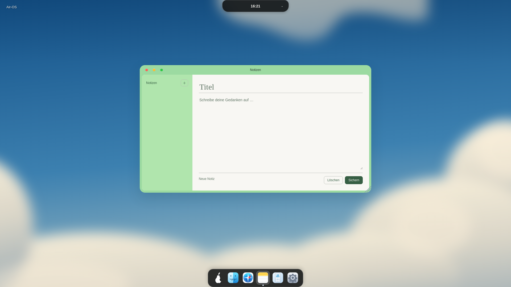](visual/air-lighter-glass-before-notes-1920.png) | [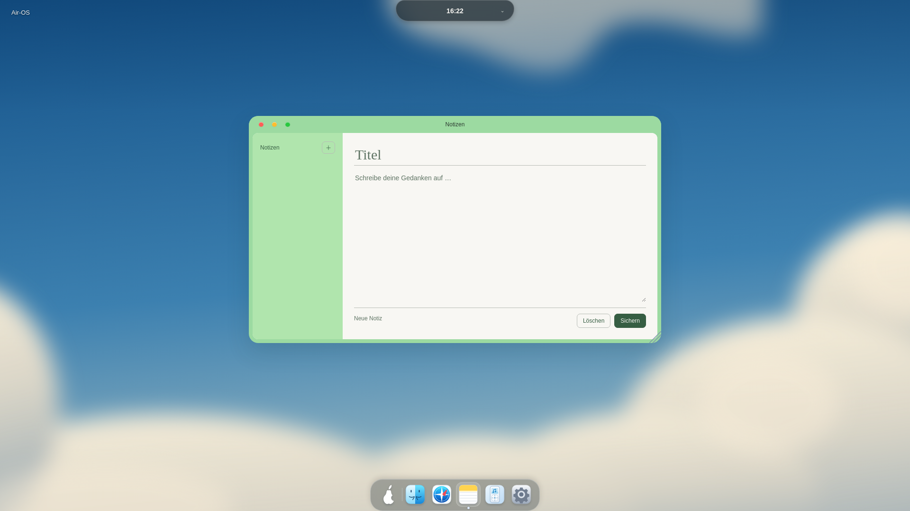](visual/air-lighter-glass-after-notes-1920.png) | [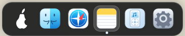](visual/air-lighter-glass-before-dock-1920.png) |  | [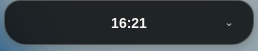](visual/air-lighter-glass-before-island-1920.png) | [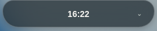](visual/air-lighter-glass-after-island-1920.png) |
| 1650 | [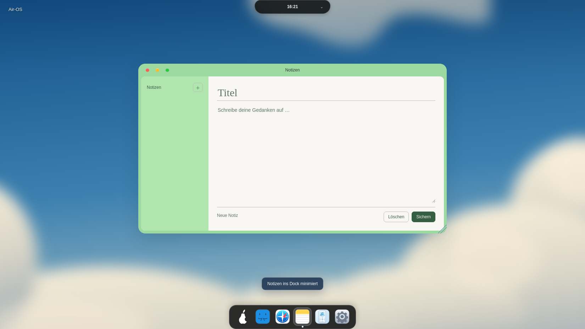](visual/air-lighter-glass-before-notes-1650.png) | [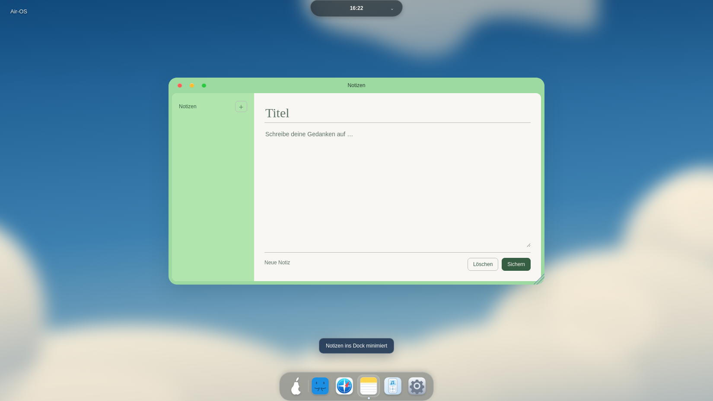](visual/air-lighter-glass-after-notes-1650.png) | [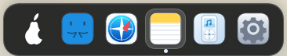](visual/air-lighter-glass-before-dock-1650.png) |  | [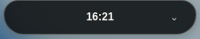](visual/air-lighter-glass-before-island-1650.png) | [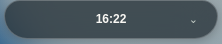](visual/air-lighter-glass-after-island-1650.png) |
| 390 | [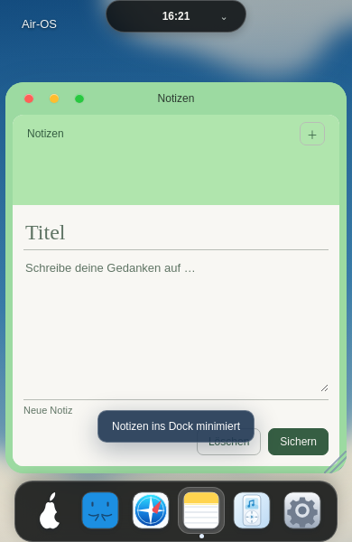](visual/air-lighter-glass-before-notes-390.png) | [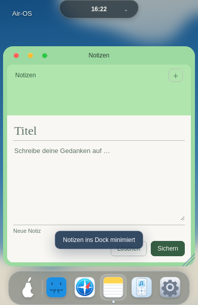](visual/air-lighter-glass-after-notes-390.png) | [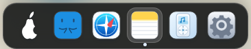](visual/air-lighter-glass-before-dock-390.png) | [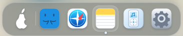](visual/air-lighter-glass-after-dock-390.png) | [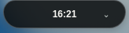](visual/air-lighter-glass-before-island-390.png) | [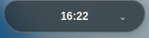](visual/air-lighter-glass-after-island-390.png) |

Classic bei390px, unverändert:

| Vorher | Nachher |
| --- | --- |
| [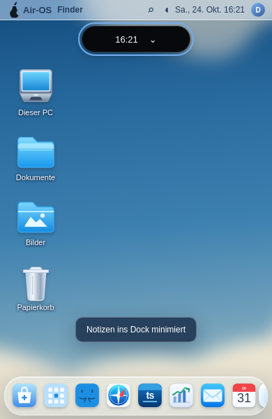](visual/air-lighter-glass-before-classic-390.png) |  |

20 tatsächliche PNGs. Detail-Clips schließen die sichtbaren Rundungen ein und sind nicht nachträglich gezeichnet. Der Divider bleibt absichtlich zurückhaltend; stärkere Graufärbung, veränderte App-Auswahl oder Verbreiterung wären weitere Änderungen und wurden nicht eingeführt.

Native Windows-/macOS-Abnahmen, CB-03 und bekannte Dependency-/Legacy-Electron-/Signing-/Notarisierungsblocker bleiben offen. PR-/Actions-API erneut Forbidden, kein neuer CI-Erfolg behauptet. main, bestehende PRs und Installer unverändert. Nächste drei separate kleine Einheiten: echte Windows-Belege auswerten, native macOS-Abnahme, CB-03 prüfen. Nach Commit/Push STOP.
