# Air Modern – dezentes Glas und freigestellte Birne

24. Oktober 2026. Basis: verifizierter K3-Remote-HEAD `f65e7683d70904183b1217d2bc16e73bb6b60036`. Eigener Branch `theme/air-modern-soft-glass-20261024`. Benutzerauftrag: neue Profile Modern, dezentes Glas und runde Unterkante am Dock, weichere Island, freigestellte weiße Birne, sichtbare Originalicons und schlichter Air-OS-Schriftzug. Keine neue App-/Window-/Dock-Verwaltung.

## Umsetzung

- Nur eindeutig neu registrierte Profile ohne gespeicherte Preferences erhalten jetzt **desktopTheme=modern und dockTheme=modern**. Zuvor war nur der Desktop modern. Gespeicherte Kombinationen bleiben maßgeblich; vorhandene/unklare Profile und bestehende Dateien ohne entsprechende Auswahl behalten konservative Classic-Fallbacks. Keine Migration, keine Überschreibung bestehender Profile. Beide Themes weiterhin unabhängig; Reset verwendet die bestehenden profilabhängigen Generationsdefaults.
- Modern-Desktop + Modern-Dock: Hintergrund `rgba(9,11,12,.84)`, bestehender 18px-Blur, feine helle Kontur, 20px-Radius an allen vier Ecken. Unveränderte Außenmaße und Unterkante y=Viewporthöhe. Die runden unteren Ecken lassen lediglich dort den Hintergrund durch; kein abgeschnittenes Icon, kein neuer Abstand und kein Scrollen.
- Modern-Island: gleicher dezenter Glasgrund und 18px-Blur, Radien `16px 16px 22px 22px`, unveränderte Außenmaße/obere Position. Echte Uhr, Panel und Schnellzugriff bleiben bestehen. Keine zusätzliche obere Menüleiste.
- Birne: vorhandener Vektorpfad aus dem Air-OS-Menü in `index.html`, weiß gefüllt, transparenter Hintergrund. Kein neues Logo oder Asset. Das bisher eingebettete schwarz-weiße PNG wird für den Modern-Launchpad-Renderer ersetzt. Die erste Maskenlösung wurde im tatsächlichen GUI-Test nach Theme-Wechseln als fehlerhaft erkannt und durch den bereits vorhandenen, referenzfreien Vektor korrigiert. Regression prüft die exakte vorhandene Pfadsilhouette, weiße Füllung und Verzicht auf Bildkachel/shared IDs. Classic behält sein Rasterlogo. Home-Schnellkarte verwendet weiterhin dieselben bestehenden Logo-Daten.
- Andere farbige Original-SVGs bleiben bytegleich. Eine schwache helle Unterlage/Kontur verbessert ihre Abhebung; der bisherige dunkle Icon-Schlagschatten entfällt ausschließlich im Modern-Dock. Keine Umfärbung, kein Graustufenfilter, keine Vergrößerung des Docks.
- Air-OS links oben: transparenter Button ohne Schatten/Rahmen oder sichtbaren Pfeil, nur Schriftzug. Ursprüngliche Mindesthöhe/Innenabstände, Popup und Tastaturverhalten bleiben; sichtbarer Fokus und dezenter Hover-Unterstrich.
- Bestehende Einstellung „Glas reduzieren“ macht Dock und geschlossene Modern-Island opak und deaktiviert Blur. Bestehende Preference wird als Renderer-Klasse abgebildet, keine neue Einstellung. Erhöhter Kontrast/Forced Colors erhalten opake/systemeigene Flächen. Keine neue Animation/Dependency, keine Änderungen an Speicherformat, IPC, App-Inhalten oder Installer-Konfiguration.

## Tatsächlich ausgeführte Prüfungen

**232/232 Node-Tests bestanden**, keine Fehler/Skips. Neuer Store-Test: beide Modern-Defaults, konservativer Altprofil-Fallback, gespeicherte Classic-Auswahl nach neuer Store-Instanz, unabhängige Themes, erhaltene Pins/Wallpaper und profilabhängiger Reset. Bestehende Profil-/Persistenz-/Race-/Notes-/Reminders-/E3-/Sicherheitsregressionen weiter aktiv. Logo-Regression aktualisiert auf die neue beauftragte Darstellung; keine Sicherheitsprüfung entfernt. Syntaxprüfungen für app.js/air-launchpad.js, Catalina-Konfiguration und Whitespace bestanden.

Echte **Linux Electron 32.3.3**, Chromium 128, authentifizierte Xvfb-Sitzungen mit Chromium-Sandbox, getrennte Wegwerfprofile, lokale CDP-Verbindung. Vorher: unveränderter K3-Code in detached Test-Worktree. Nachher: aktueller Branch. Drei tatsächliche Renderer-Viewportgrößen, keine Windows-/macOS-Simulation als native Abnahme ausgegeben. Alle Daten synthetisch; keine Zugangsdaten in Screenshots/Repository.

GUI prüft: neue Profildefaults über authentifizierte Preferences, Außenkoordinaten, kein Dock-Overflow, unveränderte andere Originalicons, Systemmenü Enter/Escape/Fokus, Startmenü Space/Suche/Escape, Kontrollzentrum/Schnellzugriff/Escape/Fokus, Air Home öffnen/schließen und Geometrie, Classic-Haut und großes Launchpad gegen Vorher identisch. Nach Reload gespeicherte Classic-/Pin-Auswahl erhalten, unbekannte Pinreferenz erhalten; echtes Pin/Unpin ohne Schließen des Startmenüs, echter Notes-Start und bestätigter Notes-Save. Reduced Glass sowie Forced Colors zusätzlich geprüft. Keine Rendererfehler. Vollständige Fenster-/Profil-/Widgetfunktion zusätzlich durch vorhandene automatische Regressionen abgesichert; kein neuer nativer Hardwaretest.

| Viewport | Dock x/y, Breite × Höhe | Island x/y, Breite × Höhe | Air Home x/y, Breite × Höhe; Navigation |
| --- | --- | --- | --- |
| 1920 × 1080 | 781/1012, 358 × 68 | 835/0, 250 × 45 | 200/103, 1522 × 849; 212 |
| 1650 × 930 | 646/862, 358 × 68 | 717,58/0, 214,84 × 38,67 | 171,88/93, 1307,97 × 731,08; 182,19 |
| 390 × 600 | 16/532, 358 × 68 | 117/0, 156 × 36 | 12/91, 366 × 430; 366 als obere Navigation |

Alle Dock-/Island-/Home-Werte vor/nach identisch. Classic-Geometrie und berechnete Flächen/Farben ebenfalls identisch. Der schlichtere Systembutton ist durch den entfallenen Pfeil schmaler; Menüposition/Mindesthöhe bleiben. Rohdaten: [Vorher](visual/air-soft-glass-before.json), [Nachher](visual/air-soft-glass-after.json). Reproduzierbarer optionaler Helfer: `scripts/check-soft-glass.cjs`, benötigt vorhandenes Playwright außerhalb der Produktabhängigkeiten, isoliertes Profil und laufendes echtes Electron/CDP. Baseline-Port9252, Nachher9253, `AIR_GUI_TEST_ISOLATED=1`, Baseline zusätzlich `AIR_GUI_BASELINE=1`.

## Sichtbarer Vorher-/Nachhervergleich

Die beiden vom Benutzer angehängten Bilder sind die visuelle Referenz: Bild1 zeigt die zuvor opake, unten eckige Leiste/den schwarzen Logokasten; Bild2 zeigt die gewünschte kompakte dunkle Randgestaltung und Mint-/Creme-Hauptfläche. Vergleich anhand dieser sichtbaren Bilder, **kein automatischer Pixel-Diff** gegen lokale Originaldateien (die Windows-Pfade C:/Air-Os/... sind hier nicht verfügbar). Keine Fremdassets übernommen.

| Größe / Zustand | Unveränderter K3-Stand | Nachher |
| --- | --- | --- |
| 1920 Desktop | 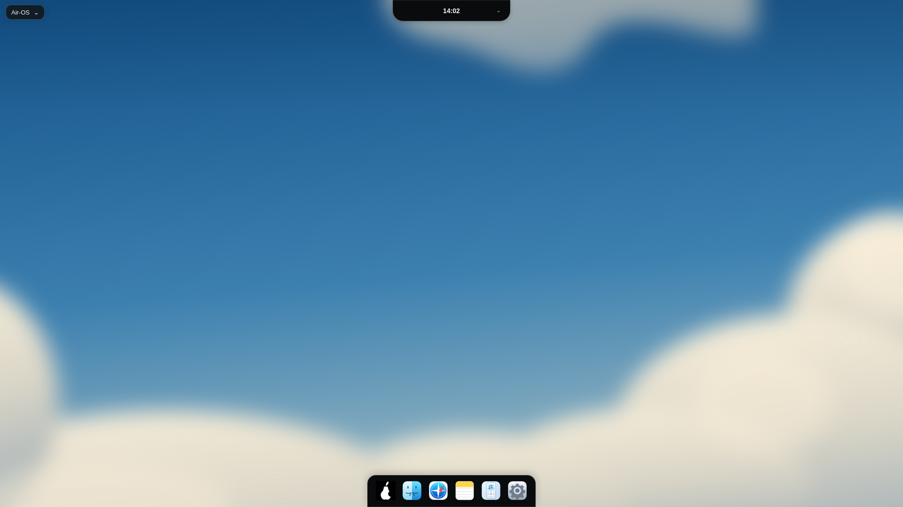 | 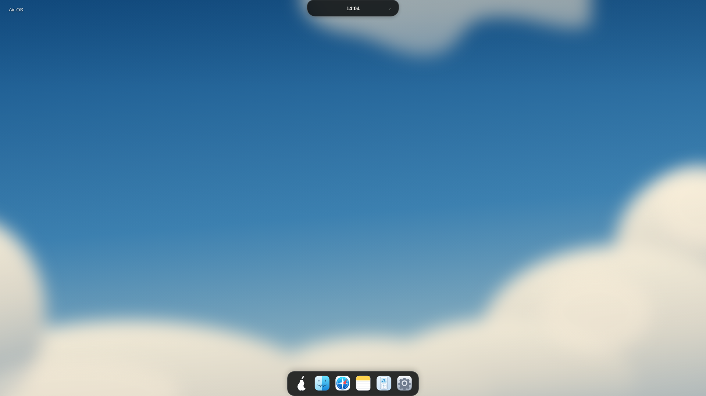 |
| 1650 Desktop | 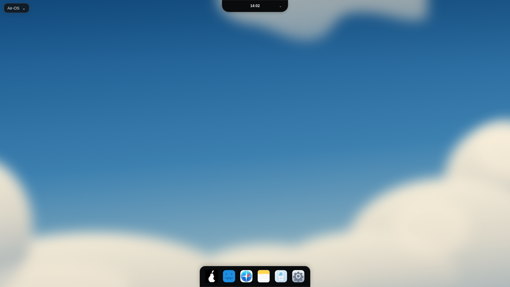 | 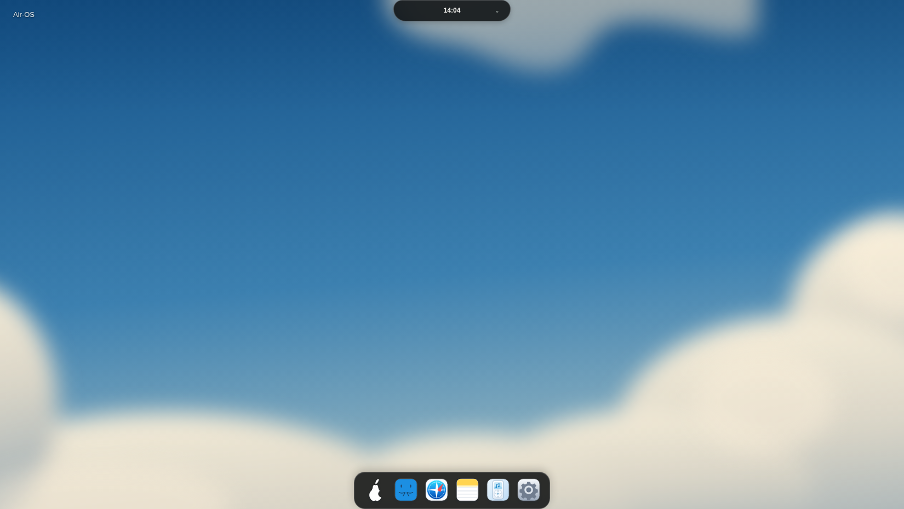 |
| 390 Desktop | 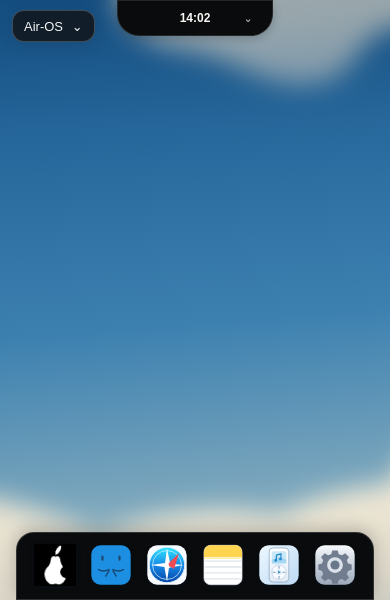 | 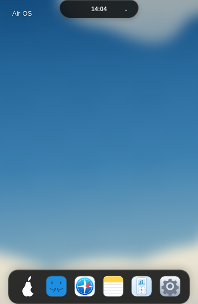 |
| 1920 Air Home | 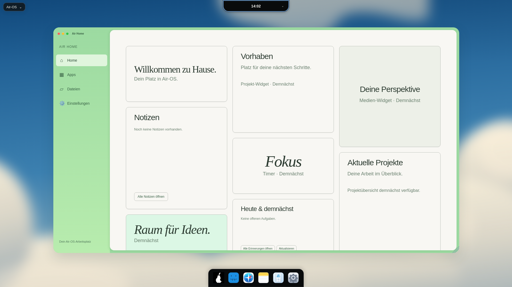 | 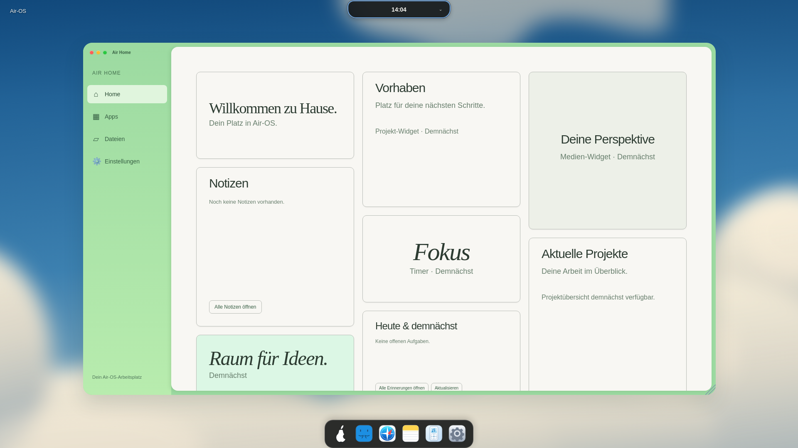 |
| 1650 Air Home | 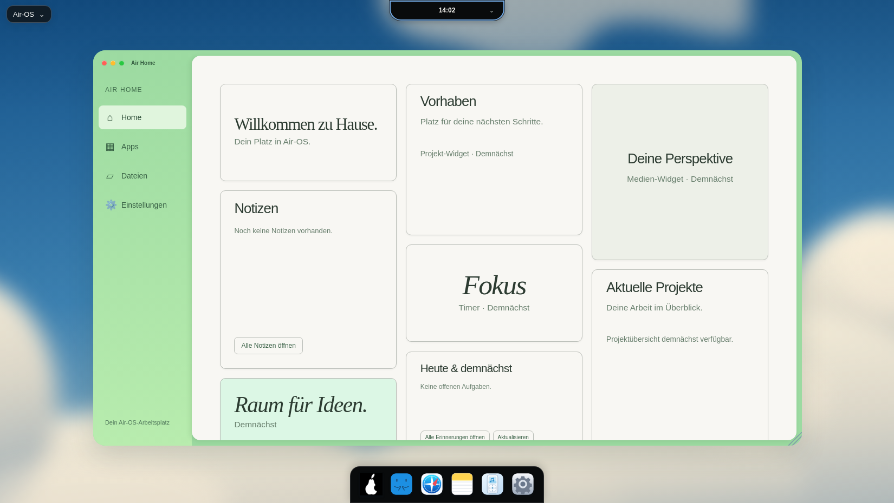 |  |
| 390 Air Home | 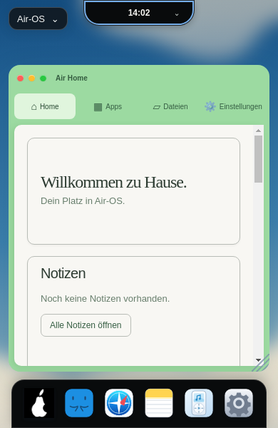 | 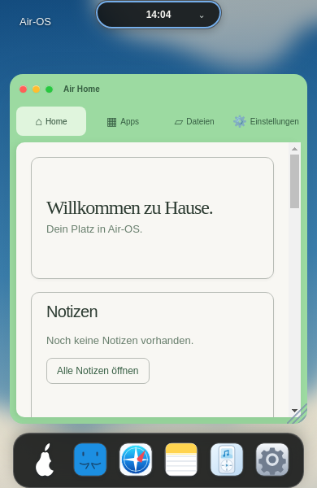 |
| 1920 Kontrollzentrum | 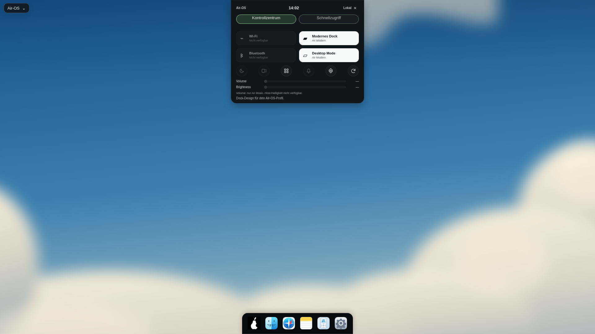 | 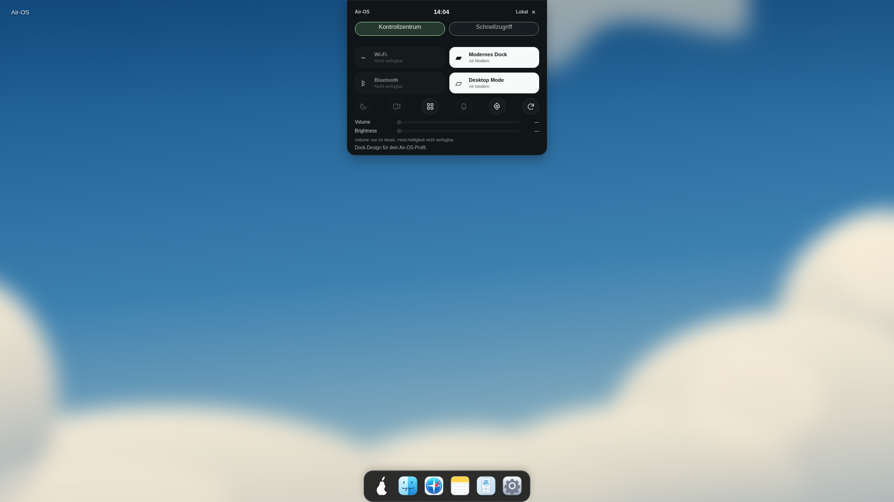 |
| 1650 Kontrollzentrum | 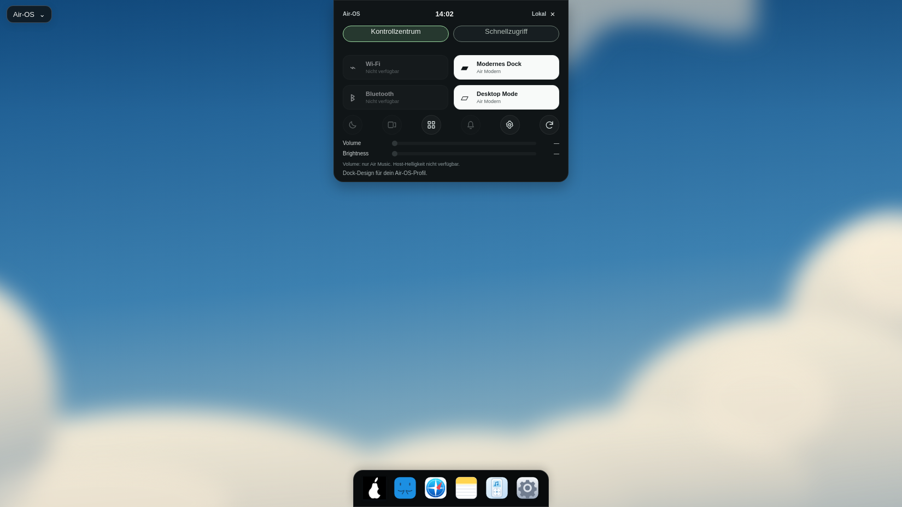 | 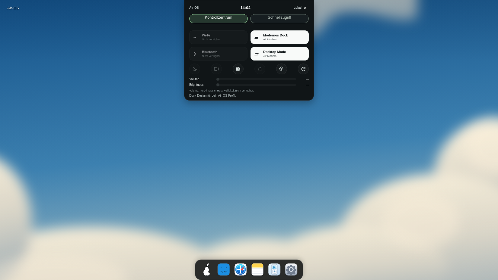 |
| 390 Kontrollzentrum | 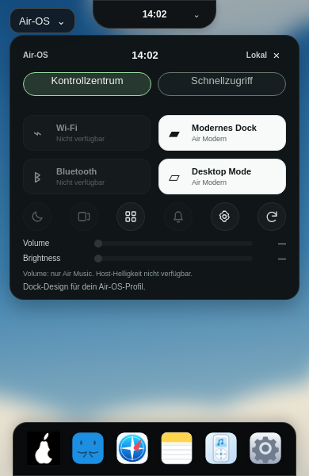 | 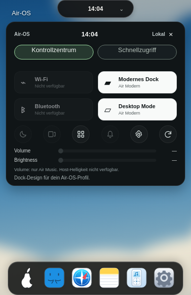 |

Bewusst verbleibende Unterschiede zu Bild2: Air-OS behält sein eigenes weiches Vektorwolken-Wallpaper statt fremdem strukturiertem Foto; sechs eigene Standardapps statt fremder App-Auswahl. Island zeigt echte lokale Uhr ohne erfundene Medienaktivität/Albumgrafik. Air Home enthält echte Notes/Reminders und ausdrücklich angekündigte übrige Widgets statt fremder Inhalte/Fotos. Dessen Geometrie wurde nicht angefasst; bei1650 liegt y weiterhin93 statt des ursprünglichen proportionalen Richtwertes89. Die neue etwas transparentere Fläche und runden vier Dockecken sind die aktuelle ausdrückliche Benutzerkorrektur gegenüber früheren Vorgaben zum eckigen Andocken. Keine pixelgenaue Gleichheit oder native Windows-Darstellung bestätigt.

Offen: echte Windows-/macOS-Abnahmen, bestehende CB-02/CB-03, M1-Unterbrechbarkeit. Bekannte Dependency-/Legacy-Electron-, Signing-/Notarisierungs-/Release-Blocker unverändert. PR-/Actions-API nicht zugänglich; kein neuer CI-Erfolg behauptet. main, PRs und Installer unverändert. Keine öffentliche Veröffentlichung.
