# CB-02 – präzise Notes-Fensterbuttons

24. Oktober 2026 · Basis/Remote-HEAD **bc5b8dae196aabc62df5ffc3d1710da02289aed2** · Branch **fix/air-notes-window-buttons-cb02**.

## Änderung und Abgrenzung

Nur `styles.css`, ausschließlich unter `html[data-desktop-theme="modern"] .air-notes-window`: Die drei bestehenden nativen HTML-Buttons erhalten echte transparente **24×24CSS-Pixel** statt10×10. Ihre ursprünglichen roten/gelben/grünen10px-Kreise werden mittig als `::before` mit pointer-events:none gezeichnet. Originalfarben/kleiner Kreisschatten bleiben; keine zusätzlichen DOM-/Overlay-Elemente und keine JavaScript-/Handleränderung.

Die echten Kästen sind bewusst rechteckig: Eine erste6px-Rundung bestand den tatsächlichen Electron-Hit-Test an einigen Ecken nicht. border-radius:0 behebt dies, während ausschließlich die sichtbaren Kreise rund bleiben. Gleichmäßige4px-Lücken trennen die Kästen; insgesamt80px statt zuvor46px. Sichtbare Punktmitten liegen nun28px statt18px auseinander. Das ist die beabsichtigte lokale Änderung, keine Behauptung pixelidentischer Punktpositionen. Der absolut zentrierte Fenstertitel bleibt exakt an seiner bisherigen Position.

36px-Titelleiste unverändert: Buttons vertikal mittig mit6px Abstand oben/unten. Der2px-Fokusrahmen mit2px-Offset bleibt innerhalb der Leiste mit2px Reserve. Dezent getönter Hoverhintergrund zeigt die größere Bedienfläche; Ring nur bei focus-visible, nicht pauschal bei Mausfokus. Aria-Labels und bestehende Close-/Minimize-/Maximize-/Drag-Handler in app.js unverändert. Deren Drag-Ausschluss für .traffic/buttons bleibt wirksam.

Generische13px-Buttons, Home-eigene9px-Buttons, Classic, Fenstermaße/-positionen/Resize, Notes-Speicherung/Profile, Dock/Glas/Birne, Startmenü, Island/M1 sowie M2 unangetastet. Keine neue Abhängigkeit/Animation oder zweite Fensterverwaltung. Der separate Windows-Anleitungsbranch bleibt erhalten; dieser Branch basiert wie beauftragt direkt auf M2.

## Tatsächlich ausgeführte Tests

**244/244 Tests bestanden**,0 Fehler/Skips, neue vollständige Linux-Testsuite nach finaler CSS-Korrektur. Zwei zusätzliche CB-02-Regressionsfälle für Mindestgröße, vollständige rechteckige Hitbox, transparente Fläche,10px-Pseudokreis/Center/Pointer-Vertrag, Abstand/Fokusrahmen innerhalb36px, Originalfarben und erhaltene generische/Home-Regeln. Bestehende Notes-Modern-Scope-Regression prüft jeden Selektorzweig einschließlich Pseudoelemente und Zustände auf Modern UND Notes. Alle vorhandenen Notes-/Profil-/M1-/M2-/Sicherheitsregressionen bleiben aktiv.

Echte Linux/Electron32.3.3-/Chromium128-Tests mit Sandbox, authentifizierten Xvfb-Sitzungen und getrennten synthetischen Wegwerfprofilen. Vorher: unveränderter M2-Commit in eigenem detached Worktree. Nachher: finaler CB-02-Code. Original-Rendereraufnahmen, weder Neuzeichnung noch CSS-Simulation der Bilder. Detailaufnahmen sind direkte Renderer-Clips mit gleicher180×36px-Region relativ zum Fenster. Keine privaten Notizen verwendet. Native Windows/macOS ausdrücklich nicht geprüft.

Je1920×1080,1650×930,390×600 bestätigt:

- Drei echte Button-DOMRects24×24; keine Überlappung,4px zwischen Kästen, vertikal exakt mittig.
- Echte Pseudoelement-Contentquads über CDP DOM.getBoxModel gemessen: drei10×10-Kreise exakt mittig in ihren jeweiligen Kästen. Keine lediglich aus CSS angenommene Pixelgeometrie.
-9elementFromPoint-Prüfpunkte pro Button (je Mitte, Kanten, Ecken1px innerhalb), somit27 je Auflösung und81 insgesamt: immer der passende Button, kein Nachbar/Overlay.
- Tatsächliche Playwright-Mausklicks in der transparenten Ecke x+1/y+1: Maximize/Restore, Minimize plus Dock-Restore mit laufender M2-WAAPI, Close/Reopen. Kein direkter Aufruf der Click-Handler für diese Aktionsprüfungen. Vollständige Restore-Geometrie unverändert.
- Tab/Shift+Tab erreicht alle drei Buttons; Enter/Space lösen native Buttonaktionen aus. Fokusrahmen2px nach Tastatur, kein focus-visible nach normalem Maus-Maximize, Hover sichtbar.
- Titelleiste außerhalb der Buttons mit echter Maus verschoben, ohne Resize/Nachbaraktion. Auf390px innerhalb des bestehenden begrenzten Bewegungsraums getestet.
- Vollständige Notes-Fenstergeometrie und neun bestehende Layout-/Titel-/Editor-Rects sowie deren berechnete Material-/Fontwerte vor/nach identisch. Classic und Home einschließlich Buttonkästen/-farben/-schatten/-fonts gegen echten M2-Vorherstand identisch.
- Keine Rendererfehler. Vorher- und finaler Nachher-Helferlauf Exit0. Optionale Reproduktion: `scripts/check-notes-buttons.cjs`, benötigt vorhandenes externes Playwright, isoliertes echtes Electron und `AIR_GUI_TEST_ISOLATED=1`; Vorher zusätzlich `AIR_GUI_BASELINE=1`. Standard-CDP9256/9257, optional AIR_GUI_CDP.

Syntax des GUI-Helfers, Catalina-Konfiguration, Dokumentlinks und git diff --check bestanden. Actions-/PR-Abfrage Forbidden; kein neuer CI-Erfolg behauptet. Keine Sicherheitschecks deaktiviert.

## Messwerte in CSS-Pixeln

S/M/X bezeichnet Schließen/Minimieren/Maximieren. Alle Größen hier sind tatsächlich im Linux-Renderer erhoben, keine Windows-DPI-Messung.

| Viewport | Notes außen vor/nach x/y/B/H | S/M/X-Buttonpositionen vorher x/y, je10×10 | S/M/X nachher x/y, je24×24 | Kreise nachher x/y, je10×10 |
| --- | --- | --- | --- | --- |
|1920×1080 |525/244,72/870/480 |539/257,72 ·557/257,72 ·575/257,72 |539/250,72 ·567/250,72 ·595/250,72 |546/257,72 ·574/257,72 ·602/257,72 |
|1650×930 |390/180,22/870/480 |404/193,22 ·422/193,22 ·440/193,22 |404/186,22 ·432/186,22 ·460/186,22 |411/193,22 ·439/193,22 ·467/193,22 |
|390×600 |6/91/378/433 |20/104 ·38/104 ·56/104 |20/97 ·48/97 ·76/97 |27/104 ·55/104 ·83/104 |

[Vorher-Rohdaten](visual/cb02-before-measurements.json) · [Nachher-Rohdaten einschließlich Pseudoelementen](visual/cb02-after-measurements.json). Titel-Rects vor/nach identisch, x/y bei1920:939,48/255,72;1650:804,48/191,22;390:174,48/102, jeweils41,05×14px. Keine neue äußere Fenster-/Editorlayoutverschiebung gemessen. Hover/Fokus sind bewusst Zustandsdarstellungen, keine Größenänderung.

## Vollständiger sichtbarer Bildvergleich

Die Bilder sind anklickbar und liegen unter docs/visual. Nur der Nachherstand enthält die größeren realen Klickflächen. Sie bleiben im Ruhezustand transparent; den24px-Kasten macht der zusätzliche Fokusbeleg sichtbar.

| Auflösung | Notes vorher | Notes nachher | Buttons vorher | Buttons nachher |
| --- | --- | --- | --- | --- |
| 1920 |  | [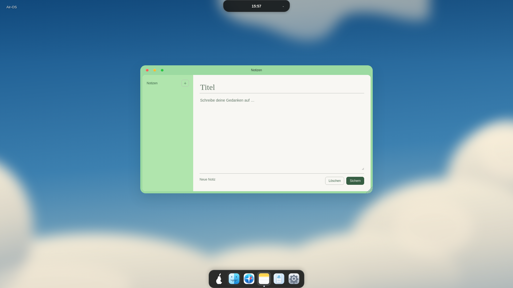](visual/cb02-after-notes-1920.png) |  |  |
| 1650 | [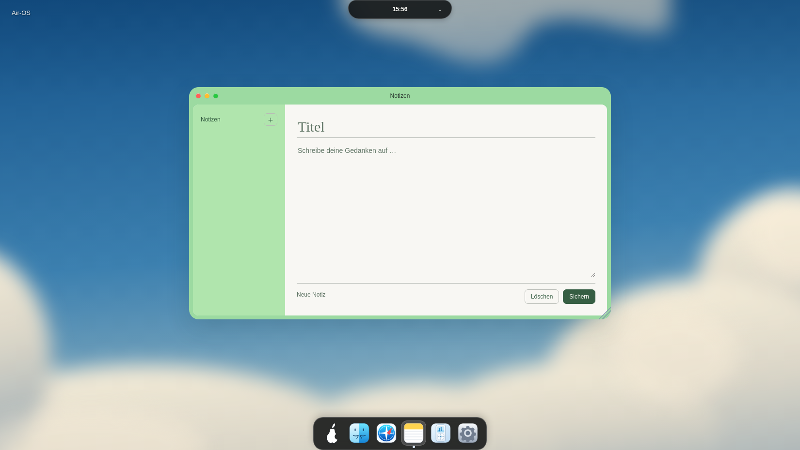](visual/cb02-before-notes-1650.png) | [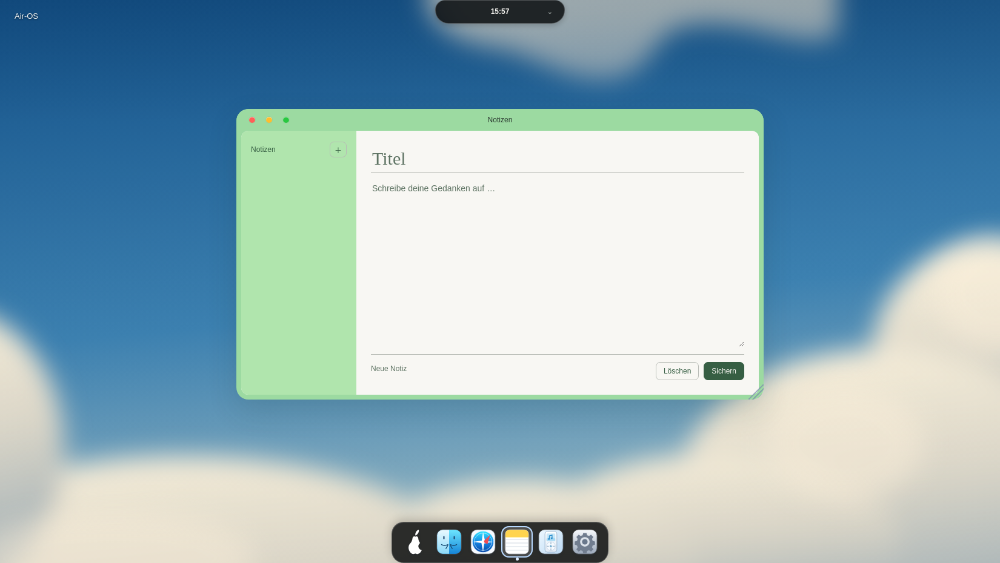](visual/cb02-after-notes-1650.png) |  |  |
| 390 | [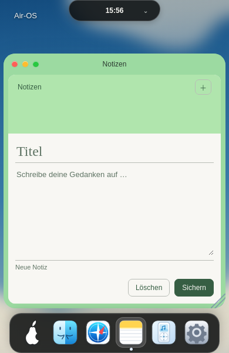](visual/cb02-before-notes-390.png) | [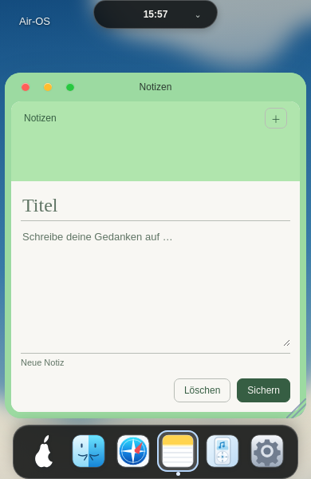](visual/cb02-after-notes-390.png) |  |  |

### Classic bleibt unverändert

| Größe | Classic vorher | Classic nachher |
| --- | --- | --- |
| 1920 |  | [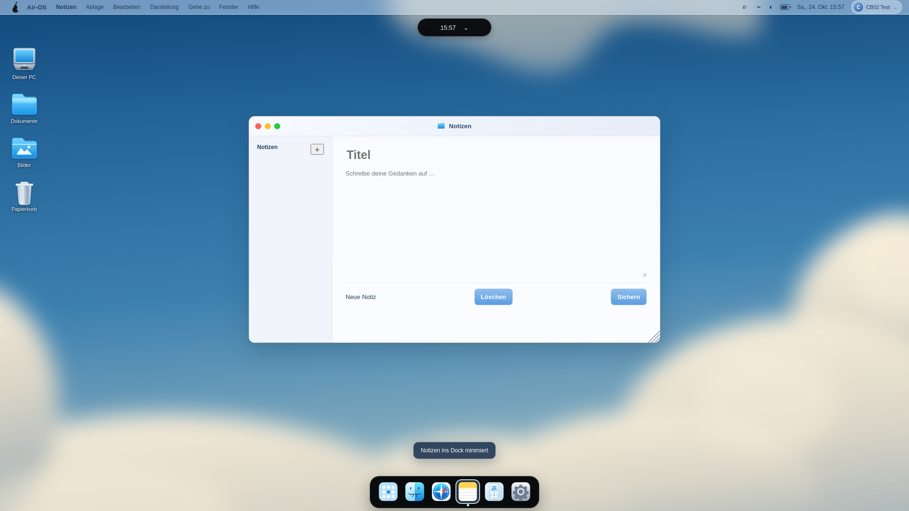](visual/cb02-after-classic-notes-1920.png) |
| 1650 | [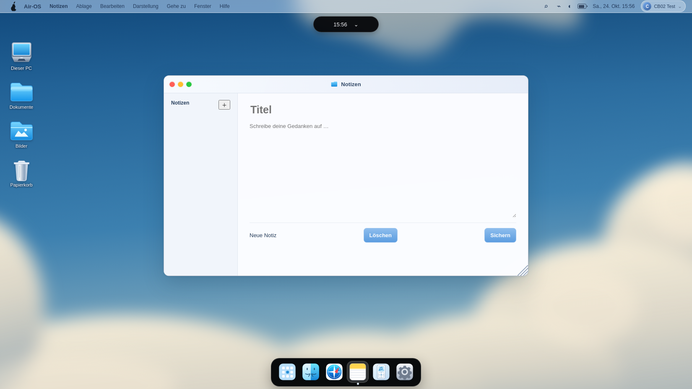](visual/cb02-before-classic-notes-1650.png) |  |
| 390 | [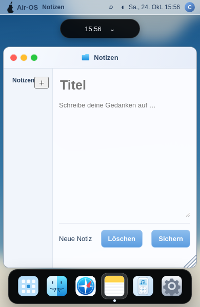](visual/cb02-before-classic-notes-390.png) | [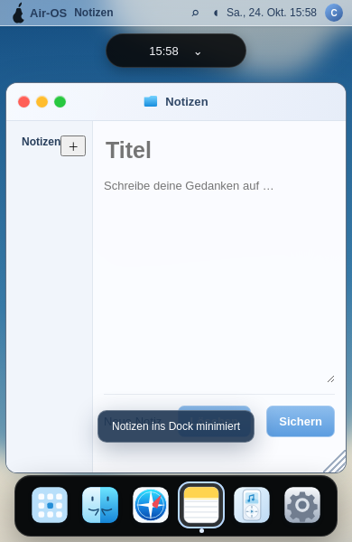](visual/cb02-after-classic-notes-390.png) |

### Tastaturfokus und Hover bei390px

| Sichtbarer24px-Fokusrahmen | Dezent getönte Hoverfläche |
| --- | --- |
| [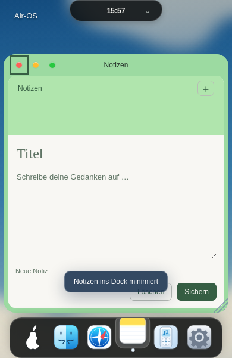](visual/cb02-after-focus-390.png) | [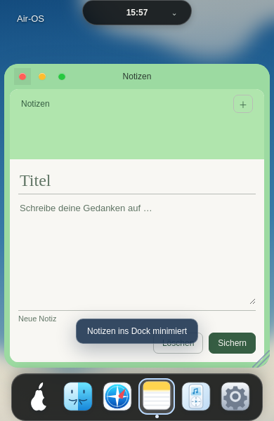](visual/cb02-after-hover-390.png) |

Insgesamt20 echte PNG-Aufnahmen:12 verlangte Modern-Vorher-/Nachherbilder,6Classicbilder und2Interaktionsbelege. Die Vergleichsbilder zeigen dieselbe Auflösung und dieselbe anfängliche Fensterposition, synthetische leere Notes-Profile und keine verfälschenden eingezeichneten Hitboxen. Detailbilder bleiben180×36Originalpixel, keine künstliche Vergrößerung/Neuzeichnung.

## Offene Punkte

CB-02 im hier geprüften Linux-Electron behoben. Native Windows-/macOS-Abnahmen bleiben offen; diese Ergebnisse sind keine nachträgliche Windows-Abnahme. CB-03-Bedienkonturen, bekannte Dependency-/Legacy-Electron-/Signing-/Notarisierungs-/Release-Blocker unverändert. Keine neue1:1-Referenz- oder Performancebehauptung. main, bestehende PRs, Installer und andere Entwicklungsbranches unverändert. Nächste separate Einheiten: Windows-Belege erheben/auswerten, native macOS-Abnahme, CB-03 gezielt prüfen. Nach Commit/Push STOP.
