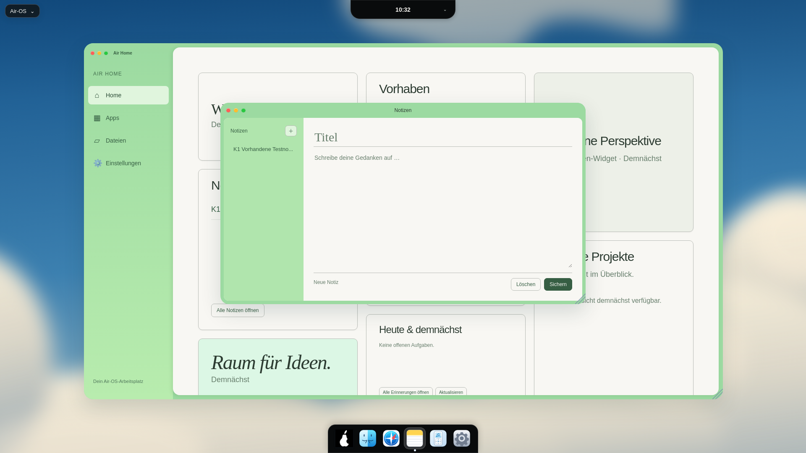
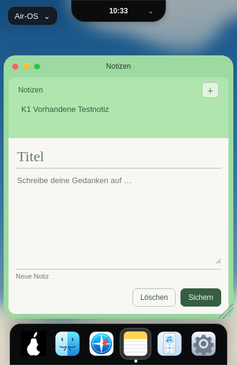

# K1 – CB-01: Notes-Sekundärtext-Kontrast

24. Oktober 2026 · Basis617b1b293ef5a5b075c2c5819c0b84238731e1a3 · Branch `fix/air-notes-secondary-contrast-k1-20261024`.

Nur zwei `color`-Deklarationen in styles.css: #677e6c→#5f7464. Betroffen: `html[data-desktop-theme="modern"] .air-notes-window #note-status` sowie die vorhandene gemeinsame `input::placeholder, textarea::placeholder`-Regel innerhalb desselben Modern-/Notes-Scopes. Titel-Placeholder wird mitgefärbt, ohne als eigener Verstoß kleinen Texts ausgegeben zu werden. Kein globaler Token, keine anderen Apps, kein JS-Produktcode geändert.

## Tatsächlich gemessene CSS-Kombinationen und berechneter Kontrast

Echter Linux/Electron32.3.3/Chromium128.0.6613.186-Renderer, aktive Sandbox, Xvfb. Auflösungen per CDP als CSS-Viewports1920×1080,1650×930,390×600. Ausschließlich synthetische Testkonten/Notizen. **Keine native Windows-/macOS-Abnahme.**

| Element | Vorher | Nachher | Hintergrund | Kontrast vor/nach |
| --- | --- | --- | --- | --- |
| Notes-Status,12px bzw.11px |#677e6c |#5f7464 |#f8f7f3 aus tatsächlicher .note-actions-Fläche |4,1003483213→**4,6991984843:1** |
| Textarea-Placeholder,14px bzw.13px |#677e6c |#5f7464,opacity1 |#f8f7f3 aus tatsächlicher Editorfläche |4,1003483213→**4,6991984843:1** |
| Großer Titel-Placeholder |#677e6c |#5f7464 |Dieselbe opake Cremefläche |Gleiche Farbverbesserung; bisher große Schrift separat bewertet |

Kontraste nach WCAG-sRGB aus den berechneten Farbwerten, nicht aus antialiasierten Screenshot-Glyphkanten. Statusfarbe ist opak; der Statusspan selbst ist transparent über der opaken Aktionsfläche. Beim Placeholder wurde dessen reale Browserdarstellung geprüft: Chromium128 liefert bei getComputedStyle(textarea,'::placeholder') die Eltern-Textfarbe#2c3b31. Der Test liest stattdessen den tatsächlich sichtbaren `-webkit-input-placeholder`-Knoten im User-Agent-Shadow-DOM über CDP und CSS.getComputedStyleForNode; Farbe, display:block und opacity1 bestätigt. Es wurde keine Produktkorrektur für ein Test-API-Verhalten erfunden.

## Echte Vorher-/Nachher-Aufnahmen

Im selben Electron-Viewport mit gleicher DOM-Struktur, leerem neuem Editor und synthetischer Notizliste wurde vorübergehend das vollständige ursprüngliche styles.css aus dem exakten Basiscommit geladen. Danach wurde dieses Test-Stylesheet entfernt und die aktuelle reguläre Datei wieder aktiviert. Das sind reale Renderaufnahmen beider Stände, keine nachbearbeiteten Bilder, keine Screenshots alter Sitzungen und keine Windows-Simulation. Produktdateien mussten für den Vergleich nicht rückwärts verändert werden.

| Größe | Vorher | Nachher |
| --- | --- | --- |
|1920×1080 | | |
|1650×930 |[Vorher1650](visual/air-notes-k1-before-1650.png) |[Nachher1650](visual/air-notes-k1-after-1650.png) |
|390×600 | | |

[Rohe Messwerte](visual/air-notes-k1-measurements.json).

| Viewport | Notes-Fenster x/y, B×H vor UND nach | Vergleich |
| --- | --- | --- |
|1920×1080 |525/244,719;870×480px |Alle22 Notes-Elementrechtecke identisch |
|1650×930 |390/180,219;870×480px |Alle22 Notes-Elementrechtecke identisch |
|390×600 |6/91;378×433px |Alle22 Notes-Elementrechtecke identisch |

Keine Schrift-/Abstands-/Layoutverschiebung; Farbe ist bewusst nur geringfügig dunkler. In den verglichenen normalen Notes-Elementstyles ändert allein die Statusfarbe ihren sichtbaren Wert; Placeholder separat oben geprüft. Eine vom Text abgeleitete borderColor des randlosen Statusspans ändert sich erwartungsgemäß mit currentColor, der Rand bleibt0px. Vorhandene funktionale Konturen bleiben#b8bcb6; CB-03 nicht angefasst. Trefferflächen ebenfalls unverändert; CB-02 nicht angefasst.

## Verifikation und verbleibende Grenzen

- **217/217 Tests,0 Fehler/Skips**, neu auf Linux ausgeführt. Neuer CSS-Farb-/Hintergrundtest mit altem Wert als negativer Regression; Modern-only-/Notes-Scope-Test und alle bisherigen Notes-/E3-/Profil-/Fehler-/Race-Tests grün. Vorhandene Speicherfehler-/Retry-/neuere-Draft-Fälle bleiben mit klaren Test-Doubles abgedeckt.
- GUI bei allen drei Größen: echte berechnete Vorher-/Nachher-Kontraste, kein Layoutshift, Classic-Snapshots vor/nach vollständig identisch. Home, Widgets, Dock und Island mit gleichen Styles/Positionen. Aktuelle Notes-Farben betreffen keine anderen Apps; der tatsächliche Produktdiff besteht nur aus den zwei Deklarationen.
- Über echte vorhandene Notes-Oberfläche gespeichert und gelöscht; Home reagiert automatisch, Island-Speichernachricht bleibt funktionsfähig. Keine Rendererfehler. Kein Speicherformat-/IPC-/Featurewechsel.
- Syntax des neuen optionalen GUI-Helfers, Catalina-Konfiguration und Whitespace geprüft. Keine native Catalina-/macOS-/Windows-Zusage daraus ableiten. Actions-API Forbidden, kein neuer CI-Erfolg bestätigt.

Reproduktion: eigener Wegwerf-userData am Login, aktive Sandbox/Xvfb117/CDP9246 und extern vorhandenes Playwright. `AIR_GUI_TEST_ISOLATED=1 node scripts/check-notes-contrast.cjs`. Helfer liest Basis-CSS via git show; Basiscommit muss lokal vorhanden sein. Lokaler Starter `/workspace/.air-os-onboarding/start-air-notes-contrast-k1.sh`. Keine Projektdependency hinzugefügt, keine neuen Hintergrundtimer. Passwörter zufällig nur im Testspeicher.

CB-01 ist für den geprüften Modern-Standardzustand korrigiert. Disabled-/Forced-Colors-/abweichende OS-Farben und native Schrift-/Hitboxdarstellung gehören weiter in F2.1/F2.2. Supaste nicht nachträglich als visuell verifiziert behauptet. main, PRs, Installer und andere Entwicklungsbranches unverändert; Audit-/Signing-/Notarisierungsblocker bleiben bestehen. Nächste Implementierung nur separat beauftragtes K2.
