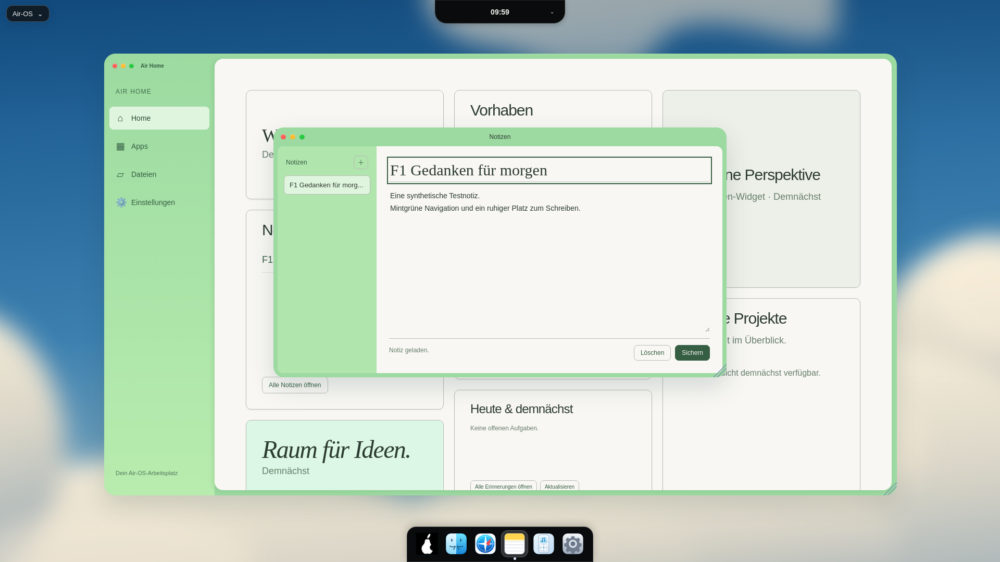

# F1 – Air Notes als Erweiterung von Air Home

24. Oktober 2026. Basis E3 b57da11, eigener Branch `theme/air-notes-modern-f1-20261024`. Ausschließlich eine Notes-Fensterklasse und darauf begrenzte Modern-Styles. Keine Änderung der Notes-/Widget-Logik, anderer Apps, IPC oder Persistenz.

| Merkmal aus dem Air-Home-Konzept | Notes-Umsetzung |
| --- | --- |
| Mint-Rahmen#9cdaa1 | Notes-Außenfläche/Titelleiste,8px-Innenabstand,20px-Ecken, weicher Schatten |
| Hellgrüne Navigation#b0e5ad |190px-Notizenliste mit dezent getönter Auswahl; Neu-Button bleibt am Listenanfang |
| Creme#f8f7f3 | Editorfläche, Eingaben und Statusleiste,12px-Innenradius |
| Dunkelgrün#2c3b31/Sekundär#677e6c | Titel/Inhalt und Speicherstatus, feine Umrandungen#b8bcb6 |
| Serif-/Systemtypografie | Georgia-Titelfeld30px, Systemschrift im Editor14px und in der Navigation |
| Ruhige Aktionen | Dunkelgrünes Sichern, cremefarbenes Löschen, sichtbare Fokusumrandung; vorhandene Fensteraktionen |

| Viewport | Notes-Fenster x/y, B×H | Liste / Editor | Modern / Classic |
| --- | --- | --- | --- |
| 1920×1080 |525/244,719,870×480px |190×436 /664×436px |[Modern](visual/air-notes-f1-modern-1920.png) · [Classic](visual/air-notes-f1-classic-1920.png) |
| 1650×930 |390/180,219,870×480px |190×436 /664×436px |[Modern](visual/air-notes-f1-modern-1650.png) · [Classic](visual/air-notes-f1-classic-1650.png) |
| 390×600 |6/91,378×433px |oben362×100 /unten362×289px |[Modern](visual/air-notes-f1-modern-390.png) · [Classic](visual/air-notes-f1-classic-390.png) |

[Rohe getBoundingClientRect- und berechnete Style-Messwerte](visual/air-notes-f1-measurements.json). Screenshot zeigt absichtlich sichtbaren Tastaturfokus im Titelfeld. Notes bleibt ein normales870×480px-Fenster auf großen Displays; keine Vergrößerung auf Air-Home-Maße. Mobile Liste wird zum oberen Band und kann separat scrollen. Speicheraktionen/Titel/Text/Neu liegen nachweislich im sichtbaren Fenster; keine horizontale Content-Überbreite. Vorhandene Resize-/Drag-/Minimize-/Maximize-/Close-Wege unverändert.

**Classic-Nachweis:** Browser vergleicht dieselben Notes-Elemente mit/ohne neue F1-Regeln anhand des vollständigen bisherigen styles.css-Präfixes. Berechnete Classic-Werte für Rahmen/Titelleiste/Liste/Editor/Buttons/aktive Notiz/Felder identisch. Vor dem Vergleich vorhandene endliche CSS-Animationen/Transitions abgewartet, damit keine Zwischenfarben als Regression gelten. Alle F1-Selektoren verlangen Modern+Notes; CSS-Scope-Regression prüft auch Responsive- und :is-Fokuszweige. Home-/Dock-/Island-Styles mit/ohne F1-Regeln sowie Original-Dock-SVGs zusätzlich verglichen.

**Verifikation:**216/216 Tests,0 Fehler/Skips, inklusive aller bisherigen Notes-Speicherfehler-/Retry-/neuere-Draft-/Profil-/E3-Race-Tests. Ein neuer gezielter CSS-Isolationstest und optionaler echter GUI-Regressionshelfer. Syntax/Catalina-Konfiguration/Whitespace geprüft. Echt Electron32.3.3 unter Linux mit aktiver Sandbox/Xvfb, reduzierte Bewegung, drei Renderer-Viewports per CDP: Startmenü-Start, echte Notes-Erstellung/Bearbeitung/Speicherung/Auswahl/Löschung, automatische Home-Aktualisierung und Island-Speichermitteilung; echte Fensteraktionen und Keyboard-Close/Fokus; Logout/Bob ohne Alice-Notizen und erneute Alice-Anmeldung mit unveränderten Daten. Keine Rendererfehler. Fehler-/verzögerte Draft-Fälle deterministisch in vorhandenen Tests mit markierten Doubles, kein neuer nativer Diskfehler im GUI-Lauf behauptet.

Reproduktion: isoliertes Wegwerf-userData am Login, aktive Sandbox/Xvfb115/CDP9245, extern vorhandenes Playwright. `AIR_GUI_TEST_ISOLATED=1 node scripts/check-notes-modern.cjs`. Lokaler Helfer `/workspace/.air-os-onboarding/start-air-notes-modern-f1.sh`. Nur synthetische Profile/Notizen, zufälliges Passwort nur im Testspeicher. Keine neue Abhängigkeit, keine Installer-/Workflow-/Manifeständerung.

**Visueller Vergleich und Grenzen:** Farben, Seitenleistenrolle, Cremefläche und Typografie orientieren sich am bestehenden verbindlichen Air-Home-Konzept, das im großen Screenshot hinter Notes sichtbar ist. In diesem Prompt kein neues spezifisches Notes-Zielbild angehängt; kein angeblicher1:1-Pixelvergleich. Notes besitzt naturgemäß ein Editorlayout statt Dashboard-Kacheln. Kleinere Außenrundung20px und geringere Fenstergröße entsprechen einer ergänzenden App. Systemfont-/Georgia-Metriken, native Textarea-Griffe und Scrollbars können auf Windows/macOS abweichen. Fotowolken und bekannte D1-Desktopabweichungen bleiben unverändert. Native Plattform-/Screenreader-Abnahme folgt in F2; Actions-API Forbidden, keine neue CI-Erfolgsaussage. Audit/Signing/Notarisierung offen. main/PRs/Installer unverändert.
