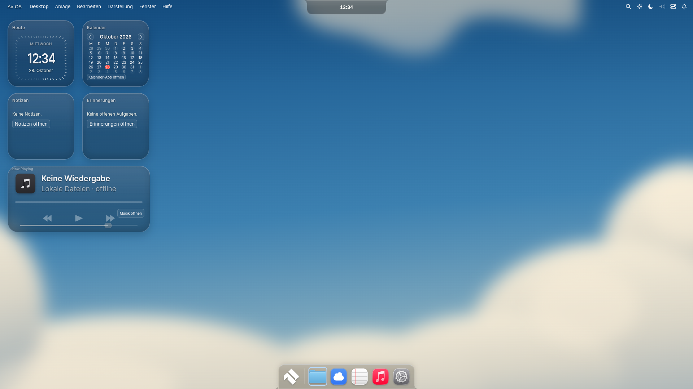
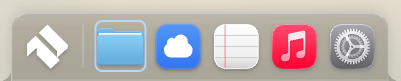
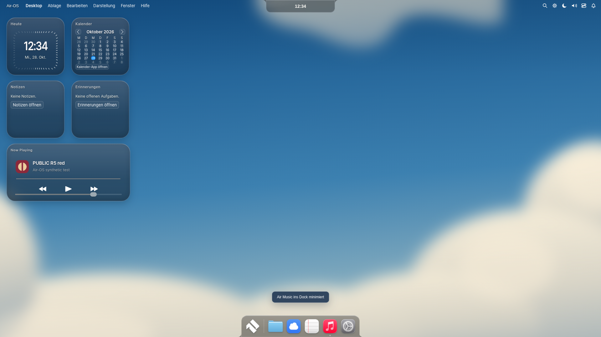
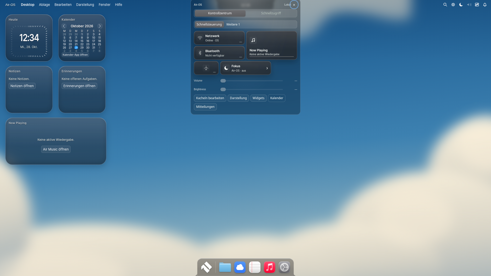
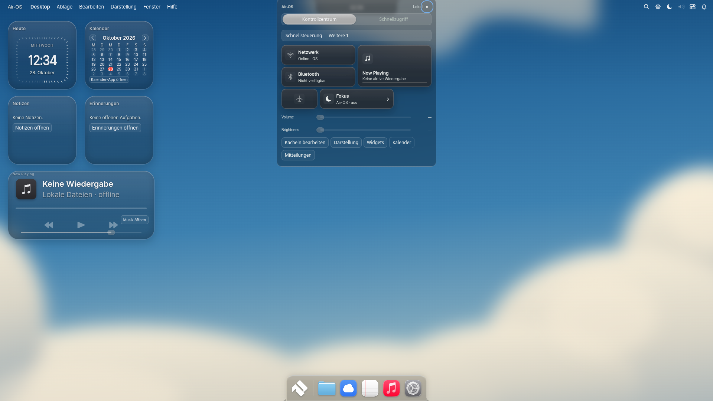

# Air-OS R5 — MacShell Fidelity

Verbindliche Basis `a5e17ece1b1e7f4ceaee69f92fae26490088e8db`, Branch `feat/air-os-r5-macshell-fidelity`. Technischer Testkanal, keine Produktionsfreigabe. Die charakteristischen Air-OS-Außenformen und die vorhandenen Datencontroller bleiben maßgeblich.

## A — echte Ausführungspfade

Originale `liquidglass.frag`/`dockglass.frag` behalten SDF, Squircle-Normalen, Snell,24Golden-Angle-Gaussiantaps, Dispersion, Rim, Meniskus und Mipmapberechnung. Electron-Anpassung: auf derselben Original-SDF/bezel-Distanz fließend zwischen detailreicher Originalwallpapertextur an der Kante und vorhandener gecachter Preblur-Innenfläche wechseln. Keine zweite Engine/keine neue Capturequelle. Nur im Übergangsband zwei Texturzugriffe, innen/außen je ein Zugriff. Originale Tint-/Dickenwerte bleiben erhalten. Opaque Szenenbasis verhindert unbeabsichtigte Alphaabdunklung bei transparenten PNGs. Concave Air-OS-SDF unverändert.

`GlassSlab`, `GlassSlider`, `GlassSwitch`, `GlassSegmented`, `LiquidKnob`: eigener begrenzter prozeduraler Track (keine DOM-/Fensteraufnahme) geht in den bestehenden liquidglass-Draw. Originale21×14/27×17-Slidergrößen,14px-Trackinset,4px-Track,1.35-fache LiquidKnob-Trackvergrößerung im Compositorfallback, lokale Stärke.85/.65, zwei animierte Switch-/Segmentkanten und ursprüngliche T7-Jig-/OutBack-Zeitachsen. Native Input-/Click-/Keyboardhandler behalten alle Werte und bestätigen Speicherung. Dekorative Linsen sind aria-hidden/pointer-events:none; keine neuen Hitboxen. Lokale Textur nur bei tatsächlicher Trackänderung neu hochladen; keine Zeichen/Passwörter in Texturen. Max32 lokale Quellen,1024×256, gemeinsamer Cleanup/Context-Restore. Reduced/Forced Colors/Classic bleiben bedienbar.

Diagnosebudget für kleine sichtbare Kanten von16K auf begrenzte64K Pixel angehoben; Hardwarebudget500K unverändert, Software-/Unknown-Guard unverändert. **Kein produktiver Software-Liquid-Modus.** Isolierte Diagnose lief ohne `--enable-unsafe-swiftshader`/ohne ausgeschaltete Chromium-Sandbox. Eigene Testuhr nur im Renderer; Main-Uhr und performance.now bleiben natürlich.

A-Abnahme: **496/496 Tests**, echter Linux-Electron44.9.3-Drei-Größen-Lauf inklusive Shaderkompilierung, Refraktion-on/off, originaler nativer Slider-/Switchbedienung und bestätigter Pref-Speicherung, Context Loss/Restore, Idle, M1/M2-Reverse, Classic/Modern, Reduced und Logout. [Messprotokoll](visual/r5/A/material-report.json), [Slider gehalten](visual/r5/A/glass-slider-held.png), [Switch](visual/r5/A/glass-switch.png), [Tests](visual/r5/A/tests.tap). Keine Hardware-GPU-Abnahme.390px ist ein CDP-Rendererviewport.

## Quellen

MacShell fixiert auf `1bdb51870b621100fd2709f66c8f8e00ab17b9c4`. Bestehende Originalquellen und MIT/OFL/GPL bleiben erhalten; neue originale Quellen/Bytehashes: [Manifest](../third_party/r5/provenance.json), [MIT](../third_party/r5/LICENSE), [NOTICE](../third_party/r5/NOTICE). QML-Referenzen zählen allein nicht als Integration. Tatsächlich laufende Zielpfade: `scripts/build-glass2-shaders.cjs`, `air-desktop-glass.js`, `air-glass-controls.js`, `src/core/macshell-fidelity.js`. Neue Randdetailmischung ist eine dokumentierte Electron-Compositoranpassung, keine behauptete originale Qt-Callsite.

CheckpointA300d984,CheckpointB/C7184d63. Der abschließende nativeR5-Installer wird nach tatsächlicher CI-Abnahme unten dokumentiert.

## B — Widget/PlayerArt und Scroll-under

`PlayerArt.qml` liefert die unveränderte generische Musiknoten-Path2D,512px-Verlauf,#3b3b40/#27272b,0.62-Skalierung sowie Schatten/Prägung. Canvas2D statt Qt MultiEffect: Schattenradius32×.24 und Innenblur6.4 sind bewusst adaptierte Compositorwerte. Kein neues Markenasset. `PlayerWidget.qml` liefert die vorhandene RU-Komposition, jetzt mit der vollständigen Kartenfläche statt einer zweiten Header-/Padding-Verkleinerung; Titel24RU/Künstler21RU, Artwork/Transportpositionen bleiben original. `PlayerBtn.qml`:0.86-Pressedscale,0.6Opacity,180msOutBack. Bestehende originale PlayerGlyph-Zeichenfunktionen bleiben maßgeblich. Glyphwechsel verwendet zwei abbrechbare340msOutCubic-Lagen; keine neue Audioengine.

Echte ausdrücklich ausgewählte, bereits im Air-Music-Transport vorhandene Cover-Blobs werden begrenzt dekodiert, auf16×16 nur für die originale sättigungsgewichtete Palette reduziert und nach Revision geprüft. Kein Dateisystemzugriff, keine fremden Bilder. Originale HSL-Farbfläche mit begrenzter Sättigung. `tintcard.frag` läuft bei Coverdaten als **fünftes, erst dann erzeugtes Programm** im bestehenden Kontext; originale Rounded-Coverage/smoothstep-Scheibe/Premultiplied-Alpha-Mischung. Wichtig: Am fixierten Upstreamstand existiert **keine QML-Callsite für tintcard.frag**. Ihre Verbindung zur Liquid-Playerkarte ist eine Air-OS-Anpassung, keine angeblich ursprüngliche Komposition:480msOutCubic,Alpha0.42×0.55,34pxSoftness. Der CSS-Modus führt dieselbe Farbausbreitung begrenzt in Canvas2D aus. Keine Cover: originale graue Musiknote statt erfundenem Album. Schnelle Wechsel, Fehler, Reduced Motion, Logout und entfernte Widgets räumen Animationen/Bilder auf.

`ClockWidget.qml`/bestehende Clock-Geometrie: tickweise .40/.58-Past- und .12/.28-Ahead-Deckkraft, reale Sekunden,zentrierte64u-Typografie mit.94/1.14-Stretch, realer Wochentag/Datum. Der bestehende Widgettimer tickt nur für das sichtbare Zifferblatt sekündlich; kein zusätzlicher GPU-Loop. Kalender übernimmt#FF453A-Tageskreis; echte Datumsnavigation bleibt beim vorhandenen Controller. Notes/Reminders bleiben echte profilgebundene Air-OS-Daten, nur Listenkomposition/Leerzustände wurden angeglichen.

Das **explizit bestätigte** Preset nutzt jetzt Originalraster21/228 und56/258/460; vorhandene konfigurierte Profile werden nicht automatisch überschrieben.185/395px-Kartenmaße bleiben unverändert.

`FeatherBlur.qml`: komplementäre9-Stufen-smoothstep-Masken,hold52/depth30/blur9/pad24 für Settings; Spotlight adaptiert aufhold0/depth34. Originale scharfe DOM-Inhalte und eine inert/aria-hidden-Blurkopie derselben eigenen Oberfläche; keine Pixelaufnahme, kein GL-Readback. Blurstrip≤106px,≤600Knoten,≤4096physische Breitenpixel; darüber bleibt das Original unverändert lesbar. Formulare werden neutralisiert,Cloudpanel/IDs/Eventattribute/Canvas/Frames/Medien ausgeschlossen. Kopie nur bei Inhaltsänderung neu aufgebaut, Scrollpositionsupdates höchstens einmal pro Frame. Native Controller behalten Fokus/Inputs; keine konkurrierenden Bedienelemente.

CSS-Fallback: Docktönung0.231,Widgetverlauf0.42 statt zusätzlicher deckender Schichten,neutrale.42-Island/Popovertönung,feine obere Reflexe/Innenkante. Geometrie/M1/M2 unverändert. Reduced Transparency wird opak und ohne Blur; Forced Colors nutzt Systemfarben. **CSS-Blur ist keine Snell-Refraktion.**

## C — tatsächliche Korrekturrunde

Der erste integrierte Screenshot zeigte eine vom Alt-CSS verschobene Uhr,einen zu tiefen Lautstärkeregler und bei schnellem Play/Pause übriggebliebene Glyphlagen. Produktcode korrigiert: spezifische originale Zentrierung,5%-Trackinset/7px-Unterrand,sauberer Abbruch und Entfernen veralteter Glyphlagen. [Erste Integration](visual/r5/first-integration/desktop-1920.png) bleibt als Nachweis erhalten. Keine nachbearbeiteten Produktbilder.

| Bereich | Referenz / Abweichung | Korrektur und verbleibende Grenze |
|---|---|---|
| Glasrand/Refraktion | liquidglass/dockglass; zu stark vorgefilterte Kanten | originale Snellrechnung plus kantenabhängige Detailquelle;Wallpaper-only |
| Alpha/Transparenz | GlassSlab/WidgetVisual; CSS-Zusatzabdunklung | einzelne klare Tönung;CSS ohne optische Brechung |
| Widgets innen | Clock/Calendar/PlayerWidget | Originalticks/RU/PlayerArt;Air-OS-Header und Notesdaten bleiben |
| Dock/Island | MacDock/GlassSlab | Originalmaterial/Detaillicht;bewusst eigene gerade/konkave bzw.Island-Silhouette |
| Controls | GlassSlider/Switch/Segmented/LiquidKnob | lokale prozedurale Trackquelle;kein Capture fremder Flächen;native Eingaben bleiben |
| Scroll-under | FeatherBlur | komplementäre bounded DOM-Compositorschichten;Inputs neutral statt Qt-Pixelsource |
| Menüleiste/Apps | bestehender MacBar/MacTahoe-Port |26px und Dark-Sidebar/Light-Workspace erhalten;kein kompletter Neubau |
| Animationen | PlayerBtn/Glyph/Clock,bestehende M1/M2 | finite abbrechbare Übergänge;keine unbelegte60fps-Aussage |

Originalreferenzbilder aus dem Upstream-README wurden angefragt; der verfügbare Netzwerkpfad beantwortete die GitHub-user-attachments-URL mit403. Daher **Quellcodevergleich und reproduzierbarer R4/R5-Bildvergleich**, keine behauptete direkte Pixelabnahme gegen eine ausführbare MacShell-Originaloberfläche. Keine Pixelgleichheitsquote.

B/C-Nachweis: echte Electron44.9.3-Läufe bei1920×1080,1650×930,390×600 mit tatsächlich eingelesenen CC0-MP3s/64px-PNG-Covern. [Shaderlauf](visual/r5/B/material-report.json): max5Programme inklusive tintcard,aktiveLinsen,0IdleDraws im700ms-Fenster,ContextLoss/Restore,erfolgreiche native Range-/Switchbedienung mit bestätigter Speicherung,komplementärer Scrollmaskenlauf(scrollTop38,1aktiveinertKopie). [Normaler CSS-Lauf](visual/r5/C/material-report.json):0GL-Programme,echter Softwareguard. [Vergleichsbasisszenen](visual/r5/before-final/),[Nachher](visual/r5/C/),[echte Shaderbilder](visual/r5/B/). Identischer synthetischer Rendererzeitpunkt2026-10-28T12:34:30Z,identische ausgewählte Widgetpositionen,Main-/Performanceuhr unverändert. Diagnose ist SwiftShader,keine Hardwareabnahme.

Im festen Dock-Rechteck(755,1013–1167,1080) beträgt die mittlere absolute RGB-Abweichung von Refraktion an/aus beim R4-Diagnosebild1.949 und nachR5-A3.986(8bit-Kanalwerte). Das ist ein Bildnachweis stärkerer sichtbarer Wirkung im isolierten synthetischen Renderpfad,keine FPS-/Hardware-/Pixelgleichheitsbewertung. R5 nutzt hier ein64K- statt16K-Diagnosebudget; dieser Unterschied ist Teil der dokumentierten Kantenqualitätskorrektur.

## D — Regression und Grenzen

Vollständige Testsuite jetzt **511/511**(491Ausgangsregressionen erhalten),moderner eingefrorener44.9.3/26.18.0-Toolchainaudit **0Befunde**;Legacy-Catalina-Kanal separat und unverändert. Sourceprüfung enthält318lokale Runtime-/Lizenzassets;gemeinsamer PWA-Build304allowlistAssets,kein Deployment/Cloudlogin.

Der unveränderte vollständige Electron-Harness lief zusätzlich erfolgreich durch: zwei Profile,echte Notes-Speicherung,Neustartpersistenz,Finder/Apps,Kontrollzentrum,Notifikationen,MRU/Snap,M1/M2vorwärts/rückwärts,Classic/Modern,WebGL/WebGL2wirklichnull im deaktivierten Host. [Protokoll](visual/r5/D/r1-gui-report.json),[Bewegungszustände](visual/r5/D/t7-motion-state.json),[vollständige Tests](visual/r5/D/tests.tap),[moderner Audit](visual/r5/D/modern-audit.json). Keine Änderungen an Main-/Preloadberechtigungen,Auth/Dateiroots,Cloud/PWA-Code,Dock-/Islandgeometrie oder R1–R4-Workflows.

Gezielte DPI-Nachprüfung: native Linsen-Rastercache und beide vorhandenen Renderer reagieren auf reine Auflösungs-/DPR-Mediaänderungen mit einem wieder registrierten,abortierbaren Listener;kein Polling. Numeric-Tracktexture bleibt bei unverändertem Inhalt gecacht,Canvasraster folgtDPR1/2/3. Lokale Texturdiagnostik zählt nur tatsächlich alloziierte GL-Texturen,nicht CSS-Quellcanvas. Settings-Linsen verwenden den vorhandenen Tahoe-Workspace-Farbtoken als eigene Trackbasis statt einer pauschalen dunklen Fläche.

Performancedaten sind **kumulierte reale performance.now-Walltimes** über den gesamten synthetischen Lauf,keine Frametime-/FPS-Garantie: im Linux-SwiftShaderlauf max5Programme,0Draws im700ms-Idlefenster,218msakkumulierteCanvastransferzeit,ca42.2sakkumuliertePaintzeit einschließlich vieler Zustands-/Viewport-/Contextänderungen. Softwarediagnose bleibt deshalb ausdrücklich isoliert;kein produktiver Software-Liquid-Schalter. DPR/Textures/Prepasszählung stehen im jeweiligen Materialreport. Hardwarebudget500K bleibt unverändert;Diagnose64K. CSS-Fallback führt0Materialprogramme aus.

Bewusst offen: nativeHardware-GPU/Windows11/SAC/macOS/Hyprland,echtePicker-/Zustimmungsdialoge,hörbareAudioausgabe,vertrauenswürdigesSigning,volleLive-Fensterrefraktion. Kein physischerHardwaretest aus CI abgeleitet. Ganze Qt-Scenegraph-/MultiEffectpipeline ist keine bytegleiche Chromiumimplementierung. `LiquidScrollBar.qml` liegt nur als referenzierte Originalquelle vor und zählt **nicht** als integriert;Switchdrag/Knobgesten,kompletteLyrics/Playeransichten und vollständigeQt-Covereffekte bleiben offen. Bestehender MacLock-Shader-/Authentifizierungspfad bleibt eigenständig und wurde übergreifend geprüft,aber nicht ersetzt. Keine neuen MacTahoe-Assets inR5;vorhandene14GPL-Icons/MIT-GTK-Tokens/OFL-Schriften unverändert lizenzkonform gebündelt.

## Bildvergleich

Identische kontrollierte Linux-Szenen,normaler CSS-Produktpfad:

| Szene | R4 unverändert | R5 nach Korrektur |
|---|---|---|
| Desktop1920 |  |  |
| Dock |  |  |
| Player mit echtem eigenem Cover |  |  |
| Kontrollzentrum |  |  |

[1650px](visual/r5/C/desktop-1650.png),[390px](visual/r5/C/desktop-390.png),[Slider](visual/r5/C/glass-slider-held.png),[Feather](visual/r5/C/scroll-under.png),[Forced Colors](visual/r5/C/forced-colors.png),[Reduced Transparency](visual/r5/C/reduced-transparency.png),[Lockscreen](visual/r5/C/lockscreen-1920.png). [D: Appfenster](visual/r5/D/t6-apps-1920.png),[Launchpad](visual/r5/D/t7-launchpad-1920.png),[Spotlight](visual/r5/D/deep-spotlight-1920.png),[Notifications](visual/r5/D/deep-notifications-1920.png),[Dock unter Hover](visual/r5/D/t7-many-hover-1920.png).

## Wiederverwendete Originalbytes

Die folgenden lokal gebündelten Originale wurden zusätzlich bytegleich gegen den fixierten MacShell-Checkout geprüft. Weitere neue Quelldateien stehen im R5-Hashmanifest; adaptierte JS-/GLES-Zielpfade sind bewusst separate Dateien.

| Original | SHA-256 | Lokale Lizenzquelle |
|---|---|---|
| liquidglass.frag | `17c803e919d156cfff3c285fc2b11a59548b8b757e191190269ee0b81b2f336b` | [third_party/deep-port/liquidglass.frag](../third_party/deep-port/liquidglass.frag) |
| dockglass.frag | `f1ebcf553c2dfb007050799f6c44d74556c2b49e4aac661c77f39b94ded0a631` | [third_party/glass2/dockglass.frag](../third_party/glass2/dockglass.frag) |
| contourglow.frag | `4677f7224000a835d0251e491fd8790048de51878bddb0c8d635c7b8b679e579` | [third_party/glass2/contourglow.frag](../third_party/glass2/contourglow.frag) |
| tintcard.frag | `fcb5040b7dee6bd3bace55ce8f5295b6d1fd3903772b2d357ea5d712da5f53c5` | [third_party/evolution1/original/tintcard.frag](../third_party/evolution1/original/tintcard.frag) |
| GlassSlab.qml | `91365c979a7ae5c0d712f7161d198e32245ea99f1a579094d57a434449eb55ca` | [third_party/evolution1/original/GlassSlab.qml](../third_party/evolution1/original/GlassSlab.qml) |
| FeatherBlur.qml | `a90258c0a3b02394e78ebda1ab535d39ab4b38b7e626841cf8c4b5b37c874deb` | [third_party/evolution1/original/FeatherBlur.qml](../third_party/evolution1/original/FeatherBlur.qml) |
| PlayerWidget.qml | `14fcb922a9348cc85702b6371164e4c502b2ec3109ed64f805942281f2999d8a` | [third_party/tahoe7/original/PlayerWidget.qml](../third_party/tahoe7/original/PlayerWidget.qml) |

Letzte sichtbare Korrektur: Der ältere kompakte Tahoe-Selektor begrenzte Titel/Künstler trotz gesetzter Originalvariablen auf15/12px. R5setzt jetzt die tatsächlichen24/21RU-Werte(21.98/19.23px bei185px-Kartenhöhe) mit600/500Gewicht durch. Echte GUI-Assertions vergleichen computedStyle mit den Original-RU-Werten. Linux-GUI-Launcher verwenden jetzt weder `--disable-setuid-sandbox` noch `--enable-unsafe-swiftshader`/`--no-sandbox`. Der erste zusätzliche Legacy-Lauf wurde wegen des alten Flags automatisch abgelehnt; nach Entfernen der Ausnahmen liefen der direkte vollständige Electron-End-to-Endtest und beide R5-Materialpfade erfolgreich. Keine offene Sicherheitsausnahme für die Abnahme.
