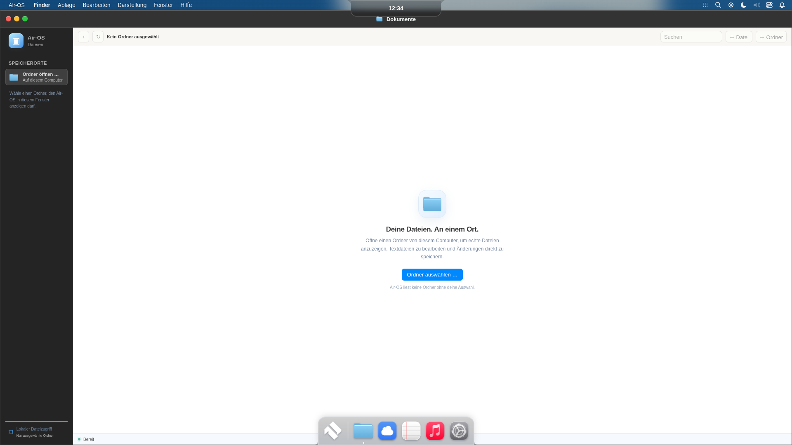
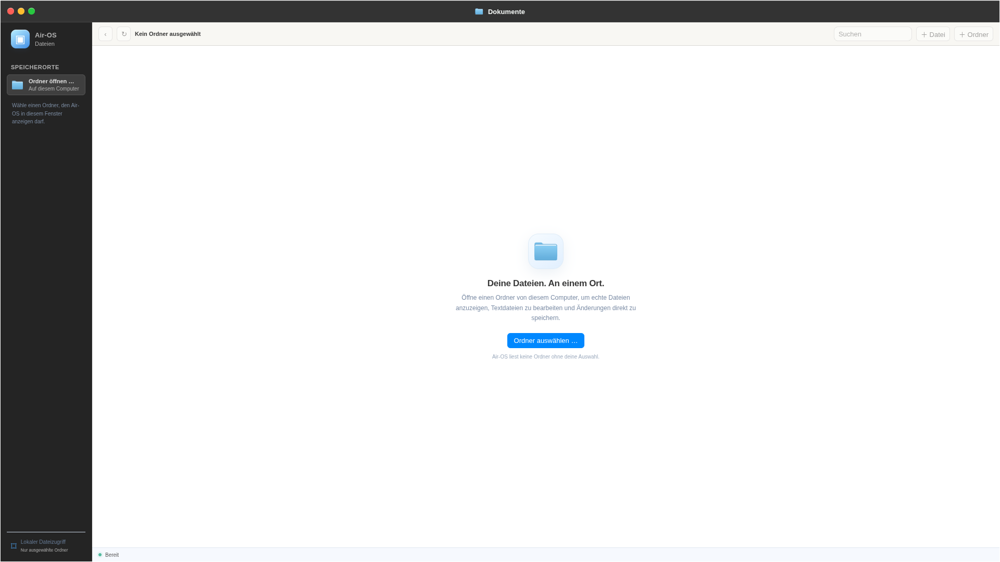

# R6.1 — Fenstergrenzen und F11

Basis:2e43327423abcce56da464789e01bf92ff7345f0. Branch:fix/r6-window-bounds.

Ursache: Der Modern-Fensterhost kombinierte die Desktop-Topverschiebung,62px Island-Reserve und76px Dock-Reserve. Maximieren auf100% füllte diesen künstlich verkleinerten Host statt die Arbeitsfläche.

Modern nutzt jetzt24px Menüzeile und darunter die komplette Arbeitsfläche mit Hostinset0. Dock bleibt Overlay; Island behält ihre feste Position/Form. Normale Fenster lassen sich bis an alle Arbeitsflächenränder ziehen. Maximieren/Restore verwenden weiterhin denselben Fenstercontroller und dieselben gespeicherten Geometrien.

F11 schaltet echtes BrowserWindow.setFullScreen über Native-Key-Handler bzw. eng begrenzte authentifizierte Main-/Preload-IPC. Keine dauerhaft frameless-Erzeugung. Native Enter/Leave-Ereignisse steuern die Rendererklasse: Systemleisten/Dock/Island verborgen, aktives Appfenster füllt den Client. F11 erneut stellt normalen Zustand her. Die Renderer-F11-Brücke deckt auch den CDP-Tastaturpfad ab, der den nativen before-input-Hook im ersten GUI-Test nicht auslöste. Keine nachgebaute native Vollbildzustandsbehauptung: isFullScreen wurde tatsächlich geprüft.

Vollbild verändert keine gespeicherte Fenstergeometrie; Drag/Resize/Snap sind währenddessen blockiert. Listener werden bei Logout/Pagehide entfernt, Logout beendet natives Vollbild. Classic außerhalb Vollbild bleibt unverändert. Keine neue Window-Engine und keine Installer-/Workflowänderung.

## Tatsächliche Prüfung

535/535 Node-Tests bestanden, einschließlich aller533 bisherigen Tests. Echte sandboxerhaltende Linux-Electron44.9.3-GUI mit isoliertem synthetischem Profil:

| Renderer | Maximierter Finder x/y | Breite×Höhe |
|---|---|---|
|1920×1080|0/24|1920×1056|
|1650×930|0/24|1650×906|
|390×600|0/24|390×576|

Bei1920×1080 alle vier Ränder mit echten Pointer-Drags erreicht; normales Maximize/Restore und F11-Restore innerhalb1px bestätigt. Native F11-State true/false geprüft, Vollbild-App0/0/1920/1080, Dock/Island verborgen. Menü24px. Dwindle/Master/Monocle/Floating, interne Arbeitsbereiche, M2-Minimize/Reverse/Fokus sowie M1-Öffnen/Schließen und Classic-Wechsel bestanden. [Messprotokoll](visual/r61/bounds-report.json).

390px ist ein schmaler CDP-Rendererviewport, kein physisches390px-Gerät. Kein nativer Windows-/macOS-Hardwaretest in dieser Sitzung; Windows-Titelleisten-/Mehrmonitorverhalten bleibt dort manuell abzunehmen. Kein neuer Installer gebaut; vorhandener R6-Download enthält diesen Hotfix noch nicht.

Kleinere Viewports:[1650](visual/r61/finder-maximized-1650.png),[390](visual/r61/finder-maximized-390.png).
