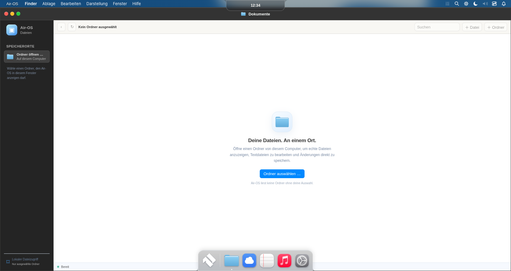
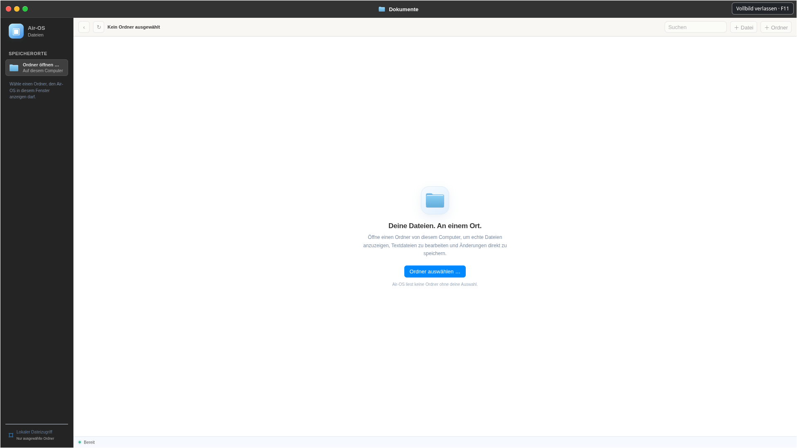

# R6.1 — Echtes Vollbild und vollständige Arbeitsfläche

Branch:fix/air-os-r6-true-fullscreen. Verbindliche Basis2e43327423abcce56da464789e01bf92ff7345f0; geprüfter erster Hotfix49ee7eef61f80d2f889e6f7672e5d1b654f8f3d5 wiederverwendet, nichts neu begonnen.

## Ursache und Korrektur

Im aktiven R6 kombinieren sich Desktop31px, Island-Hostverschiebung62px und untere76px-Reserve. Die ältere8/12/86px-Regel ist zusätzlich noch in styles.css vorhanden, aber nachfolgende Overrides bestimmen die tatsächliche Box. Maximieren100% bezog sich auf diesen verkleinerten Host. Der nachgereichte Windows-Screenshot zeigt genau diesen Effekt; native Windows-Titelleiste und internes Maximieren waren zudem unterschiedliche Zustände.

Modern arbeitet jetzt mit24px Menüzeile und danach voller Breite/Höhe ohne Dockreserve. Gemeinsamer Vertrag src/core/window-system.js workArea → app.js appWindowHostRect wird für Drag/Clamp/Snap, Maximize/Restore sowie die vorhandenen Hyprland-Layouts verwendet. CSS setzt denselben Host. Classic außerhalb Vollbild bleibt beim bisherigen Host. Dock ist Overlay, nicht Layoutreserve; Island bleibt fest oben mit ihrer eigenen Höhe/Kontur. Dwindle/Master behalten nur innere8px-Gaps, äußere Ränder0; Monocle füllt die Fläche.

Normal: frei beweglich/skalierbar, am Rand weiterhin greifbar. Grün und Titelleisten-Doppelklick maximieren/restaurieren denselben vorhandenen Controller. Gesicherte normale Geometrie bleibt maßgeblich.

Echtes Vollbild: BrowserWindow.setFullScreen über Main/preload; keine dauerhaft frameless-Erzeugung. F11 (Native-Key-Hook und sicherer DOM-/IPC-Fallback), Darstellung → Vollbild, Escape ohne vorrangigen Dialog sowie sichtbarer Vollbild-verlassen-Button. Native Enter/Leave-Ereignisse sind maßgeblich. IPC verwendet bestehende Main-Window-/Frame-/Session-Autorisierung. Logout verlässt Vollbild; Listener werden entfernt. Keine temporäre Vollbildgeometrie in Profilpräferenzen schreiben; Drag/Resize/Snap blockiert. M1/M2 bleiben ursprüngliche Timeline-Owner.

## Gemessene Linux-Electron-Abnahme

538/538 Node-Tests bestanden, alle533 ursprünglichen R6-Tests erhalten. Echte sandboxerhaltende Electron44.9.3-GUI mit synthetischem Profil, fünf Renderergrößen:

| Viewport | Maximierter Finder x/y | Größe | Kantenabweichung |
|---|---|---|---|
|1688×896|0/24|1688×872|0px an allen4Kanten|
|1920×1080|0/24|1920×1056|0px|
|1650×930|0/24|1650×906|0px|
|1536×864|0/24|1536×840|0px|
|390×600|0/24|390×576|0px|

Normale Randdrags und Restore innerhalb1px. Vollständige DOMRects für Menü, Island, Host, Finder, Dock und Viewport: [Messdaten](visual/r61/full-screen/bounds-report.json). Echter F11-Eintritt/Austritt, Menüaktion, sichtbarer Rückweg und Escape-Dialogvorrang bestanden. Vor nativer Fullscreenmessung wird die CDP-Größenemulation aufgehoben: inner/outer/screen1920×1080, aktive App0/0/1920/1080.390 ist ausdrücklich nur ein schmaler Rendererviewport.

Snaplinks/rechts, Doppelklick, Floating/Dwindle/Master/Monocle/Workspaces, M2-Minimize/Reverse/Fokus, M1-Schließen/Reverse und Classic-Wechsel bestanden. Kein privates Profil/Cloudkonto/Dateisystem verwendet.

[Normal](visual/r61/full-screen/finder-normal-1688.png) · [obere Kante](visual/r61/full-screen/finder-edge-1688-top-left.png) · [untere Kante](visual/r61/full-screen/finder-edge-1688-bottom-left.png) · [Dwindle](visual/r61/full-screen/layout-dwindle.png) · [Monocle](visual/r61/full-screen/layout-monocle.png) · [aus Vollbild zurück](visual/r61/full-screen/finder-fullscreen-restored.png) · [Desktop minimiert](visual/r61/full-screen/desktop-minimized.png).

## Windows-R6.1

Eigener eindeutig benannter technischer R6.1-Testkanal auf Grundlage der unveränderten R6-Verifier/Toolchain. R1–R6 bleiben intakt. Pflichtaudit/Tests/Runtimebytes/ASAR/x64/NSIS/Hash, tatsächliche Runnerinstallation und installierte EXE: volle bestehende GUI, R6-Produktpfad, neue5-Größen-/Fullscreenabnahme und separate Shaderdiagnose. Noch laufende Windowsabnahme wird erst nach realem CI-Erfolg als bestanden dokumentiert.

Kein Codesigning/Produktionsrelease. Physisches Windows11/SAC, echte Mehrmonitor-/DPI-Hardware und macOS bleiben separat abzunehmen. Kein Schutzmechanismus wird umgangen.
