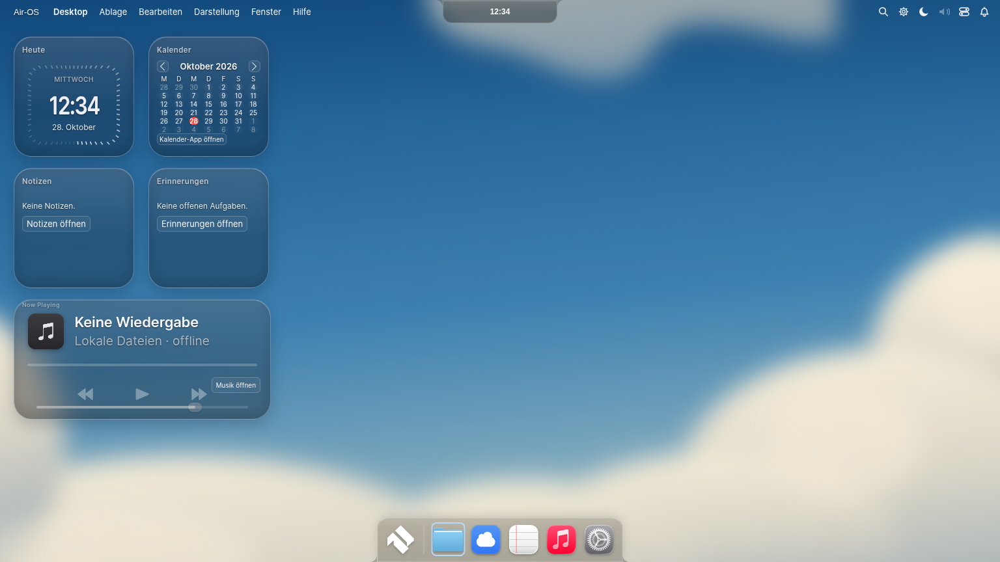
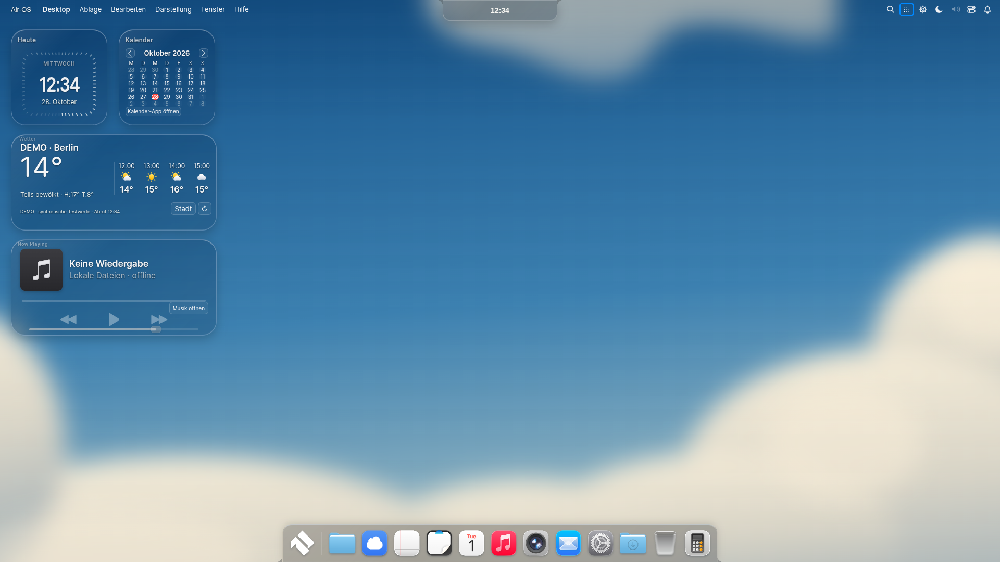
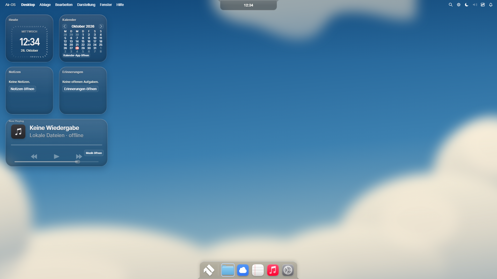
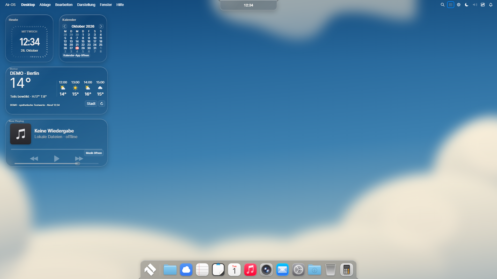
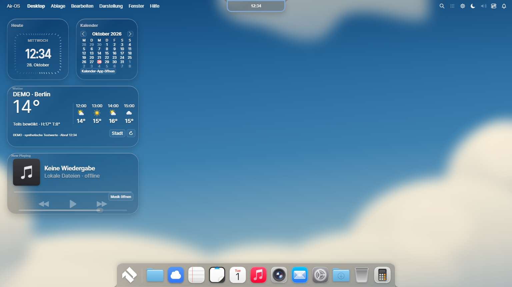
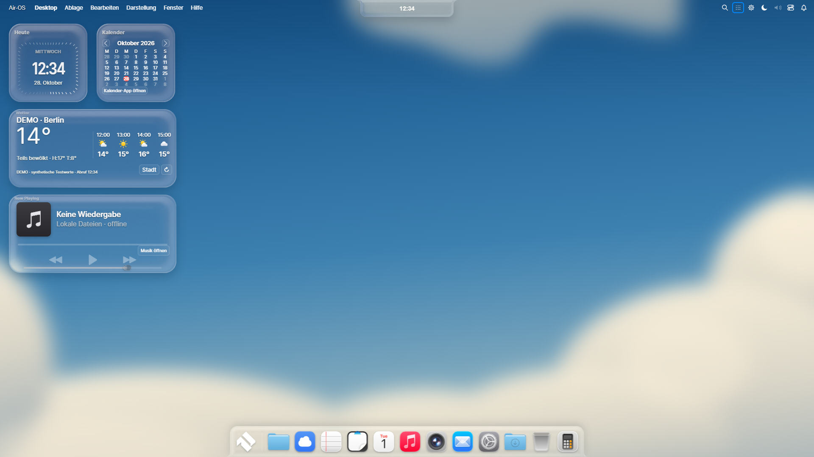

# Air-OS R6 — MacShell × MacTahoe × Hyprland

Technischer Teststand, keine Produktionsfreigabe. Branch: feat/air-os-r6-macshell-hyprland.

## Verbindliche Basis und Checkpoints

- Basis: 7c3fc8dc8eb6e55bcd709bd007be79e3537d108e; R5-Produkt e8a7538c005291b2525511f3338b621b356ca217.
- A:08d4737 — Original-Acrylic/GlassFinish/Dual-Kawase im gemeinsamen Renderer.
- B:8374257 — interne Dwindle/Master/Monocle-Layouts und vier Arbeitsbereiche.
- C:d1e9ca5 — reversibles Reference-Preset, freiwilliger Wetteradapter und Originalglyphen.
- D:7d1f447 — echte Pixelmessung, begrenzter Hyprland-Eventadapter und M2-Fokuskorrektur.
- Produkt-/Buildcheckpoint:58e395966d2699a707eac6fa5a8fa5860bb4ce66 — tatsächliche PlayerScale-Callsite und eigener Windows-R6-Kanal.

[Source-Port-Matrix mit Originalpfaden, Lizenzen und Ausführungspfaden](AIR_OS_R6_HYPRLAND_SOURCE_PORT.md).

## Tatsächlich umgesetzt

### Eine gemeinsame Materialengine

MacShell Liquid Glass bleibt die Standardfamilie. Zusätzlich wählbar: Hyprland Acrylic mit Original-Dual-Kawase; Hybrid aus vorhandenem MacShell-Gaussian und genau einem Acrylic-Finish; separates Hyprland GlassFinish. Dieselbe GLASS-3-Context-/Framebuffer-/Textur-Ownership, lazy Shader, gecachte Vorfilterung, keine Capturequelle und kein zweiter Renderer.

Acrylic:24px Refraction,48px Bulb,0.82 Clarity,0.025 Aberration, Originaltint0x14EEF5FF als optische Tiefe,1 Strength,0.0117 Noise,1 Brightness. Originale Profiltiefe/Normalen, Dispersion, Absorption/Fresnel/Licht und sRGB-Transfer laufen tatsächlich. SDR-, UV-/DPR- und konkave Air-Masken sind erklärte Electron-Anpassungen. MacShell-Callsiteparameter aus Tahoe8A bleiben erhalten.

Materialauswahl gilt für geeignete bereits angebundene Systemflächen; lokale native-Control-Linsen behalten ihren vorhandenen MacShell-Trackpfad. MacLock besitzt weiter seinen eigenen sicheren Renderer. Der Desktop-Backdrop bleibt **Wallpaper-only**. Keine echte Live-Fensterrefraktion behauptet.

Software-/Unknown-GPU-Schutz bleibt aktiv. Normaler Softwarepfad: hochwertiger CSS-Compositor-Fallback mit echter Transparenz und Blur; **keine Snell-Refraktion**. Reduzierte Transparenz und Forced Colors überschreiben alle Familien. Isolierte explizite Shaderdiagnose ist keine Hardwareabnahme und kein neuer produktiver Softwaremodus.

### Fenster und Arbeitsbereiche

Floating bleibt Standard. Optional: rekursive Dwindle-Splits, linkes Master-/Nebenfensterlayout und Monocle. Vier interne profilgebundene Arbeitsbereiche, ratio und Fensterzuordnungen werden erst nach Main-ACK übernommen. Bestehende Registry/openApps/MRU/Fokusverwaltung bleiben allein maßgeblich.

Originale lineare Geometrieinterpolation läuft in endlichem180msRAF; native Hyprland-Timer/Waylandobjekte werden nicht eingebaut. Bei unmöglichen Mindestgrößen wird Monocle verwendet. Freie Geometrien werden beim Wechsel zurück restauriert. Kein Fremdfensterzugriff, kein WinBox-Ersatz.

M1/M2-Transform-Timelines bleiben unverändert. Eine tatsächlich gefundene Regression wurde behoben: Ein während M2 restaurierendes Fenster darf vom Layout-Reflow nicht auf running herabgestuft werden. Reflow wartet auf den vorhandenen Animationsabschluss. Gezielte echte Tests minimieren/restaurieren in jedem Layout und prüfen den Fokus.

### Bestätigtes MacShell Reference Desktop

Zusätzlicher ausdrücklich bestätigter Preset:
Uhr/Kalender185×185 bei21/228px und56px oben; Wetter395×185 bei21/258; Player395×185 bei21/460. Original52px-Dockbasis,13 echte registrierte Appzuordnungen (Air Home über das Air-OS-Startsymbol), gekoppelte Magnifikation/dynamische Breite. Vorherige Widget-/Pin-/Materialkonfiguration wird gesichert und kann bestätigt wiederhergestellt werden. Keine automatische Änderung bestehender Profile/Pins.

Fehlende echte Callsite jetzt portiert: MacWidgets.playerScale0.8 → WidgetVisual.contentScale → PlayerWidget.k. Bei185px Höhe wächst Artwork von ca55 auf81px; Original-RU-Typografie und Glyphengrößen skalieren entsprechend. Echte Musikengine, Fortschritt, Coverpalette und Controls bleiben dieselben.

Wetter: freiwillige Stadtwahl, feste Open-Meteo-HTTPS-Endpunkte, aktuelle Temperatur/Zustand/High-Low/Stunden, Cache, Timeout, Fehler-/Offlineanzeige und Datenquellenhinweis. Keine Ortung, API-Schlüssel oder Hintergrundpolling. Original-WeatherIcon-Zeichenfunktionen laufen tatsächlich. Produktzustand ohne Einrichtung bleibt ehrlich. Testwetter trägt dauerhaft DEMO. Lokaler Livezugriff wurde mit HTTP403 blockiert; kein lokaler Liveerfolg behauptet. Anbieterangaben: privater/nichtkommerzieller Zugang, DatenCC-BY4.0 mit Attribution/GeoNames-Hinweis; kommerzielle Verwendung nicht freigegeben.

Optionaler Linux-/Hyprland-Socket2-Adapter: separate native Zustimmung, privater uid-Pfad, begrenzte lokale Ereignisse, nur Workspace-ID/Monitoränderung. Fremde Titel werden verworfen, keine Steuerbefehle/Polling. Cleanup bei Widerruf/Navigation/Logout/Quit. Windows/macOS deaktiviert. **Kein echter Hyprland-Testhost.**

## Visueller Vergleich und tatsächliche Korrekturrunden

Die nachgereichten Nutzerbilder (Desktop1280×720, MacLock-Medienansicht) sind im Chat sichtbar. Ein herunterladbarer Pixelmaster dieser Anhänge ist im Workspace nicht vorhanden. Daher visueller Kompositionsvergleich mit diesen Bildern und separat kontrollierter R5/R6-Pixelvergleich; keine erfundene Pixelregistrierung/Pixelgleichheit.

| Bereich / Referenz | Gefundene Abweichung | Produktkorrektur / Nachweis | Grenze |
|---|---|---|---|
| MacWidgets / sichtbarer Nutzerdesktop | Frühere5-Karten-Spalte statt Uhr/Kalender und zwei breiten Reihen | Bestätigtes4-Widget-Preset, Originalraster,13 echte Appzuordnungen | Eigenes Cloudwallpaper bleibt; keine fremden Markenapps importiert |
| Dock / MacDock | Fokusrückgabe nach Dialog hielt eine Icongruppe unbeabsichtigt vergrößert | Fokus zurück zum Auslöser, konkave CSS-Füße mit konsistenter Tönung; [erste](visual/r6/C-first/reference-desktop.png)/[korrigierte Runde](visual/r6/C/reference-desktop.png) | Air-OS-Randform und Pinvertrag bleiben bewusst eigenständig |
| Material / Originalshader | Refraction-Ableitungen skalierten mit begrenzter Rasterauflösung; Acrylic überstimmte Reduced Transparency | Logische-Pixel-Kalibrierung und höhere Reduced-Spezifität; echte Context-/Reduced-Prüfung | Wallpapertextur und SDR statt echter Compositor-Szene/HDR |
| Player / MacWidgets,WidgetVisual,PlayerWidget | Fehlender0.8-Callsitefaktor, zu kleines Artwork und zu große Beschriftung | [Nach Nutzerreferenz korrigiert](visual/r6/reference-corrected/reference-desktop.png); ca81px Artwork, originale Glyphengrößen | Echte Air-Music-Lautstärke als zusätzliche Air-Aktion; keine zweite Engine |
| Uhr/Kalender/Typografie | Referenz nutzt dieselbe enge Zweierkomposition | Bestehende Originalticks/RU-Schrift, echte Datumsnavigation erhalten | Deutsche Labels/eigener Testzeitpunkt statt englischer Originalaufnahme |
| MacLock / zweite Nutzerreferenz | Großer Cover-/Benachrichtigungsaufbau weiterhin unterschiedlich | Bestehender sicherer MacLock/Morph-/Materialpfad getestet, neutrale/ausdrücklich freigegebene Vorschau | Große Coverkarte und private Notificationstapel nicht neu portiert; keine vertraulichen Login-Daten freigegeben |

Kontrollierte Messgeometrie bei1536×864:
Dock835×73 bei350.5/791, gerade Basis bei864; Island176.02×36 bei679.98/0. Menüzeile26px. Geometrie bleibt durch M1/M2 und die bestehenden Außenmasken bestimmt. Vier Zielviewports1536×864,1920×1080,1650×930,390×600;390 ist ein klar gekennzeichneter CDP-Rendererviewport.

Vorher / Nachher, tatsächliche Linux-Electron-Aufnahmen:

[Nachher1536 vor finaler PlayerScale-Korrektur](visual/r6/accepted-linux/desktop-1536.png) · [Dwindle](visual/r6/accepted-linux/layout-dwindle.png) · [Master](visual/r6/accepted-linux/layout-master.png) · [Monocle](visual/r6/accepted-linux/layout-monocle.png) · [Island](visual/r6/accepted-linux/island-open-1536.png) · [alle Linux-Aufnahmen](visual/r6/).

## Refraktionsnachweis und Performancegrenzen

Echte gerenderte synthetische Linien, identischer Dockausschnitt61028Pixel einschließlich unveränderter Icons; Referenzbilder und Refraktion-aus-Vergleiche: [Pixelmessung](visual/r6/D/pixel-proof.json).

| Familie | Mittlere absolute RGB-Differenz0–255 | Pixel mit Kanalabweichung>3 | Lazy-Programme / Texturen in dieser Szene |
|---|---:|---:|---:|
| Acrylic | 1.167 | 4337 | 7 / 4 |
| Hybrid | 2.195 | 8322 | 7 / 6 |
| GlassFinish | 2.898 | 11731 | 8 / 6 |

Das belegt einen sichtbaren berechneten Effekt; weder starke Hardware-Fidelity noch Originalpixelgleichheit folgen daraus. [Acrylic-Linien](visual/r6/D/stripes-acrylic.png), [gerenderter Dockausschnitt](visual/r6/D/stripes-acrylic-dock.png), [Hybrid](visual/r6/D/stripes-hybrid.png).

Vollständiger isolierter Softwarelauf: maximal8Programme/12Texturen in den gemessenen Szenen, ca27.65MB geschätzte Texturbytes;999Draws/180Vorfilterdraws über den gesamten interaktiven Lauf,28Szenenaufbauten/15Dekodierungen. Kumulierte CPU-Wallzeiten:15ms Upload,198ms Canvastransfer,66.75s Paint über den vollständigen aufwendigen Test, keine GPU-Timer-/FPS-Messung. Im gemessenen700ms-Leerlauffenster **0 zusätzliche Draws**. DPR1/2/3, Context Loss/Restore inklusive Acrylic, Reduced Motion/Transparency und Forced Colors geprüft. Diese Softwarekosten begründen den weiterhin aktiven Schutz. Normaler Software-CSS-Lauf:0GL-Programme/0Texturen/0Draws. Kein60fps-Versprechen.

## Tests, Plattformen und Windows R6

- 533/533 Node-Regressionen lokal; native Windows-Pflichtsuite ebenfalls grün, TAP im Evidenzartefakt; alle bisherigen511 erhalten. Originalhashes/Shader/Layouts/Prefgrenzen/Wetter/Consent/Socketlimits/Windows-Pipeline ergänzt.
- Moderner vollständiger Dependency-Audit:0 Schwachstellen. Root-Legacy32.3.3 bleibt separat; Modern-Guard verweigert ihn korrekt. Unveränderter Guard mit tatsächlich installierter44.9.3-Toolchain separat bestanden; native CI verknüpft genau diese eingefrorene Toolchain.
- Source-/Syntax-/365Runtimeassetprüfungen bestanden; reproduzierbare Shadergeneratoren erzeugen identische Bytes.
- Bestehende vollständige echte Linux-Electron-Suite: Profile/Notes/Reminders/Kalender/Musik/Finder/Settings, MRU/Snap/M1/M2/Classic, Neustart und deaktiviertes WebGL bestanden. Beide getContext-Aufrufe null.
- Neuer vollständiger R6-CSS-Lauf in4Größen: Reference-Backup/Restore, Layouts/M2/Fokus/Workspaces, echte MP3-Metadaten/PlayerArt, native Inputs, reduzierte Präferenzen, Logout bestanden.
- Isolierte Shaderläufe:4Familien tatsächlich kompiliert/gerendert, ursprüngliche Kernregression, Idle/DPR/Context Loss bestanden. **Softwarediagnose, kein Hardware-WebGL.**
- Zusatzprobe mit2 echten synthetischen Profilen und echtem Prozessneustart bestätigt Master/Workspace2 nur bei Alice, Floating/Workspace1 und leerer Wettercache bei Bob. [Protokoll](visual/r6/profile-probe/profile-layout-report.json).
- PWA-Build:350 allowlistete Assets, kein Deployment/Cloudlogin. Bestehende Cloud-/PWA-Verträge nicht erweitert.

Windows-R6-Workflow: [.github/workflows/build-windows-r6.yml](../.github/workflows/build-windows-r6.yml), [Buildverifier](../scripts/windows-r6-build.cjs). R1–R5 und eingefrorene Toolchain unverändert. Exakte ASAR-Quellbytes, Lizenz-/Payloadinventur, PE-x64 und Installerhash werden geprüft, danach tatsächliche Runnerinstallation und installierte EXE/GUIs. Audit und alle Tests sind Pflicht.

### Tatsächlich abgeschlossene native Windows-Abnahme

[CI40731104765](https://github.com/quattrologic/Air-Os-Clean/actions/runs/40731104765): **22/22 Schritte erfolgreich**. Build-/Produktcommit58e395966d2699a707eac6fa5a8fa5860bb4ce66; gesicherter Windows-Bildcommit762707f0d41c466c0315448e2577e0d786e1bc78. Windows-Server-Runnerkernel10.0.20348, kein physischer Windows11-Test.

[Air-OS Ultimate — Windows x64 — R6 Testbuild herunterladen](https://github.com/quattrologic/Air-Os-Clean/actions/runs/40731104765/artifacts/12835359688)

- Datei:Air-OS-Ultimate-R6-1.0.3-dev.1.sha58e395966d26-Windows-x64.exe
- Größe:122556185Bytes (ca122.56MB).
- Builddatum:2026-10-28T17:01:54.493Z.
- Electron:44.9.3; electron-builder:26.18.0.
- SHA-256:85eec3e2d2b83756e2f2cf5bf6307fcdf39e6403f88bd102ae85ab7dd3276e31
- NSIS/x64/365ASAR-Runtimebytes/Lizenz-/Payloadinventur verifiziert; Installer tatsächlich im Runner installiert und installierte EXE gestartet.
- Audit, komplette Pflichtsuite, vollständige bestehende installierte GUI, neuer R6-Produktlauf4Viewports und isolierte Shaderdiagnose erfolgreich.
- Profile/Neustart/MacLock/Login/Logout, Apps, MRU/Snap, neue Layouts/M2-Fokus und Reference-Backup/Restore bestanden. Beide WebGL-Kontexte bei explizitem Fallback null.
- **Echter Wetterabruf für öffentliche Teststadt Berlin im Windows-Runner erfolgreich** (keine Response-/IPC-Mocks); Linux-Netzwerkblock bleibt gesondert dokumentiert. Vergleichsbilder nutzen danach bewusst markierte DEMO-Wetterfixtures.
- Normaler Windows-Produktpfad:software-gpu → CSS-Fallback,0GL-Programme/0Texturen/0Draws. Separate explizite SwiftShaderdiagnose: alle4Materialfamilien tatsächlich ausgeführt, maximal9Programme/12Texturen, Idle-Draws0. Kumuliert562Draws,216Vorfilterdraws,36Szenenaufbauten,434ms Transfer-Wallzeit,27.325s Paint-Wallzeit im vollständigen interaktiven Test. Keine Hardware-/FPS-Freigabe.
- **Ungesigniert**, kein öffentliches Produktionsrelease. Smart App Control/Defender nicht umgehen oder deaktivieren. SAC-Verhalten auf echtem Windows11 und vertrauenswürdige Signierung bleiben offen.

[Gesicherte Windows-Metadaten](visual/r6/windows-r6/58e395966d2699a707eac6fa5a8fa5860bb4ce66/evidence.json) · [alle66Windows-PNGs](visual/r6/windows-r6/58e395966d2699a707eac6fa5a8fa5860bb4ce66/) · [vollständige Test-/Audit-/Diagnoseartefakte](https://github.com/quattrologic/Air-Os-Clean/actions/runs/40731104765/artifacts/12835987657). Actions-Artefakte:14Tage Aufbewahrung, GitHub-Anmeldung kann erforderlich sein; gesicherte Repositorybilder bleiben erhalten.

**Vorher R5 / Nachher R6, normale installierte Windows-Produktoberfläche,1920×1080:**

R5 nutzte das frühere5-Karten-Preset; R6 das neue ausdrücklich bestätigte4-Widget-Referenzpreset. Kein isolierter Material-A/B-Leistungsbenchmark dieser unterschiedlichen Kompositionen. Sichtbarer Unterschied: ursprüngliche Zweier-/Breitreihen, größerer Original-PlayerArt-Bereich durch echte0.8-Callsite, breites dynamisches Dock und transparenter CSS-Glaskörper. Windows-Schriftrasterung/kräftigeres Textgewicht weichen sichtbar von der Qt-Nutzerreferenz ab und bleiben eine Fidelity-Grenze.

**Hauptbenchmark1536×864, installierte Windows-App, normaler CSS-Produktpfad:**

**Separate installierte SwiftShaderdiagnose — keine Hardwareabnahme:**

[Dwindle](visual/r6/windows-r6/58e395966d2699a707eac6fa5a8fa5860bb4ce66/layout-dwindle.png) · [Master](visual/r6/windows-r6/58e395966d2699a707eac6fa5a8fa5860bb4ce66/layout-master.png) · [Monocle](visual/r6/windows-r6/58e395966d2699a707eac6fa5a8fa5860bb4ce66/layout-monocle.png) · [MacLock neutral](visual/r6/windows-r6/58e395966d2699a707eac6fa5a8fa5860bb4ce66/r1-lockscreen-1920.png) · [Kontrollzentrum](visual/r6/windows-r6/58e395966d2699a707eac6fa5a8fa5860bb4ce66/island-open-1536.png) · [Spotlight](visual/r6/windows-r6/58e395966d2699a707eac6fa5a8fa5860bb4ce66/spotlight.png).

### Später auf eigenem Windows-PC prüfen

1. Actions-ZIP herunterladen und entpacken. SHA256SUMS.txt und BUILD-INFO.json gehören zum selben Installer. Get-FileHash -Algorithm SHA256 auf die EXE anwenden und den vollständigen Hash vergleichen.
2. Nur manuell auf dem eigenen Test-PC installieren; synthetisches lokales Testprofil anlegen, keine Cloudanmeldung. Bei SAC-/Publisherblock nicht Schutzfunktionen umgehen; signierter Build/Hardwareabnahme bleiben separate Voraussetzungen.
3. Modern wählen, Darstellung → Arbeitsbereiche öffnen; Reference-Desktopvorschau und Austausch ausdrücklich bestätigen. Bestehende Konfiguration ist wiederherstellbar.
4. Wetter nur nach freiwilliger Stadtwahl, Musik nur nach eigener expliziter Dateiauswahl. Fensterlayouts sind interne Air-OS-Modi; Floating lässt sich wiederherstellen.
5. Hardware-GPU/Display/DPI, Audio, native Picker/Zustimmung, Suspend/Resume und tatsächliches Windows11-/SAC-Verhalten manuell protokollieren; Runnererfolg ersetzt diese Abnahme nicht.

## Weiter offene Grenzen

Physische Windows11-/Hardware-GPU-/SAC-Abnahme, vertrauenswürdige Signierung, macOS-Hardware, echter Hyprlandhost, manuelle native Picker/Zustimmungsdialoge und Audioausgabe bleiben offen. Kein Defender-/SAC-Bypass, kein öffentliches Produktionsrelease. Kein Live-Backdrop fremder Fenster, vollständiger Wayland-Compositor, Scrollinglayout, voller Hyprland-Animations-/OkLab-/Shadow/Prism/Frost-Port oder vollständiger MacLock-Medienumbau. Lokaler Livewetterzugriff403-blockiert; echter öffentlicher Berlin-Abruf im Windows-Runner bestanden. Verfügbarkeit auf eigenem Gerät bleibt zu prüfen. Alte nicht profilgebundene Kalender-/Playlistdaten bleiben unangetastet.
