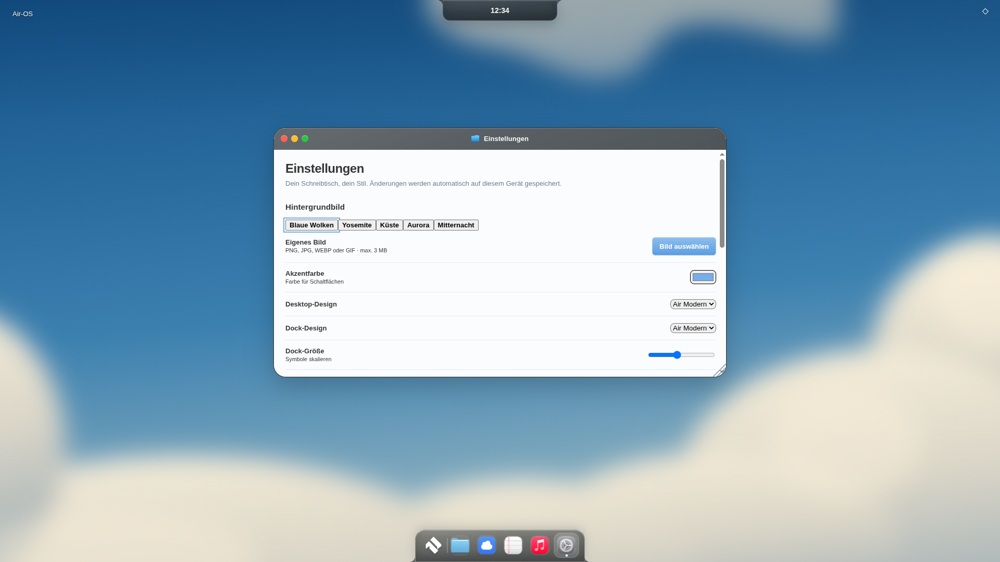
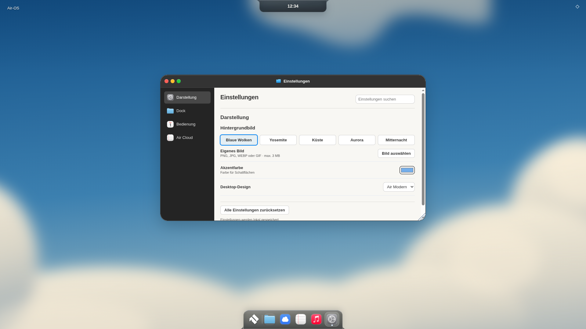
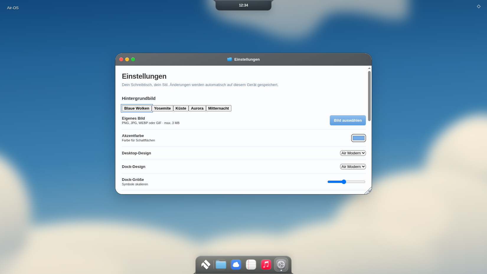
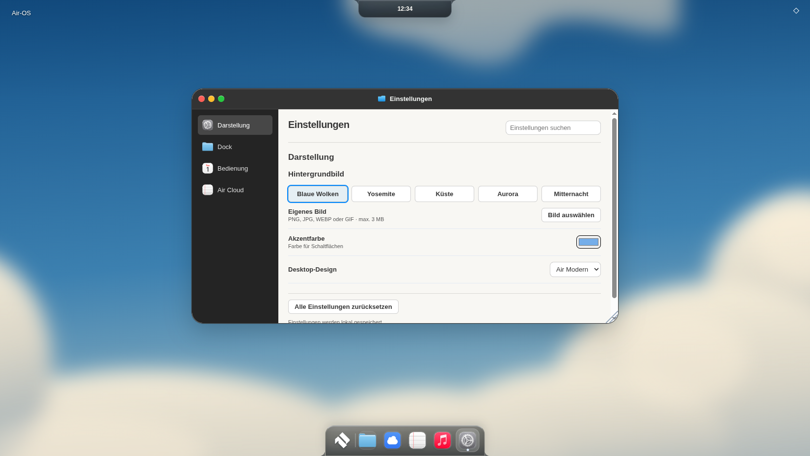
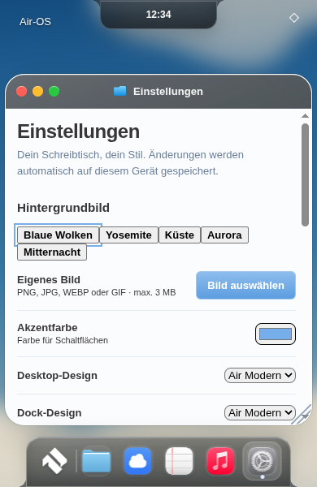
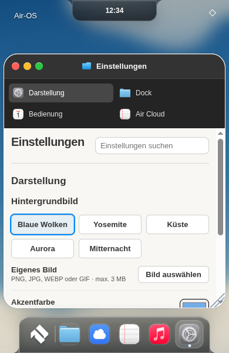

# Air-OS Tahoe 2 – Einstellungen

Basis `a420dd3ef89243fbc75a9baecb00b0d05d65fa3c`, eigener Branch `feat/air-os-tahoe-2`. 26. Oktober 2026. Sauberer Arbeitsbaum und Remote-HEAD verifiziert; kein Neustart des Masterports. Umfang aufgrund des ausdrücklich begrenzten Budgets: **genau eine App – Einstellungen**. Finder, Notes und Reminders nicht neu gestaltet.

Geprüfter Produktcommit: `59dd9d44dce478aa431cd622df1ecd77bc75ebf7`.

## Umsetzung

`air-settings-tahoe.js` ordnet die bestehenden DOM-Bedienelemente samt ihren Eventhandlern in Darstellung, Dock, Bedienung und – soweit tatsächlich vorhanden – Air Cloud ein. Keine leeren Kategorien, neue Kontoverwaltung oder Datenbank. Originalicons über den vorhandenen Registry-Painter. Suchtoolbar filtert bestehende Optionen über alle Kategorien; ehrlicher Leerzustand. Native Buttons/Tab/Enter, sichtbarer aktiver Zustand, beschriftete native Schalter. Auf schmalen Ansichten zweispaltige Kategorien oberhalb des scrollbaren Inhalts statt gequetschter Sidebar. Jede Option und der gemeinsame Speicherstatus bleiben erreichbar.

Die Modern-Präsentation lässt sich beim Wechsel zu Classic vollständig in die ursprüngliche DOM-Reihenfolge zurückführen. Observer werden bei Schließen, Profilwechsel und pagehide entfernt. Keine neuen Timer. Cloud-Eingaben/Authentifizierung unverändert, kein Cloudlogin ausgeführt.

`air-tahoe.css` erweitert die gemeinsame Komponentenebene um Kategorieauswahl, Toolbar/Suche, Einstellungszeilen, Auswahlfelder, Switches, Wallpaper-Auswahlbuttons, Footerstatus und Leerzustand. Vorhandene MIT-Sass-Werte: Laptopspacing/-padding 4px, Menüzeile 28px, Buttonradius 6px, Feldradius 8px; Darkbasis #242424, Header #333333, Text #dedede, Akzent #0088ff, heller Hinweistext #565656. Quelle und unveränderte Lizenz: `third_party/tahoe/gtk/source/_variables.scss`, `_colors.scss`, `_colors-palette.scss` (fixierter Masterport-Pin). Sidebarbreite176px und mobile Kategorien sind dokumentierte Electron-Anpassungen. Creme #f8f7f3 bleibt Air-OS-Entscheidung. Keine neue Shaderengine; ein aktives GLASS-Canvas bleibt vorrangig, dunkler Headerfallback wird ausschließlich ohne Canvas gesetzt.

Einstellungen verwenden nun die bestehende serialisierte Schreibqueue mit Bestätigung vor Anwendung/Erfolgsmeldung, expliziter preferenceSession-Prüfung vor und nach dem Schreibvorgang. Fehler erhalten die zuletzt bestätigten Werte und bieten Retry. Slider/Farbwahl speichern beim bestätigten Change statt bei jedem Inputframe. Das bereits bestätigte Desktop-Theme-Verfahren und die Resetfunktion bleiben erhalten. Rücksetzen/Fehlerkorrektur liest die tatsächlich gespeicherten Werte, statt Dockgröße/Accessibility hart auf Defaults zu setzen. Sonstige Aufrufer der bisherigen Preferences-Helfer unverändert.

## Tatsächlich geprüft

- **400/400 Tests bestanden**, alle bisherigen396 plus vier Regressionen: bestätigter Queuepfad, Fehler/Retry, verspätete fremde Sitzung und Präsentations-/Cleanupvertrag.
- **184 Runtime-Ressourcen** und JavaScript-Syntax validiert; Paketliste ergänzt nur den neuen Präsentationsadapter. Keine neuen Abhängigkeiten, Build-/Signierungslogik unverändert.
- Echte sandboxed Linux-Electron44-Prüfung in1920×1080,1650×930,390×600: Einstellungen über bestehendes Startmenü geöffnet/geschlossen, alle vier Kategorien, Suchtreffer/Leerzustand, echter Reduce-Glass-Schalter mit bestätigter Persistenz und sichtbarer Erfolgsmeldung. Vorher-/Nachher-Screenshots sowie Detailseiten. 390px ist eine schmale Rendereransicht, kein physisches iPad.
- Vollständiger bestehender Electron-App-/Zwei-Profil-/Logout-/Neustart-/Notes-/Home-/Finder-/Reminders-/Classic-/M1-/M2-/Reduced-Motion-/WebGL-Ausfalllauf bestanden. Kopie des Prüflaunchers passt ausschließlich den vorhandenen Cloud-Einstieg an die neue Kategorie an; keine Cloudanmeldung. [Messbericht](visual/tahoe2-regression/r1-gui-report.json).
- Dock und geschlossene Island exakt gleiche Rechtecke wie vor dem Umbau bei allen drei Größen: Dock325×62/bottom0; Island220×40,189,078125×36,144×36/top0. Keine neue Fensterverwaltung, neuen Rechte oder Datenmigration.
- Regulärer SwiftShader-/CSS-Fallback. Keine native Windows-/macOS-/Safari- oder Hardware-GPU-Abnahme behauptet. Gemeinsame Context-Loss-/Reduced-Transparency-Tests bleiben erhalten. Kein neuer CI-Erfolg behauptet; GitHub-API ist in dieser Umgebung bereits als403 dokumentiert. main/PRs/Installer unverändert.

## Echte Vorher-/Nachher-Aufnahmen

| Renderer | Vorher | Nachher |
|---|---|---|
| 1920 |  |  |
| 1650 |  |  |
| 390 |  |  |

Weitere tatsächlich bediente Kategorien: [dock](visual/tahoe2-after/settings-dock-390.png) · [accessibility](visual/tahoe2-after/settings-accessibility-390.png) · [cloud](visual/tahoe2-after/settings-cloud-390.png) · 

## Gesicherter Umfang / offen

Eine vollständige Einstellungen-Präsentation, keine weitere App begonnen. Plattform-/Textvergrößerungsabnahme und zusätzliche App-Komponenten für Tabellen/Kontextmenüs sowie Finder/Notes/Reminders bleiben separat offen. Keine neuen MacShell-/MacLock-/Widgetfunktionen. Der Produktcommit steht oben; der folgende Dokumentationscommit sichert Bericht und Aufnahmen. Nach Commit/Push STOP.
