# R1 – aktueller Windows-x64-Testkanal

25. Oktober2026. Basis und verifizierter Remote-HEAD: **5e642b43aaaaf0bc11babe629840322f0ae46be0** (`docs/macshell-integration-roadmap-20261025`). Eigener Integrations-/Buildbranch **build/air-ultimate-windows-x64-r1-20261025**. Diese Einheit implementiert Build-, Inhalts-/Sicherheitsprüfung und Installations-/GUI-Smoke; keine MacLock-Medien-/NewAmp-Funktionen vorweggenommen.

## Tatsächlich integrierter Stand

Die Basis enthält nach geprüfter Git-Abstammung A1–A3, B1/B2/B2.2, C1/C2/K3, D1, E1–E3, F1/K1/K2/CB-02, Glass-/konkave Randkorrektur, M1/M2 und MacLock L1A/L1B.1/L1B.2/L1B.3 sowie AM1/Quellenzuordnung/MacShell-Masterplan. AM1 und die100er-Matrix sind **Planung**, keine NewAmp- oder restliche MacShell-Implementierung. Air Musik verwendet weiterhin AmplitudeJS; L1C und AM2+ fehlen.

PR-#11-Head `eecab2a043fc62ab0802312aa09ce29dfd96c280` und PR-#12-Head `eb3f3bc62641afdd4a0fc2a5a66f6dc3fa053f73` erneut über Git-Refs gelesen. Der aktuelle Entwicklungsstand führt deren relevante bestehende App-/Build-/Pfadfixes bereits weiter; der alte Installerbranch enthält keine darüber hinaus fehlende Änderung an `scripts/test-build.cjs` oder dem Desktopworkflow. Kein pauschales Merge alter oder fremder Dependabot-/PR-Stände. main/PRs/alter Installerbranch nicht verändert.

Bestehende Anmeldung, Profile, App Registry/Lifecycle, Air Home mit echten Notes-/Reminderswidgets, Notes/Reminders/Finder, Startmenü/Suche/Pinning, K3-Schnellzugriff, M1/M2 und Classic bleiben im Produktcode unverändert. Kein neues Dock/keine zweite Island oder Audioengine. Keine zusätzlichen privaten Daten vor Login, keine native OS-Sperre behauptet.

## Implementierter Buildweg

- Neuer [Windows-R1-Workflow](../.github/workflows/build-windows-r1.yml), ausschließlich eigener Branch-Push oder manuell, **windows-2022/x64**, Node24, read-only Repositoryrechte, keine Releases.
- Separate eingefrorene [Modern-Toolchain](../build/windows-x64/package.json) samt [Lockfile](../build/windows-x64/package-lock.json): **Electron44.9.3, electron-builder26.18.0, AmplitudeJS5.3.2**. `npm ci`, kein Force-Upgrade und kein stummes Überspringen von Audits. Installation verwendet den MIT-lizenzierten `@electron-internal/extract-zip1.0.6` statt des alten verwundbaren `extract-zip2.0.1`.
- Root-`package.json`, Catalina-Mindestversion10.15/Electron32-Deklaration und vorhandene Workflows bleiben unverändert. Eine neue Dependency-Junction wird nur in einem frischen CI-Checkout erstellt; vorhandene Entwicklerinstallationen werden ausdrücklich nicht ersetzt. `check:modern` prüft den tatsächlich installierten Runtime, `check:catalina` weiterhin die getrennte Legacykonfiguration.
- [R1-Prüfer](../scripts/windows-test-build.cjs): vollständige Syntax-/Ressourcenprüfung; eindeutige `-dev.<run>.sha<commit>`-Version und Test-/Unsigned-/Runtime-/UTC-Metadaten; Windows-x64-only NSIS mit explizitem Runtime44.9.3, `--publish never`.
- Tatsächliches `app.asar` vor Upload prüfen: alle71 erwarteten Quelldateien/Produktressourcen einschließlich Login-/MacLock-JS, CSS, Wallpaper, Originalfonts, Shader/Auditquellen, MIT/OFL/NOTICE, Store-Public-Key und Amplitude inklusive Lizenz. Dateien byte-/SHA256-vergleichen, alle lokalen HTML-Scripts/Styles auflösen, fremde Runtimeabhängigkeiten und Private-Key-/Profildaten zurückweisen. PE-Machine muss x64 sein, Installerformat/Version/Anzahl stimmen. Electron-/Chromiumlizenzen ebenfalls prüfen.
- Electron-builder bereinigt Paketmetadaten: Root-JSON ohne `scripts/devDependencies/build`, Amplitude-JSON ohne `scripts/keywords/bugs`. Ausschließlich diese beobachteten Transformationsfelder ausnehmen; alle übrigen Metadaten strikt vergleichen. `aircard/README.md` ist ein vom Builder absichtlich weggelassener Entwicklertext, keine Laufzeitdatei. Lizenz-/Font-/Shaderprüfungen werden nicht abgeschwächt.
- Artefakt enthält echte EXE, `BUILD-INFO.json`, `SHA256SUMS.txt`, Dateigröße und vollständigen Installer-Dateihash. Hash/Bytes stehen zusätzlich in CI-Summary und Artefaktname; der GitHub-Artefakt-ZIP-Digest ist ein **anderer** Hash.
- Native CI versucht die tatsächliche NSIS-Datei still zu installieren und die **installierte** EXE zu starten. Resultate werden separat in BUILD-INFO dokumentiert. Nach erfolgreicher Sicherheits-/Paketprüfung darf ein technisches Artefakt auch bei gescheiterter Installation/GUI hochgeladen werden; der Job bleibt dann rot und die Fehler werden nicht als Erfolg ausgegeben. Keine produktive Freigabe.

## Sicherheitsstatus – tatsächliche neue Auflösung

[Legacy-Audit](references/r1/legacy-audit.json): **2 High**, Electron32 und `extract-zip`; aktuell0 Moderate in dieser frischen Auflösung. Die historisch dokumentierten10 Einträge sind historische Ergebnisse. Legacy bleibt ein Releaseblocker.

[Audit des eingefrorenen Modern-Baums](references/r1/modern-audit.json): **0 gemeldete Schwachstellen** bei dieser Prüfung, einschließlich Produktions- und Entwicklungsabhängigkeiten. Das ist kein vollständiger Sicherheitsnachweis/Releasezertifikat. Beide Kanäle werden nicht vermischt. Bestehende Securityprüfungen bleiben aktiviert; der neue Windowsjob auditiert seinen tatsächlich verwendeten eingefrorenen Baum erneut und scheitert bei High/Critical.

Lizenzen der ausgewählten Werkzeuge geprüft: Electron MIT (Electron contributors/GitHub), electron-builder MIT (Loopline Systems), interner ZIP-Extractor MIT (Electron contributors); reine Buildwerkzeuge werden nicht als zweite Runtime ausgeliefert. Tatsächliches Linux-ASAR enthält als einzige npm-Runtimeabhängigkeit AmplitudeJS samt MIT-Lizenz. MacLock MIT/OFL/Inter-/Open-Runde-Notices sind gebündelt. Keine fremden Medien-/Logo-/Lyricsassets hinzugefügt.

## Tatsächlich lokale Tests und Paketprüfung

**310/310 Tests bestanden**,0 Fehler/Skips;10 gezielte neue R1-Regressionen: Runtime-/Legacytrennung, tatsächliche ASAR-Dateien, fehlender Font, veralteter Shader, ungebündeltes HTML-Script, unerwartete Runtimeabhängigkeit, falsche Musikversion, x64-only Checksum-/Stale-Outputvertrag und geschütztes Dependencylinking sowie bytegleichen Git-Checkout trotz Windows-`autocrlf`. Synthetische PE-/Installerfixtures sind ausdrücklich **keine lauffähigen Installer** und werden nie als Download hochgeladen.

Alle71 Runtime-Ressourcen gefunden und sämtliche JS/CJS-Dateien syntaktisch geprüft; YAML/`check:catalina`/`git diff --check` bestanden. Zusätzlich **echtes electron-builder26.18.0-Linux-Verzeichnispaket** mit Electron44.9.3 erzeugt und dessen tatsächliches ASAR gegen71 Ressourcen verifiziert: [Dateihashes](references/r1/linux-asar-files.json). Das ist kein Windowsinstaller und wird nicht als solcher angeboten.

## Echte Electron-GUI und Vorher-/Nachherbilder

Linux/Xvfb, Chromium-Sandbox aktiv, isolierte synthetische Profile. Vorher Electron32.3.3/Chromium128; nachher Electron44.9.3/Chromium152. ANGLE/SwiftShader ist **Softwaregrafik**, kein physischer GPU-/Windowsnachweis. Große native Testfenster werden wirklich vergrößert;390px verwendet im echten Electronrenderer schmale CDP-Metriken bei weiterhin mindestens760px breitem nativen Host. Kein natives390px-Gerät/Fenster behauptet.

[Testhelfer](../scripts/check-windows-package.cjs) verwendet echte CDP-Maus-/Tastaturereignisse und die bestehenden authentifizierten APIs für synthetische Fixtures, keine Auth-/Renderer-Mocks. Anmeldung per Enter einschließlich Fehlversuch/Retry; Fenster-/Menüaktionen per tatsächlichen Klicks. Bestehende Registryeinträge werden auf interne Zuordnung und tatsächlichen Fensterstart geprüft; externes Spotify bleibt ohne Installation ausdrücklich ungeprüft. Erfolgreicher Fenstershellstart bestätigt keine Netzwerk-/Inhaltsfunktion eines externen Dienstes.

Geprüft: neue Profile Modern; Notes-Save/Home-Liveupdate; Finder/Home/Reminders; M2-Minimize/Umkehr/Restore/Close; K3/Island/Escape/Fokus/schneller Wechsel; Classic/Modern; Reduced Motion; zwei Profile/Logout; Prozessneustart und Persistenz; nativer WebGL-Ausfall mit weiterhin funktionsfähiger Anmeldung. Vorher-Legacy verwendet dafür den vorhandenen BrowserWindow-`webgl:false`-Testentry, Modern deaktivierte native3D-APIs. Kein JavaScript-getContext-Mock.

| Renderer | Dock x/y/B/H | unten | Island x/y/B/H | oben |
| --- | --- | --- | --- | --- |
|1920×1080|781/1012/358/68|0|835/0/250/45|0|
|1650×930|646/862/358/68|0|717.578125/0/214.84375/38.671875|0|
|390×600|16/532/358/68|0|117/0/156/36|0|

Beide endgültigen Läufe Exit0: je26 Registryeinträge erfasst,25 interne Appfenster tatsächlich gestartet/geschlossen, externes Spotify ausdrücklich nicht gestartet. Beide Profile-/Neustart-/WebGL-Fallbackprüfungen bestanden. Alle gemessenen Dock-/Islandboxen zwischen Electron32 und44 exakt gleich. [Vorher-Rohdaten](visual/r1-before/r1-gui-report.json) · [Nachher-Rohdaten](visual/r1-after/r1-gui-report.json). Root-Styles/Dock/Island/Home/Notes/M1/M2/Auth sind bytegleich zur Basis. Keine neue60fps-/Originalpixel-/Hardwarebehauptung.

Testhelferkorrekturen sind keine verschwiegenen Produkterfolge: erste rohe CDP-Eingaben bzw. Navigationserwartungen waren unvollständig; native Oberfläche musste statt nur virtueller Metriken vergrößert werden; Accounts müssen nach asynchronem Laden bereit sein; Auth darf nicht künstlich auf Animationsende warten. CLI-WebGL-Deaktivierung wirkte im Legacy-32-Pfad nicht zuverlässig, deshalb vorhandener nativer Fallback-Testentry. Abgebrochene/fehlgeschlagene Versuche gelten nicht als bestandene Abnahme. Finale Nachweise werden getrennt ausgewiesen.

## Windows-CI und Download

Erster tatsächlicher Windowslauf [40175663014](https://github.com/quattrologic/Air-Os-Clean/actions/runs/40175663014), Buildcommit **7040b35dc7815de97b253bc1297041e1add25581**: Windows-x64-Runner, eingefrorene Installation, Audit und vollständige Quellenprüfung erfolgreich; **Testsuite fehlgeschlagen**, Packaging/Installation/GUI übersprungen, kein Artefakt. Öffentliche Stepstatus geprüft. Direkter API-Logzugriff Forbidden, öffentlich verlinkte Step-Logs404; die exakten ursprünglichen Windows-Testfehler nicht geraten.

Ein konkreter plattformübergreifender Fehler wurde separat reproduziert: CRLF-Checkout der Original-QML-/Shaderdateien lässt zwei bestehende Originalintegritätstests scheitern. Neue `.gitattributes` erzwingt kanonisches LF für Text und unveränderte Binärfonts/-assets. Keine Originalhashes oder Tests aufgeweicht. Neue Regression führt `git -c core.autocrlf=true checkout-index` aus und vergleicht Shader/QML/Font/Wallpaper bytegenau. Der Testgate startet weiter sämtliche Tests; Fehlernamen/details werden begrenzt in öffentliche Actions-Annotationen und als TAP-Diagnose geschrieben, statt nur Exit1 zu zeigen.

**STATUS: korrigierter Windowslauf nach Push zu verifizieren; noch kein erfolgreicher neuer Installer/Dateihash behauptet.** Kein alter Run#99/Installer wird als aktueller Build ausgegeben. GitHub-REST-/GraphQL-API liefert derzeit Forbidden, öffentliche Actions-/Release-/PR-Seiten sind lesbar. Workflow wird über Push auf genau diesen eigenen Branch ausgelöst; bestehende PRs/main/Installerbranch bleiben unverändert.

Aktuell keine behauptete Windowsinstallation, kein erfundener Download, keine geratene Prüfsumme. Ein erfolgreicher Windows-CI-Build wäre lediglich ein unsigniertes technisches Testartefakt. Eine eventuelle unbeaufsichtigte Windows-Runner-GUI-Prüfung wäre echte Windowssoftware, aber **keine physische Hardware-/GPU-Abnahme**. Native macOS-Abnahme, Windows-Signing, macOS-Signing/Notarisierung, CB-03, weitere Sicherheits-/Releaseblocker und MacLock-Softwareperformance bleiben offen.

Nächste Einheit erst nach abgeschlossenem R1 und neuem Auftrag: **L1C.1 öffentliche DEMO-Medienblase**, keine private Now-Playing-Datenfreigabe vor sicherem Sitzungsvertrag. AM2/NewAmp und weitere Matrixfunktionen folgen separat.

## Vollständiger sichtbarer Bildvergleich – echte Linux-Electron-Aufnahmen

| Größe / Zustand | Vorher Electron32 | Nachher Electron44 |
| --- | --- | --- |
| 1920px / MacLock | 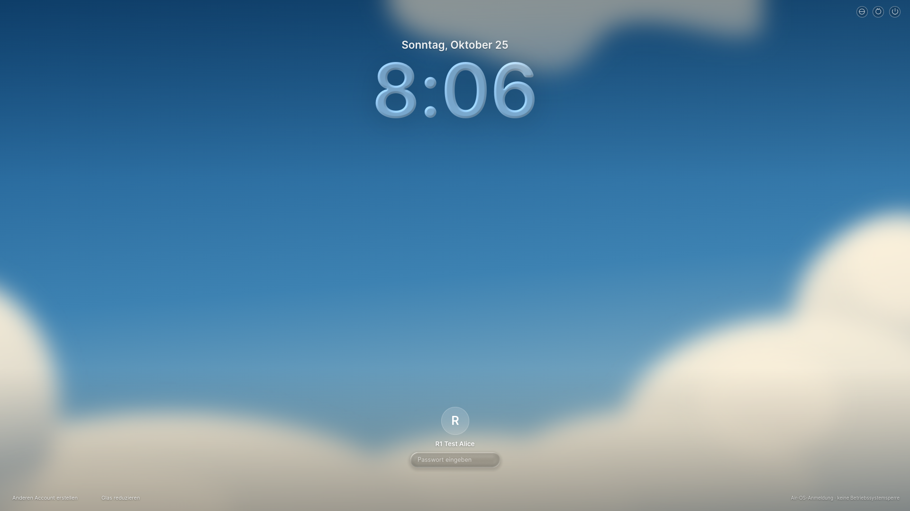 |  |
| 1920px / Desktop | 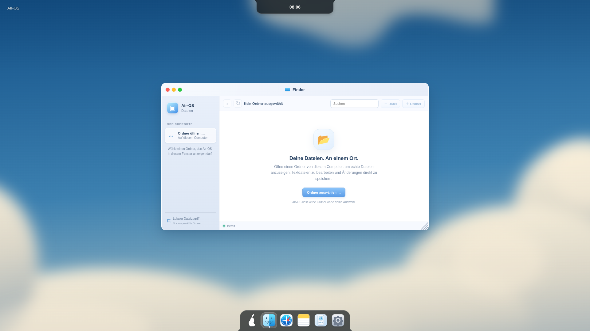 |  |
| 1920px / Notes | 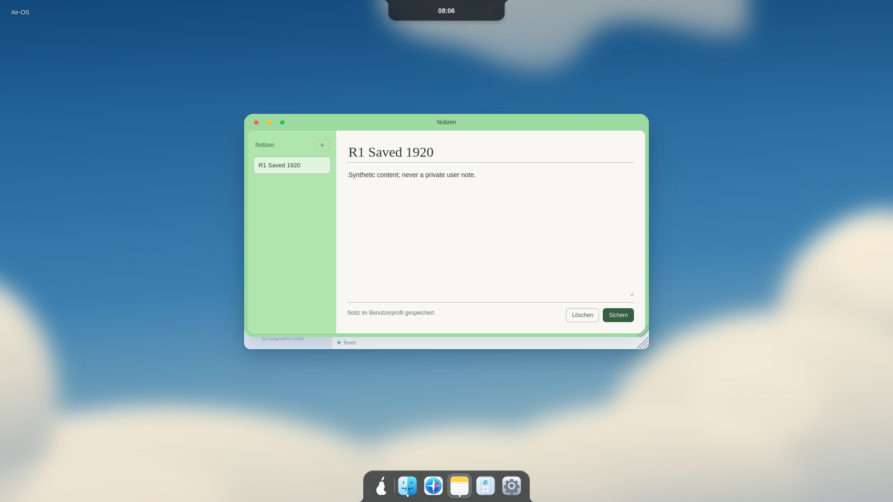 |  |
| 1920px / Air Home |  |  |
| 1920px / Classic |  | 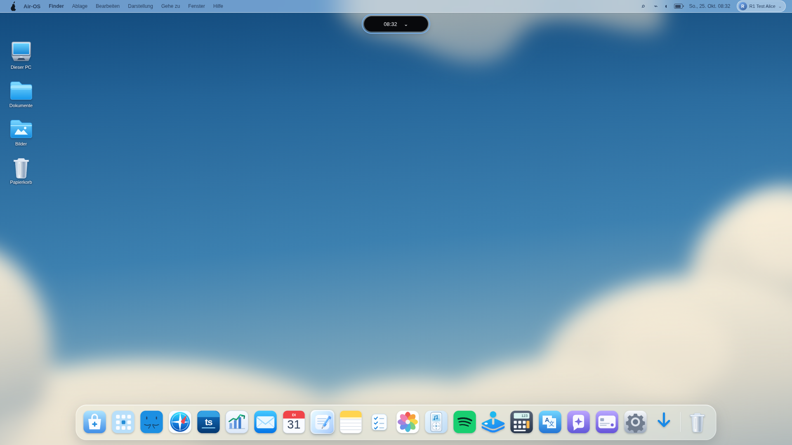 |
| 1650px / MacLock |  |  |
| 1650px / Desktop | 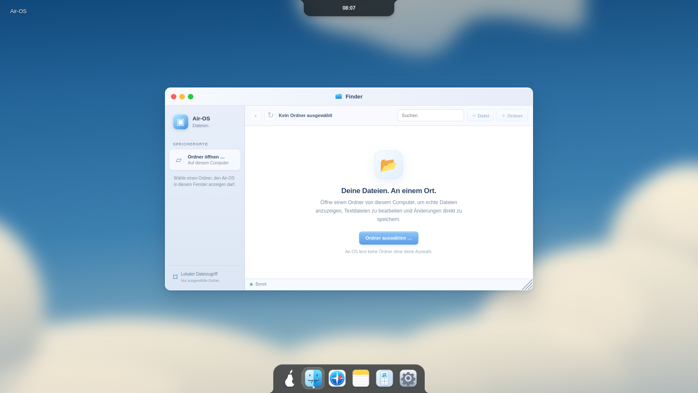 |  |
| 1650px / Notes | 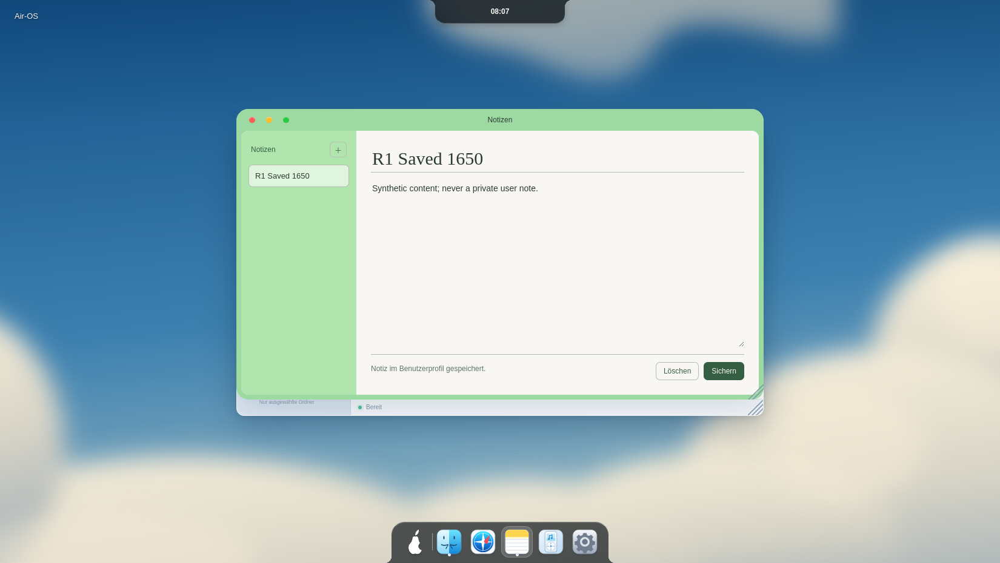 | 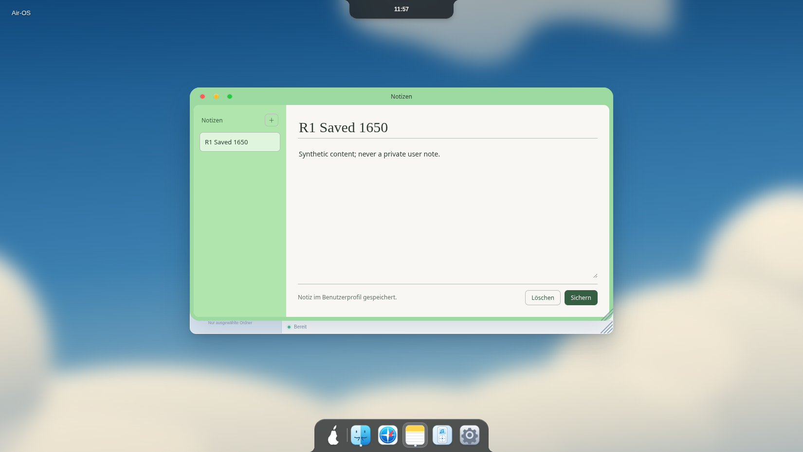 |
| 1650px / Air Home | 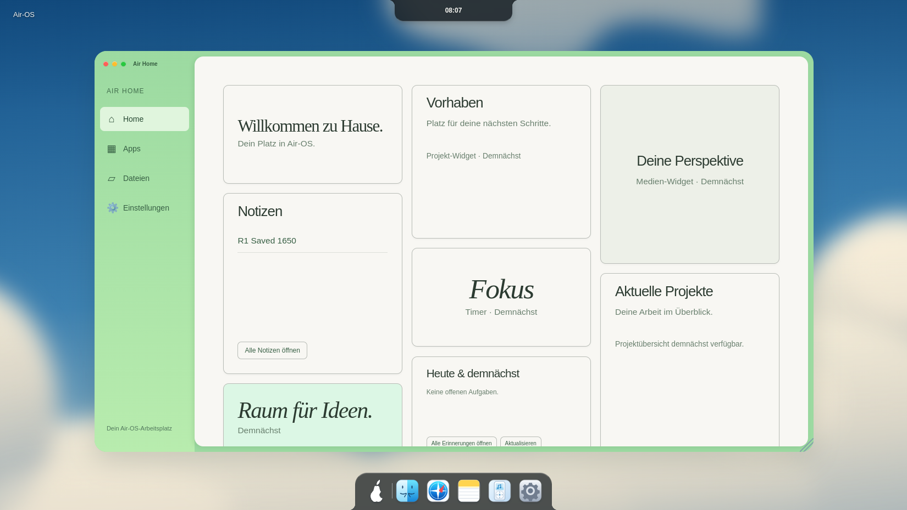 |  |
| 1650px / Classic | 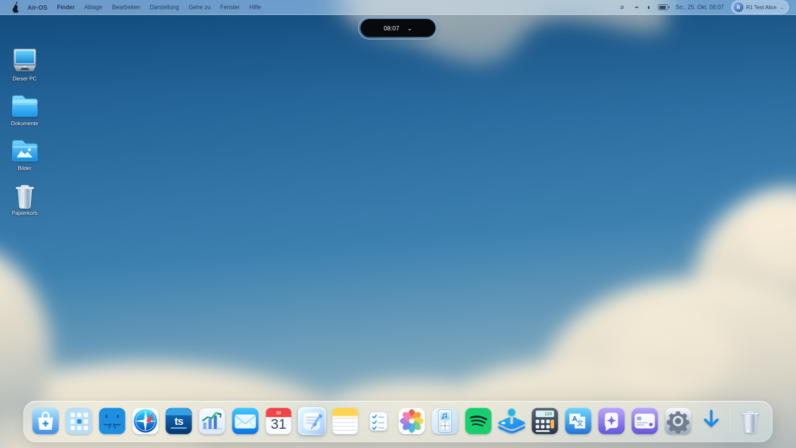 |  |
| 390px / MacLock | 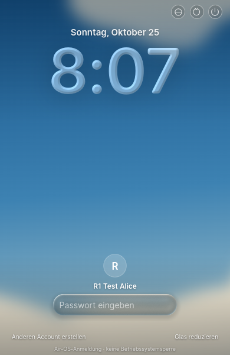 | 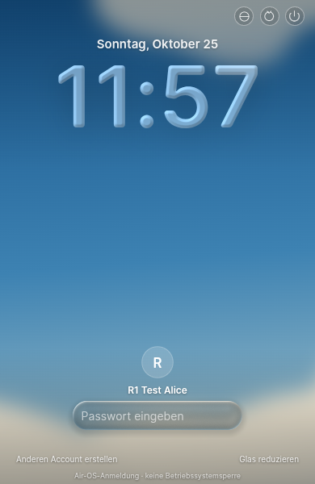 |
| 390px / Desktop | 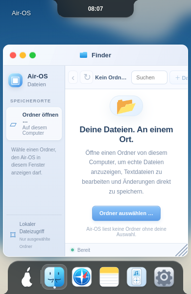 |  |
| 390px / Notes | 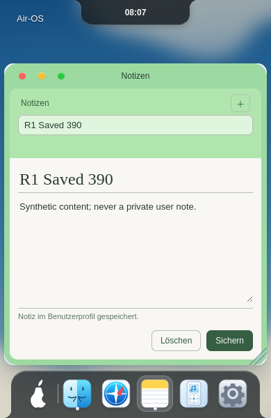 | 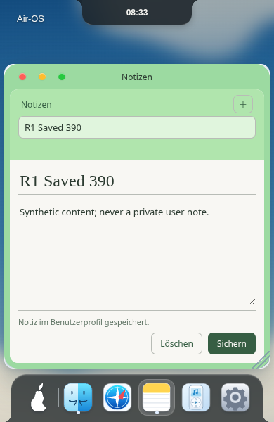 |
| 390px / Air Home | 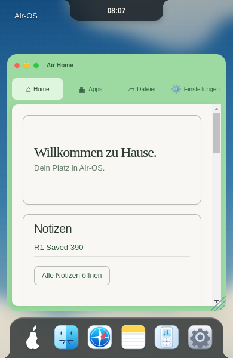 |  |
| 390px / Classic |  | 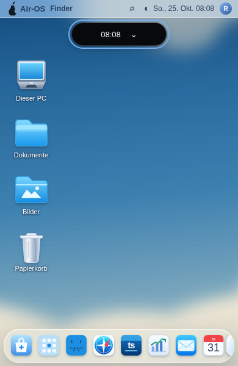 |
| 390px / nativer WebGL-Ausfall | 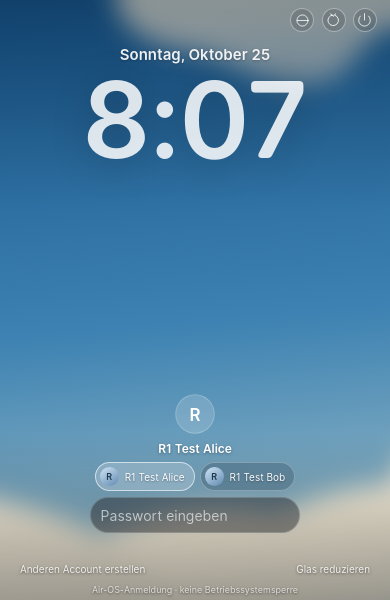 | 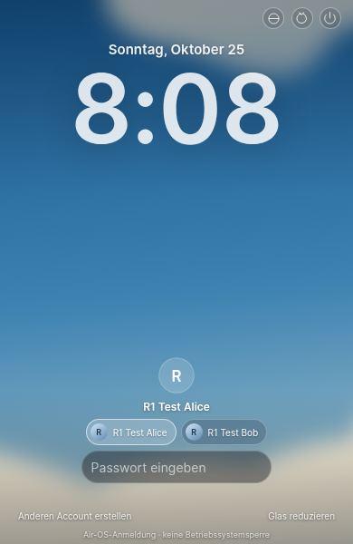 |
