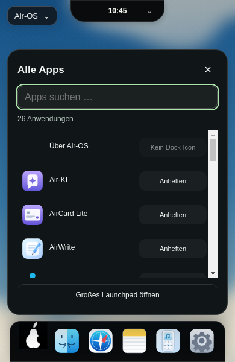
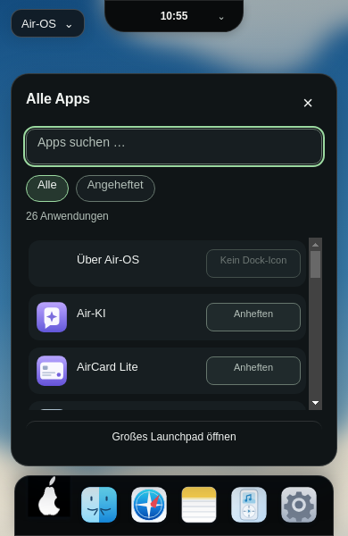

# K2 – bestehendes Startmenü im Hybrid-Design

24. Oktober 2026 · Basis3dacfc4316c2f8081c91a7c289b09b7b5bedb23f · Branch `theme/air-start-menu-hybrid-k2-20261024`.

## Umfang und echte Filter

Ein vorhandenes Menü in air-launchpad.js/css und index.html, dieselbe App Registry, derselbe Lifecycle und derselbe authentifizierte Pin-Adapter. Kein zweiter Manager, keine neue Datenbank oder IPC-Route. Nur Modern-Desktop erhält dunkle Such-/Zeilenflächen und genau zwei Filterbuttons.

- **Alle:** bisherige registrierte verfügbare Apps, einschließlich bisheriger Fehler-/Startpfade. Text ausschließlich über textContent; bestehende statische Icon-Daten unverändert.
- **Angeheftet:** Registry-Ergebnisse, deren ID in der vollständigen vorhandenen airDockReferences(dockPins)-Liste steht. null=vollständige Standards,[]=leer. Unbekannte gespeicherte IDs bleiben auf Platte erhalten und erscheinen erst bei tatsächlicher Registrierung. Nicht auf die viewportabhängig sichtbare Dock-Teilmenge begrenzen.
- Pflicht-Startbutton bleibt im Dock, ist nicht automatisch ein optionaler gespeicherter Default-Pin. Der Filter fügt deshalb bei[] keinen künstlichen Launchpad-Treffer hinzu.
- Filter und Suchbegriff kombiniert, ohne neue Persistenz. Öffnen beginnt mit Alle/leerer Suche wie bisher. Aktiver Chip sichtbar und mit aria-pressed ausgezeichnet. Leerer Pin-Satz und Suchleertreffer verständlich benannt.

Pin/Unpin bleibt eine getrennte Geschwisteraktion; kein App-Start durch Pin-Klick. Erst bestätigte Speicherung aktualisiert den Status. Bei Unpin unter aktivem Pin-Filter verschwindet der Eintrag; Fokus fällt sinnvoll auf die Suche zurück. Fokus fällt während einer deaktivierten Pin-Aktion zunächst auf die Suche; ein per Pfeiltaste gewählter Treffer bleibt auch nach Neuzeichnen fokussiert. Benutzer kann während ausstehender Speicherung weitertippen/Filter wählen, ohne dass die Antwort seinen Fokus wieder auf die alte Pin-Aktion zieht. Bei ausstehendem App-Start bleibt Suche bedienbar; nur doppelte Mutationen bleiben gesperrt. Fehler und Retry erhalten; aktuelle Suche wird bei Fehler nicht geleert.

## Design und erhaltene Geometrie

Palette laut eigenständigem Hybrid-Entwurf: Panel#101517, Such-/Zeilenfläche#171e21, Text#f2f5f3, Sekundärtext#b5c1ba, aktive Chipfläche#26382f und Mint-Kontur/Fokus#9cdaa1. Systemschrift,16/22px Menüüberschrift,14/20px Suche,13/18px App-Namen und Chips. Suche40px, Chips30px, Zeilen mindestens52px mit unveränderten36px-Originalicons; badgehaltige Zeilen können bei Umbruch wachsen. Karte12px, Menü bisher20px Radius. Bestehende Menübreite,16px-Außenpadding, Maximalhöhe/Position nicht geändert; neue Elemente verringern nur die sichtbare Trefferfläche.

Pin-Aktion bleibt112px-Spalte mit klarer Kontur und eigenem Fokus. Hover80ms, Press-Hintergrund unmittelbar ohne Transition. Kein dekorativer Bounce oder neue Öffnungsanimation. Vorhandene140ms-Eintrittsanimation bleibt, bei OS-/Air-OS-Bewegungsreduktion keine Eintrittsanimation. Globale Air-OS-Regel setzt effektive Transition-Dauer auf0,00001s statt mathematisch0; GUI prüft dies als praktisch sofortiges Feedback. Native Such-/Scrollbar-Oberfläche nur am Modern-Menü über color-scheme:dark.

| Viewport | Menü x/y, B×H vor UND nach | Dock x/y, B×H vor UND nach | Island x/y, B×H vor UND nach |
| --- | --- | --- | --- |
|1920×1080 |720/562,480×440px |781/1012,358×68px |835/0,250×45px |
|1650×930 |585/412,480×440px |646/862,358×68px |717,578/0,214,844×38,672px |
|390×600 |12/82,366×440px |16/532,358×68px |117/0,156×36px |

Jeweils10px Abstand oberhalb des Docks. Keine Erweiterung der Menübreite/Viewport-Abstände. Nur Trefferbereich scrollt vertikal; kein horizontaler Menü-Overflow und kein Dock-Scrolling. Die358px-Dockbreite gilt für sechs Standardicons; bewusstes Pin/Unpin ändert wie bisher die Icon-Anzahl innerhalb der unveränderten Kapazitätsberechnung.

## Echte Linux-Electron-Aufnahmen

Vorher: unveränderter bestätigter K1-Commit in einem eigenen detached Test-Worktree mit vorhandenen Dependencies und isoliertem synthetischem Profil. Danach: neuer K2-Code in einem anderen isolierten Profil. Beide echte Electron32.3.3-Läufe mit aktiver Sandbox und Xvfb, nacheinander. Keine retuschierten Bilder oder Rückinterpretation neuer Filter als Altzustand. Registry und Standard-Pins identisch; Zeit im Screenshot stammt vom jeweiligen echten Lauf.

| Viewport | Vorher | Nachher | Angeheftet |
| --- | --- | --- | --- |
|1920×1080 |[Vorher](visual/air-start-k2-before-1920.png) |[Nachher](visual/air-start-k2-after-1920.png) |[Pins](visual/air-start-k2-pinned-1920.png) |
|1650×930 |[Vorher](visual/air-start-k2-before-1650.png) |[Nachher](visual/air-start-k2-after-1650.png) |[Pins](visual/air-start-k2-pinned-1650.png) |
|390×600 | | |[Pins390](visual/air-start-k2-pinned-390.png) |

[Vorher-Messwerte mit Classic-Skin](visual/air-start-k2-before-measurements.json) · [Nachher-Messwerte und Classic-Vergleich](visual/air-start-k2-after-measurements.json).

Classic-Desktop mit Modern-Dock behält den bisherigen kompakten Menüweg und identische berechnete Styles/Geometrien, ohne Filterchips. Classic-Dock öffnet weiterhin das große Launchpad. Unabhängige Themes nicht neu gekoppelt. Dock, Island, Kontrollzentrum, Notes, Home, Wallpaper, Logos und Iconquellen nicht verändert.

## Tatsächlich ausgeführte Tests

**225/225 Tests,0 Fehler/Skips**, neu auf Linux ausgeführt. Acht neue Controller-Regressionen: null/[]/unbekannte Referenzen, beide Suchfilter und leere Treffer, bestätigte Pin-Änderung und kein App-Start, Texteingabe/Fokus während Pin-Write, Texteingabe/Filter während Launch und Fehler/Retry, transienter Filter/Classic und geänderter profilbezogener Pin-Satz. Vorhandene Store-/Profil-/Session-/Fehler-/Race-Regressionen aktiv. API-/DOM-Doubles für deterministische Verzögerungen/Fehler klar begrenzt.

Echte Linux-GUI bei drei Renderer-Viewports per CDP: komplette Registry in Alle, unveränderte SVG-Daten/keine Grayscale-Filter, vollständige Standardpins und explizit leere Pins, Pin/Unpin mit echter Speicherung, keine App durch Pin-Aktion, Suchnamen/IDs/Leertreffer, Enter zum Notes-Start, Escape/Fokus, Tab/Space für Filter, Pfeile für Treffer, Trigger Enter/Space. Sofortiger Press-Farbwert#365044 geprüft. Reduced Motion über OS-Media-Signal und vorhandene Preferences-Einstellung separat geprüft. Profilzustand nach Reload und Alice/Bob-Logout/Re-Login real erhalten, unbekannte Referenzen bewahrt. Classic-Berechnungswerte gegen echte Baseline identisch, kein Rendererfehler.

Syntax, Catalina-Konfiguration und Whitespace ebenfalls geprüft. Keine nativen Windows-/macOS-Tests daraus ableiten. Actions-API Forbidden; kein neuer CI-Erfolg behauptet. Keine neuen Dependencies, Installer-/Release-/Security-Workflow-Änderungen.

Reproduktion mit extern vorhandenem Playwright: Baseline-Worktree aus3dacfc4 und eigenen userData-Profilen am Login, aktive Sandbox/Xvfb. `AIR_GUI_TEST_ISOLATED=1 AIR_GUI_BASELINE=1 node scripts/check-start-hybrid.cjs` an CDP9247, danach Baseline beenden; `AIR_GUI_TEST_ISOLATED=1 node scripts/check-start-hybrid.cjs` an CDP9248. Helfer unter `/workspace/.air-os-onboarding/start-air-start-hybrid-k2-baseline.sh` (Display118, Worktree `/workspace/.air-os-onboarding/k2-baseline-tree`) und `start-air-start-hybrid-k2-after.sh` (Display119). Test erstellt zufällige Konten; Passwörter nur im Speicher. Vorher-Messdatei wird für Vergleich benötigt.

## Abweichungen und Grenzen

Supaste nach wie vor nicht visuell verifiziert; dies ist die Umsetzung der dokumentierten Hybrid-Entwurfswerte, keine behauptete1:1-Kopie. Das Menü bleibt eine App-Liste, keine Clipboard-/OCR-/Cloud-/Dateisuchoberfläche und keine zweite Island. Es werden weniger App-Zeilen gleichzeitig sichtbar, weil die Filtergruppe Platz benötigt; alle Apps bleiben im vertikal scrollenden Trefferbereich erreichbar. Kein neues Asset für bestehende Apps ohne Icon erfunden; deren textbasierter Eintrag bleibt wie zuvor startbar und nicht fälschlich anheftbar.

Systemschrift und native Scrollbar können auf anderen Plattformen abweichen. Native Windows-/macOS-Abnahmen sowie CB-02/CB-03 bleiben offen; Audit-/Legacy-Electron-/Signing-/Notarisierungsblocker bestehen. main, bestehende PRs, Installer und andere Entwicklungsbranches unverändert. Nächste Einheit K3 ausschließlich separat.
