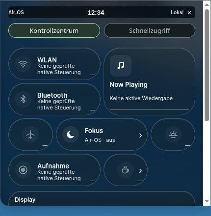
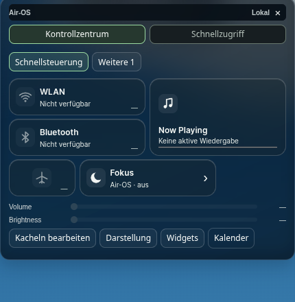

# UI-REFINE-1 – Proportionen, Kontrollseiten und Heute

26.Oktober2026, Basis **7c48ba8f12690b22b592dc757cd10b4cd589c947**, Branch **feat/air-ui-refine-1**. Produktcode **bb4cec88e3ccac44edfc56dfb92376128256089f**. Der nachgereichte Screenshot mit roten Markierungen ist die Aufgabenreferenz. Keine neue Glass-Engine, keine Apps/Cloud-/iPad-Veröffentlichung, keine privaten Daten oder neuen Abhängigkeiten.

## Gegen die markierten Probleme geprüft

| Markierung | Tatsächliche Korrektur |
|---|---|
| Dock zu breit | Standard mit6 vorhandenen Buttons **358×68 →325×62 CSS-Pixel** (−9,2% Breite/−8,8% Höhe). Icons42→38px, echte Buttonflächen52→48px; Reihenfolge/Pins unverändert. Gerade Basis bottom0, zentriert, unveränderte12px-konkave Anschlüsse. Kein Skalierungstransform der ganzen Dockhülle; M2 verwendet weiterhin echte aktuelle Buttonrechtecke. |
| Geschlossene Island |1920: **250×45 →220×40**;1650: **214,844×38,672 →189,078×36**;390: **156×36 →144×36**. Top0/exaktzentriert, inverse Anschlüsse und M1-Zeitachse unverändert. |
| Großes rundes CC mit Scrollbalken | Panelradius18→14px, Kachelradius34/Slider26→14px, kompakte54px-Rasterzeilen. Bestehendes4-Spalten-First-Fit auf maximal3 Zeilen pro Seite aufgeteilt, gespeicherte Reihenfolge vollständig erhalten. Schnellsteuerung/weitere Kontrollen plus Darstellung/Widgets-Detailseiten. Editor zeigt2 Katalogeinträge pro Seite (6 Seiten), alle12 Originaleinträge erreichbar. |
| Grauer Symbolpunkt rechts | Benachrichtigungsverlauf bleibt ein echter32×32px-Button, transparenter Hintergrund/keine Kapsel/kein Schatten. Tastaturfokus und Funktion bleiben. |
| Mehrfache obere Uhr | Nur zentrale Islandzeit ständig oben sichtbar. `#clock` und `#air-control-clock` ausschließlich Modern ausgeblendet, Header ohne leere Uhrspalte. Kalender-Trigger beschriftet und in Panel-Fußleiste verlegt; Kalenderwidget öffnet denselben vorhandenen Popupcode. Escape gibt Fokus sinnvoll zurück. Classic-Zeit bleibt erhalten. |
| Leeres Uhrwidget | **Heute** mit Uhrzeit gemäß Profilformat, vollständigem lokalen Datum, tatsächlicher Wochenleiste, nächster echter offener Erinnerung, Notes-/Reminders-Schnellaktionen und ehrlichem Leer-/Fehlerzustand mit Retry. Große Variante ergänzt Fälligkeit/Anzahl offener Aufgaben und mehr Titelplatz. Kein Wetter/erfundener Termin. |

Die Hauptseite besitzt bei allen drei gemessenen Renderergrößen **scrollHeight=clientHeight**: Software382/372/405px bei1920/1650/390 (Panel-Clientbreite428/428/364px). Damit wird der Scrollbalken nicht lediglich durch Abschneiden entfernt. `overflow-y:auto` bleibt als Sicherheitsnetz für Textvergrößerung; normale Seiten sind tatsächlich kleiner als der verfügbare Raum. Scrollbarstyling ist zusätzlich zurückhaltend. Detailseiten und Editor werden durch Navigation erreichbar, kein `overflow:hidden`-Verstecken der Funktionen. Rohwerte: [Geometrie-/Abnahmevergleich](visual/refine1-comparison.json).

## Heute und Datenschutz

Bestehender Widgetschlüssel `clock`/gespeicherte Positionen weiterverwendet. Kompakt232×180px, erweitert272×232px; Auswahl in Widgets-Seite wird als validiertes `todaySize` im bestehenden Profil gespeichert. Kalender bleibt eigenständiges200×184px-Widget. Standardpositionen bleiben20/100 und20/290. Bei explizitem Vergrößern wird ein tatsächlich überlappendes Kalenderwidget nach unten verschoben und die Änderung bestätigt gespeichert; sonst bleiben gespeicherte Koordinaten erhalten, lediglich sichtbare Bildschirmgrenzen werden geklemmt. Draggriff fokussiert beim Anklicken, Pfeiltasten verschieben weiterhin im8px-Raster. Keine klein skalierten Touch-/Textflächen.

`src/core/today-widget.js` ist ausschließlich ein flüchtiger Lifecycle-Adapter um **dieselbe** `window.airOS.reminders.list()`-Bridge. Vorschau/Fälligkeitslogik wird unverändert aus `airHomeReminders.preview` wiederverwendet. Kein zweiter Datenspeicher, kein neuer IPC-Endpunkt. Nur Titel/Fälligkeitslabel/offene Anzahl werden im Widgetzustand gehalten; Beschreibungen nicht. Titel ausschließlich `textContent`. `preferenceSession` wird vor und nach Laden geprüft, Requestversionen verwerfen überholte Antworten. Logout/Profilwechsel/Deaktivierung leeren den Zustand; verspätete Antworten dürfen nicht zurückschreiben.

Laden bei Aktivierung, bestätigtem Reminders-Ereignis, Wiederkehr ins sichtbare Dokument und lokalem Tageswechsel. Kein Reminders-Polling. Ein bestehender Widget-Zeitgeber wurde von1s auf15s reduziert und bei Unsichtbarkeit beendet; er aktualisiert die Minutenuhr und erkennt einen Tageswechsel ohne zusätzlichen Timer. Bestehende Kalender-Popup-Timer laufen nur beim geöffneten Popup.

## Tests und reale Nachweise

**386/386 Tests bestanden**,0 Fehler/Skips; alle378 bisherigen Tests erhalten, acht neue Regressionen: komplette paginierte Kachelreihenfolge, echte API-Ergebnisse/keine Beschreibungen, Leer-/Fehler-/Retry-/ungültige Antworten, überholte Antworten, Sitzungswechsel/Logout/Deaktivierung, validierte Größen/Positionen, Modern-Uhr-/Kalender-/Symbolvertrag.155 Laufzeitressourcen sowie Syntax/Diff geprüft.

Echtes sandboxed **Linux-Electron44**,1920×1080,1650×930,390×600: regulärer CSS-Software-Fallback vorher/nachher plus integrierter WebGL-Pfad im bestehenden abgesicherten16K-Diagnosehost. Keine Hardware-GPU-Abnahme;390px ist ein schmaler Renderer. Testuhr nur im CDP-Testrenderer fixiert, identische öffentliche Testprofile/Notizen/Reminder „Test · Tagesübersicht“ und Wallpaper. Teststreifen ausschließlich technischer Nachweis.

GUI-Assertions prüfen: neue Dockmaße/zentrierte Island, kein Scrollbedarf unmittelbar nach CC-Öffnen, nur eine obere Zeit, tatsächlich transparente Symbolfläche, sämtliche Kontrollseiten/alle6 Editorseiten, bestätigten Fokus an/aus, Kalenderzugriff/Navigation/Escape. Zusatzlauf390: Keep-Awake-Detail erreichbar/keine reale Sperre im Testhost, großer Widgetmodus, echte Pfeiltastenposition, Notes-/Reminders-Appstarts, Größe/Position nach Seitenneuladen, zweites Testprofil ohne erste Erinnerung und mit eigener kompakter Größe. Positive Keep-Awake-OS-Abnahme bleibt separat; Controller/Sitzungstests bleiben erhalten.

Bestandslauf: Apps/Notes speichern/Reminders/Finder/Home, zwei getrennte Profile, Logout/Neustart, Classic/Modern, M1/M2-Rückwärtsanimationen, Reduced Motion/Transparency, echte WebGL1/2-Abschaltung bestanden. Der neue Kalender-/Widgets-Zugriff und zweistufige Escape-Weg sind im separaten Regressionslauncher nachvollzogen; alte Tests wurden nicht abgeschwächt. Materialdiagnose: konkave Maskenalpha0/255/255,0 zusätzliche Draws in650ms Ruhe, nach Classic/Context Loss/Profilwechsel0 Programme/Texturen/Kacheln.

Gelöste Befunde: Editoraufnahme vor Material-Repaint; alter GUI-Test suchte Widgeteinstellungen am früheren Ort; Widget-Draggriff verhinderte ohne expliziten Fokus die anschließende echte Pfeiltastenbedienung. Finale Prüfungen behalten die strengen Assertions; frühere Fehlaufnahmen sind ausdrücklich separat markiert.

## Bilder

| Größe | Vorher direkt geöffnet | Nachher direkt geöffnet | Nachher gesamter Desktop mit beiden Widgets | Editor |
|---|---|---|---|---|
|1920×1080|[Bild](visual/refine1-before/control-clouds-1920.png)|[Bild](visual/refine1-after/control-clouds-1920.png)|[Bild](visual/refine1-after/desktop-clouds-1920.png)|[Bild](visual/refine1-after/editor-1920.png)|
|1650×930|[Bild](visual/refine1-before/control-clouds-1650.png)|[Bild](visual/refine1-after/control-clouds-1650.png)|[Bild](visual/refine1-after/desktop-clouds-1650.png)|[Bild](visual/refine1-after/editor-1650.png)|
|390×600|[Bild](visual/refine1-before/control-clouds-390.png)|[Bild](visual/refine1-after/control-clouds-390.png)|[Bild](visual/refine1-after/desktop-clouds-390.png)|[Bild](visual/refine1-after/editor-390.png)|

| Kontrollzentrum vorher | Nachher |
|---|---|
|  |  |

[Großes Heute](visual/refine1-extra/today-expanded-desktop.png), [Position/Größe nach Neuladen](visual/refine1-extra/today-expanded-after-reload.png), [getrenntes leeres Profil](visual/refine1-extra/second-profile-empty.png), [Keep-Awake-Detail](visual/refine1-extra/keepawake-reachable.png), [WebGL statt CSS](visual/refine1-diagnostic/control-clouds-1920.png). Rohberichte: [vorher](visual/refine1-before/report.json), [nachher](visual/refine1-after/report.json), [Material/Cleanup](visual/refine1-diagnostic/report.json), [Widget-/Profilzusatzlauf](visual/refine1-extra/report.json), [Bestandsregression](visual/refine1-regression/r1-gui-report.json).

Reproduktion: `scripts/check-ui-refine.cjs`, `scripts/check-ui-refine-extra.cjs`, `scripts/check-ui-refine-regression.cjs` im vorhandenen isolierten Electron-Testhost; `python scripts/measure-ui-refine.py`. Keine neue Library. Original-MIT/OFL unverändert; MacLock/Main-Authentifizierung/M1/M2/Apps/Cloud/PWA-/Buildlogik unverändert, nur neue UI-Laufzeitassets in Paketliste.

**Grenzen:** native Windows-/macOS-/Hardware-GPU-/Safari-Abnahmen offen, keine FPS-/Pixelgleichheitsbehauptung. Kein echter Keep-Awake-Vorgang auf diesem Laptop. GitHub-PR-/CI-API hier403; kein neuer grüner CI-Lauf behauptet. main, vorhandene PRs und Installer unverändert; keine Veröffentlichung.
