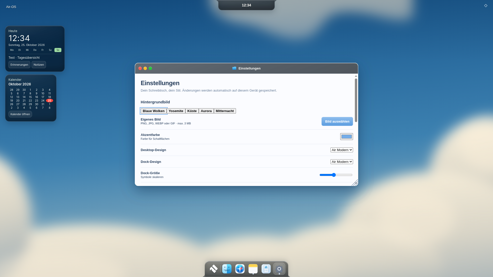
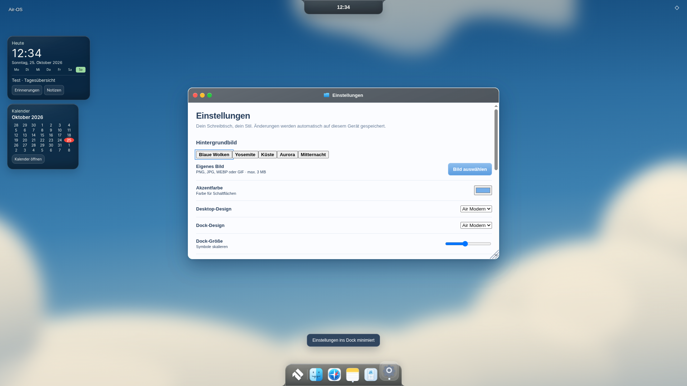

# WinBox evaluation – bounded prototype, no production migration

Base `30aef2bc89d212f1c0992547a2263a1841c783c8`, branch `feat/air-winbox-evaluation`,26.Oktober2026. Only relevant window/M2/lifecycle paths reviewed. No application, theme, profile, Cloud/PWA or installer code changed.

**Outcome: production adoption BLOCKED under the current single-owner contract.** A small working adapter and the exact locally vendored WinBox.js0.2.82 distribution are included for evaluation. No CDN, npm runtime dependency, production script tag or silently activated alternate manager.

## What actually works

`src/core/winbox-adapter.js` calls the real WinBox `move`, `resize`, `focus`, `maximize`, `restore`, `close` APIs. Explicit detached root/mount, idempotent disposal, profile-changing/pagehide cleanup and a preflight rejecting active Air-OS-owned elements/M2 state. Geometry snapshots contain numbers only. Four additional tests plus the entire existing suite: **390/390 passed**,0 errors/skips.155 production runtime resources validated; no vendor bloat added to the shipping package.

One real sandboxed Linux-Electron44 run at1920×1080, synthetic isolated account, multiple existing windows (Notes and Settings), two screenshots. The test starts the actual Settings app through the existing Registry, rejects adoption of its live registered DOM, then executes the real bundled WinBox in a **hidden isolated test root**, with a disabled clone of that Settings content. This clone is a geometry/API fixture, **not a working replacement Settings app**. Native mouse interaction still uses the original app and its M2 rapid minimize/restore path. Original registry/lifecycle snapshot remains unchanged by the probe. Results: move50/60, resize700×420, maximize=true, restore=false, close successful. [Actual measurements](visual/winbox-evaluation/report.json).

WinBox drag gestures, accessible replacement titlebar and a migrated app's M2 are **not** accepted as working. No native Windows/macOS acceptance claimed. Existing Air-OS mouse/focus/close actions remain real and working. The full suite retains existing M2/lifecycle/profile regressions.

## Concrete integration blockers

- `WinBox({mount})` moves the supplied content into its newly created `.winbox > .wb-body`. It does not adopt the existing `.app-window` as its outer engine node. Air-OS `openApps`, close handlers, app initialization closures and shader titlebar selectors retain the original section.
- `animateAppWindowIntoDock`/`FromDock` and `clearDockMotion` own transform/opacity/display/pointerEvents and completion/version guards on **that same registered section**. Moving only the body would animate/hide an empty old shell while WinBox stays visible; wrapping the old frame introduces two coordinate/transform owners.
- WinBox maintains global window stacking/focus/max/min state and its own global viewport assumptions. Hiding its native header is insufficient to remove that ownership. The Air-OS titlebar uses pointer listeners; WinBox expects its own drag/header/resize structure. Running both is excluded.
- A correct bridge would need an explicit transfer of outer DOM/geometry ownership, focus/z-index delegation, host-coordinate mapping and M2 integration tests. That exceeds the requested small adapter and is intentionally **not** forced into production.

Thus **zero production code removed/saved yet**. The library could replace bespoke move/resize/max geometry only after that ownership seam is designed and tested; app registry, profiles, security, lifecycle and M2 remain Air-OS responsibilities. No broad rewrite or additional roadmap implemented.

## Licence and integrity

[Upstream](https://github.com/nextapps-de/winbox), version0.2.82 from npm. Exact archive SHA512 verified against registry integrity; bundle SHA256 recorded in [provenance](../third_party/winbox-0.2.82/provenance.json). [Apache-2.0](../third_party/winbox-0.2.82/LICENSE), author/copyright Thomas Wilkerling, Hosted by Nextapps GmbH retained in original bundle and [NOTICE](../third_party/winbox-0.2.82/NOTICE). Original bytes including CRLF preserved via `.gitattributes`. No extra libraries/assets taken.

## Screenshots

Both are real Electron captures of the **unchanged production window path**, before and after the isolated probe and an actual Settings M2 reversal. They intentionally do not imply a visual WinBox migration.

| Before | After |
|---|---|
|  |  |

Reproduction: existing isolated Electron/Xvfb test environment, `scripts/check-winbox-evaluation.cjs`, local `AIR_R1_APP`/`AIR_R1_EXE` and `AIR_GUI_TEST_ISOLATED=1`. Vendor injection is confined to CDP evaluation; no production CSP weakening. No private profile, file or cloud account used. main/PRs/installer unchanged. CI not claimed; commit SHA supplied in completion message.
