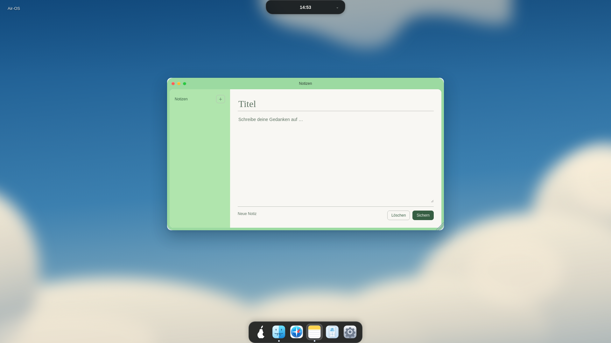
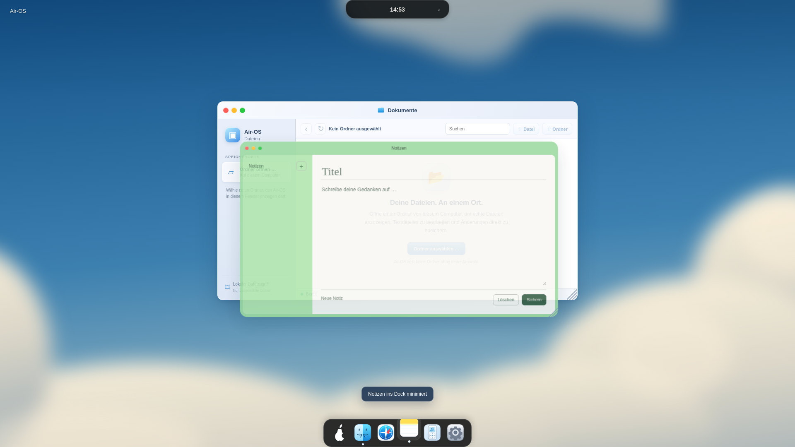
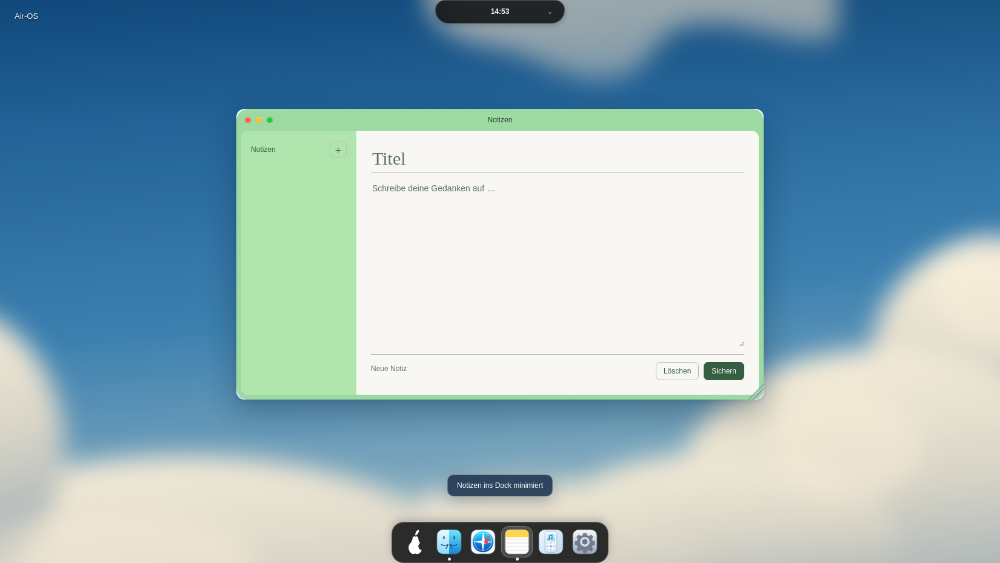
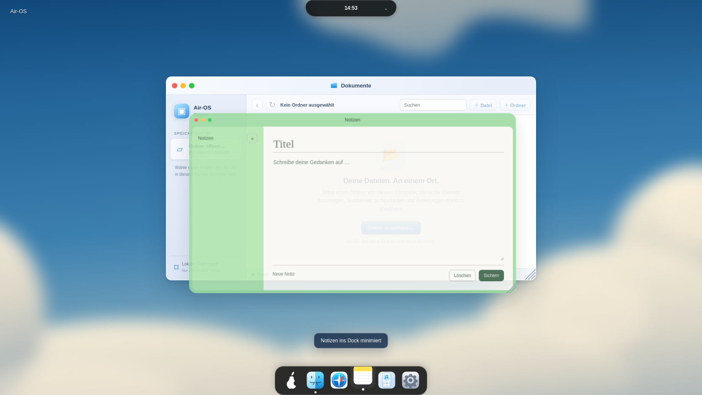
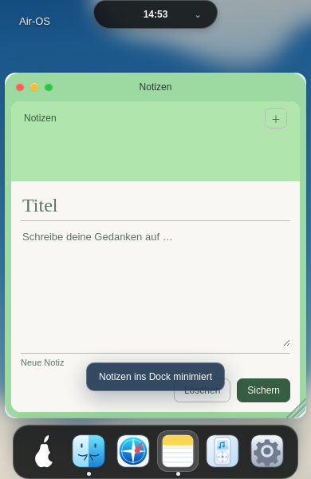
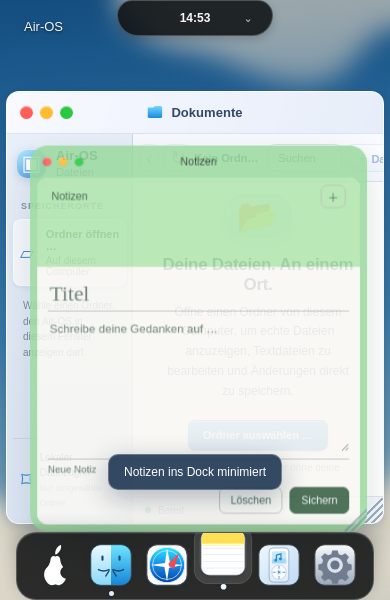

# M2 – umkehrbare Fensterbewegung zwischen Desktop und Dock

24. Oktober 2026. Basis/Remote-HEAD `ce0ef22d5b4083258fd9a49ff933f92442a86728`, eigener Branch `fix/air-window-interruptible-m2-20261024`. Nur die vorhandenen Fensteranimations-/Launcherwege in app.js; keine neue Bibliothek, Registry oder zweite Fensterverwaltung.

## Befund und Umsetzung

Bisher minimierte WAAPI ein Fenster410ms lang. Wiederherstellen zeigte es synchron und unanimiert an. openApp erkannte ein gerade minimierendes Fenster noch als sichtbar und erhöhte nur seinen Z-Index: Die alte Completion versteckte es anschließend trotzdem. Ein Close während Minimieren wurde von der is-minimizing-Frühausstiegsregel verworfen.

Modern verwendet jetzt pro Fenster den vorhandenen `_airOSMotion`-Slot mit einer gemeinsamen410ms-Zeitleiste, ursprünglicher cubic-bezier(.55,0,.9,.35), Translate/Scale und Opacity1→0. Die Zielgeometrie wird einmal aus der vorhandenen dockMotionValues-/appDockRect-Berechnung bestimmt; bei Umkehr wird **dieselbe WAAPI-Instanz mit reverse()** weiterverwendet. Keine Neuberechnung aus einem bereits skalierten Zwischenrect. Wiederherstellen eines vollständig minimierten Fensters beginnt am Dock-Ende derselben Kurve. Erstmalige App-Starts bleiben synchron sichtbar, einschließlich des vorhandenen Startup-Finder-Schutzes.

Ein kleiner fensterlokaler Zustand enthält aktuelle Zielrichtung, Close-Completion, Callbackgeneration und vorübergehend überschriebene Inline-Werte. clearDockMotion invalidiert diesen Zustand, entfernt alte Callbacks und stellt transition/pointerEvents wieder her. Completion prüft Fensterverbindung, Zustandsidentität, Animationsidentität und Generation. Weder ein alter Close-Callback derselben umgekehrten Animation noch ein Callback eines entfernten Fensters darf eine wiederhergestellte/neue Instanz verstecken.

- openApp stellt auch ein gerade ins Dock bewegtes Fenster wieder her und meldet weiterhin focused über den bestehenden Lifecycle.
- Erneuter Dock-Klick während Wiederherstellen verwendet die vorhandene Minimieren-Aktion. Ein weiterer App-Start über openApp bleibt ein Fokus-/Startauftrag und minimiert nicht versehentlich.
- Close während Minimieren ersetzt dessen Abschlussaktion, statt ignoriert zu werden. Close während Wiederherstellen kehrt die Bewegung um. Reopen vor Close-Abschluss verwirft den Close-Auftrag und behält die bestehende Instanz/Daten; nach abgeschlossenem Close wird regulär eine neue Instanz erzeugt.
- display bleibt während der Bewegung flex, wird erst beim aktuellen Minimier-/Close-Abschluss none. pointerEvents ist beim Minimieren none, beim Wiederherstellen auto. Fokus wandert beim Minimieren aus dem Fenster zum erreichbaren Dock-/Startbutton; Wiederherstellen fokussiert das vorherige noch sichtbare/bearbeitbare Ziel oder den vorhandenen Schließen-Button. preventScroll schützt die Geometrie. Keine Fokusübernahme durch verspätete Abschluss-Callbacks.
- Rahmenfarbe/Radien/Filter bleiben im Modern-Pfad konstant; keine alten is-minimizing/is-opening-CSS-Transforms parallel zur WAAPI. Bestehende CSS-Transitions werden nur für die Laufzeit des Effekts ausgesetzt und anschließend wiederhergestellt.
- Air-OS- und OS-Reduced-Motion sowie fehlende WAAPI führen die aktuelle Aktion unmittelbar aus. Einstellungs-/Media-Query-Wechsel während einer Bewegung beenden sie im aktuellen Zielzustand. Dokumentverbergen beendet aktuelle Bewegungen; pagehide räumt Effekte und zusätzliche Listener auf, ohne alte Close-Completions in ein neues Profil zu übertragen. Keine neuen Timer.

Classic verwendet weiterhin den ursprünglichen Minimier-/synchronen Restore-Code. Keine Änderungen an CSS, Fenstermaßen, Dock-/Glas-/Logo-/Island-Dateien oder M1. Keine Änderung am gespeicherten Datenformat/IPC/Preferences/Installer.

## Automatisierte Tests

**242/242 Tests bestanden**,0 Fehler/Skips; zuvor235. Sieben neue Regressionen mit ausdrücklich synthetischen WAAPI-/DOM-Doubles für deterministische Callback-/Zeitpositionsfälle:

1. Eine Instanz mit lebender Zeitposition bei Minimize/Restore/Minimize, alte Completion verworfen, Geometrie/Cleanup erhalten.
2. Close während Minimieren, Reopen vor Abschluss, Close während Wiederherstellen genau einmal.
3. Unabhängige Effekte mehrerer Fenster, Cleanup/abgetrennte alte Instanz, neue Instanz nicht versteckt.
4. Beide Reduced-Motion-Quellen, fehlende WAAPI und Änderungen während Laufzeit einschließlich Sichtbarkeit.
5. Schließen bereits minimierter Fenster ohne sichtbares Wiederaufblitzen.
6. Classic behält410ms-Originalframes und synchronen Restore/RAF-Pfad.
7. Bestehender openApp-Pfad stellt laufende Minimierung wieder her, meldet focused, wiederholter Start kehrt Restore nicht um.

Die vorhandene Spotify-Routing-Regression führt nur einen isolierten Ausschnitt der Dock-Handler aus. Deren Fixture wurde um leere openApps und Modern-Kontext ergänzt; native installierte/nicht installierte Zustände und Fehlermeldungsassertionen unverändert. Keine Tests oder Sicherheitschecks deaktiviert.

Syntaxprüfungen, vollständige Suite, Catalina-Konfiguration und git diff --check bestanden. PR-/Actions-Abfrage erneut Forbidden; kein neuer CI-Erfolg behauptet.

## Echte Electron-Messungen

Linux Electron32.3.3/Chromium128 in eigener authentifizierter Xvfb-Sitzung mit Chromium-Sandbox und isolierten synthetischen Testprofilen. Optionaler Helfer `scripts/check-window-motion.cjs`: `AIR_GUI_TEST_ISOLATED=1`, CDP standardmäßig9255 bzw. `AIR_GUI_CDP`; vorhandenes externes Playwright, keine neue Produktabhängigkeit.

Je1920×1080,1650×930,390×600:

- Acht schnelle Richtungswechsel während tatsächlich laufender Bewegung über vorhandene Dock-Handler. Vorher-/Nachher im selben Task: getBoundingClientRect x/y/Breite/Höhe, berechnete Opacity und currentTime **identisch**. Dieselbe Animation erhalten; Rate nach animation.ready geprüft. Gezielt wieder aufgerufene veraltete Completion darf kein Fenster verbergen.
- Zusätzlich echte Maus-Doppelklickfolge während Restore: zweite Aktion kehrt zurück ins Dock, danach normale Wiederherstellung. Fokus im Fenster, Lifecycle focused/minimized sowie aktive Dock-Markierung geprüft.
- Vollständige Minimier-/Restore-Rundreise, zwei Fenster gleichzeitig, Close bei laufender Minimierung und Wiederherstellung, Reopen vor/nach Close, anschließend maximierte Fenster rundreisen lassen.
- Beide Reduced-Motion-Wege, Classic-Minimieren/Restore; zusätzlich OS-Mediawechsel während Laufzeit und Logout während Restore. Neues Profil enthält weder altes Notes-Fenster noch alten Notes-Lifecycle.
- Dock-/Island-Geometrie/Glasfarben/Radien und alle sichtbaren Icon-SVGs vor/nach Rundreise gleich. Keine Rendererfehler. Finaler Helferlauf Exit0.

| Viewport | Notes vor/nach Restore x/y, Breite × Höhe | Maximiertes Notes-Fenster vor/nach Rundreise | Max. unmittelbarer Umkehrsprung |
| --- | --- | --- | --- |
| 1920 × 1080 | 525/244,72,870×480 | 0/93,1920×911 | x/y/B/H0px, Opacity0, Zeit0ms |
| 1650 × 930 | 390/180,22,870×480 | 0/93,1650×761 | x/y/B/H0px, Opacity0, Zeit0ms |
| 390 × 600 | 6/91,378×433 | 0/91,390×433 | x/y/B/H0px, Opacity0, Zeit0ms |

[Rohmesswerte mit24 vollständigen Umkehrpaaren](visual/air-window-m2-measurements.json). Diese Messung belegt Stetigkeit unmittelbar beim Umkehren, keine garantierten FPS oder Geschwindigkeitsstetigkeit einer Feder. Zukünftige Bildschirm-/Dock-Geometrieänderungen mitten in einer Bewegung sind kein in dieser Einheit neu implementiertes Retargeting; die einmal bestimmte Bahn bleibt während derselben Animation stabil.

## Screenshots

Echte Renderer-Aufnahmen. Die205ms-Zwischenframes wurden bewusst pausiert, um eine reproduzierbare Ansicht der tatsächlichen Browseranimation zu sichern; sie ersetzen keine zeitliche Messung. Transparenz während der Bewegung ist beabsichtigt, kein neuer Fensterglaszustand. Dahinter liegt ein zweites bestehendes Finder-Fenster. Leere Notes-Felder gehören zu isolierten Testprofilen.

| Auflösung | Fenster in Ruhe | WAAPI-Zwischenframe205ms, gezielt pausiert |
| --- | --- | --- |
| 1920 |  |  |
| 1650 |  |  |
| 390 |  |  |

Keine Layoutsprünge in den24 gemessenen Richtungswechseln oder den vollständigen gemessenen Rundreisen gefunden. Keine neue visuelle Abweichung vom vorhandenen Mint-/Glasdesign beabsichtigt. Native Windows-/macOS-Abnahmen und CB-02/CB-03 bleiben ausdrücklich offen. Bestehende Audit-/Legacy-Electron-/Signing-/Notarisierungs-/Release-Blocker unverändert. main/PRs/Installer unverändert, keine Veröffentlichung oder Merge. Nächste getrennte Einheiten: native Windows-Abnahme, native macOS-Abnahme, danach eine bestätigte CB-02/CB-03-Abweichung separat korrigieren. Nach Sicherung STOP.
