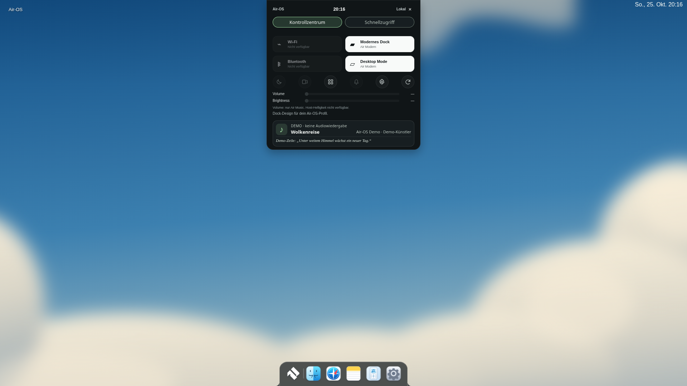
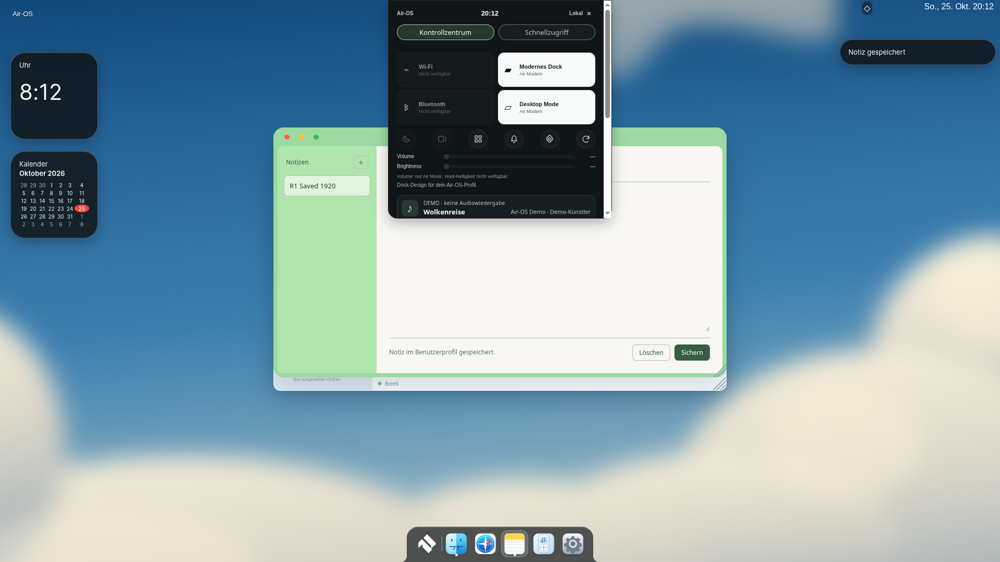
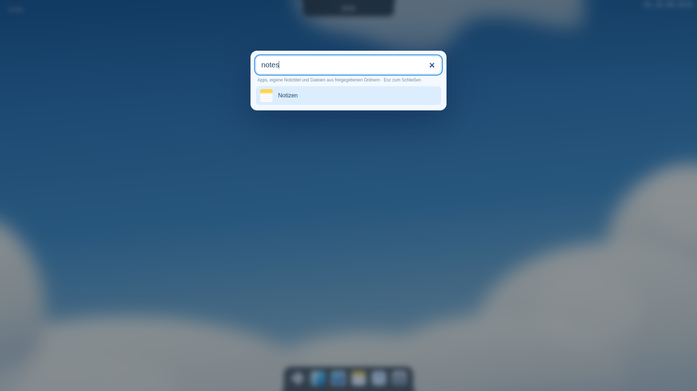
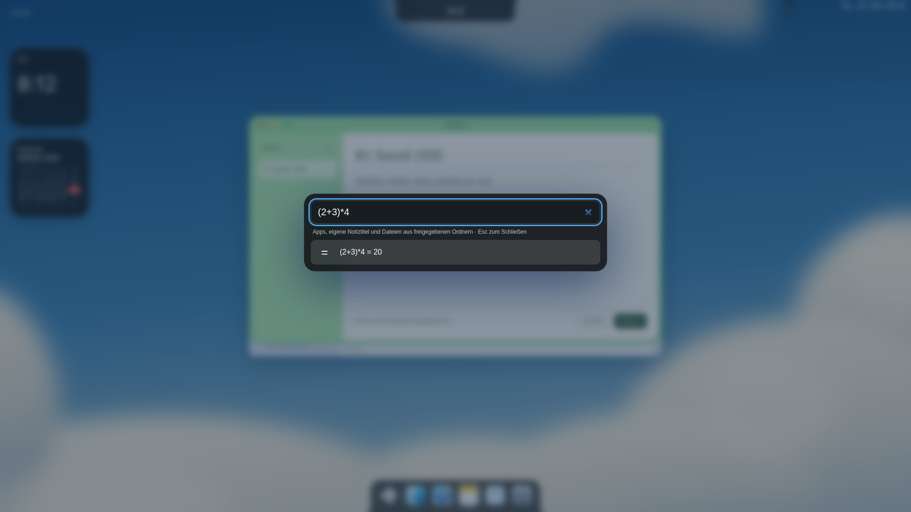
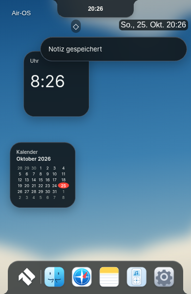

# MacShell Deep Port 1 – geprüfter Teilport

25.Oktober2026 (Europe/Berlin). Basis **616e5030fc03579b62f7ee0b1fc93e3f3cb9fc6e**, Branch **feat/macshell-deep-port-1-20261025**. MacShell fixiert auf **1bdb51870b621100fd2709f66c8f8e00ab17b9c4**. Bestehende100-Punkte-Matrix wird referenziert, nicht ersetzt. Dieses Paket ist **kein vollständiger MacShell-Port**.

## Originalcode → realer Ausführungspfad

| Original | Tatsächlich übernommen / portiert | Air-OS-Ausführung |
|---|---|---|
| `MacShell/liquidglass.frag` | Rechenkörper ab `TAPS=24` **unverändert**, inkl.Golden-Angle/IGN/gewichteter Mip-Level-Blur, Snell-Refraktion, RGB-Dispersion, SDF-Bezel, Specular/Rim/Grain/Inner-Shading. Regression vergleicht gesamten mathematischen Körper bytegleich. Qt440→GLSL ES300, Highp, Uniformblock→einzelne Uniforms, Binding/Location→WebGL. | `macshell-material-shader.js` + `air-desktop-glass.js`, im Desktop geladen. Ein WebGL2-Kontext/Programm/Texturcache, Ausgabe in nicht interaktive2D-Materialkacheln an vorhandenem Dock, Island, Panel, Kalender, Spotlight, Fenstern und neuen Widgets/Verlauf/Kontextmenü. |
| `MacDock.qml` Liquid-Uniforms | Thickness30,Dispersion.06,Magnify.08,Rim.45×.20,Grain.03×.3,BlurPx1.5,Tint.42×.55,Saturation1.25,Shadow0/RimTint0/RingW0; Air-OS-eigene Konturen bleiben maßgeblich. | Gemeinsame Engine wählt diese Werte für vorhandenes Dock. Keine MacShell-Dockhülle übernommen. |
| `MacBar.qml`/`CalendarWidget.qml`/`ClockWidget.qml` Materialwerte | Allgemeine Dicke22/Rim.45/Ring1.4/FlatInner1; Widgetdicke30/Tint min(.92,.25+.42×.8),Magnify.08×min(1,90/h),Blur1. | Dieselbe Engine, keine zweite Popover-GL-Implementierung. Basis-Sampling und Grenzfälle siehe unten. |
| `MacBar.qml::calcValue` | Rekursiver Parser mit atom/term/sum, Unary, Klammern, Modulo und Nullteilerprüfung direkt portiert; einzige Schutzergänzung256-Zeichen-Limit. Kein eval/Function. | Spotlight zeigt echte Rechnung; Enter öffnet den vorhandenen Rechner. Keine ungeprüfte Shell-/Clipboardaktion. |
| `MacBar.qml::searchApps` | Originale Score-Leiter100(exakt)/80(Prefix)/60(Wort-Prefix)/40(Teilstring);25 für vorhandene Registry-ID als Adapter. | Modern-Spotlight verwendet bestehende Registry; Classic behält alten Ranker. Keine neue Suchdatenbank/Usage-Überwachung. Vorhandene authentifizierte Notes-/freigegebene Dateisuche bleibt. |
| `MacBar.qml::ccLayout` | Originaler4-Spalten-First-Fit samt Occupancy/Rows/Pixel-Ys, CellH66/Gap6/SliderGap10 direkt portiert. `ccDef` auf vier bereits bestehende Air-OS-Kacheln mit2×1 Zellen begrenzt. | Vorhandene Island-Kontrollansicht, bestehende Aktionen und ehrlich deaktivierte WLAN/BT-Kacheln. Aufklappbarer Editor „Anordnung & Desktopwidgets“, bestätigte profilbezogene Speicherung der Kachelreihenfolge. Native Dienste/Submenüs nicht übernommen. |
| `MacBar.qml::notifReceive` | Zustandsmodell: steigende IDs, Zeit, neueste zuerst,60 History-Einträge, höchstens4 Banner. | Eigene bestätigte `air-notes-saved`/`air-notes-changed`/`air-reminders-changed`-Ereignisse. Generische Meldungen ohne private Titel/Inhalte. Verlauf oben rechts: gelesen/ungelesen, Entfernen, Escape/Outside-Click/Fokus. Keine OS-Benachrichtigungsüberwachung, kein Audio. |
| `ClockWidget.qml`, `CalendarWidget.qml`, `MacWidgets.qml` | Kleine168×168-Hülle, Basisradius28, ursprüngliche12h-liveTime-Formel; bestehender portierter42-Zellen-Kalender und echte lokale Zeit. | Zwei **optional aktivierte** Desktopwidgets, Header per Pointer oder Pfeiltasten verschiebbar,8px-Raster und profilgespeicherte Position. Kein zweiter Kalenderstore. Unterhalb vorhandener Appfenster, Classic ausgeblendet. |
| `SPopUp.qml` / `MacDock.qml` | Öffnung.94→1/320ms OutQuint, Fensteraktionsmodell nach Electron portiert. | Rechtsklick am vorhandenen Dock: Öffnen/Fokus, Minimieren, Schließen über bestehende `openApp`-/Fensterbuttons. Keine zweite Registry/WM, keine eigene M2-Minimierung. Bestehendes Pinning erhalten. |
| `shell.qml` | Gemeinsamer Decoder/Texturcache und bedarfsabhängiges Rendern als Integrationsprinzip; keine Linux-Poller portiert. | Wallpaper wird pro Bild-/Viewportzustand einmal gerastert. Kein Desktopcapturer/Hyprland/Quickshell/PAM. |

Unveränderte tatsächlich benutzte Originaldateien/Algorithmen und MIT-Lizenz liegen in `third_party/deep-port/`. [Quellenprüfung mit Hashes](../third_party/deep-port/source-review.json). Root-MIT-Lizenz tatsächlich vom fixierten Original geladen und mit beigefügter Lizenz verglichen: Copyright(c)2026 Rickky erhalten. Open-Runde-OFL-Nachweise unverändert im bestehenden Fontpaket. Keine Applelogos/kommerziellen Bilder/Medien kopiert. Original-QML nur für verwendete Quellenbelege gebündelt, nicht als angeblich laufende Funktion gezählt.

## Materialgrenzen und Performance

Der reguläre Desktop rendert echte Refraktion **gegen das tatsächlich gesetzte lokale Wallpaper**. Er behauptet keine DOM-/Fenster-Screencopy: hinter einem Popover liegende Appinhalte sind nicht in dieser Textur. Canvas2D-Blur5 ersetzt Qt MultiEffect als einmaliger Szenen-Vorpass, nicht dessen private identische Blur-Pyramide. Top-left-Texturkoordinaten/Viewportoffsets sind nach WebGL übertragen. DPR1-Materialkacheln und2D-Kopie aus gemeinsamem WebGL-Backbuffer sind technische Anpassungen; Retinaschärfe, Transferkosten und große Fenster auf Hardware offen. Dockfüße/konkave Anschlüsse bleiben bestehendes CSS; Shader behandelt ausschließlich die bestehende Körperfläche, nicht die komplette inverse SDF-Kontur. Bestehende opake Fensterinhalte bleiben über der Materialkachel. Kein Anspruch auf identische Livefensterreflexion/Pixelgleichheit.

Rendern nur nach DOM-/Geometrie-/Theme-/Pointer-Ende-Ereignissen, koalesziert über RAF; keine eigene Dauerloop. Szenentextur/Mips gecacht. Classic/Reduced Glass/Forced Colors/reduzierte Transparenz verwenden bisherige CSS-Flächen. SwiftShader/llvmpipe/Softwarepfad wird im **Produkt** bewusst als CSS-Fallback behandelt. Context Loss entfernt Materialkacheln und gibt Programme/Texturen/Buffer frei; Logout/pagehide beendet Observer und entfernt Ressourcen. Einsekündiger Datums-/Minutentest nur für sichtbare Widgets; DOM wird ausschließlich bei geändertem Inhalt erneuert. Versteckte Dokumente pausieren den Timer, Widgettext löst keinen Wallpaper-Shaderdurchlauf aus. Keine33ms-Sekundenzeigerloop. Profile wechseln mit neuem Sitzungsticket; Layoutwrites prüfen dieses Ticket und verwerfen ältere UI-Antworten. Verlauf ist **sitzungsbezogen im RAM**, kein persistenter zweiter Store. Banner4500ms; Animationen berücksichtigen Reduced Motion.

Die separate reale Chromium-WebGL2-**Fixture** übergeht ausschließlich die Software-GPU-Ablehnung in der Testkopie des Renderers. Sie nutzt sonst denselben Shader/Renderer, misst gezeichnete Pixel und prüft Context Loss/pagehide. Die Produktdatei enthält keinen solchen Bypass. [Messbericht](visual/deep1-glass/report.json): erste Draw-Wallzeit enthält Decode/Upload/Compile und Testkommunikation;2 Draws beim Aufbau, danach0 Draws während300ms beobachteter Ruhe. Dies ist kein FPS-/Hardware-/langfristiger Ressourcenbenchmark. Physische Windows-/macOS-GPU bleibt offen.

## Status in der vorhandenen Matrix

Keine der folgenden breiten Matrixzeilen wird pauschal als vollständig abgeschlossen erklärt:

- **G01 Teilport:** originaler Brechungsshader läuft; vollständige reale Fensterbackdrops und inverse Kontur-SDF fehlen. **G02/G03/G04:** integrierte Rim-/Grainformeln und ausgewählte Übergänge, keine vollständigen Contour-/Switch-/Spring-/Morphkomponenten.
- **C01 Teilport:** Originalpacking und gespeicherte Reihenfolge für vier bestehende Kacheln. Vollständiger12-Control-Katalog, Drag/Add/Remove und weitere Gruppen fehlen. **C02–Cxx:** bestehende echte Air-OS-Funktionen bleiben; keine neuen nativen Netzwerk-/Energie-/Displayadapter.
- **S01 Teilport:** Originalranking, bestehende Apps, keine Originalkategorien/Usage-Frequenz. **S04 erhalten:** echte Notes-/freigegebene Dateisuche. **S05 Teilport:** originaler Rechnerparser läuft, Einheitenkonvertierung fehlt. **S02/S03:** kein vollständiges Spotlight-Aktions-/Fensterinventar neu portiert.
- **N01/N02/N03 Teilfunktionen:** echter Appempfang,60/4-Limits, Verlauf/read/remove und Banner; OS-Empfang, Ersetzung/Gruppierung, Klickaktionen, persistenter Verlauf und Dust-Dissolve fehlen. **N04:** keine neue Lock-Bridge/Live-Aktivitäten.
- **W01/W03/W04 Teilport:** zwei reale kleine Widgettypen mit Raster/gespeicherter Position; Originalgalerie/Editmodus, Größenvarianten/Clock-Dial und originalexakte Typografie noch nicht vollständig. UI zeigt Bedienheader und kleinere eingepasste Uhrschrift statt vollständigem QML-Zifferblatt. **W05/W06:** Player/Bildwidget nicht integriert; keine erfundene Medienquelle. Wetter bleibt aus.
- **D01/D03 Teilfunktionen:** bestehende Fenster können über neues Dockkontextmenü gestartet/fokussiert/minimiert/geschlossen werden. **D02 erhalten**, keine neue Pinverwaltung. **D04/D05/D06:** keine behaupteten Livevorschauen, Bounce-/Reorder-/Tear-off-Ports. **D07/D09** weiterhin bewusst keine Ersetzung der festen Dockposition oder M2-Animation.

Zusätzlich geprüft, aber **nicht** integriert: `contourglow.frag` (cursorabhängiger Zusatzpass), `tintcard.frag` (Albumfarbübergang ohne autorisierte aktuelle Medienquelle nicht sinnvoll), `dust.frag` (Capture/Partikelauflösung), `fade.frag` (Lyrics-Feathering). Keine ungenutzte Shaderdatei als Funktion gezählt. Keine neue umfassende Roadmap.

## Tatsächliche Tests und Befunde

**356/356 Node-Tests bestanden**,0 Fehler/Skips. Neue Regressionen: vollständiger Originalshader-Rechenkörper, Parser/Bösinput/Nullteiler,4-Spaltenpacking, Score-Leiter, ursprüngliche Clockzeit und validierte getrennte Profilanordnungen. Vollständige bestehende Suite weiter vorhanden. **142 Laufzeitdateien**/Syntax/PWA-Build separat geprüft; bestehender echter Chromium-HTTPS-/Unterverzeichnis-/Offline-/Update-/Browserneustart-PWA-Lauf erneut bestanden ([neuer Bericht](visual/deep1-pwa/browser-report.json)), historische PWA-2-Bilder unverändert erhalten; kein neuer Windowsinstaller/Signing-/Pageslauf.

Echtes Linux-Electron44 vor/nach bei1920×1080,1650×930,390×600: bisherige Registry/Appstarts, Notes/Home-Liveupdates, Profile/Logout/Neustart, Classic/Modern, M1/M2-Richtungswechsel, K3 und Reduced Motion sowie expliziter WebGL1/2-Ausfall erhalten. **Dock-/Island-Rechtecke exaktgleich** zur Basis.390px ist ein schmaler echter Renderer, keine physische390px-Hardware. Kein nativer Windows-/macOS-/Safari-Nachweis.

Befunde wurden tatsächlich korrigiert: Suchfeld schrumpfte unter Flexdruck/Animation und verlor den erwarteten Klickfokus → feste49px-Eingabe, oberer Animationsanker und Originalbreite640; Widgets lagen außerhalb der Desktop-Stackingebene über Fensterbuttons → Einordnung unter vorhandene Appfenster. Neue Kalenderzeilen passten zunächst nicht in168px → kurze Bedienheader/15px-Zeilen. Asynchrone K3-Karten und M1-Schließende werden in Integrationstests vollständig abgewartet; keine Assertion entfernt. Zwischenzeitlich rote GUI-Läufe werden nicht als Erfolg gezählt; [aufgelöster Stackingbefund](visual/deep1-diagnostics/r1-failure.png) bleibt als Diagnose erhalten.

Zusatzlauf [Funktionsbericht](visual/deep1-features/report.json): alle drei Größen, echte UI-Kachelreihenfolge gespeichert, Widgetposition per Tastatur gespeichert, Fenster-Schließbutton via elementFromPoint erreichbar, bestätigtes Notes-Save im Verlauf/gelesen/entfernt, Dock-Rechtsklick und Start über reale Klickflächen; zweites Profil ohne Widgets/alten Verlauf. [Volle Nachherregression](visual/deep1-after/full-regression-report.json), [Basis](visual/deep1-before/r1-gui-report.json). Keine privaten Laptopdateien/Cloudkeys/Accounts verwendet.

| Bereich | Vorher | Nachher |
|---|---|---|
| Dock1920 |  |  |
| Desktop/Island1920 | [Vorher](visual/deep1-baseline/desktop-1920.png) | [Nachher](visual/deep1-after/r1-desktop-1920.png) |
| Kontrollzentrum1920 |  |  |
| Spotlight1920 |  |  |
| Widgets390 | [Keine Widgets in Basis](visual/deep1-baseline/desktop-390.png) |  |
| Verlauf390 | Kein eigener Verlauf in Basis | [Echte Notes-Meldung](visual/deep1-features/history-390.png) |
| Dockaktionen390 | Kein eigener Kontextpfad in Basis | [Dockaktionen](visual/deep1-features/dock-actions-390.png) |

Weitere Originalbilder/alle drei Größen liegen in `docs/visual/deep1-before/`, `deep1-baseline/`, `deep1-after/`, `deep1-features/`; jede Breite mit echten Bilddateien/Rohberichten. Vergleichbare originale MacShell-Runtime-Screenshots hier nicht verfügbar; kein Qt-/Hyprland-Lauf und keine unbelegte1:1-Gleichheit. [Reale Shader-Testaufnahme](visual/deep1-glass/original-shader-fixture.png) ist ausdrücklich technische Fixture und kein Original-MacShell-Desktopbild.

## Teilcommits

1. `d6c6eaa` Originalmaterial/Spotlight-Parser und gemeinsamer Ausführungspfad.
2. `b736a2c` Originalpacking/Ranking, gespeicherte Anordnungen, Verlauf und Dockaktionen.
3. Anschließender Prüf-/Korrekturcommit: Stacking/Fokus/Uniformabgleich, echte Integrationsbilder und dieser Bericht; SHA im Abschluss.

Offen bleiben insbesondere echte Hardware-/Performanceabnahme, Livebackdrop-Capture, volle Control-Center-States/Submenüs, Bild-/Medienwidgets, Original-Lyrics/Player, komplette Notificationeffekte und zusätzliche Menü-/Spring-/Morphports. Classic, MacLock, M1/M2, Profile, Apps, Cloud/PWA und Build-/Signierungslogik werden nicht durch MacShell-Versionen ersetzt. Keine Folgephase automatisch begonnen; STOP nach geprüftem Paket.
