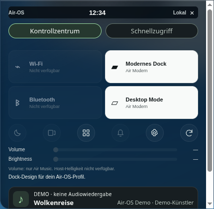
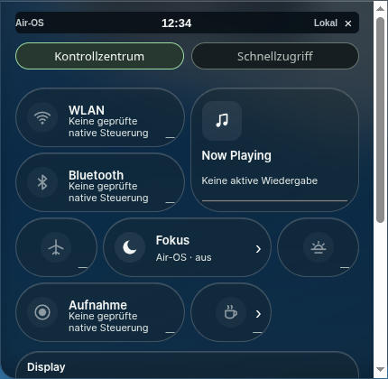

# MacShell Deep Port 2 – vorhandenes Kontrollzentrum erweitert

26.Oktober2026. Basis **743acaea5931d740c95a7b2497fb025290139b30**, Branch **feat/macshell-deep-port-2**. Produktcode-Commit: **2ba11da88f722076a8c8a89d5ebf4712b0b8b29b**. Kein zweites Kontrollzentrum, keine zweite Registry/Fensterverwaltung. Vorhandene Island, M1/M2 und GLASS-3 bleiben zuständig. Ausschließlich isolierte synthetische Profile/Notizen und öffentliche Testwallpaper; keine Cloud-Anmeldung/Veröffentlichung.

## Originalcode und tatsächlicher Ausführungspfad

MacShell-Pin **1bdb51870b621100fd2709f66c8f8e00ab17b9c4**, [MacBar.qml](https://github.com/0-ss/MacShell/blob/1bdb51870b621100fd2709f66c8f8e00ab17b9c4/MacShell/MacBar.qml), MIT Copyright(c)2026 Rickky. [Provenienz mit Original-Dateihash](../third_party/deep-port/control-center-port.json), [MIT](../third_party/deep-port/LICENSE); bestehende OFL-Nachweise erhalten.

| Original | Port / realer Pfad |
|---|---|
| `ccCatalog`, `ccDefault`, `ccLayout` (Zeilen431–493) | Alle12 Original-IDs/Glyphnamen/Zellgrößen, zehn Defaultkacheln, unveränderter4-Spalten-First-Fit-Rechenkörper;66px Zellhöhe,6px Abstand,10px um Sliderzeilen. `src/core/macshell-math.js`, bestehender `air-deep-desktop.js` rendert denselben Gridhost. Numerischer Vierkachel-Vertrag bleibt für gespeicherte Altwerte/Classic-/Browserkompatibilität verfügbar. |
| `Glyph` (ab690) | Tatsächliche Canvas-Pfadbefehle/Geometrien und Helfer für ausschließlich zwölf CC-Glyphen nach `src/core/control-glyphs.js` übernommen. QML-Paintsignale → einmaliger Canvas2D-Aufruf beim Aufbau; keine Apple-/Archlogos oder fremden Bildassets. |
| `CCTile`, `CCPill`, `ContourGlow` (ab1305) | Radius34, Slider26, Pressscale.97,200ms OutBack(2.4),320ms OutCubic, Pillenhöhe28/Radius14,13/12px-Typografie. OutBack-/OutCubic-Polynome über lineare Bézier-X-Koordinaten portiert. Bestehende Engine zeichnet dieselben originalen Liquid-/Konturshader auch für Kacheln/Details/Editor, Konturspread `max(40,min(w,h)*.9)` und320ms-Lichtbewegung. |
| `ccAdd`, `ccRemove` und Reihenfolgenmodell | Hinzufügen/Entfernen/oben/unten/Originalanordnung im selben bestehenden Preferences-Controller. Native Tastaturbuttons ersetzen QML-Drag. Bestätigte profilgebundene Writes; keine optimistische Speicherung, Busy-Schutz, Fehlerstatus und erneute Aktion möglich. |
| Detail-/Editoropacity180ms OutCubic | Unterseiten innerhalb des vorhandenen Panels, Zurück/Escape/Fokus und ausgeblendete nicht fokussierbare Hauptansicht. Eigene5px-Einblendverschiebung ist eine dokumentierte Electron-Anpassung. |

`MorphText`/`MorphGlyph`-Textbreiten-/Blur-Morphs und vollständige QML-Stagger-/Dragabläufe wurden **nicht** neu portiert. Bestehender MacLock-Port bleibt erhalten. Originales äußeres CC:300px,520/150ms; Air-OS verwendet absichtlich die vorhandene430px-Island-Panelhülle (responsiv) und M1 statt einer konkurrierenden Original-Popupanimation. Kein Pixelgleichheitsanspruch; Original-QML hier nicht ausführbar verglichen. Vergleich gegen konkrete Originalmaße/States/Quellen, keine erfundenen Referenzscreenshots.

## Was wirklich nutzbar ist

- **Fokus:** bestätigte Profileinstellung `focusMode`. Stumme normale Air-Notes-/Reminders-Banner und neue Notes-Island-Mitteilungen; Verlauf wird weiter geführt. Kritische Banner (`alert`) und vorhandene direkte Aktions-/Fehlerrückmeldungen bleiben sichtbar. Kein systemweiter Fokusmodus. Der kritische Test verwendet einen inhaltsfreien eigenen Air-OS-Hinweis, keine fremden Appereignisse.
- **Keep Awake:** neue eng begrenzte Main-Bridge mit boolescher Aktion, exakter `preferenceSession`, vertrauenswürdigem Hauptframe und Hauptfenster. Electron `powerSaveBlocker.start('prevent-display-sleep')` nur bei expliziter Aktivierung. Nicht gespeichert/nicht beim Login wiederhergestellt. Freigabe bei Aus, Logout, Neuanmeldung, Navigation, Rendererabsturz, Fensterschließen, App-Ende/Neustart. Im isolierten GUI-Testhost ist Verfügbarkeit absichtlichfalse; auf diesem Laptop wurde keine echte Energiesperre eingeschaltet. Positive Lebenszyklustests verwenden einen injizierten Testtreiber, keine native Windows-/macOS-Abnahme.
- **Darstellung:** vorhandene unabhängige Dock-/Desktop-Themebuttons bleiben unverändert verdrahtet. Zugriff über Darstellung und optionale Dark-Mode-Kachel; diese bezeichnet ausdrücklich Air-OS-Themes. Reduziertes Glas/Bewegung werden bestätigt im bestehenden Profil gespeichert. Classic erhält ursprüngliche Buttons/Sliders/Grid zurück. Browser/PWA ohne native Control-Bridge behält den bisherigen Gridpfad; kein PWA-Umbau.
- **Audio/Now Playing:** vorhandener Amplitude-Air-Music-Transport, sofern dessen echtes Audio eine Quelle besitzt. Vorhandener Lautstärkeregler und Play/Pause; echte optionale Metadaten und nativer Wiedergabefortschritt, keine zweite Engine/Timer. Ohne Quelle: deaktivierter Regler/Play und „Keine aktive Wiedergabe“, kein Demo-Live-Track oder erfundenes Cover. Positiver echter Musiktransport wurde hier mangels verbundener Audioquelle **nicht** als bestanden ausgegeben.
- **WLAN, Bluetooth, Flugmodus, Night Shift, Systemhelligkeit, Aufnahme, Spielmodus:** sichtbare Nichtverfügbarkeit und reine Detailhinweise. Keine ungeprüften OS-Adapter, Shellbefehle oder simulierten Werte. Displayregler bleibt deaktiviert. Keine behauptete OS-Steuerung.

Neue Felder `controlTiles` (null=Originaldefault,[]=explizit leer, sonst eindeutige Original-IDs) und `focusMode` im bestehenden Store; alte `controlOrder`-/Profil-/Notesdaten bleiben erhalten. Keep-Awake-Zustand ist ausschließlich flüchtig.

## Tests und echte Bilder

**378/378 Tests bestanden**,0 Fehler/Skips. Alle367 bestehenden Tests erhalten, elf neue Regressionen: vollständiger Katalog/überlappungsfreies Packing/Slidergap, leere/ungültige Auswahl, Profil-/Neustart-/Fehlerpersistenz, Keep-Awake-Opt-in/Idempotenz/Sitzungswechsel/Cleanup/Testhostschutz, kritische Mitteilungen, Main-Bridge-Grenzen und ausführbare originale Glyphpfade. Ein vorhandener isolierter `openDesktop`-Test erhielt lediglich den neuen Keep-Awake-Cleanup-Teststub; seine Sessionassertionen bleiben erhalten. **153 Laufzeitressourcen**, Syntax-/Diffprüfungen bestanden. Ein neuer Fehler-/Retry-Test prüft die bestätigte Anwendung der Glas-/Bewegungsschalter in der bestehenden Appearance-Warteschlange; bei fehlgeschlagenem Write bleibt der Cache unverändert.

Echte sandboxed Linux-Electron44-Läufe bei1920×1080,1650×930,390×600, zwei öffentliche Testwallpaper. Reguläre SwiftShader-Konfiguration bleibt CSS; WebGL-Materialintegration im vorhandenen ausdrücklich isolierten16K-Diagnosehost, kein Hardwareerfolg.390px ist ein schmaler Renderer, kein physisches390px-Display. Testuhr ausschließlich per CDP fixiert.

GUI prüft: Katalogdefault, Fokus an/aus und unterdrückte normale/erlaubte kritische Banner, Detail-Zurück/Escape ohne vorzeitiges Islandschließen, Hinzufügen/Sortieren/Defaultreset mit bestätigtem Store, Keep-Awake-Nichtaktivierung, Editor/Detailseiten und Glasverankerung sowie sofortige bestätigte Glasreduzierung und Rückschaltung. Bestehender voller App-/Zwei-Profil-/Neustart-/Classic-/M1-/M2-/K3-/Reduced-Motion-/WebGL-Ausfalllauf zusätzlich bestanden. GPU-Diagnose prüft Refraktion/konkave Maske, Idle, Kontextverlust, Reduced Glass, DPR2 und Cleanup. Keine privaten Inhalte in Texturen/Artefakten.

| Auflösung | Vorher offen | Nachher offen (CSS) | Editor | Fokusdetails | Keep-Awake-Details |
|---|---|---|---|---|---|
|1920×1080|[Bild](visual/deep2-before/control-clouds-1920.png)|[Bild](visual/deep2-after/control-clouds-1920.png)|[Bild](visual/deep2-after/editor-1920.png)|[Bild](visual/deep2-after/detail-focus-1920.png)|[Bild](visual/deep2-after/detail-awake-1920.png)|
|1650×930|[Bild](visual/deep2-before/control-clouds-1650.png)|[Bild](visual/deep2-after/control-clouds-1650.png)|[Bild](visual/deep2-after/editor-1650.png)|[Bild](visual/deep2-after/detail-focus-1650.png)|[Bild](visual/deep2-after/detail-awake-1650.png)|
|390×600|[Bild](visual/deep2-before/control-clouds-390.png)|[Bild](visual/deep2-after/control-clouds-390.png)|[Bild](visual/deep2-after/editor-390.png)|[Bild](visual/deep2-after/detail-focus-390.png)|[Bild](visual/deep2-after/detail-awake-390.png)|

[Geschlossene Island vorher1920](visual/deep2-before/island-clouds-1920.png) / [nachher](visual/deep2-after/island-clouds-1920.png); entsprechend1650/390 in denselben Ordnern. [Integriertes WebGL-Kontrollzentrum](visual/deep2-diagnostic/control-clouds-1920.png), [Editor390](visual/deep2-diagnostic/editor-390.png). Rohmessungen: [Vorher](visual/deep2-before/report.json), [CSS](visual/deep2-after/report.json), [WebGL/Cleanup](visual/deep2-diagnostic/report.json), [Bestandsregression](visual/deep2-regression/r1-gui-report.json). Reproduktion: `scripts/check-control2.cjs` im vorhandenen isolierten Electron-Testlauncher.

[Geometrie-/Bild-/Cleanupvergleich](visual/deep2-comparison.json), reproduzierbar mit `python scripts/measure-control2.py`. Dock358×68/bottom0 und geschlossene Islandtop0 in allen Größen exakt wie vorher; keine zusätzlichen Materialdraws in650ms Ruhe.

| Kontrollzentrum vorher (CSS) | Nachher (CSS) |
|---|---|
|  |  |

Gelöste Befunde: neuer Cleanupaufruf benötigte im vorhandenen Funktionsextraktionstest den zusätzlichen Stub; Detailseiten standen zunächst unter den Shortcuts statt allein; die Glas-/Bewegungsschalter benötigten die bestätigte bestehende Appearance-Warteschlange statt nur einen Storewrite; Native-Scrollziele konnten unter dem bestehenden Sticky-Header liegen →90px Scrollpadding ohne Änderung des Panelrechtecks; Diagnosefoto musste den asynchronen Material-Repaint abwarten. Finale Prüfungen behalten strenge Geometrie-/Idle-/Canvasassertionen. Frühere nicht bestandene Aufnahmen gelten nicht als Abnahme.

**Offen:** echte Windows-/macOS-Keep-Awake-/GPU-/Systemadapterabnahme, positive reale Air-Music-Steuerung, vollständige Original-Text-/Glyph-Morphs, Drag/Stagger und Wi-Fi-/Bluetooth-Systemunterseiten. Keine öffentliche Freigabe/Installeränderung. GitHub-API für PR-/CI-Abfrage hier403; kein neuer grüner CI-Lauf behauptet. Commit-SHA im Abschlussbericht und in Git-Historie dieses Berichts; ein Commit kann seinen eigenen SHA nicht enthalten.
