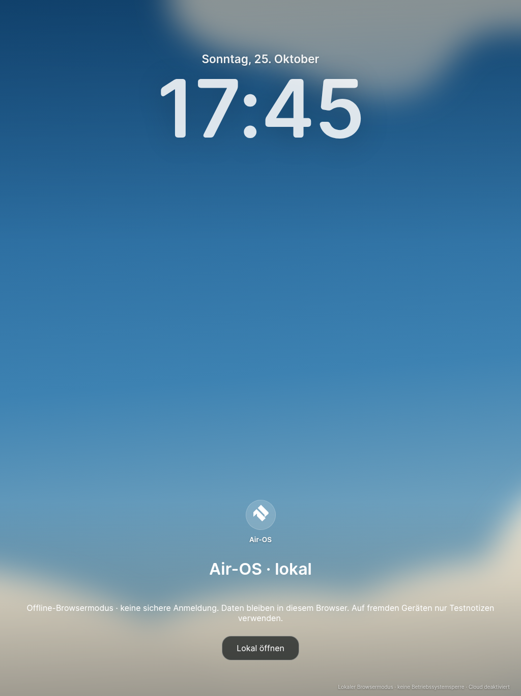
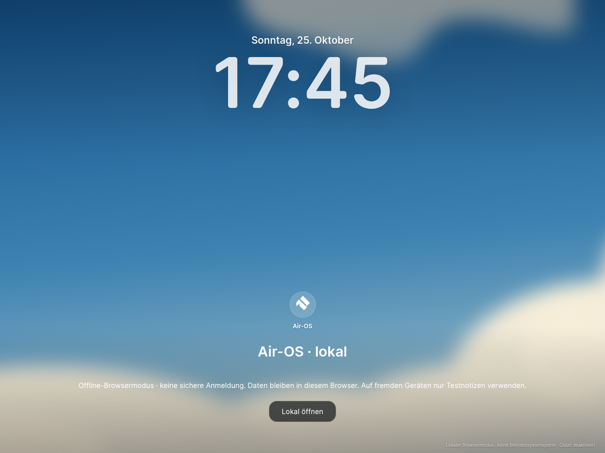
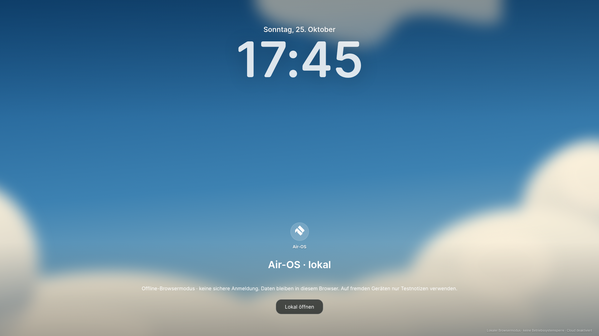
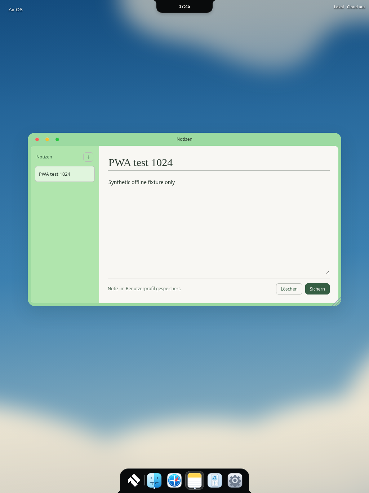
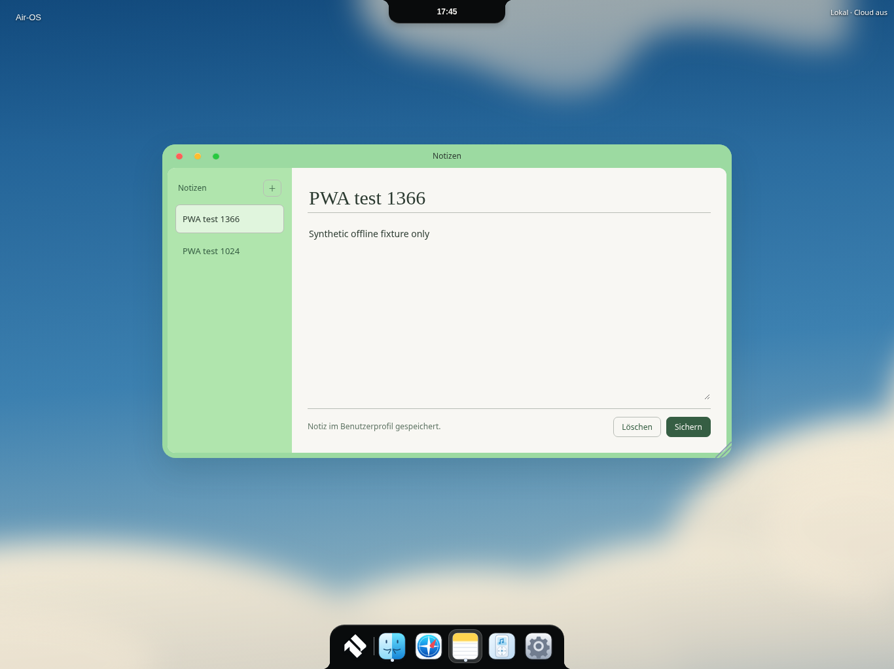
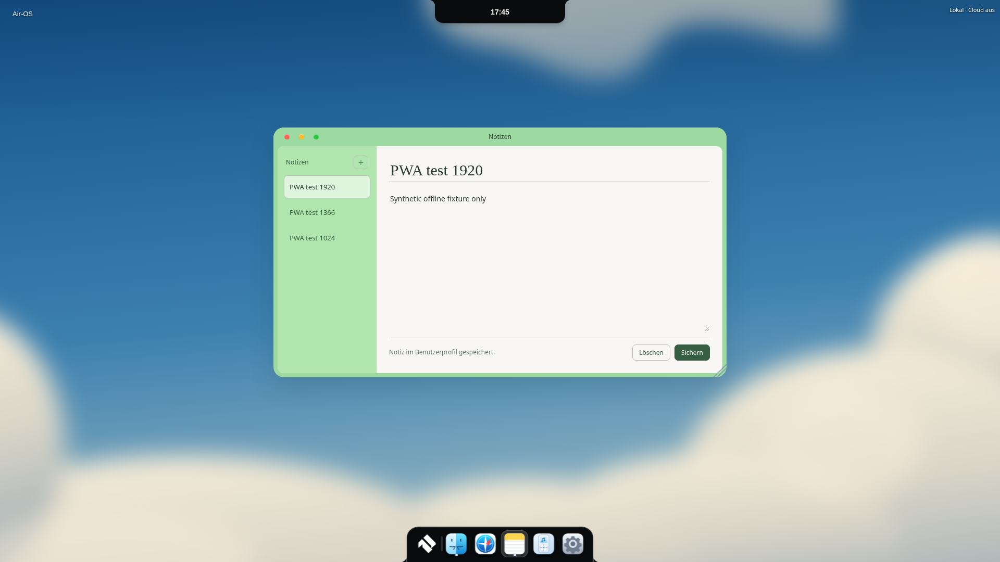

# PWA-1 – lokaler Air-OS-Browsereinstieg

25. Oktober 2026, Europe/Berlin. Basis CLOUD-1 `3b1bc37d844b986c385c115ace36e67491e15305`, Branch `feat/air-ipad-pwa1-20261025`.

## Betrieb und Build

`npm run build:pwa` erzeugt **dist/pwa/** als eigenständigen statischen Build (113 erlaubte Dateien). Diesen Ordner vollständig auf einem HTTPS-Host unter einem eigenen Pfad bereitstellen; keine Veröffentlichung wurde durchgeführt. Kein Node-/Electron-Backend auf dem Webserver nötig. Für lokale Entwicklung ist `http://localhost` als sicherer Browserkontext möglich. Manifest, Start-/Scope-URLs und Service Worker sind relativ und unterstützen Unterverzeichnisse. Server: `.js` mit JavaScript-MIME, `.webmanifest` als `application/manifest+json`, keine SPA-Umleitung fehlender Assets; `sw.js` ohne langfristigen HTTP-Cache ausliefern. HTTPS/TLS über Host konfigurieren. Safari: nach echter Geräteprüfung über Teilen → Zum Home-Bildschirm installieren. Eine tatsächliche iPad-Installation wurde hier **nicht** durchgeführt.

Startseite ist das gemeinsame MacLock-Layout mit echtem Datum/Uhr und ausdrücklich **lokalem Browsermodus**. Keine Passwortmaske, kein Cloud-/Systemlogin. „Lokal öffnen“ öffnet den gemeinsamen Desktop, Logout führt wieder zum lokalen Lockscreen. Kein Zugriff auf bestehende Electron-Profile. Browserdaten werden in separater IndexedDB `air-os-pwa-local-v1` dieser Web-Origin gespeichert; andere lokale Apps/Profiles/Dateien werden nicht gelesen. Lokale Daten sind **nicht verschlüsselt**; jeder mit Zugang zum Browser kann sie nach lokalem Öffnen lesen. Auf fremdem Laptop ausschließlich synthetische Testnotizen verwenden. Browser kann Daten bei Speicherknappheit entfernen; dies ist kein Backup. Nach Tests eigene Test-Website-Daten über Browser löschen, nicht pauschal andere Browser-/Laptopdaten entfernen.

Notes verwenden das bestehende JSON-Format `id,title,body,createdAt,updatedAt` und denselben gemeinsamen Notizkonstruktor `src/core/notes-format.js` wie der Electron-Store. IndexedDB-Readwrite-Transaktionen verhindern verlorene gleichzeitige Storewrites; Snapshot-Prüfung verhindert Überschreiben veralteter Editorstände. Fehler brechen Transaktion ab und erscheinen über bestehende Notes-Fehlermeldungen. Erstellen, Bearbeiten, Löschen, Offlinebetrieb und erneutes Laden funktionieren lokal. Air Home zeigt vorhandene Notes über dieselbe Bridge. Keine Cloud-Anmeldung oder Schlüssel, kein Supabase-Netzwerkzugriff. PWA-CSP begrenzt Verbindungen auf die eigene Origin.

`pwa/adapter.js` trennt Webfähigkeiten von Electron. Vorhandene Registry/Fensterverwaltung und Dock-/Island-Komponenten werden wiederverwendet. Unterstützter kleiner Pfad: Home, Notes, Einstellungen, Rechner, Über-Ansicht und Startmenü. Andere Apps werden beim Start ehrlich zurückgewiesen; native Datei-/Store-/Spotify-/Reminders-/Cloudfunktionen sind deaktiviert. Noch keine vollwertige Finder-/Musik-/Kalender-PWA. Die existierende Notes-Oberfläche wird verwendet, nicht ein zweiter Editor. Gemeinsame Desktop-Dateien werden nur im generierten PWA-Build für Plattformstart/Skriptauswahl angepasst. Native Windows-/macOS-Konfigurationen, Logo, M1/M2 und Desktop-Design bleiben erhalten; Packaging ergänzt lediglich den gemeinsamen Formathelfer.

Manifest und Touchicon nutzen die offiziellen BRAND-2-PNGs (192/512, eigenes maskable512). Gemeinsame CSS-Glasflächen mit Reduced-Glass-Standard auf Web: lesbarer, kostengünstiger Fallback, keine neuen Shader-/GPU-Loops. Lockscreen verwendet die vorhandenen Materialien/Fonts in CSS statt WebGL. Hoch-/Querformat verwenden responsives gemeinsames Layout, `viewport-fit=cover`, Safe-Area-Abstände für Randbedienbereiche und Text, Touchziele für wesentliche Notes-Aktionen. Dockbasis und zentrale Island bleiben am jeweiligen Rand; keine neue Taskleiste. Tatsächliche iPadOS-Tastatur/Homeindikator/Split View/Statusleisten-Safe-Areas müssen auf Hardware abgenommen werden.

## Offline und Updates

Service Worker precacht ausschließlich die explizite, gehashte Buildliste. Keine API-Antworten, Notizen, Tokens, Requests mit Querystring, fremde Origins oder Nicht-GET-Requests im Cache. Navigation auf Einstieg/desktop.html ist offline verfügbar. Cacheversion hängt von tatsächlichem Dateiinhalt ab. Bereinigung löscht nur ältere Air-OS-Caches **desselben Installationspfads**; fremde Caches bleiben erhalten. IndexedDB bleibt beim Update unberührt. Neue Version wartet und wird erst über sichtbaren Updatebutton nach Hinweis auf ungespeicherte Eingaben aktiviert. Keine automatische erste Installations-Neuladung, die Eingaben verwerfen würde. Installations-/Speicherfehler werden angezeigt.

## Tatsächliche Prüfungen

**345/345 Tests bestanden**,0 Fehler/Skips; drei neue Regressionen für Build/Manifest/Icons/CSP/Adapter, gemeinsamen Notes-Formatpfad und Cache-Isolation.125 Electron-Laufzeitdateien/Syntax und Diffprüfung bestanden. Keine neuen App-Abhängigkeiten. Browser-Prüfskript `scripts/check-pwa.cjs` verwendet bereits verfügbare Playwright-Entwicklungswerkzeuge und Chromium (`AIR_PWA_CHROMIUM` konfigurierbar); diese sind keine App-Laufzeitvoraussetzung.

Echter **Chromium154 unter Linux**, isoliertes temporäres Browserprofil, synthetische Notizen, Touch-Eingaben.1024×1366,1366×1024 und1920×1080. Manifest-Installierbarkeitsprüfung über CDP ohne gemeldete Fehler, tatsächlicher Service Worker, Offline-Neuladen, lokale Notizen, Logout, Update/Cache-Bereinigung und unveränderte Daten geprüft. Kein tatsächlicher „Zum Home-Bildschirm“-Installationsnachweis. Nicht Safari/iPadOS, kein natives Windows/macOS; keine Cloud getestet. [Rohbericht](visual/pwa1/browser-report.json) enthält Messwerte und exakte Browserergebnisse.

| Ansicht | Hochformat1024 | Querformat1366 | Desktop1920 |
|---|---|---|---|
| Lokaler Lockscreen |  |  |  |
| Offline-Notes |  |  |  |

Offen: echte Safari-/iPadOS-Installation, Bildschirmtastatur und Speicher-Eviction, native Touch-/Safe-Area-Abnahme, HTTPS-Deployment durch Eigentümer und später eine separat beauftragte Cloud-Verbindung auf dem eigenen Gerät. Kein neuer Gesamtplan, keine Veröffentlichung oder Installerfreigabe.
