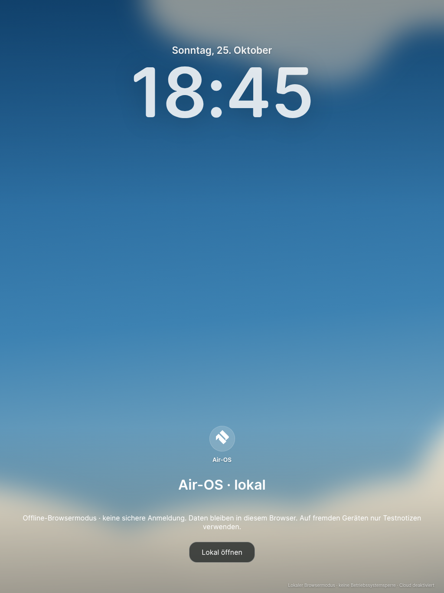
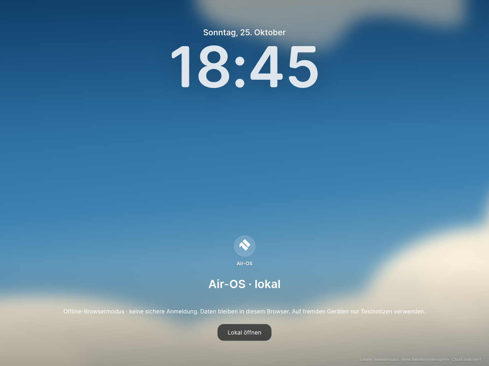
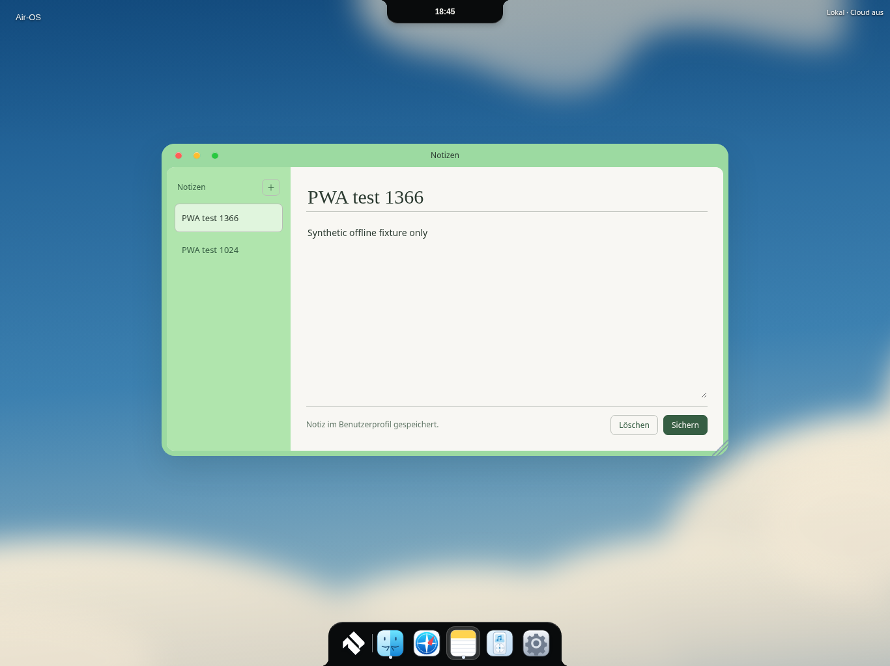
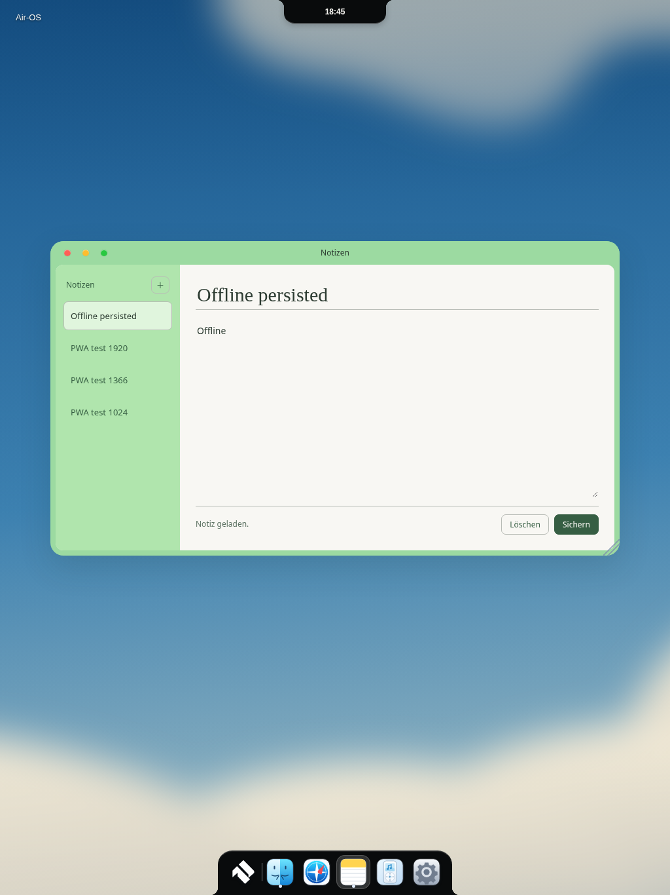

# PWA-2 – manueller öffentlicher HTTPS-Testweg und Safari-Vorbereitung

25. Oktober 2026 (Europe/Berlin). Basis PWA-1 `e3b19d62d72a3bc024c0d8a5ea7df232ee864b52`, Branch `feat/air-ipad-pwa2-20261025`. PWA-1 wird weiterverwendet. **Keine Veröffentlichung ausgelöst, keine öffentliche Test-URL vorhanden.** Keine Cloud-Anmeldung, keine Supabase-Schlüssel, keine privaten Dateien oder Profile verwendet.

## Veröffentlichungsweg – erst nach ausdrücklicher Freigabe

[deploy-pwa-preview.yml](../.github/workflows/deploy-pwa-preview.yml) ist ausschließlich `workflow_dispatch`, ohne Push-/PR-/Zeittrigger. Exakter PWA-2-Branch und Eingabe `publish-public-pwa-test` sind erforderlich. Buildjob: frischer Checkout, `npm ci --ignore-scripts`, vollständige Testsuite, `npm run build:pwa`, [Paketprüfung](../scripts/check-pwa-package.cjs). Einziger Uploadpfad **dist/pwa/**. Kein Repository-Root, Electron-Paket, Profil, lokale Notizdatei oder Environmentfile im Artefakt. Prüfer verweigert Symlinks/private/native Dateien und kaputte Assetverweise. Keine Secretsreferenzen im Workflow. Buildtoken nur contents:read; Pages-/OIDC-Schreibrechte nur im getrennten Deployjob. Kein Installations-/Signing-/Cloudworkflow geändert.

Vor einem autorisierten Lauf durch Repository-Eigentümer erforderlich:

1. Explizite Freigabe einer **öffentlichen** Testseite einholen. GitHub Pages ist kein privater Zugangsschutz; ein Environment-Review schützt die Veröffentlichung, **nicht den Zugriff auf die Website**.
2. GitHub-Einstellung Pages → Source „GitHub Actions“ und Verfügbarkeit des Pages-Plans prüfen. Kein bestehendes Pages-Projekt ungeprüft überschreiben: Deployment würde dessen aktuelle Seite ersetzen. Hier wurden keine Pages-/Domain-/Environmenteinstellungen verändert.
3. Environment `pwa-public-preview` mit erforderlichem Reviewer, deaktiviertem Self-Review und erlaubtem PWA-2-Branch konfigurieren, soweit der GitHub-Plan dies unterstützt. Der Name im YAML allein erzeugt keinen Reviewschutz. Kein PAT oder Cloudsecret nötig; GitHub-OIDC/Pages-Berechtigung wird vom Job verwendet.
4. **GitHub verlangt für workflow_dispatch eine Registrierung der Workflowdatei auf dem Defaultbranch. Diese neue Datei liegt derzeit nur auf PWA-2.** Eine minimale Workflowregistrierung auf main benötigt einen separaten ausdrücklichen Auftrag; main wurde hier unverändert gelassen. Ohne Registrierung ist ein Dispatch dieses neuen Workflows gegebenenfalls nicht verfügbar. Nicht als bereits ausführbaren/grünen Pages-CI-Lauf ausgeben.
5. Nach diesen Voraussetzungen und ausdrücklicher Freigabe: Actions → „Air-OS PWA public HTTPS test“ → Run workflow, Branch `feat/air-ipad-pwa2-20261025`, Bestätigungstext eingeben; Environment-Review abwarten. Alternativ kann der Eigentümer denselben expliziten Dispatch über gh auslösen. **In dieser Sitzung nicht ausgeführt.**
6. Erst nach grünem Deployjob die tatsächliche `page_url` aus dessen Ausgabe/Environment verwenden. HTTPS im Browser prüfen. Kein ungeprüfter `github.io`-Link wird hier als existent ausgegeben. Für diesen Test keine echten Notizen/Cloudzugangsdaten verwenden.

Build lokal: `npm run build:pwa && node scripts/check-pwa-package.cjs`. Ergebnis 116 statische Dateien, davon115 explizit gecacht. `.nojekyll` bewahrt auch `node_modules/amplitudejs/...` als statische Laufzeitdatei; keine zweite Electron-Laufzeit. Favicon korrigiert: PWA-1 verwies auf ausgeschlossenes ICO, nun vorhandenes offizielles BRAND-2-32px-PNG. Native Icons unverändert. Icons/Manifest/SW/Skripte funktionieren mit relativem Unterverzeichnispfad. Lizenzdateien aus vorhandenem Paket weiter enthalten.

## Auf dem eigenen iPad

1. Nach autorisiertem Deployment die **tatsächliche HTTPS-URL aus dem Actionslauf** direkt in Safari öffnen, kein eingebetteter Messenger-Browser, kein Privatmodus. Nur synthetische Testnotizen verwenden. Erst vollständig online laden; keine Cloudanmeldung.
2. Safari → **Teilen → Zum Home-Bildschirm** → „Air-OS“ bestätigen. Je iPadOS-Version „Als Web-App öffnen“ aktivieren, falls angeboten.
3. Vom Home-Bildschirm starten: lokaler Air-OS-Lockscreen, **keine sichere Systemanmeldung**. „Lokal öffnen“, Notizen über Startmenü/Dock starten, eine Testnotiz speichern. Browser- und installierter Web-App-Speicher müssen auf dem tatsächlichen iPad getrennt geprüft werden; keine automatische gemeinsame Speicherung voraussetzen.
4. Flugmodus einschalten, App vollständig schließen, erneut vom Home-Bildschirm starten; Testnotiz öffnen, bearbeiten und löschen. Offlinefähigkeit setzt erfolgreiche erste Installation/Cachefüllung voraus. Ohne Cloud/Backup können iPadOS-Speicherbereinigung oder Löschen der Website-Daten Notizen entfernen.
5. Hoch-/Querformat und Split View prüfen. Im Editor Bildschirmtastatur öffnen: Titel/Text/Fokus und Speichern müssen erreichbar bleiben. Dockbasis/konkave Füße und Island am Rand prüfen; Homeindikator, Safe Areas und Statusleiste tatsächlich ansehen.
6. Nach freigegebenem neuen Build online öffnen. Neue Version wartet; Updatebutton nach Sicherung ungespeicherter Eingaben bestätigen. Danach erneut offline starten, gespeicherte Testnotizen prüfen. App-Neustart ist keine Neuinstallation. Bei Problemen keine pauschale Browserdatenlöschung; erst Testnotizen sichern.

**Privatsphäre:** PWA bleibt lokal und unverschlüsselt. Pages-Inhalte sind öffentlich, lokale IndexedDB-Notizen werden nicht hochgeladen. GitHub-Project-Pages unter demselben Host teilen eine Origin mit anderen Projekten; ein anderer Pfad ist keine Sicherheitsgrenze für IndexedDB. Für spätere persönliche/Cloud-Daten eine dedizierte vertrauenswürdige Origin und eigenes Sicherheitskonzept verwenden. Öffentliche Testseite ausschließlich mit Testdaten verwenden.

## Safari-Vorbereitung und Grenzen

Nur PWA-Dateien ergänzt: Apple-Web-App-Titel/Statusleistenmetadaten, vorhandenes Touchicon, WebKit-Backdropfilter und 16px-Texteingaben gegen Fokus-Autozoom. `pwa/viewport.js` reagiert auf VisualViewport-Verkleinerung, begrenzt ausschließlich den fokussierten Notes-Arbeitsbereich und ermöglicht Scrollen zum Eingabefeld; Aufräumen bei pagehide. Notes-Aktionen bleiben im Arbeitsbereich sichtbar. Keine Größen-/Positionsregeln für Dock/Island geändert, Desktopdateien/Cloud/Auth/M1/M2 unverändert. Vorhandene Safe-Area-Regeln und gemeinsamen Touch-Pointerhandler weiterverwendet. Echte Bildschirmtastatur/Homeindikator/Standalone-Safe-Areas sind mangels iPad **NICHT ABGENOMMEN**; synthetischer VisualViewport-Test ist kein Tastaturnachweis.

## Tatsächliche Ergebnisse

- **348/348 Tests bestanden**,0 Fehler/Skips;125 Electron-Laufzeitdateien/Syntax/Diff bestanden. Workflow-YAML separat geparst, manueller Trigger und Uploadpfad geprüft. Keine Tests abgeschwächt; Paketprüfung erkennt den vorher kaputten Faviconverweis.
- Echte lokale **HTTPS**-Prüfung auf Loopback unter `/Air-Os-Clean/`, Chromium154/Linux, isoliertes temporäres Browserprofil. Kurzlebiges selbst signiertes Testzertifikat nur über dessen SPKI im Testprozess akzeptiert; kein öffentlich vertrauenswürdiges Zertifikat behauptet, keine Browser-/OS-Sicherheit dauerhaft geändert. Kein Hosting/Deployment im Internet. `scripts/check-pwa-pages.cjs` ist reproduzierbar mit vorhandenem Playwright-Testwerkzeug/Chromium/OpenSSL; keine neuen App-Abhängigkeiten.
- 1024×1366,1366×1024,1920×1080: echte Touchaktionen, lokale CRUD, Service Worker, Offline-Navigation, Update mit Cachebereinigung, Daten nach Update und **vollständigem Browserprozess-Neustart offline** erhalten. Keine JavaScriptfehler. Manifest-Installierbarkeitsdiagnose Chromium ohne Fehler; kein tatsächlicher iPad-Home-Screen-Installationsnachweis.
- Dock in allen Größen358×68, bottom0; Islandtop0. [Rohbericht](visual/pwa2/browser-report.json).
- **WebKit BLOCKIERT:** lokale Laufzeit fehlt; tatsächlicher Downloadversuch für WebKit26.5/Playwright2336 von den angebotenen Downloadhosts liefert HTTP403 „Domain forbidden“. Kein erfolgreicher WebKit-/Safari-Test. Kein iPad verfügbar. Chromium nicht als iPadOS ausgegeben.
- Pages-Workflow nur vorbereitet/lokal geprüft, nicht dispatched, kein grüner Pages-CI-/öffentlicher TLS-/Pages-Konfigurationsnachweis. Bekannte Legacy-Abhängigkeits-/Signingblocker werden durch die PWA nicht als gelöst bezeichnet.

| Echte Browseraufnahme | Hochformat | Querformat |
|---|---|---|
| Lockscreen |  |  |
| Offline-Notes |  |  |

