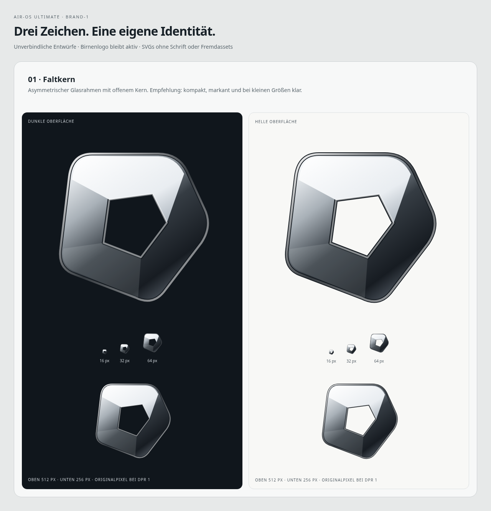
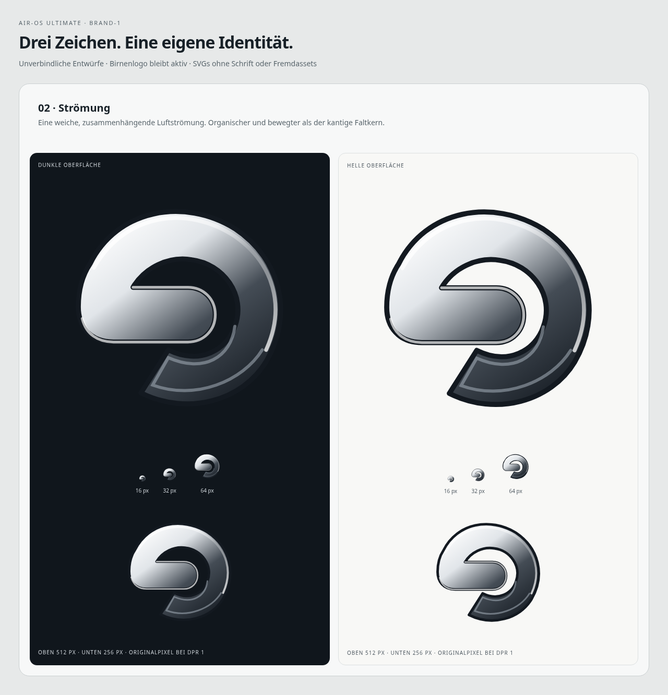
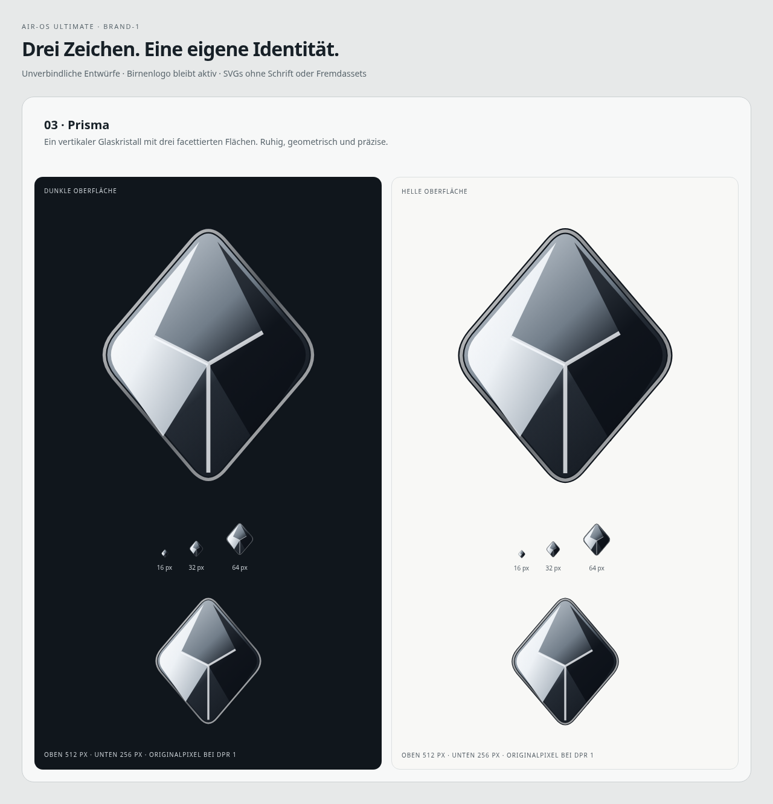

# BRAND-1 – drei Air-OS-Markensymbole

25.Oktober2026 (Europe/Berlin). Basis/Remote **0df1a30426b205e6cde5d998e0154f42de968c2c**, eigener Branch **design/air-os-brand-1-20261025**. Sauberer Arbeitsbaum, R1.1-Remote verifiziert; paralleler L1C.1-Branch45fa967 bleibt unverändert. Keine Zusammenführung alter Produktstände oder Änderung aktiver Icons/Installer. [Verbindliches Produktziel](../../AIR_OS_ULTIMATE_PRODUCT_SPEC.md).

**Auswahl offen. Empfehlung:01 Faltkern.** Der asymmetrische Umriss mit offenem Kern ist kompakt und hebt sich von den beiden anderen Richtungen ab. Das Zeichen passt sowohl als kleiner Launcher als auch als großes App-Icon.02 ist weicher/organischer,03 strenger/geometrischer. Alle drei sind neue, eigenhändig konstruierte Vektorgeometrien ohne fremde Logos, Fonts oder Assets; keine Apple-/Birnen-/Fruchtsilhouette. Keine Markenrechtsverfügbarkeit behauptet. Liquid-Glass-Anmutung durch statische Vektorgradienten, Konturen und Lichtkanten; kein vorgetäuschter live WebGL-Effekt.

| 01 Faltkern – Favorit | 02 Strömung | 03 Prisma |
| --- | --- | --- |
|  |  |  |
| [SVG](01-fold.svg) | [SVG](02-flow.svg) | [SVG](03-prism.svg) |

[Gemeinsamer Vergleich](comparison.png) · [interaktive lokale Vorschauseite](preview.html) · [Rendernachweis](render-report.json).

Die PNGs stammen direkt aus diesen SVGs, tatsächlich in Electron/Chromium gerendert, keine generierten Ersatzbilder. Die Entwurfsblätter zeigen dasselbe unveränderte Zeichen jeweils auf Dunkel#10161c und Hell#f8f8f6. Oben512px, darunter16/32/64px und256px bei DPR1. Die Vorschauseite enthält Beschriftungen; **die SVG-Markensymbole selbst enthalten keine sichtbare Schrift**. Transparenter Hintergrund in den exportierten Einzel-PNGs, keine schwarze Symbolkachel. Feine Brechungskanten werden bei16px naturgemäß reduziert; die Hauptsilhouette bleibt maßgeblich.

| Größe | Faltkern | Strömung | Prisma |
| --- | --- | --- | --- |
|16|[PNG](png/fold-16.png)|[PNG](png/flow-16.png)|[PNG](png/prism-16.png)|
|32|[PNG](png/fold-32.png)|[PNG](png/flow-32.png)|[PNG](png/prism-32.png)|
|64|[PNG](png/fold-64.png)|[PNG](png/flow-64.png)|[PNG](png/prism-64.png)|
|256|[PNG](png/fold-256.png)|[PNG](png/flow-256.png)|[PNG](png/prism-256.png)|
|512|[PNG](png/fold-512.png)|[PNG](png/flow-512.png)|[PNG](png/prism-512.png)|

## Geprüfte aktuelle Iconpfade – keine Integration vor Auswahl

| Ziel | Tatsächlicher Stand | Spätere konsistente Einbindung |
| --- | --- | --- |
|Windows|`package.json`: kein`build.win.icon`/NSIS-Iconpfad;`main.cjs`:`BrowserWindow` ohne`icon`. Keine ICO-Datei im Repository gefunden. Build besitzt bisher keine explizite eigene native App-Iconkonfiguration.|Gewähltes SVG als einzige Masterdatei; daraus ICO mit16/24/32/48/64/128/256px erzeugen. Später explizit`build.win.icon`, passende NSIS-Iconoptionen und Windows-BrowserWindow-PNG setzen; neuen Installer erst separat bauen/signieren/testen.|
|macOS|Kein`build.mac.icon`, keine ICNS-Datei gefunden. SVG-Dockzeichen der internen Air-OS-Oberfläche ist vom nativen macOS-Dock-/Bundleicon getrennt.|ICNS aus demselben Master bis1024px, explizit`build.mac.icon`; Retina-/Bundle-/Dockprüfung und Signing/Notarisierung separat. Kein macOS-Fenstericon durch einen Windows-only-BrowserWindowparameter vortäuschen.|
|Bestehende UI|Birne in`index.html` als inlineSVG (`.air-mark`), Modern-Launcher in`air-launchpad.js` als`airLaunchpadLogo`/`vectorIcon.launchpad`; K3-Homekarte in`air-island.js` klont dieses Zeichen. Classic verwendet weiterhin das Grid. `assets/air-logo.png` vorhanden, aber keine Referenz in den geprüften Laufzeitdateien gefunden.|Erst nach Auswahl in einer separaten kleinen Phase einen gemeinsamen lokalen SVG-Master für die betroffenen Markenplätze verwenden; keine App-Logos, Icongrößen, Classic-Regeln oder Dock-/Islandgeometrien verändern.|
|Zukünftige PWA/iPad|Kein Web-App-Manifest/Serviceworker/Apple-Touch-Iconpfad in den geprüften Projektdateien; PWA noch nicht implementiert.|Aus demselben Master PNG192/512für Manifest`purpose:any`, eigenes gepolstertes maskable-Derivat mit sicherer Zone und180px Apple-Touch-Icon. Manifest-/HTML-Pfade, Installierbarkeit, Offline-/Lockscreen-/Authverhalten später als eigene PWA-Phase testen. Keine bestehende PWA-Funktion behaupten.|

Geprüft: package.json, main.cjs, index.html, login.html, relevante Launcher-/Island-/Logo-CSS-Pfade sowie vorhandene ICO/ICNS/Manifest-/Serviceworker-Dateinamen. Keine vollständige Plattform-/Cloudanalyse. Gewählte Masterdatei später z.B.`assets/brand/air-os.svg`; Buildableitungen deterministisch erzeugen und hashen, aus512px-PNG keine Retina-Quelldatei hochskalieren. Der aktuelle Entwurfsordner ist nur Dokumentation und wird nicht in die App-Paketdateiliste aufgenommen.

## Prüfung / Abschluss

**5/5 gezielte Tests bestanden**,0 Fehler/Skips: vier neue Asset-/Render-/Auswahlschutztests plus vorhandene Modern-Birne-/Classic-Grid-Regression. Alle drei SVGs zusätzlich mit echtem XML-Parser geprüft.15 tatsächlich dekodierte PNGs besitzen exakt16/32/64/256/512px, RGBA/transparente Ecken und Abstand zum Rand, keine abgeschnittene Hauptform oder schwarze Kachel. Bei16px Boundingboxen: Faltkern[1,1,15,15], Strömung[1,1,15,15], Prisma[2,1,14,15]. [Pixel-/Hashnachweis](pixel-report.json). Sichtprüfung des Vergleichs und der Größenblätter durchgeführt; feine Glaskanten bleiben eine Gestaltung, keine automatisiert bewiesene subjektive Lesbarkeit.

Finaler echter Electron44.9.3/Linux/Xvfb-Rendererlauf Exit0 mit19 PNGs (ein Vergleich, drei Entwurfsblätter,15 transparente Größenexporte); sämtliche Dateihashes geprüft. Initialer Versuch mit verborgenem Previewfenster wurde wegen pausierter RAF verworfen, final eigener sichtbarer Previewhost mit Sandbox/ContextIsolation/WebSecurity und ohne NodeIntegration, keine Produktprofile geladen. Zusätzliche Antialias-Sicherheitsmarge in den finalen SVGs verhindert Randberührung bei16px. Keine Pixelnachbearbeitung oder KI-Ersatzbilder.

JS-Syntax, lokale Markdownlinks und`git diff --check` bestanden; Produkt-/Packaging-/Iconpfade gegen Basis unverändert. Vollsuite und native Windows-/macOS-/iPad-/Installationsabnahme in dieser reinen Entwurfsphase nicht erneut ausgeführt oder behauptet; vorherige327/327 gehören zum R1.1-Checkpoint. Kein neuer CI-/Signatur-/Releaseerfolg. Die vorhandenen R1.1-/L1C.1-Branches bleiben unverändert. Reproduktion: `AIR_BRAND_PREVIEW=1 <Electron44> scripts/render-brand-1.cjs --user-data-dir=<eigener-temporärer-Pfad>`, mit funktionierender Desktop-/Sandboxumgebung. Der Previewhost lädt nur diese lokale Seite, keine Produktmain/preload/Benutzerprofile oder Netzressourcen.

Nächste Schritte nur nach Nutzerwahl/neuem Auftrag: einen Entwurf bestätigen, genau diesen Master weiter verfeinern, anschließend native/UI-/PWA-Iconintegration separat prüfen. Keine automatische Birnenersetzung. Cloud/PWA/MacShell-/Signierarbeit bleibt außerhalb BRAND-1. STOP nach Commit/Push.
