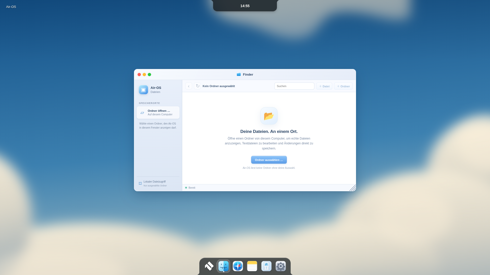
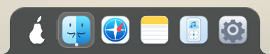
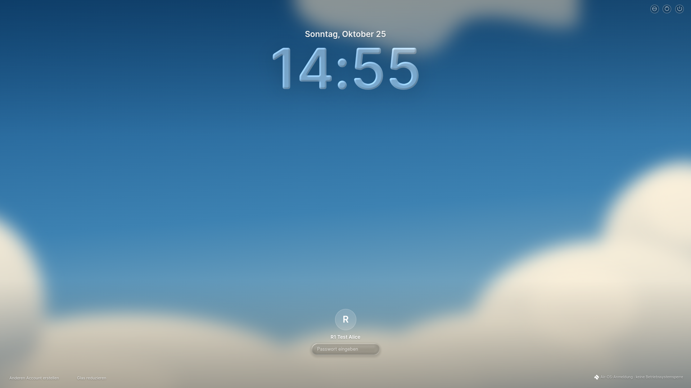
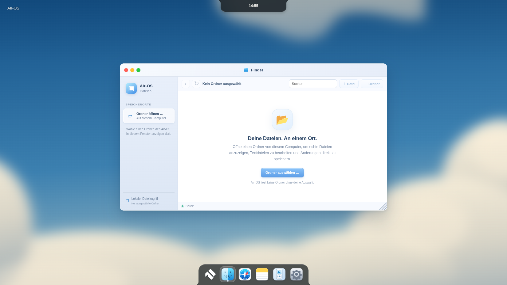
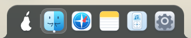
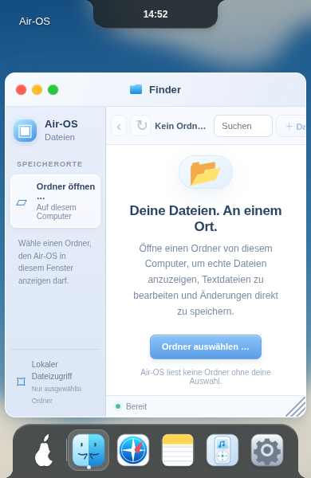
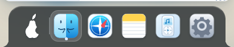
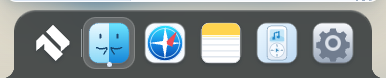
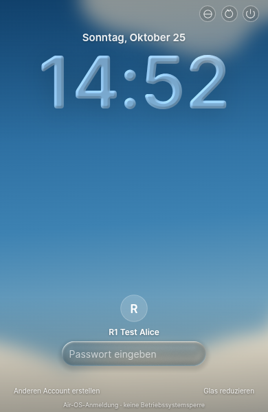
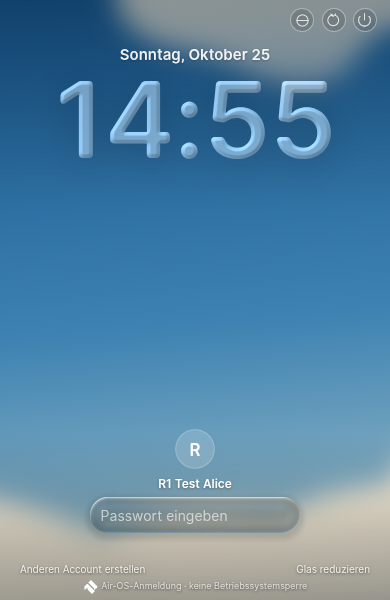

# BRAND-2 – offizielles geometrisches Air-OS-Logo

25.Oktober2026, Europe/Berlin. Basis/Remote99ba39383dd20198d77981572ccc91d3f738314c; eigener Branch `design/air-os-brand-2-20261025`. Aktive Referenzen geprüft: tatsächlich noch Birne in index.html/air-launchpad.js, Home-Schnellkarte der Island klont den Launcher; keine BRAND-1-Auswahl vorausgesetzt. Bestehende Schrift-A-/Balkenmarken in Einrichtung/Schlafansicht ebenfalls ersetzt. Benutzerinitialen/Avatare sind Profildaten und bleiben unverändert. Classic-Grid ist eine Appfunktion und bleibt erhalten.

## Vorlage und Dateien

Das vom Nutzer im BRAND-2-Auftrag gezeigte geometrische Schwarz-Weiß-Bild wurde als zwei geradlinige Polygone mit erhaltenem diagonalem Negativraum manuell vektorisiert. Kein BRAND-1-Entwurf, keine Birnen-/Apple-Silhouette, keine Rundung/Verformung des Symbols. Die sichtbare Bildvorlage war verfügbar, aber kein lokales Originalbitmap für einen automatischen Pixelvergleich: **keine behauptete Pixelgleichheit**. Abgelesene Eckpunkte und Referenzhinweis zusätzlich in air-os-master.json; SVG-Master ist maßgeblich.

- [SVG-Master](../../../assets/brand/air-os-master.svg), [schwarz](../../../assets/brand/air-os-black.svg), [weiß](../../../assets/brand/air-os-white.svg). Gleiche Pfadkoordinaten/ViewBox; nur Fill verschieden.
- [App-Icon-SVG](../../../assets/brand/air-os-app.svg): dezenter dunkler Hintergrund, unverändertes eingebettetes Zeichen; [maskable](../../../assets/brand/air-os-maskable.svg): vollflächiger Hintergrund und zusätzliche sichere Zone.
- [ICO](../../../assets/brand/air-os.ico):16/32/48/64/128/256; [ICNS](../../../assets/brand/air-os.icns):11 Standard-/Retina-PNG-Chunks bis1024; [PNG-Dateien](../../../assets/brand/png/), einschließlich16/32/64/256/512,192/180/1024.
- [Icon-/Farbvorschau](../../visual/brand2-icons/comparison.png), [Chromium-Renderbeleg](../../visual/brand2-icons/render-report.json).

Reproduktion ohne neue npm-Abhängigkeiten: `node scripts/sync-brand2-svg.cjs` → isolierter Electron44-Lauf `scripts/render-brand2.cjs` → `python scripts/build-brand2-containers.py`. PNGs stammen aus echten SVG-Renderings; ICO/ICNS werden mit Python-Standardbibliothek verlustfrei aus den vorhandenen PNG-Payloads zusammengesetzt, nicht aus einem256px-Bild hochskaliert. Pillow war lediglich zur unabhängigen Containerdekodierung in der vorhandenen Prüfumgebung vorhanden; keine Produktabhängigkeit hinzugefügt.

## Einbindung und Umfang

Dock/Modern-Startsymbol und schwarzes Systemmenüzeichen nutzen die offizielle Geometrie; K3-Homekarte übernimmt sie über den vorhandenen Renderer. Die geschlossene Island zeigt keine zusätzliche Marke und bleibt unverändert. Lockscreen: Einrichtung, Schlaf-/Startmarke und bestehende Scopezeile mit neuem Symbol; Uhr/Anmeldung/Avatare unverändert. Favicon und Apple-Touch-Icon in beiden HTML-Einstiegspunkten. Windows BrowserWindow-PNG und electron-builder win.icon/mac.icon sowie NSIS Installer-/Uninstaller-/Headericon gesetzt. Original-App-Icons/Reihenfolge, Profile/Classic-Funktionen/M1/M2/MacLock bleiben erhalten.

PWA bisher nicht implementiert: Apple-Touch-Icon verlinkt und [Manifest-Iconfragment](../../../assets/brand/pwa-icons.json) vorbereitet; kein falscher Installierbarkeits-/Serviceworker-/Offline-/iPad-Nachweis. R1-/R1.1-Workflows und Signierlogik bytegleich. Historische Birnen-/BRAND-1-Dateien und Dokumentation nicht gelöscht; aktive Markengeometrie ersetzt. Andere Apps, etwa Browser- oder Fremdmarken, nicht umbenannt oder umgefärbt.

## Tatsächliche Prüfungen

**334/334 vollständige Tests bestanden**,0 Fehler/Skips. Drei neue offizielleBrand-Regressionen für Geometrie/aktiveReferenzen, native Container-PNGs und Größen-/Packagingpfade; vorhandene Logoregression auf offizielle Vorlage aktualisiert, Classic-Grid-/Themevertrag erhalten. SVG-/PNG-/ICO-/ICNS-Pfade und Header geprüft, ICO/ICNS zusätzlich erfolgreich dekodiert. Syntax/Ressourcen/Diff geprüft. Keine neue externe Abhängigkeit.

Echte Linux-Electron44.9.3-/Sandbox-/Xvfb-Vorher/Nachherläufe1920×1080,1650×930,390×600 jeweils Exit0. Desktop/Dock/Lockscreen-Screenshots plus Notes/Home/Classic aufgenommen. Login/Fehler/Retry, zwei isolierte Profile, Persistenz/Neustart, Appstarts, K3/Fokus/Escape/M1/M2/ReducedMotion und nativer WebGL-Fallback durch vorhandenen R1-Smoke bestanden.390px ist ein schmaler Renderer im vorhandenen mindestens760px-Host, kein natives390px-Gerät.

Dock-/Island-/Uhrboxen zwischen beiden Läufen exaktgleich: Dock358×68,unten0; Island1920:250×45,1650:214.84375×38.671875,390:156×36,oben0. Keine Icons abgeschnitten, Dock ohne Scrollen. [Vorher-Rohdaten](../../visual/brand2-before/r1-gui-report.json), [Nachher](../../visual/brand2-after/r1-gui-report.json).

Tatsächliches electron-builder26.18.0-/Electron44.9.3-Linux-Verzeichnispaket erstellt und reales ASAR byte-/hashgeprüft: **121 Laufzeitdateien,50 Branddateien**, [Beleg](package-proof.json). Vorab-Staging aus uncommittetem BRAND-2 auf Basis99ba393, kein veröffentlichter Installer/kein finaler Commit-Build. Ein erster Paketversuch scheiterte am schreibgeschützten Standardcache; final mit vorhandenem Electron-Verzeichnis und eigenem Buildercache bestanden. Keine verlorenen App-/Branddateien; Aircard-Extraressourcen im finalen Staging erhalten.

**Offen:** native Windows-EXE-/Installer-Ressourcenansicht und echte macOS-Bundle-/Dockabnahme; ICNS-Dekodierung auf Linux ist keine macOS-Abnahme. Signierter Windowsbuild/SAC weiter blockiert gemäß R1.1. Kein neuer Windows-/macOS-Installer, keine Signatur/Notarisierung/physischeGPU-/PWA-Abnahme behauptet. R1-/R1.1-/L1C.1-Entwicklungsbranches bleiben unverändert; spätere gezielte Buildintegration gesondert. Kein weiterer Plattformumbau.

## Echte Vorher-/Nachherbilder

### 1920px

| Ansicht | Vorher | Nachher |
| --- | --- | --- |
|desktop|||
|dock|||
|lockscreen|||

### 1650px

| Ansicht | Vorher | Nachher |
| --- | --- | --- |
|desktop|||
|dock|||
|lockscreen|||

### 390px

| Ansicht | Vorher | Nachher |
| --- | --- | --- |
|desktop|||
|dock|||
|lockscreen|||

Nächste Einheiten nur nach neuem Auftrag: native Windows-Iconabnahme, macOS-Bundleabnahme, PWA-Integration separat. BRAND-2-Commit/Push, SHA im Abschlussbericht; danach STOP.
