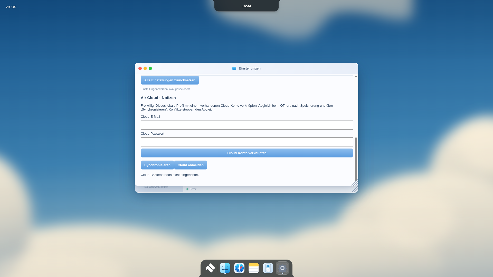
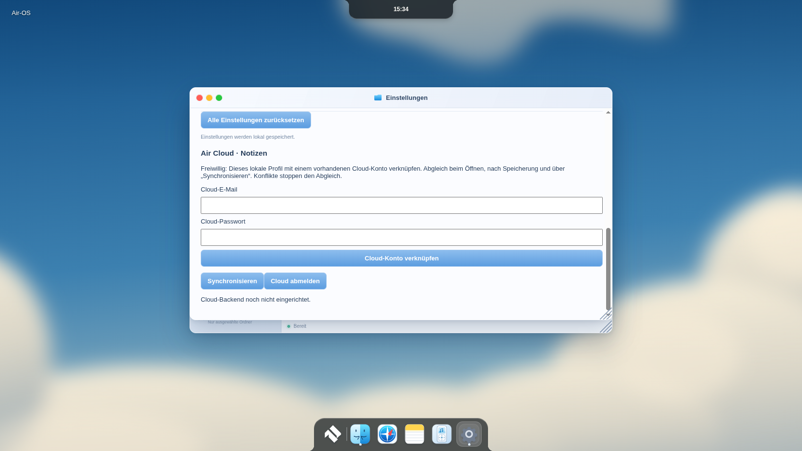
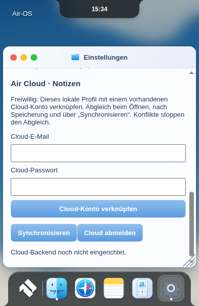

# CLOUD-1 – freiwillige Profilverknüpfung und Notes-Synchronisierung

25. Oktober 2026, Europe/Berlin. Basis `1491eaab6d12a31cf0e5f989e439e3fde9b45b9e`, Branch `feat/air-cloud-notes-cloud1-20261025`.

## Implementiert

Bestehende lokale Profile/Passwortprüfung bleiben maßgeblich. Unter **Einstellungen → Air Cloud · Notizen** lässt sich ein vorhandenes, bestätigtes Supabase-Konto per E-Mail/Passwort mit dem angemeldeten lokalen Profil verknüpfen. Dies ist kein zweites lokales Benutzerverzeichnis und ersetzt die MacLock-Anmeldung nicht. Keine Cloud-Anmeldung im nicht authentifizierten Lockscreen. Keine automatische Übertragung ohne freiwillige Anmeldung. Nach Verknüpfung wird synchronisiert; danach beim Desktopstart, bestätigtem Speichern/Löschen, Online-Ereignis und manuell in Einstellungen. Kein Polling, kein Realtime-/Cloud-SDK, keine neuen externen Abhängigkeiten.

REST/Auth laufen ausschließlich im Hauptprozess. Öffentlicher Project-Publishable-/Anon-Key, HTTPS ausschließlich auf `*.supabase.co`, keine Service-Role-Schlüssel. Passwort nur für den Auth-Aufruf, kein persistentes Passwort oder Logging. Refresh-Token verschlüsselt mit Electron `safeStorage`, Dateimodus0600, atomare Speicherung, getrennt nach lokalem Profil. Linux `basic_text` und fehlende OS-Verschlüsselung werden abgelehnt. Access-Token nur im Speicher, nie in Renderer/Events/Logs. Refresh erfolgt vor jedem Abgleich; Rotation wird vor Datenzugriff persistiert. Lokaler Logout invalidiert laufende Antworten, entfernt den Refresh-Token und erfordert erneute Cloud-Anmeldung. Cloud-Abmeldung löscht lokale Tokens sofort; nicht bestätigte Serverrevokation wird als Warnung gemeldet. Basis/Accountbindung bleiben erhalten; ein anderes Cloud-Konto wird abgelehnt. Keine automatische Neuzuordnung oder destructive Unlink-Aktion.

Notizen bleiben im bestehenden `notes-v1.json`, offline vollständig verfügbar. Eine zusätzliche profilbezogene `cloud-notes-v1.json` enthält verschlüsselten Refresh-Token, Cloud-UID, letzten synchronisierten Stand und Datum. Sie ist ein Merge-Journal, keine konkurrierende Notes-Datenbank. Die Basis enthält private Notiztexte wie der bestehende lokale Store; lokale Festplattenverschlüsselung bleibt Aufgabe des Betriebssystems. Keine Ende-zu-Ende-Verschlüsselung: Supabase erhält Notiztexte unter RLS.

Drei-Wege-Abgleich nach UUID: unveränderte Seite übernimmt Änderung/Löschung, unabhängige Änderungen werden zusammengeführt. Fehlender Eintrag gegenüber dem letzten gemeinsamen Stand bedeutet Löschung; ohne gemeinsamen Stand werden unabhängige lokale und entfernte Notizen vereinigt. Widersprüchliche Änderung/Änderung oder Änderung/Löschung stoppt **den gesamten Abgleich**, ohne Konfliktversionen zu überschreiben. Kein Last-Writer-Wins. Nutzer muss Konflikttexte separat sichern und auf beiden Geräten bewusst angleichen; komfortabler Konfliktdialog noch offen. Nach Remote-CAS erfolgt synchrones lokales Compare/Apply; zwischenzeitliche lokale Änderungen stoppen das Übernehmen. Ein bereits bestätigter Remote-Commit kann bei anschließendem Logout oder lokaler Änderung bestehen bleiben; der lokale Stand bleibt erhalten, nächster Abgleich kann einen expliziten Konflikt melden. Kein behauptetes verteiltes Transaktionsrollback.

SQL-RPC prüft authentifizierten Owner und erwartete Version atomar. Direkte authentifizierte Tabellenwrites sind entzogen. Bestehende geöffnete Notes-Editoren erhalten zusätzlich Snapshot-Prüfung für Speichern und Löschen, damit veraltete Editoren importierte Daten nicht überschreiben. Neue importierte Notizen erscheinen in Air Home; Notes-Fenster zum vollständigen Neuladen schließen/öffnen. Ungespeicherte Editorfelder werden durch Sync nicht verändert. Manuelle Fehler/Retry in Einstellungen; letzter automatischer Syncfehler ist dort über Status sichtbar. Lokale erfolgreiche Speicherung bleibt bei Cloudfehler erfolgreich.

## Backend-Setup – Voraussetzung für echten Onlinebetrieb

1. Eigenes Supabase-Projekt erstellen, gewünschte Region/Datenschutz wählen. Auth-E-Mail-Anmeldung mit Bestätigung aktivieren. Zwei eigene bestätigte Testkonten über Supabase-Verwaltung/Einladungsflow anlegen. Keine öffentliche unkontrollierte Kontoanlage für die private App nötig. Kontoerstellung, Passwort-Reset und MFA-UI sind nicht Bestandteil dieser Einheit; bestehendes bestätigtes Konto erforderlich.
2. [supabase.sql](supabase.sql) einmal im SQL Editor als Projektowner ausführen. Enthält Tabelle, **RLS**, ausschließlich eigentümerbezogenen SELECT, CAS-RPC ohne vom Client gewählten Owner, Signup-Trigger und Initialisierung bestehender Auth-Nutzer. Bei vorhandenen gleichnamigen Objekten nicht blind erneut ausführen. Vor produktivem Betrieb Migration/Backup prüfen.
3. In der Startumgebung des Electron-Hauptprozesses `AIR_CLOUD_SUPABASE_URL=https://<project>.supabase.co` und `AIR_CLOUD_SUPABASE_ANON_KEY=<öffentlicher Publishable-/Anon-Key>` setzen. Kein `service_role`, kein `sb_secret_`. Keine Werte committen. Fehlende/ungültige Konfiguration deaktiviert Cloud, lokale App bleibt nutzbar. Diese erste Integration benötigt Host-Konfiguration; kein neuer Installer, kein clientseitiger Projektwechsel.
4. App starten, lokal anmelden, Einstellungen öffnen, bestätigtes Cloud-Konto verknüpfen. Dasselbe Cloud-Konto in einer zweiten unabhängigen Installation mit einem dort bestehenden lokalen Profil verknüpfen. Profile verschiedener Geräte brauchen nicht denselben lokalen Namen. Tokens müssen auf jedem Gerät separat eingerichtet werden; OS-gebundene Token-Dateien nicht kopieren.
5. Für echte Abnahme A/B erstellen/bearbeiten/löschen; Offline auf A ändern, B parallel dieselbe Notiz ändern, wieder verbinden: expliziter Konflikt, beide Versionen erhalten. Getrennte zweite Cloud-Identität testen; fremde Owner-Queries müssen leer/abgelehnt, direkter Tabellenwrite abgelehnt sein. Version-CAS parallel auslösen. Refresh/Logout/Neustart und abgelaufene Tokens prüfen.

**Keine Cloud-Zugangsdaten/kein bereitgestelltes Backend vorhanden. Kein echter Online-Sync, keine produktive RLS-/Auth-/Refresh-Abnahme behauptet.** SQL-Integration muss gegen ein echtes Supabase-Projekt zusätzlich ausgeführt und geprüft werden. Kein iPad-/PWA-Cloudbetrieb, kein SSO/MFA/UI, kein Realtime-Push. Windows/macOS-`safeStorage` hardwareabhängig noch nicht nativ geprüft. Root-Legacy-Audit-/Signingblocker bleiben unverändert.

## Prüfungen

Gezielte automatisierte Tests verwenden zwei unabhängige Store-Verzeichnisse und zwei isolierte Identitäten an einem expliziten Protokoll-Testserver, **keinen echten Supabase-Dienst**: Erstellung, Änderung, Löschung, Offline/Reconnect, Konflikte, CAS-Rennen, fehlgeschlagene Writes, Neustart, Logout/verspätete Antworten, sichere Speicherung blockiert, veraltete Editorwrites, Datenisolation. SQL-RLS wird strukturell geprüft; dies ersetzt keine serverseitige RLS-Ausführung. GUI-Prüfung ohne Backend prüft den unveränderten lokalen Auth-/App-/Profil-/Fallbackpfad, nicht Cloud-Login.

Testergebnisse und tatsächliche Electron-Ergebnisse im abschließenden Fortschrittscheckpoint. Keine neuen Installer-/Signier-/Designänderungen. `package.json` ergänzt nur zwei notwendige Laufzeitdateien; native Windows/macOS-Buildparameter unverändert.

### Tatsächliches Ergebnis

**342/342 Tests bestanden**,0 Fehler/Skips, davon8 neue Cloud-Regressionen.124 Laufzeitdateien/Syntax und `git diff --check` bestanden. Vorhandene CSS-Isolationsprüfung beibehalten; neue Formularregeln ausschließlich in `air-cloud.css`.

Echte Linux-Electron44-GUI1920×1080,1650×930 und390×600: Exit0, Sandbox/Isolation,25 interne Apps/26 Registryeinträge, Notes/Home-Liveupdates, zwei lokale Profile/Logout/Neustart, Classic/Modern, M1/M2/K3/Reduced Motion und nativer WebGL1/2-Ausfall geprüft. Neue Settings-Sektion gemountet und fehlendes Backend jeweils bestätigt.22 tatsächliche PNGs und [Rohmessungen](../visual/cloud1/r1-gui-report.json). Geschützte Dock-/Island-Rechtecke exaktgleich zum BRAND-2-Bericht; Dock358×68,bottom0.390px ist schmaler echter Renderer, kein natives390px-Gerät. Linux ist keine native Windows-/macOS-/iPad-Abnahme. Kein neuer Windowsinstaller/Cloud-CI-Lauf.

| Auflösung | Cloud-Einstellungen | Desktop | Lockscreen |
|---|---|---|---|
|1920||[Desktop](../visual/cloud1/r1-desktop-1920.png)|[Lockscreen](../visual/cloud1/r1-lockscreen-1920.png)|
|1650||[Desktop](../visual/cloud1/r1-desktop-1650.png)|[Lockscreen](../visual/cloud1/r1-lockscreen-1650.png)|
|390||[Desktop](../visual/cloud1/r1-desktop-390.png)|[Lockscreen](../visual/cloud1/r1-lockscreen-390.png)|
